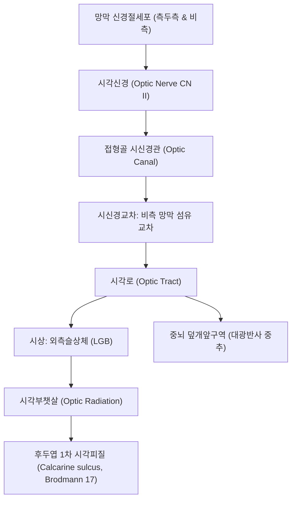

# ⚡ [[2. 시각신경|시각신경]] (Optic Nerve / 視神經, 제2뇌신경 CN II)

> **핵심 3줄 요약 (Key Summary)**:
> - 🗺️ **신경 기원 & 해부학적 주행**: 망막 신경절세포(Ganglion cells) 축삭이 시신경원판에서 모여 시신경관(Optic canal)을 통해 두개강으로 진입, 시신경교차(Optic chiasm)에서 비측 섬유가 교차한 후 시각로를 거쳐 외측슬상체(LGB)로 투사되는 중추신경계 백질 돌출관이다.
> - 🎯 **특수체감각 지배 & 뇌척수액 피복**: 시각 정보를 1차 시각피질(후두엽 후두극)로 전달하며, 삼중 경막·지주막·연막초로 둘러싸여 있어 두개내압(ICP) 상승 및 [[뇌부종]]이 시신경초로 직접 전달된다.
> - ⚠️ **임상 핵심 & 비침습 뇌압 모니터링**: 두개내압 상승 시 시신경초 직경(ONSD)이 팽창하여 초음파상 5.0~5.8mm 이상으로 확장(유두부종 선행)되며, [[뇌하수체 종양]]에 의한 시신경교차 압박 시 양이측 반맹(Bitemporal hemianopsia)이 발생한다.
> - 🔍 주요 이학적 검사 & 자침 안전: 대면 시야 검사 및 대광반사(구심로: CN II, 원심로: CN III)를 시행하며, 안와 주위 [[정명]](BL1), [[승읍]](ST1) 자침 시 안구를 보호하고 무리한 직자를 엄금한다.

---

## 1. 신경 기원 & 해부학적 분지 경로 (Anatomy & Course)
시각신경(Optic nerve, CN II)은 말초신경이 아닌 뇌간과 간뇌에서 파생된 중추신경계(CNS) 섬유로, 희소돌기아교세포(Oligodendrocyte)에 의해 수초화되어 있다.

* **4대 주행 분절 (Anatomical Segments)**:
  * **안구내 분절 (Intraocular segment, ~1mm)**: 망막 신경절세포 축삭이 사상판(Lamina cribrosa)을 통과하여 시신경유두(Optic disc)를 형성.
  * **안와내 분절 (Intraorbital segment, ~25-30mm)**: [[안구 운동]]을 보상하기 위해 S자형 곡선을 그리며 안와지방체와 외안근 원추강 내를 주행.
  * **시신경관 분절 (Intracanalicular segment, ~6mm)**: 접형골 소익 기저부의 시신경관(Optic canal)을 안동맥(Ophthalmic artery)과 함께 통과.
  * **두개내 분절 (Intracranial segment, ~10-16mm)**: 안장(Sella turcica) 상방에서 좌우 시신경이 합류하여 시신경교차(Optic chiasm)를 형성.

---

## 2. 신경 지배 맵 & 기능 네트워크 (Innervation Map)

### 1) 기능 전달 체계
* **시각 구심로**: 명암, 색상, 형태, 심도 및 시각 인지를 대뇌 후두엽으로 전달.
* **동공 대광반사 구심로 (Afferent Pupillary Reflex)**: 빛 자극을 중뇌 덮개앞핵(Pretectal nucleus)으로 전달하여 양측 에딩거-베스트팔핵(EW nucleus)을 흥분시킴.

---

## 3. 호발 포착 부위 & 터널 증후군 병태생리
* **시신경관(Optic Canal) 골성 압박**:
  * 안면 두개골 외상 시 시신경관 [[골절]] 편에 의해 시신경이 손상되거나 부종으로 인한 급성 허혈성 시신경병증(Traumatic optic neuropathy) 발생.
* **두개내압 상승 및 [[시신경염|시신경초 확장]]**:
  * [[뇌척수액]] 지주막하공간이 시신경초를 따라 안구 뒤편까지 연장되어 있으므로, 두개내압 상승 시 시신경초 직경(ONSD)이 팽창하고 망막 중심정맥 회류가 차단되어 유두부종(Papilledema)이 유도된다.
* **시신경교차(Optic Chiasm)의 안장 상부 압박**:
  * 뇌하수체 선종(Pituitary adenoma)이나 두개인두종이 터키안 상방으로 증식하면 교차부 중앙의 비측 망막 섬유를 눌러 양이측 반맹이 발생한다.

---

## 4. 손상 레벨별 임상 증상 & 신경학적 결손

| 손상 위치 | 시야 결손 패턴 (Visual Field Defect) | 대광반사 반응 |
| :--- | :--- | :--- |
| **편측 시신경 (Optic nerve)** | 동측 안구 완전 [[실명]] (Monocular anopsia) | 동측 직간접 대광반사 구심성 결손(RAPD, Marcus Gunn pupil) |
| **시신경교차 중앙부 (Optic chiasm)** | 양이측 반맹 (Bitemporal hemianopsia) | 양측 외측 시야 결손, [[뇌하수체 종양]] 전형 |
| **시각로 (Optic tract)** | 반대측 동명성 반맹 (Homonymous hemianopsia) | 병변 반대측 시야 완전 소실 |
| **시각부챗살 측두엽 루프 (Meyer's loop)** | 반대측 상부 1/4 동명맹 (Pie in the sky) | 측두엽 병변 시사 |
| **후두엽 시각피질 (Occipital pole)** | 황반 보존 동명성 반맹 (Macular sparing) | 중대뇌동맥/후대뇌동맥 이중 혈류로 중심시력 유지 |

---

## 5. 관련 이학적 검사 & 신경 감별 매트릭스

| 이학적 검사명 | 검사 방법 및 유발 기전 | 양성 반응 | 관련 감별 질환 |
| :--- | :--- | :--- | :--- |
| **스윙 손전등 검사 (Swinging Flashlight Test)** | 양측 안구에 번갈아 빛을 비추며 동공 수축 관찰 | 환측에 빛을 비출 때 오히려 동공이 산대됨 (RAPD 양성) | 시신경염, 허혈성 시신경병증, 망막박리 |
| **대면 시야 검사 (Confrontation Visual Field Test)** | 검사자와 환자가 마주보고 사분면 시야 경계를 손가락 움직임으로 비교 | 특정 사분면 또는 반측 시야 감지 실패 | 뇌졸중, [[뇌하수체 종양]], 녹내장 |
| **시신경초 직경(ONSD) 안구 초음파** | 안구 뒤 3mm 지점에서 시신경초 외경 측정 | ONSD > 5.5~5.8mm 확장 | 두개내압 상승(ICP), [[뇌출혈]], [[뇌부종]], 가성뇌종양 |

---

## 6. 한의 신경 치료 프로토콜 (약침·침도·신경수기) (+ 양방 치료·의뢰 기준)

* **안구 주위 및 후두부 미세순환 침구 요법**:
  * 안와 주위 [[정명]](BL1), [[승읍]](ST1), [[동자료]](GB1), [[태양]](EX-HN5)과 후두부 [[풍지]](GB20), [[천주]](BL10)를 배혈하여 안동맥 및 후대뇌동맥 혈류를 개선한다.
* **경추 및 뇌두개 정골 추나요법**:
  * 후두골-접형골 기저관절(SBS) 가동성 회복과 상부경추 정렬을 통해 두개강 내 정맥 유출과 뇌척수액 순환을 원활히 한다.
* **시신경 보호 및 명목 한약 처방**:
  * 안구 피로, 시력 감퇴, 허혈성 병변에 [[명목지황탕]], [[보기음양환]], [[사물탕]] 가감방을 처방한다.
* **양방 치료 & 의뢰 기준 (Conventional Treatment & Referral)**:
  * **응급 의뢰 트리거**: 갑작스러운 무통성 시력 상실(망막동맥 폐색 의심, 90분 골든타임), 시야 결손 동반 두통, ONSD 비정상 확장 환자는 즉각 안과 및 신경과 응급실로 의뢰한다.

---

## 7. 💡 사용자 진료실 핵심 필기 & 임상 팁 (원문 보존)
- 시신경은 중추신경계의 직접적인 연장선으로 수막(경막, 지주막, 연막)에 둘러싸여 있다.
- 안구 [[초음파]](POCUS)로 안구 후방 3mm 지점의 시신경초 직경(ONSD)을 측정하면 뇌압 상승을 1분 만에 비침습적으로 확인할 수 있는 최고의 스크리닝 도구가 된다.
- 정명혈 자침 시에는 안구를 외측으로 살짝 밀어내고 안와 내벽을 따라 0.3~0.5촌 천자하며, 혈종이 생기면 안압이 급격히 상승할 수 있으므로 발침 후 철저히 압박 지혈한다.

---

## 8. 출처 및 학술 참고 문헌 (References)

- Ahmad B et al. (2026). Limited utility of optic nerve sheath diameter for monitoring intracranial pressure in patients with intracranial hemorrhage. *Front Neurol*. 17:1932373. PMID: 42922811
  - [연구 요약] 두개내 출혈 및 외상 환자에서 초음파 유도 시신경초 직경(ONSD) 계측을 통한 두개내압 모니터링의 임상 유용성과 역치값 분석.

- Heydari F et al. (2026). Comparison of the Diagnostic Value of Ultrasound and Rotterdam CT Scoring Criterion Used for Measuring Optic Nerve Sheath Diameter in the Prognosis of the Mortality and Disability Level of Patients with Head Trauma. *Adv Biomed Res*. 15:51. PMID: 42891474
  - [연구 요약] 두부 외상 환자에서 안구 초음파 시신경초 직경 계측과 뇌 CT 척도의 예후 예측도 비교 및 뇌압 상승 진단 가치 평가.
