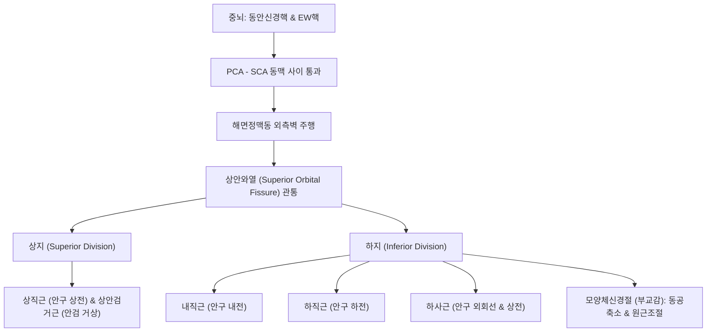

# ⚡ [[3. 동안신경|동안신경]] (Oculomotor Nerve / 動眼神經, 제3뇌신경 CN III)

> **핵심 3줄 요약 (Key Summary)**:
> - 🗺️ **신경 기원 & 해부학적 주행**: 중뇌 상구(Superior colliculus) 높이의 동안신경핵 및 에딩거-베스트팔핵(EW nucleus)에서 기시하여 각간와(Interpeduncular fossa)로 출현, 후대뇌동맥(PCA)과 상소뇌동맥(SCA) 사이를 지나 [[해면정맥동]] 외측벽을 거쳐 상안와열(Superior orbital fissure)을 통해 안와로 진입한다.
> - 🎯 **외안근 운동 & 동공 부교감 지배**: 상직근, 하직근, 내직근, 하사근, [[상안검거근]](Levator palpebrae superioris)의 체운동과 함께 모양체근(Ciliary muscle, 원근조절) 및 동공조임근(Sphincter pupillae, 축동)을 지배한다.
> - ⚠️ **임상 레드플래그: 동공 침범 동안신경 마비**: 동안신경 외측 표재부에 동공 수축 부교감 섬유가 주행하므로, 후교통동맥(PCoA) 동맥류 압박 시 통증을 동반한 급성 동공 산대(Mydriasis) 및 대광반사 소실이 나타나며, 미세혈관 허혈([[당뇨병]]성) 시에는 중심부 운동섬유만 침범되어 동공이 보존(Pupil-sparing)된다.
> - 🔍 주요 이학적 검사 & 결손 징후: 환측 안구가 '외하방(Down and out)'으로 편위되고 완전 [[안검하수]](Ptosis)가 발생하며, 안와상연 [[어요]](EX-HN4), [[양백]](GB14) 자침 시 안와 내 구조물을 보호한다.

---

## 1. 신경 기원 & 해부학적 분지 경로 (Anatomy & Course)
동안신경(Oculomotor nerve, CN III)은 안구의 대부분 운동과 내인성 동공 수축을 담당하는 체운동 및 내장운동(부교감) 혼합 뇌신경이다.

* **신경 기원 (Origin in Midbrain)**:
  * 중뇌 수도(Cerebral aqueduct) 복측 회백질의 체운동핵(Somatic motor nucleus) 및 부교감신경절이전 섬유를 내보내는 에딩거-베스트팔핵(Edinger-Westphal nucleus).
* **두개강 내 주행 경로 (Intracranial Course)**:
  * 대뇌각 사이의 각간와(Interpeduncular fossa)에서 나와 후대뇌동맥(PCA)과 상소뇌동맥(SCA) 사이의 협곡을 통과한다.
  * 후교통동맥(PCoA)의 외측을 스치며 안장 결절을 지나 접형골 해면정맥동(Cavernous sinus)의 외측벽 가장 상단에 위치한다.
* **안와 진입 및 분지 (Orbital Branches)**:
  * 상안와열(Superior orbital fissure)의 총건륜(Annulus of Zinn) 내부를 관통하여 두 갈래로 분지한다.
  * **상지 (Superior division)**: 상직근(Superior rectus) 및 [[상안검거근]](Levator palpebrae superioris) 지배.
  * **하지 (Inferior division)**: [[내직근]](Medial rectus), [[하직근]](Inferior rectus), [[하사근]](Inferior oblique) 지배 및 모양체신경절(Ciliary ganglion)로 부교감 섬유 제공.

---

## 2. 신경 지배 맵 & 기능 네트워크 (Innervation Map)

---

## 3. 호발 포착 부위 & 터널 증후군 병태생리
* **후교통동맥류(PCoA Aneurysm) 기계적 압박 (절대 응급)**:
  * 내경동맥과 후교통동맥 분기부의 동맥류가 팽창하면 바로 인접한 동안신경의 외측 표층(동공 지배 부교감 섬유)을 눌러 동공 산대, 안검하수, 복시를 유발한다(파열 전 경고 징후).
* **천막열공 헤르니아 (Uncal Herniation)**:
  * 두개내압 상승으로 측두엽 구상돌기(Uncus)가 소뇌천막열공(Tentorial notch) 아래로 밀려 내려오면서 동안신경을 압박하여 동측 동공 산대(Hutchinson's pupil)를 유발한다.
* **해면정맥동 혈전증 및 톨로사-헌트 증후군 (Tolosa-Hunt Syndrome)**:
  * 해면정맥동 내부의 비특이적 육아종성 염증이 동안신경, 활차신경, 외전신경을 동시에 침범하여 유통성 안근마비를 일으킨다.
* **당뇨병성 미세혈관 허혈 (Diabetic Microvascular Ischemia)**:
  * 신경내막 영양혈관의 허혈로 심부 운동섬유만 손상되고 표재부 부교감 섬유는 보존되어 동공 크기가 정상인 마비(Pupil-sparing palsy)가 나타난다.

---

## 4. 손상 레벨별 임상 증상 & 신경학적 결손

| 구분 | 외안근 마비 양상 | 동공 상태 (Pupil) | 주 원인 및 의뢰 기준 |
| :--- | :--- | :--- | :--- |
| **압박성 병변 (Surgical III)** | 안검하수, 안구 외하방 편위, 복시 | **동공 산대 (산동), 대광반사 소실** | **후교통동맥류(PCoA), 뇌종양, 뇌탈출 (즉시 응급실)** |
| **허혈성 병변 (Medical III)** | 안검하수, 안구 외하방 편위, 복시 | **동공 정상 (Pupil-sparing, 대광반사 보존)** | [[당뇨병]], [[고혈압]], 미세혈관 허혈 (내과적 조절) |
| **부분 마비 (상지/하지 단독)** | 상안검거근 또는 특정 직근 단독 약화 | 동공 침범 여부 다양 | 상안와열 증후군, 안와첨 증후군 |

---

## 5. 관련 이학적 검사 & 신경 감별 매트릭스

| 이학적 검사명 | 검사 방법 및 유발 기전 | 양성 반응 | 관련 감별 질환 |
| :--- | :--- | :--- | :--- |
| **9방향 안구 운동 검사 (Cardinal Gaze Test)** | 검사자의 손가락을 'H'자 형태로 움직이며 안구 추적 관찰 | 내전, 상전, 하전 장애 (외전 및 외하전만 가능) | 동안신경 마비 vs 중증근무력증 |
| **동공 대광반사 및 조절반사** | 직간접 빛 자극 및 근접 주시 검사 | 환측 동공의 수축 반응 지연 또는 완전 소실 | PCoA 동맥류 감별 핵심 |
| **안검거상능 계측 (Levator Function Test)** | 전두근 움직임을 이마에서 누르고 상하 눈꺼풀 이동 폭 측정 | 이동 폭 4mm 이하 (심한 안검하수) | 동안신경성 안검하수 vs [[호너 증후군]](교감신경) |

---

## 6. 한의 신경 치료 프로토콜 (약침·침도·신경수기) (+ 양방 치료·의뢰 기준)

* **안와 주위 기혈 순환 침구 요법**:
  * [[양백]](GB14), [[어요]](EX-HN4), [[찬죽]](BL2), [[태양]](EX-HN5), [[사죽공]](TE23)에 전침 저주파(1~2Hz) 자극을 적용하여 마비된 상안검거근 및 외안근의 신경 재지배를 유도한다.
* **풍담 소퇴 및 활혈 신경 재생 한약 처방**:
  * 안근 마비 및 기혈 순환 부전에 [[견정산]](牽正散), [[보양환오탕]], [[이기거풍산]]을 투여한다.
* **양방 치료 & 의뢰 기준 (Conventional Treatment & Referral)**:
  * **절대 응급**: 급성 두통과 함께 동공 산대를 동반한 동안신경 마비가 발생하면 PCoA 동맥류 파열 직전 신호이므로 즉시 119 구급대를 통해 뇌혈관 CT/MRA 촬영 응급실로 전원한다.

---

## 7. 💡 사용자 진료실 핵심 필기 & 임상 팁 (원문 보존)
- 운동신경과 부교감신경(동공 수축, 수정체 조절)을 함께 지닌다.
- 동안신경 마비 환자를 볼 때 가장 먼저 확인할 것은 **동공(Pupil)**이다.
- "동공이 커져 있는가, 정상인가?"
  - 동공 산대 + 대광반사 소실: 동맥류 압박 가능성 95% 이상 (생명 위협 응급!).
  - 동공 정상: 당뇨병이나 고혈압에 의한 혈관 허혈 가능성 높음 (경과 관찰 및 한의 치료 적응증).
- 안구가 바깥쪽 아래(Down and out)를 향하고 눈꺼풀이 완전히 쳐져 있다면 제3뇌신경 완전 마비의 전형적인 외형이다.

---

## 8. 출처 및 학술 참고 문헌 (References)

- Salman MS et al. (2026). Progressive Cyclic Oculomotor Nerve Palsy: An Update Focusing on Accommodation and Visual Acuity Changes. *Cureus*. 18(10):e117295. PMID: 42967151
  - [연구 요약] 동안신경 마비의 주기적 임상 경과와 동공 부교감 섬유 침범에 따른 조절력 및 시력 변화의 임상 신경학적 평가.

- Agawa Y et al. (2026). Recovery of oculomotor nerve palsy following Woven EndoBridge treatment for a symptomatic basilar artery-superior cerebellar artery junction aneurysm: illustrative case. *J Neurosurg Case Lessons*. 12(15). PMID: 42868625
  - [연구 요약] 기저동맥-상소뇌동맥 분기부 동맥류의 동안신경 압박 기전 및 혈관내 수술 후 신경 기능 회복 경과 증례 분석.
