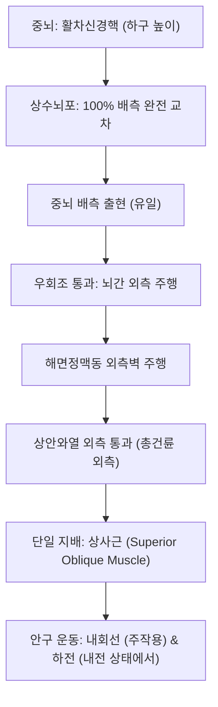

# ⚡ [[4. 도르래 신경|도르래 신경]] (Trochlear Nerve / 滑車神經, 제4뇌신경 CN IV)

> **핵심 3줄 요약 (Key Summary)**:
> - 🗺️ **신경 기원 & 해부학적 주행**: 중뇌 하구(Inferior colliculus) 높이의 활차신경핵에서 기시하여 뇌간의 '등쪽(배측)'에서 출현하는 유일한 뇌신경이며, 상수뇌포(Superior medullary velum)에서 완전 교차한 뒤 뇌간을 감아돌아 [[해면정맥동]]과 상안와열을 거쳐 [[상사근]](Superior oblique)으로 들어간다.
> - 🎯 **단일 외안근 운동 지배**: 뇌신경 중 가장 가늘고 두개강 내 주행 경로가 가장 길며, 도르래(Trochlea)를 통과하는 [[상사근]](Superior oblique) 하나만을 지배하여 안구의 내회선(Intorsion), 하전(Depression), 외전(Abduction)을 수행한다.
> - ⚠️ **임상 핵심 & 수직 [[복시]](Vertical Diplopia)**: 계단을 내려가거나 독서 시 아래를 볼 때 사물이 위아래로 겹쳐 보이는 수직 [[복시]]가 발생하며, 환자는 복시를 피하기 위해 무의식적으로 고개를 반대측 어깨로 기울이는 보상적 두부 경사(Compensatory head tilt)를 취한다.
> - 🔍 주요 이학적 검사 & 징후: 비엘쇼프스키 두부 경사 검사(Bielschowsky Head Tilt Test)에서 환측으로 머리를 기울일 때 수직 사시가 심화되며, 안와 상내측 [[찬죽]](BL2), [[정명]](BL1) 혈자리 주변을 정밀 치료한다.

---

## 1. 신경 기원 & 해부학적 분지 경로 (Anatomy & Course)
도르래 신경(Trochlear nerve, CN IV)은 뇌신경 중 가장 특이한 3대 해부학적 특성을 지닌 순수 체운동신경이다.
1. 뇌간의 배측(Dorsal aspect)에서 출현하는 유일한 뇌신경.
2. 기시 핵에서 나온 신경섬유가 100% 반대측으로 교차하여 반대측 안근을 지배.
3. 뇌신경 중 가장 가늘고 두개강 내 지주막하 주행 경로가 가장 김.

* **신경 기원 및 교차 (Origin & Decussation)**:
  * 중뇌 수도주위 회백질의 하구 높이에 위치한 활차신경핵에서 기시.
  * 중뇌 배측면의 상수뇌포에서 좌우 섬유가 완전 교차(Decussation)한 후 중뇌 배측면으로 출현.
* **두개강 내 주행 (Cisternal & Dural Course)**:
  * 중뇌 외측을 감아돌아 대뇌각과 천막 유리연 사이의 우회조(Ambient cistern)를 통과.
  * 소뇌천막 부착부를 뚫고 경막 내로 진입하여 해면정맥동 외측벽(동안신경 바로 아래)을 주행.
* **안와 진입 및 종말 (Orbital Insertion)**:
  * 상안와열(Superior orbital fissure)을 총건륜(Annulus of Zinn)의 **바깥쪽 상부**로 통과하여 안와내로 진입.
  * 안와 상내측 벽의 섬유연골성 도르래(Trochlea)를 감아도는 상사근(Superior oblique muscle)에 종말.

---

## 2. 신경 지배 맵 & 기능 네트워크 (Innervation Map)

---

## 3. 호발 포착 부위 & 터널 증후군 병태생리
* **[[외상]]성 전단 손상 (Traumatic Shear Injury)**:
  * 두개강 내 지주막하 주행 경로가 가장 길고 섬유가 가늘기 때문에, 가벼운 두부 [[외상]](특히 전두부나 후두부 타박)에서도 소뇌천막 모서리에 부딪혀 신경이 쉽게 신장되거나 단열된다([[안근마비|외안근 단독 마비]] 중 외상성 빈도 1위).
* **천막열공(Tentorial Notch) 압박 및 거미막낭종**:
  * 중뇌 배측 수조 및 사구체조(Quadrigeminal cistern) 부위의 낭종이나 혈관 기형에 의해 기계적 압박을 받는다.
* **선천성 활차신경 마비 (Congenital Palsy)**:
  * 신경 형성 부전으로 발생하여 소아기에는 보상적 머리 기울임으로 지내다가 성인기에 보상 기전이 무너지며 복시가 발현된다.

---

## 4. 손상 레벨별 임상 증상 & 신경학적 결손

| 증상 및 징후 | 기전 및 임상 양상 | 감별 포인트 |
| :--- | :--- | :--- |
| **수직 복시 (Vertical Diplopia)** | 정면 주시 시에는 미세하나, 독서나 계단을 내려갈 때(하전 시) 복시가 심화됨 | 상사근 기능 부전으로 하전 장애 |
| **보상적 두부 경사 (Head Tilt)** | 복시를 상쇄하기 위해 환측 반대쪽 어깨로 머리를 기울이고 턱을 당김 | 환측으로 기울이면 복시 극심화 |
| **외회선 사시 (Extorsion)** | 상사근의 내회선 마비로 인해 안구가 바깥쪽으로 회전 편위됨 | 안저 검사상 시신경유두 외회선 확인 |

---

## 5. 관련 이학적 검사 & 신경 감별 매트릭스

| 이학적 검사명 | 검사 방법 및 유발 기전 | 양성 반응 | 관련 감별 질환 |
| :--- | :--- | :--- | :--- |
| **파크스 3단계 검사 (Park's 3-Step Test)** | ① 정면 주시 시 상사시 안구 확인 ② 좌우 주시 시 사시 악화 방향 확인 ③ 두부 경사 시 사시 악화 확인 | 특정 외안근 마비 1개로 정확히 좁혀짐 | 활차신경 마비 확진 검사 |
| **비엘쇼프스키 두부 경사 검사 (Bielschowsky Head Tilt)** | 머리를 환측 어깨 쪽으로 기울임 | 환측 안구가 현저하게 위로 치솟으며(Hypertropia) 수직 복시 악화 | CN IV 마비 특이적 징후 |
| **복선 적색 유리 검사 (Red Glass Test)** | 적색 유리를 대고 수직 분리 거리 측정 | 아래쪽 주시 시 상하 분리 폭 최대 | 하사근 과기능 및 [[중증근무력증]] 감별 |

---

## 6. 한의 신경 치료 프로토콜 (약침·침도·신경수기) (+ 양방 치료·의뢰 기준)

* **안와 상내측 및 후두부 신경 침구 치료**:
  * 도르래 구조물이 위치한 안와 상내측의 [[찬죽]](BL2), [[어제]], [[태양]](EX-HN5) 및 경추 후두부의 [[풍지]](GB20), [[천주]](BL10) 자침을 통해 상사근의 혈류를 촉진한다.
* **상부경추 및 측두골 두개천골 추나요법**:
  * 소뇌천막의 긴장을 정상화하고 측두골-후두골 봉합부의 압박을 해소하는 두개천골 기법(CV4, 천막 이완 수기)을 적용한다.
* **한약 처방 및 신경 회복**:
  * 외상성 어혈과 기혈 응체를 해소하기 위해 [[당귀수산]], [[도홍사물탕]], [[보양환오탕]]을 투여한다.
* **양방 치료 & 의뢰 기준 (Conventional Treatment & Referral)**:
  * 외상성 마비의 50% 이상은 6개월 내 자연 호전되므로 프리즘 안경으로 보상하며 경과를 관찰한다.
  * 6개월 이상 비수술 치료에도 수직 복시가 고정되면 상사근 건 단축술이나 대항근(하사근) 절제술을 의뢰한다.

---

## 7. 💡 사용자 진료실 핵심 필기 & 임상 팁 (원문 보존)
- 운동 신경(Superior Oblique Muscle 지배) 하나만을 담당한다.
- 환자가 진료실에 들어올 때 고개를 한쪽 어깨로 갸우뚱하게 기울이고(Head tilt) 턱을 약간 숙이고 있다면 활차신경 마비를 가장 먼저 의심해야 한다.
- "계단 내려갈 때 발 디디기가 무섭고 글씨를 읽으려고 책을 보면 두 줄로 겹쳐 보인다"는 호소는 제4뇌신경 손상의 시그니처 증상이다.

---

## 8. 출처 및 학술 참고 문헌 (References)

- Ramos Fraga B et al. (2026). Isolated midbrain neurocysticercosis presenting as trochlear nerve palsy. *Surg Neurol Int*. 17:569. PMID: 42974273
  - [연구 요약] 중뇌 배측 활차신경핵 및 출현부 병변에 의해 유발된 고립성 도르래 신경 마비의 진단 지표와 수직 복시 양상 분석.

- Kunii M et al. (2026). Trochlear Nerve Palsy Caused by a Quadrigeminal Cistern Arachnoid Cyst Successfully Treated with a Hybrid Exoscope-endoscope Keyhole Approach: A Case Report. *NMC Case Rep J*. 13:499-505. PMID: 42877917
  - [연구 요약] 사구체조 거미막낭종의 도르래 신경 기계적 압박에 따른 파크스 3단계 검사 소견 및 최소침습 감압술 후 신경 기능 회복 고찰.
