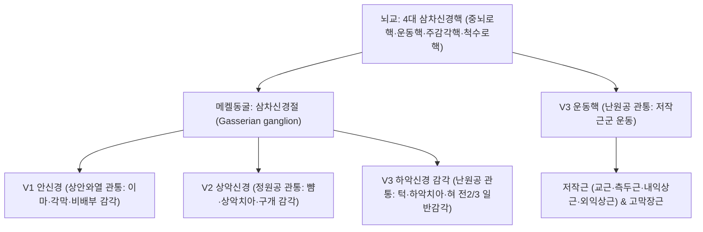

# ⚡ [[5. 삼차신경|삼차신경]] (Trigeminal Nerve / 三叉神經, 제5뇌신경 CN V)

> **핵심 3줄 요약 (Key Summary)**:
> - 🗺️ **신경 기원 & 해부학적 분지 경로**: 뇌교(Pons) 중간부 외측에서 기시하여 측두골 추체 첨부의 삼차신경절(Gasserian ganglion)을 형성한 뒤 안신경(V1, 상안와열), 상악신경(V2, 정원공), 하악신경(V3, 난원공) 세 갈래로 분지하는 뇌신경 중 가장 거대한 혼합신경이다.
> - 🎯 **안면 감각 & 저작근 운동 지배**: 안면 전체 피부, 각막, 구강 및 비강 점막, 치아 감각을 독점 지배하며, V3 운동지를 통해 저작근([[교근]], [[측두근]], [[내익상근]], [[외익상근]]) 및 [[고막장근]], 악이복근 전복을 지배한다.
> - ⚠️ **임상 핵심 & 삼차신경-경추 복합체**: 신경근 진입부(REZ)에서 상소뇌동맥(SCA) 등 혈관 접촉으로 인한 누전 전도(Ephaptic transmission)가 격렬한 발작성 안면 전격통인 [[삼차신경통]]을 유발하며, 척수로핵이 C1~C3 상부 경추신경과 수렴하여 [[삼차신경-경추 복합체]](TCC) 두통 및 안면통 연관통을 형성한다.
> - 🔍 주요 이학적 검사 & 자침 안전: 분지별 촉각/통각 비교 및 각막반사(CN V1 구심로, CN VII 원심로)를 검사하며, 안면부 [[하관]](ST7), [[협거]](ST6), [[사백]](ST2) 및 원위부 [[합곡]](LI4), [[태충]](LR3)을 정밀 배혈한다.

---

## 1. 신경 기원 & 해부학적 분지 경로 (Anatomy & Course)
삼차신경(Trigeminal nerve, CN V)은 뇌교의 전외측면에서 거대한 감각근(Portio major)과 작은 운동근(Portio minor)으로 출현한다.

* **삼차신경절 (Gasserian / Semilunar Ganglion)**:
  * 측두골 암석부 첨부의 메켈동굴(Meckel's cave) 내에 위치하며, 세 분지의 가성단극성 감각세포체를 수용한다.
* **3대 주 분지 (Three Major Divisions)**:
  1. **안신경 (Ophthalmic nerve, V1 - 순수 감각)**:
     * 해면정맥동 외측벽을 거쳐 상안와열(Superior orbital fissure)을 통해 안와로 진입.
     * 분지: [[안와상신경]](Supraorbital), [[상활차신경]](Supratrochlear), 누선신경, 비모양신경.
     * 관류: 이마, 두피 전반부, 상안검, 안구 각막, 비배부.
  2. **상악신경 (Maxillary nerve, V2 - 순수 감각)**:
     * 해면정맥동 하부를 거쳐 정원공(Foramen rotundum)을 통해 익구개와(Pterygopalatine fossa)로 진입.
     * 분지: [[관골측두신경]](Zygomaticotemporal), 안와하신경(Infraorbital), 상치조신경, 대구개신경.
     * 관류: 하안검, 뺨, 비익, 상순, 상악 치아 및 잇몸, 구개 점막.
  3. **하악신경 (Mandibular nerve, V3 - 혼합 신경)**:
     * 난원공(Foramen ovale)을 통해 측두하와(Infratemporal fossa)로 진입하며 운동근 섬유와 합류.
     * 감각 분지: 이개측두신경(Auriculotemporal), 협신경, 설신경(Lingual), 하치조신경(Inferior alveolar).
     * 운동 분지: 저작근지, 악설골근지, 악이복근 전복지, [[고막장근]]지, 구개범장근지.
     * 관류: 턱, 하순, 하악 치아 및 잇몸, 혀 전방 2/3 일반감각(미각 제외) + 저작근 운동.

---

## 2. 신경 지배 맵 & 기능 네트워크 (Innervation Map)

### 1) 4대 삼차신경핵 (Four Nuclei)
* **중뇌로핵 (Mesencephalic nucleus)**: 저작근과 치주인대의 고유수용성 감각(유일하게 중추신경계 내에 1차 신경원 세포체 존재).
* **주감각핵 (Principal sensory nucleus)**: 안면부의 정밀 촉각 및 진동각(뇌교 높이).
* **척수로핵 (Spinal trigeminal nucleus)**: 안면부의 통각 및 온도각(연수에서 상부 경추 C2-C3 교양질까지 연속).
* **운동핵 (Motor nucleus)**: 저작근을 지배하는 하부운동신경원.

---

## 3. 호발 포착 부위 & 터널 증후군 병태생리
* **신경근 진입부(Root Entry Zone, REZ) 혈관 압박**:
  * 뇌교 진입부의 수초 전환 부위(Schwann 세포에서 Oligodendrocyte로 전환)에서 상소뇌동맥(SCA)이나 전하소뇌동맥(AICA), 추골정맥 등이 신경근을 박동성 압박하여 탈수초를 유발하고, 이로 인해 촉각 섬유와 통각 섬유 간의 누전 전도(Ephaptic cross-talk)가 발생하여 극심한 발작통이 초래된다([[삼차신경통]]).
* **두개골 외 분지 골성 포착 (Foraminal Entrapment)**:
  * [[안와상신경]]의 안와상절흔/공 포착, 안와하신경의 안와하관 포착, 이신경의 이공(Mental foramen) 포착으로 국소 신경통 유발.
* **삼차신경-경추 복합체 (Trigeminocervical Complex, TCC) 기전**:
  * 삼차신경 척수로핵 미측부와 C1~C3 경추신경 후근 섬유가 2차 신경원에서 시냅스를 공유하므로, 상부 경추의 기능 부전이나 근막 긴장이 삼차신경 영역(안구 뒤, 관자놀이, 안면)으로 연관통을 투사한다.

---

## 4. 손상 레벨별 임상 증상 & 신경학적 결손

| 손상 레벨 | 주요 임상 양상 | 신경학적 결손 및 감별 포인트 |
| :--- | :--- | :--- |
| **신경근 진입부(REZ) / 혈관성** | 편측 발작성 전격통(찌르는 듯한 통증), 무통기 존재 | [[삼차신경통]], 감각 소실 없음, 세안·양치·찬바람 유발대(Trigger zone) |
| **V1 안신경 단독 병변** | 이마·두피 전방부 감각 저하, 안구 통증 | **각막반사(Corneal reflex) 소실**, 대상포진 호발 구역 |
| **V2 상악신경 병변** | 뺨, 상악 치아, 잇몸 감각 둔마 | 치통 오진 빈발, 부비동염 및 안와하 골절 감별 |
| **V3 하악신경 병변** | 턱 감각 둔마 + **개구 시 환측으로 턱 편위** | 저작근 위축, [[교근]]·[[측두근]] 근력 저하, 하악반사 소실 |
| **뇌간 척수로핵 병변** | 동측 안면 통온각 소실 + 반대측 체간 통온각 소실 | 교차성 감각 장애, 외측연수증후군(Wallenberg syndrome) |

---

## 5. 관련 이학적 검사 & 신경 감별 매트릭스

| 이학적 검사명 | 검사 방법 및 유발 기전 | 양성 반응 | 관련 감별 질환 |
| :--- | :--- | :--- | :--- |
| **각막반사 (Corneal Reflex)** | 면봉 솜으로 각막 윤부를 살짝 접촉 (V1 구심로) | 양측 안검의 즉각적인 깜빡임 소실 | CN V1 병변, 뇌간(교뇌) 손상, 청신경초종 |
| **하악반사 (Jaw Jerk Reflex)** | 입을 반쯤 벌린 상태에서 턱 끝에 검지 손가락을 대고 타진 | 턱이 급격히 상방으로 닫힘 (반사 항진) | 상부운동신경원(UMN) 병변, 위구마비 |
| **유발점 타진 및 압통 검사 (Valleix Points)** | 안와상공, 안와하공, 이공 부위를 손가락으로 가볍게 압박 | 격심한 방사성 전격통 재현 | 원발성 삼차신경통 vs 비정형 안면통 |

---

## 6. 한의 신경 치료 프로토콜 (약침·침도·신경수기) (+ 양방 치료·의뢰 기준)

* **삼차신경 분지 표적 특수 침구 및 약침술**:
  * V1 타겟: [[찬죽]](BL2), [[양백]](GB14), [[어제]].
  * V2 타겟: [[사백]](ST2), [[하관]](ST7), [[권료]](SI18).
  * V3 타겟: [[협거]](ST6), [[대영]](ST5), [[예풍]](TE17).
  * 원위 배혈: [[합곡]](LI4), [[태충]](LR3), [[풍지]](GB20).
  * 초음파 유도하 하관혈 심부 익구개와 부위 또는 외측 익상근 주변 소염약침 및 중성어혈약침 주입.
* **상부경추 추나요법 및 악관절 교정**:
  * 삼차신경-경추 복합체(TCC)의 감작을 차단하기 위해 C1-C2 후두경추관절 추나 교정과 턱관절(TMJ) 감압 수기를 적용한다.
* **청열진통 활혈 거풍 한약 처방**:
  * 신경성 전격통 완화를 위해 [[청상견통탕]], [[황련해독탕]], [[대조구등음]]을 처방한다.
* **양방 치료 & 의뢰 기준 (Conventional Treatment & Referral)**:
  * **약물 치료**: 항경련제인 카바마제핀(Carbamazepine, 1차 선택제) 또는 옥스카바제핀(Oxcarbazepine) 투여.
  * **수술 적응증**: 약물 불응성이거나 간독성 등 부작용 발생 시 신경외과 미세혈관 감압술(MVD, Janetta op) 또는 감마나이프 방사선 수술 의뢰.

---

## 7. 💡 사용자 진료실 핵심 필기 & 임상 팁 (원문 보존)
- 뼈를 타고 들어가며, 상악동이나 하악동의 치통이 있는 경우, 피부가 아픈 경우에 문제가 있는 것이다.(삼차신경통)
- [[측두근]], [[교근]], [[고막장근]]이 [[삼차신경]]의 운동지이다.
- 고막장근은 고막을 잡아줘서 북처럼 잘 울릴 수 있도록 도와주는 근육이다.
- 얼굴, 상악 감각 지배, 하악 감각, 운동 지배.
- 진료실 번역: 얼굴 통증 환자에서 ① 분지별 감각 비교 ② 유발대 확인 ③ 치과·부비동 원인 배제 ④ 양측성·40세 이전 발병이면 다발성 경화증 등 영상 의뢰 — 이 4단계를 세트로 시행한다.

---

## 8. 출처 및 학술 참고 문헌 (References)

- Takei T et al. (2026). Quantitative Morphological Analysis of the Trigeminal Nerve in Trigeminal Neuralgia Caused Solely by Venous Compression. *World Neurosurg*. 125477. PMID: 42977249
  - [연구 요약] 삼차신경통 환자에서 정맥성 압박에 의한 삼차신경근 단면적 및 형태학적 변화의 정량 분석과 미세혈관 감압술 예후 분석.

- Presswala TJ et al. (2026). Long-term Outcomes and the Predictors Following Microvascular Decompression and Gamma Knife Radiosurgery for Drug Refractory Primary Trigeminal Neuralgia: A Single-Center Experience with a Large Cohort. *Neurol India*. PMID: 42972651
  - [연구 요약] 난치성 원발성 삼차신경통 환자에서 미세혈관 감압술과 감마나이프 방사선 수술의 장기 임상 치료 성적 및 재발 예측 인자 고찰.

- Gronseth G et al. (2008). Practice parameter: the diagnostic evaluation and treatment of trigeminal neuralgia (an evidence-based review). *Neurology*. 71(15):1183-1190. PMID: 18716236
  - [연구 요약] 미국신경과학회(AAN) 및 유럽신경과학회연맹(EFNS)의 삼차신경통 진단 평가 및 카바마제핀 등 근거 중심 약물·수술 가이드라인.
