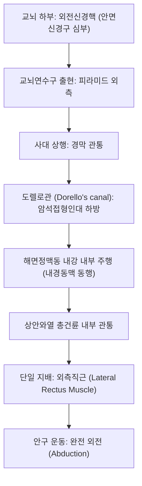

# ⚡ [[6. 갓돌림신경|갓돌림신경]] (Abducens Nerve / 外轉神經, 제6뇌신경 CN VI)

> **핵심 3줄 요약 (Key Summary)**:
> - 🗺️ **신경 기원 & 해부학적 주행**: 교뇌 하부 능형와 바닥의 외전신경핵에서 기시하여 교뇌연수구(Pontomedullary junction) 복측으로 출현, 사대의 두개저 경막을 뚫고 도렐로관(Dorello's canal)을 지나 [[해면정맥동]] 내부를 [[내경동맥]]과 나란히 통과한 뒤 상안와열을 거쳐 [[외측직근]](Lateral rectus)으로 들어간다.
> - 🎯 **외안근 단일 운동 지배**: 안구를 외측(귀 방향)으로 회전시키는 [[외측직근]](Lateral rectus) 하나만을 독점 지배한다.
> - ⚠️ **임상 핵심 & 두개내압 상승의 가성 국소화 징후(False Localizing Sign)**: 추체릉(Petrous ridge)을 넘어 도렐로관으로 꺾여 들어가는 주행 부위가 두개내압 상승 시 하방으로 견인되어 쉽게 신장되므로, [[뇌종양]]이나 뇌압 상승 시 국소 병변 없이도 양측성 또는 편측성 외전신경 마비가 유발된다.
> - 🔍 주요 이학적 검사 & 수평 복시: 외측 주시 시 안구 외전 불능과 함께 수평 동명 [[복시]](Horizontal homonymous diplopia)가 나타나며, 안구 외측 [[동자료]](GB1), [[태양]](EX-HN5), [[사죽공]](TE23)을 배혈하여 정밀 치료한다.

---

## 1. 신경 기원 & 해부학적 분지 경로 (Anatomy & Course)
갓돌림신경(Abducens nerve, CN VI)은 순수 체운동신경으로 안구의 외전 운동을 독점적으로 담당한다.

* **신경 기원 (Pontine Origin)**:
  * 교뇌 하부의 안면신경구(Facial colliculus) 심부에 위치한 외전신경핵에서 기시.
  * 안면신경 섬유가 외전신경핵을 고리 모양으로 감싸고 돌기 때문에, 교뇌 병변 시 외전신경 마비와 [[안면신경 마비]]가 흔히 동반된다.
* **두개저 및 도렐로관 통과 (Dorello's Canal)**:
  * 교뇌연수구의 피라미드 외측에서 나와 지주막하공간을 상행.
  * 접형골체와 측두골 추체 첨부 사이의 암석접형인대(Gruber's ligament) 아래 형성된 협소한 섬유골성 통로인 도렐로관(Dorello's canal)을 통과.
* **해면정맥동 주행 (Cavernous Sinus Course)**:
  * 다른 뇌신경(III, IV, V1, V2)이 해면정맥동의 **외측벽 경막**을 지나는 것과 달리, 외전신경은 유일하게 **해면정맥동 내강 내부**를 내경동맥(ICA)의 외측에서 혈액과 함께 나란히 주행한다.
* **안와 진입 및 종말**:
  * 상안와열(Superior orbital fissure)의 총건륜(Annulus of Zinn) 내부를 관통하여 [[외측직근]](Lateral rectus) 안쪽 면으로 진입.

---

## 2. 신경 지배 맵 & 기능 네트워크 (Innervation Map)

---

## 3. 호발 포착 부위 & 터널 증후군 병태생리
* **두개내압 상승에 의한 견인 손상 (가성 국소화 징후)**:
  * 도렐로관 통과 부위에서 신경이 급격히 90도 각도로 꺾이므로, 두개내압 상승(ICP)이나 뇌척수액 저압증 시 뇌간이 하방으로 밀려 내려오면서 외전신경이 추체릉에 심하게 신장되어 손상된다.
* **그라데니고 증후군 (Gradenigo's Syndrome)**:
  * 중이염이나 유양돌기염이 측두골 추체 첨부로 파급(추체첨염)되어 도렐로관의 외전신경과 삼차신경절을 동시에 침범하여 안구 외전 마비, 심한 후안와 통증, 이루를 동반한다.
* **내경동맥류 및 해면정맥동 혈전증**:
  * 해면정맥동 내강 내를 내경동맥과 직접 인접하여 주행하므로, 내경동맥류 확장이나 동정맥루(CCF) 발생 시 가장 먼저 마비가 발현된다.
* **미세혈관 허혈 (Diabetic/Hypertensive Neuropathy)**:
  * 고령자 및 당뇨병 환자에서 통증 없는 급성 편측 안구 외전 마비의 가장 흔한 원인이다.

---

## 4. 손상 레벨별 임상 증상 & 신경학적 결손

| 병변 위치 | 주요 임상 양상 | 동반 신경학적 징후 |
| :--- | :--- | :--- |
| **외전신경핵 (교뇌)** | 수평 주시 마비 (양안 모두 병변측을 보지 못함) | 안면신경 마비, 반대측 편마비 (Foville 증후군) |
| **신경 섬유 단독 손상** | 환측 안구 외전 장애, 원거리 주시 시 수평 복시 심화 | 안면신경 보존, 동공 정상 |
| **추체 첨부 (도렐로관)** | 외전 마비 + 삼차신경 통증 + 중이염 | 그라데니고 증후군 (Gradenigo syndrome) |
| **해면정맥동** | 외전 마비 + 동안신경, 활차신경, V1 감각 마비 | 해면정맥동 증후군, 맥박성 안구돌출(CCF) |
| **양측성 외전 마비** | 양안 모두 외전 불능, 내사시 | 두개내압 상승 (뇌종양, 가성뇌종양 의심) |

---

## 5. 관련 이학적 검사 & 신경 감별 매트릭스

| 이학적 검사명 | 검사 방법 및 유발 기전 | 양성 반응 | 관련 감별 질환 |
| :--- | :--- | :--- | :--- |
| **수평 안구 운동 검사** | 환측 외측으로 손가락을 이동시키며 안구 외전 관찰 | 안구가 정중선 이상 외측으로 나가지 못함 | 외전신경 마비 vs 중증근무력증 |
| **원거리/근거리 복시 비교** | 가까운 물체와 먼 물체를 번갈아 주시하게 함 | **원거리 주시 시 수평 복시가 극심화**되고 근거리 주시 시 완화됨 | 외전신경 마비의 전형적 특징 |
| **뇌압 상승 징후 검사** | 안저 검사 및 시신경초 초음파(ONSD) | 유두부종 양성 및 ONSD > 5.5mm | 뇌압 상승성 가성 국소화 외전 마비 |

---

## 6. 한의 신경 치료 프로토콜 (약침·침도·신경수기) (+ 양방 치료·의뢰 기준)

* **외측직근 표적 국소 침구 요법**:
  * 안구 외측의 [[동자료]](GB1), [[태양]](EX-HN5), [[사죽공]](TE23), [[풍지]](GB20), [[후계]](SI3) 자침 및 저주파 전침(1~2Hz) 자극을 통해 외측직근 혈류를 촉진한다.
* **경추 및 두개저 감압 추나요법**:
  * 후두하근막 이완과 상부경추 교정을 통해 추체릉 주변 두개저 경막 긴장을 해소하고 정맥 유출을 원활히 한다.
* **거풍활혈 통락 한약 처방**:
  * 미세혈관 허혈성 마비에 [[정안탕]], [[보양환오탕]], [[오약순기산]]을 투여하여 신경 회복을 유도한다.
* **양방 치료 & 의뢰 기준 (Conventional Treatment & Referral)**:
  * 허혈성 마비는 2~3개월 내 80% 이상 회복되므로 프리즘 안경이나 한쪽 눈 가림(Eye patch)으로 복시를 완화하며 보존 치료한다.
  * 유두부종을 동반하거나 양측성 마비, 진행성 두통이 있는 경우 즉각 뇌 MRI/MRA를 시행하여 뇌압 상승 원인 질환을 감별한다.

---

## 7. 💡 사용자 진료실 핵심 필기 & 임상 팁 (원문 보존)
- 운동신경으로 오직 가쪽직근(Lateral Rectus Muscle) 하나만을 지배한다.
- 환자가 "멀리 있는 신호등을 보면 두 개로 보이고, 가까운 스마트폰을 볼 때는 하나로 보인다"고 하면 100% 외전신경 마비에 의한 수평 복시이다.
- 외전신경 마비는 국소 병변 없이도 단순히 머리 안의 압력(ICP)이 올라가면 도렐로관에서 신경이 당겨져서 발생할 수 있으므로(가성 국소화 징후), 반드시 안저 검사나 ONSD 초음파로 뇌압 상승을 체크해야 한다.

---

## 8. 출처 및 학술 참고 문헌 (References)

- Gallego-Colon E et al. (2026). Moxifloxacin-induced Abducens Nerve Palsy: A Rare Neurological Complication During Mycobacterium avium Complex Lung Disease Treatment. *Open Respir Arch*. 8(4):100673. PMID: 42893185
  - [연구 요약] 외전신경의 해부학적 주행 취약성과 약물 유발성 또는 허혈성 단독 갓돌림신경 마비 환자의 감별 진단 및 임상 경과 분석.

- Ramlogan TV et al. (2026). Recurrent Left Abducens Nerve Palsy and Idiopathic Intracranial Hypertension During Pregnancy: A Diagnostic Challenge. *Cureus*. 18(9):e115680. PMID: 42828039
  - [연구 요약] 특발성 두개내 고혈압(IIH) 환자에서 도렐로관 견인에 의한 재발성 외전신경 마비의 병태생리 및 임상 신경학적 관리 고찰.
