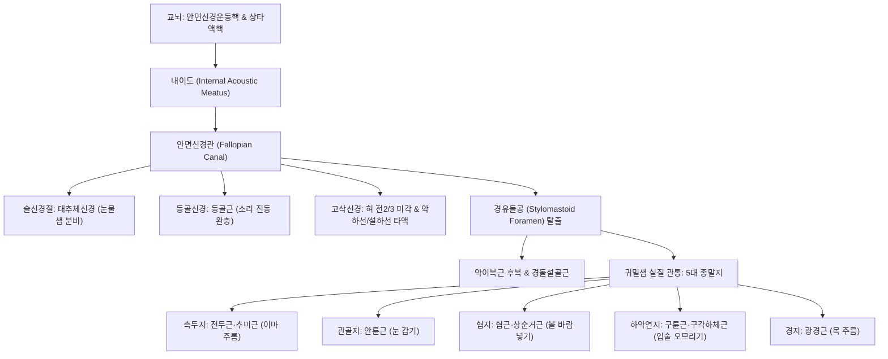

# ⚡ [[7. 얼굴신경|얼굴신경]] (Facial Nerve / 顔面神經, 제7뇌신경 CN VII)

> **핵심 3줄 요약 (Key Summary)**:
> - 🗺️ **신경 기원 & 해부학적 주행**: [[교뇌]](Pons) 하부 안면신경운동핵 및 상타액핵에서 기시하여 내이도(Internal acoustic meatus)와 안면신경관(Fallopian canal)을 통과한 뒤 [[경유돌공]](Stylomastoid foramen)을 빠져나와 귀밑샘(이하선) 실질 내에서 5대 종말 분지로 안면 표정근 전체를 지배하는 혼합 뇌신경이다.
> - 🎯 **복합 기능 지배**: 무릎신경절·등골신경·고삭신경을 통해 눈물샘·타액선(악하선·설하선) 분비 촉진 부교감 및 혀 전방 2/3 [[미각]]을 전달하며, 표정근 전체([[전두근]], [[안륜근]], [[구륜근]], [[협근]]) 운동을 총괄한다.
> - ⚠️ **임상 핵심 & 벨마비 감별**: 이마 주름 형성 여부로 중추성 [[뇌졸중]](이마 주름 보존)과 말초성 [[벨마비]](이마 주름 소실, Bell 현상)를 1초 만에 감별하며, 발병 초기 이개부 수포 동반 시 [[귀 대상포진]](람세이-헌트 증후군)을 즉각 선별해야 한다.
> - 🔍 주요 이학적 검사 & 통합 치료: 하우스-브랙만(HB Grade) 안면마비 척도를 평가하며, 신경 탈출부인 [[예풍]](TE17) 및 안면부 [[하관]](ST7), [[협거]](ST6), [[지창]](ST4) 자침과 [[악이복근]] 근막 이완, 각막 보호 안대를 티칭한다.

---

## 1. 신경 기원 & 해부학적 분지 경로 (Anatomy & Course)
얼굴신경(Facial nerve, CN VII)은 운동근과 감각·부교감 섬유를 지닌 중간신경(Nervus intermedius)이 합쳐진 복합 뇌신경이다.

* **뇌간 기원핵**:
  * **안면신경 운동핵 (Facial motor nucleus)**: [[교뇌]] 하부 망상체 깊숙이 위치하며, 안면 표정근을 지배하는 특수내장원심성(SVE) 섬유를 방출. 신경 섬유는 제6뇌신경([[갓돌림신경]])의 핵을 뒤쪽에서 휘감아 도는 **안면신경구(Internal genu)**를 형성한 후 교뇌 외측 복측으로 출현.
  * **상타액핵 (Superior salivatory nucleus)**: 일반내장원심성(GVE, 부교감) 신경세포체가 위치하여 눈물샘, 악하선(턱밑샘), 설하선(혀밑샘)의 분비 신호 전달.
  * **고속핵 (Nucleus tractus solitarius)**: 특수내장구심성(SVA) 섬유의 종착지로, 혀 앞쪽 2/3의 미각 정보 수용.
  * **삼차신경 척수로핵**: 일반체성구심성(GSA) 섬유가 종지하여 외이도 및 귓바퀴 뒤쪽 감각 담당.
* **측두골 내 안면신경관 (Fallopian Canal) 3대 분절**:
  1. **미로 분절 (Labyrinthine segment, ~3-4mm)**: 내이도저에서 슬신경절까지 주행하며 안면신경관 중 가장 좁은 협착부(직경 약 0.7mm)로 바이러스성 부종 시 급성 허혈성 감금 발생.
  2. **고실 분절 (Tympanic segment, ~8-11mm)**: 중이강 내측벽을 따라 수평 주행하며 등골 상방을 통과.
  3. **유돌 분절 (Mastoid segment, ~10-14mm)**: 수직 하행하며 등골근신경과 [[고삭신경]](Chorda tympani)을 분지한 뒤 [[경유돌공]]으로 탈출.
* **안면 탈출 및 5대 종말 분지 (Extracranial Branches)**:
  * [[경유돌공]](Stylomastoid foramen) 탈출 직후 [[악이복근]] 후복지, [[경돌설골근]]지, 후이개신경을 분지.
  * [[귀밑샘]](Parotid gland) 실질을 관통하며 안면신경총(Pes anserinus)을 형성하고 5대 종말 분지로 분기:
    1. **측두지 (Temporal branch)**: [[전두근]], [[추미근]], 상부 [[안륜근]].
    2. **관골지 (Zygomatic branch)**: 하부 [[안륜근]], 상순비익거근.
    3. **협지 (Buccal branch)**: [[협근]], 상순거근, [[구륜근]].
    4. **하악연지 (Marginal mandibular branch)**: [[구각하체근]], 하순하체근, [[이근]].
    5. **경지 (Cervical branch)**: [[광경근]](Platysma).

---

## 2. 신경 지배 맵 & 기능 네트워크 (Innervation Map)

---

## 3. 호발 포착 부위 & 터널 증후군 병태생리
* **안면신경관 미로 분절의 급성 골성 감금 (Entrapment in Labyrinthine Segment)**:
  * 직경 0.7mm의 가장 좁은 골성 관 내부에서 단순포진바이러스(HSV-1) 재활성화 등으로 신경 부종이 발생하면 신경내압이 급상승하여 모세혈관 관류가 차단되는 구획 증후군성 허혈이 발생한다([[벨마비]]).
* **경유돌공(Stylomastoid Foramen) 출현부 한랭 포착**:
  * 찬바람 노출(한랭 자극)이나 유양돌기 부종, 수면 중 측두부 압박으로 경유돌공 외구 주위 혈관 수축과 신경 허혈성 마비가 호발한다.
* **슬신경절 대상포진 (Ramsay Hunt Syndrome)**:
  * 수두대상포진바이러스(VZV)가 슬신경절에서 재활성화되어 극심한 이통, 귓바퀴 수포, 완전 안면마비, 전정와우신경(CN VIII) 동반 침범으로 어지럼증과 난청이 발생한다.

---

## 4. 손상 레벨별 임상 증상 & 신경학적 결손

| 손상 위치 | 안면 운동 마비 범위 | 동반 감각 및 자율신경 결손 | 감별 핵심 포인트 |
| :--- | :--- | :--- | :--- |
| **중추성 병변 (뇌졸중)** | **하부 안면근만 마비 (이마 주름 보존)** | 미각, 타액 분비 정상 | 상부 안면은 양측 대뇌피질 이중 지배를 받음 |
| **경유돌공 외측 (말초성)** | **동측 안면 전체 마비 (이마 주름 소실)** | 눈물, 미각, 청각 정상 | 순수 안면 표정근 마비, [[벨마비]] 전형 |
| **고삭신경 상부** | 동측 안면 전체 마비 | **혀 전방 2/3 미각 소실 + 타액 분비 감소** | 음식 맛 둔마, 구강 건조 호소 |
| **등골신경 상부** | 동측 안면 전체 마비 + 미각/타액 결손 | **청각 과민 (Hyperacusis)** | 큰 소리에 귀가 울리고 통증 호소 |
| **슬신경절 상부** | 동측 완전 마비 + 청각과민 + 미각소실 | **눈물 분비 소실 (Schirmer 검사 양성)** | 각막 건조 및 궤양 위험 극대화 |

---

## 5. 관련 이학적 검사 & 신경 감별 매트릭스

| 이학적 검사명 | 검사 방법 및 유발 기전 | 양성 반응 | 관련 감별 질환 |
| :--- | :--- | :--- | :--- |
| **이마 주름 짓기 (Forehead Wrinkling)** | 눈을 치켜뜨며 이마에 수평 주름을 만들게 함 | 환측 이마 주름 형성 불능 | 말초성 벨마비 vs 중추성 뇌졸중 감별 |
| **눈 감기 및 벨 현상 (Bell's Phenomenon)** | 눈을 꽉 감게 할 때 안구 움직임 관찰 | 안검이 닫히지 않고 흰자위가 위로 회전 편위됨 | 안면신경 마비 확진 징후 (Lagophthalmos) |
| **쉬르머 검사 (Schirmer's Test)** | 하안검 결막낭에 여과지를 끼우고 5분간 눈물 분비량 측정 | 5분간 젖은 길이 5mm 이하 | 슬신경절 상부 병변 감별 |
| **하우스-브랙만 평가 (House-Brackmann Scale)** | I등급(정상)부터 VI등급(완전 마비)까지 안면 대칭도 정량 평가 | 등급에 따른 예후 예측 | 회복 경과 및 침구 치료 효과 판정 |

---

## 6. 한의 신경 치료 프로토콜 (약침·침도·신경수기) (+ 양방 치료·의뢰 기준)

* **안면신경 주행로 특수 침구 및 전침 치료**:
  * 본간 탈출부 [[예풍]](TE17)에 자침하여 심부 득기감을 유도하고, 안면 분지별 표적혈인 [[양백]](GB14), [[찬죽]](BL2), [[사백]](ST2), [[지창]](ST4), [[협거]](ST6), [[하관]](ST7), [[권료]](SI18)에 저주파 전침(1~2Hz, 연속파 또는 단속파)을 적용하여 근위축 방지 및 축삭 재생을 촉진한다.
* **초음파 유도하 약침술 및 근막 이완**:
  * 경유돌공 출현부 및 이하선 전방에 자하거약침 또는 황련해독탕 약침을 주입하여 신경 부종을 신속히 소퇴시키고, [[악이복근]]과 흉쇄유돌근의 과긴장을 추나 수기로 이완한다.
* **거풍청열 및 활혈통락 한약 처방**:
  * 급성기 부종 소퇴에 [[갈근탕]], [[견정산]], 만성기 후유증 및 연합운동 예방에 [[보양환오탕]], [[순기활혈탕]]을 처방한다.
* **양방 치료 & 의뢰 기준 (Conventional Treatment & Referral)**:
  * **골든타임**: 발병 72시간 이내 경구 고용량 스테로이드(Prednisolone 1mg/kg) 7~10일 테이퍼링 요법 병용 권고.
  * **각막 보호 티칭**: 안검폐쇄부전으로 인한 노출성 각막염을 방지하기 위해 낮에는 무방부제 인공눈물, 취침 시 안연고 도포 및 안대 착용 필수 교육.

---

## 7. 💡 사용자 진료실 핵심 필기 & 임상 팁 (원문 보존)
- **진료실 핵심 원장님 필기 100% 융합 정리**:
  - 이마 주름 형성 여부로 중추성 뇌졸중(이마 주름 보존)과 말초성 [[벨마비]](이마 주름 소실)를 감별한다.
  - [[경유돌공]] 직하부인 [[예풍]](TE17) 및 [[하관]], [[협거]], [[지창]] 자침과 [[악이복근]] 근막 이완이 임상 핵심이다.
  - 발병 초기 이개부 수포 동반 시 [[귀 대상포진]](Ramsay Hunt 증후군)을 즉각 감별해야 하며, 각막 건조 궤양 방지를 위한 안연고 도포 및 인공눈물 처치가 필수적이다.
  - 침샘 중 턱밑샘과 혀밑샘 분비 및 혀 앞쪽 2/3 미각은 얼굴신경의 [[고삭신경]]이 담당한다.
  - 환자가 "양치할 때 물이 한쪽으로 줄줄 새고, 눈이 안 감겨서 비눗물이 들어간다"고 호소하면 전형적인 벨마비 초기 증상이다.

---

## 8. 출처 및 학술 참고 문헌 (References)

- Kim SH et al. (2025). Update on Medical Management of Acute Peripheral Facial Palsy. *J Audiol Otol*. 29(1):1-7. PMID: 39916394
  - [연구 요약] 급성 말초성 안면신경 마비의 최신 의학적 관리 지침, 스테로이드 및 항바이러스제 투여 시점과 신경 전기진단 검사의 예후 예측도 분석.

- Dalrymple SN et al. (2025). Bell's Palsy. *Prim Care*. 52(1):111-121. PMID: 39939082
  - [연구 요약] 1차 진료 현장에서의 벨마비 임상 진단, 중추성 뇌졸중과의 감별 알고리즘, 물리치료 및 침구 재활 치료의 통합 임상 지침.

- Lin WG et al. (2026). Short-term clinical outcomes associated with a standardized multicomponent facial rehabilitation program in acute or early-subacute peripheral facial nerve palsy: a prospective controlled cohort study. *Front Neurol*. 17:1931200. PMID: 42846125
  - [연구 요약] 급성 및 아급성 말초성 안면신경 마비 환자에서 표준화된 다학제 재활 및 복합 신경 자극 치료의 단기 임상 호전도 분석.
