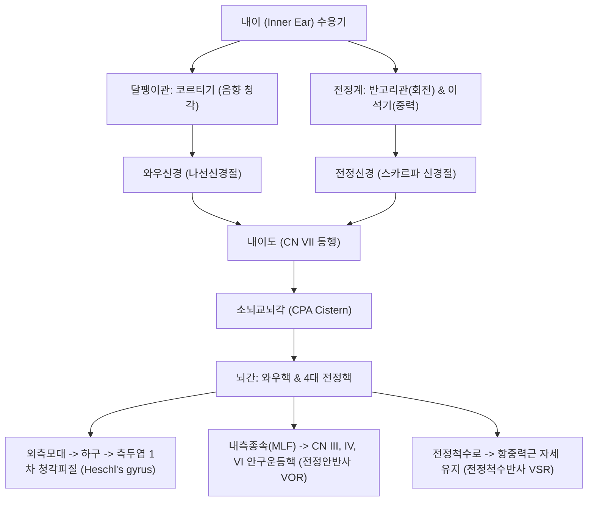

# ⚡ [[8. 속귀신경|속귀신경]] (Vestibulocochlear Nerve / 前庭蝸牛神經, 제8뇌신경 CN VIII)

> **핵심 3줄 요약 (Key Summary)**:
> - 🗺️ **신경 기원 & 해부학적 주행**: 내이의 달팽이관 나선신경절(청각) 및 전정신경절(평형)에서 기시하여 안면신경(CN VII)과 함께 내이도(Internal acoustic meatus)를 통과한 뒤 소뇌교뇌각(CPA)을 거쳐 뇌간 연수-교뇌 경계부의 와우핵 및 전정핵으로 진입하는 순수 특수감각신경이다.
> - 🎯 **청각 & 3차원 평형 감각 독점**: 와우신경은 음향 진동을 대뇌 측두엽 청각피질로 전달하고, 전정신경은 세반고리관(회전 가속도)과 이석기관(난형낭·구형낭, 직선 가속도 및 중력)의 신호를 소뇌 및 안구운동핵(VOR 반사)으로 투사한다.
> - ⚠️ **임상 핵심 & 말초성 현훈 3대 질환 감별**: 고개 돌릴 때 1분 미만 회전성 현훈인 [[이석증]](BPPV, 에플리 수기), 이충만감·난청·이명을 동반하는 [[메니에르병]], 지속적 오심·구토와 자발안진을 보이는 [[전정신경염]]을 명확히 감별한다.
> - 🔍 주요 이학적 검사 & 치료: 딕스-홀파이크 검사 및 두부충동검사(HINTS, 뇌졸중 감별)를 시행하며, 이석정복술 및 귀 주변 [[이문]](TE21), [[청궁]](SI19), [[청회]](GB2), [[예풍]](TE17) 자침과 [[영계출감탕]], [[오령산]]을 처방한다.

---

## 1. 신경 기원 & 해부학적 분지 경로 (Anatomy & Course)
속귀신경(Vestibulocochlear nerve, CN VIII)은 운동 섬유가 전혀 없는 100% 순수 특수감각(SSA) 신경으로 두 개의 독립된 신경이 합쳐져 주행한다.

* **와우신경 (Cochlear nerve - 청각)**:
  * 달팽이관(Cochlea)의 코르티 기관(Organ of Corti) 유모세포에서 청각 신호를 수용.
  * 나선신경절(Spiral ganglion)의 양극신경원 축삭이 모여 와우신경 형성.
* **전정신경 (Vestibular nerve - 평형)**:
  * 전정신경절(Scarpa's ganglion)의 양극신경원에서 기시.
  * **상전정신경**: 전반고리관, 외측반고리관, 난형낭(Utricle) 지배.
  * **하전정신경**: 후반고리관, 구형낭(Saccule) 지배.
* **내이도 및 소뇌교뇌각 주행**:
  * 측두골 내이도(Internal acoustic meatus) 내부에서 안면신경(전상방), 와우신경(전하방), 상전정신경(후상방), 하전정신경(후하방)의 4분면 배열을 형성("Seven-up, Coke-down").
  * 소뇌교뇌각(CPA cistern)을 지나 연수-교뇌 외측 홈으로 진입하여 와우핵 및 4대 전정핵(상·하·내·외측핵)에 종지.

---

## 2. 신경 지배 맵 & 기능 네트워크 (Innervation Map)

---

## 3. 호발 포착 부위 & 터널 증후군 병태생리
* **소뇌교뇌각 청신경초종 (Vestibular Schwannoma / Acoustic Neuroma)**:
  * 내이도 또는 CPA 부위 전정신경의 슈반세포에서 발생하는 양성 종양으로 서서히 진행하는 편측 감각신경성 난청, 고음조 이명, 평형 장애 유발.
* **혈관 루프 신경혈관 압박 (Neurovascular Compression / Vestibular Paroxysmia)**:
  * 전하소뇌동맥(AICA)이나 후하소뇌동맥(PICA)의 동맥 루프가 내이도 내에서 속귀신경을 압박하여 짧고 반복적인 회전성 어지럼증과 박동성 이명 유발.
* **이석 탈락 및 반고리관 감금 (BPPV 병태생리)**:
  * 난형낭의 탄산칼슘 이석(Otoconia)이 퇴행이나 외상으로 떨어져 나와 반고리관 내로 흘러 들어가 림프액 유동을 방해(관이석증)하거나 팽대부릉정에 유착(팽대부릉정이석증)되어 두위 변화 시 격렬한 회전성 어지럼증 유발.

---

## 4. 손상 레벨별 임상 증상 & 신경학적 결손

| 질환 / 병변 | 주 증상 및 특징 | 안진 (Nystagmus) 양상 | 청력 이상 동반 여부 |
| :--- | :--- | :--- | :--- |
| **[[이석증]] (BPPV)** | 체위 변경 시(누울 때, 돌아누울 때) 1분 미만 회전성 현훈 | 잠복기 있는 회선-상향 안진 (피로 현상 있음) | **청력 정상, 이명 없음** |
| **[[전정신경염]] (VN)** | 가만히 있어도 며칠간 지속되는 극심한 현훈, 오심·구토 | 건측을 향하는 수평-회선 안진 (주시 고정 시 억제) | **청력 정상** (단독 전정신경 침범) |
| **[[메니에르병]] (MD)** | 수시간 지속되는 현훈 발작, 이충만감 | 발작 초기 환측, 이후 건측 안진 | **저음조 난청 및 이명 동반** |
| **청신경초종 (종양)** | 수개월~수년에 걸친 점진적 청력 저하 | 중추성 또는 말초성 혼합 안진 | **편측 감각신경성 난청, 어음 분별력 급감** |

---

## 5. 관련 이학적 검사 & 신경 감별 매트릭스

| 이학적 검사명 | 검사 방법 및 유발 기전 | 양성 반응 | 관련 감별 질환 |
| :--- | :--- | :--- | :--- |
| **딕스-홀파이크 검사 (Dix-Hallpike Test)** | 환자를 앉힌 상태에서 고개를 45도 돌리고 신속히 앙와위로 눕힘 | 수초 잠복기 후 회선-상향 안진 및 현훈 유발 | 후반고리관 [[이석증]] 확진 |
| **두부충동검사 (Head Impulse Test, HINTS)** | 환자에게 검사자 코를 보게 하고 머리를 좌우로 빠르게 10~20도 회전 | 시선이 표적을 놓쳤다가 다시 돌아오는 교정 단속운동(Catch-up saccade) | 말초성 전정신경염 (음성이면 소뇌 뇌졸중 의심!) |
| **웨버 & 린네 검사 (Weber & Rinne Test)** | 512Hz 음차를 두정부 및 유양돌기/외이도에 대어 청력 비교 | 린네 양성(AC>BC)이면서 건측으로 편측화 | 감각신경성 난청 (속귀신경 병변) |

---

## 6. 한의 신경 치료 프로토콜 (약침·침도·신경수기) (+ 양방 치료·의뢰 기준)

* **이석정복술 (Canalith Repositioning Procedure)**:
  * 후반고리관 이석증에 **에플리 수기(Epley maneuver)**를 즉각 시행하여 반고리관 내 이석을 난형낭으로 정복(1회 성공률 80% 이상).
* **이주 주위 및 경추 침구 치료**:
  * 귀 주변의 [[이문]](TE21), [[청궁]](SI19), [[청회]](GB2), [[예풍]](TE17)과 후두부 [[풍지]](GB20), [[천주]](BL10)를 자침하여 내이 미세혈류를 개선하고 전정보상을 유도한다.
* **수담 정체 및 청간식풍 한약 처방**:
  * 메니에르병의 내림프 수종 해소에 [[오령산]], [[영계출감탕]], [[반하백출천마탕]]을 처방한다.
* **양방 치료 & 의뢰 기준 (Conventional Treatment & Referral)**:
  * **HINTS 검사상 중추성 징후**(정상 두부충동검사, 방향 전환 안진, 수직 사위 Skew deviation)가 관찰되거나 신경학적 결손 동반 시 소뇌 뇌경색 배제를 위해 즉시 뇌 MRI 의뢰.

---

## 7. 💡 사용자 진료실 핵심 필기 & 임상 팁 (원문 보존)
- **순수 감각 신경**: 속귀신경은 운동 섬유가 전혀 없는 100% 순수 특수감각신경이다.
- **평형 감각과 청각의 완벽한 융합**: 인체의 3차원 공간 평형과 음향 인지를 뇌간으로 연결하는 핵심 신경이다.
- **진료실 현훈 환자 즉각 스크리닝 룰 (10초 감별)**:
  1. 고개 돌릴 때만 1분 이내로 도는가? $
ightarrow$ **[[이석증]] (에플리 수기 즉각 시행)**.
  2. 귀가 꽉 찬 느낌(이충만감)과 함께 웅- 소리가 나며 난청이 있는가? $
ightarrow$ **[[메니에르병]] (수분 대사 조절: 오령산/영계출감탕)**.
  3. 며칠째 가만히 있어도 토할 것 같이 어지러운데 귀는 잘 들리는가? $
ightarrow$ **[[전정신경염]] (급성 침구/한약 및 조기 전정재활 운동)**.
- **이석정복술 후 티칭**: 에플리 수기 당일에는 베개를 30도 이상 높게 베고 환측으로 눕지 않도록 교육한다.
- **전정보상 재활 운동**: 전정신경염 환자는 누워만 있으면 보상이 늦어지므로 눈 움직이기, 고개 흔들며 시선 고정하기 등 Cawthorne-Cooksey 운동을 조기에 시작하도록 지도한다.

---

## 8. 출처 및 학술 참고 문헌 (References)

- Piatti D et al. (2026). Vestibular Evoked Myogenic Potentials to Diagnose Vestibular Neuritis: A Scoping Review. *Laryngoscope*. 136(4):1635-1644. PMID: 41122999
  - [연구 요약] 전정신경염 환자에서 전정유발근전위(VEMP) 검사를 통한 상전정신경 및 하전정신경 분지별 손상 평가와 진단 정밀도 고찰.

- Cowen JE et al. (2025). The Association of Vascular Loops within the Internal Auditory Meatus or Contacting the Vestibulo-Cochlear Nerve with Audiovestibular Symptoms: A Systematic Review and Meta-Analysis. *AJNR Am J Neuroradiol*. 46(2):372-379. PMID: 39231613
  - [연구 요약] 내이도 내 혈관 루프의 속귀신경 접촉 및 압박과 이명, 감각신경성 난청, 전정 증상 간의 통계적 상관관계 메타분석.
