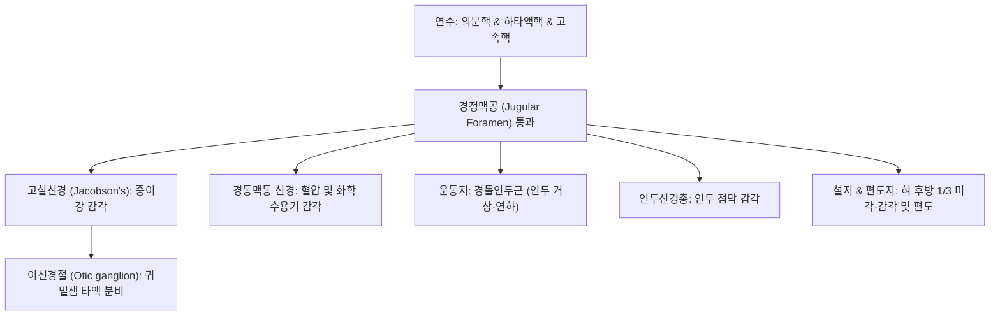

# ⚡ [[9. 설인신경|설인신경]] (Glossopharyngeal Nerve / 舌咽神經, 제9뇌신경 CN IX)

> **핵심 3줄 요약 (Key Summary)**:
> - 🗺️ **신경 기원 & 해부학적 주행**: 연수 외측 후외측구(Postolivary sulcus)에서 기시하여 미주신경(CN X), 부신경(CN XI)과 함께 경정맥공(Jugular foramen)을 통과한 뒤 내경동맥과 내경정맥 사이를 지나 경돌인두근을 감아돌며 인두벽과 혀뿌리로 진입하는 복합 혼합신경이다.
> - 🎯 **삼중 기능(감각·운동·분비) 통솔**: 혀 뒤쪽 1/3의 맛([[미각]])과 일반감각, 인두 점막 감각, 경동맥동/소체 혈압 및 화학수용기 감각을 수용하고, [[경돌인두근]] 운동을 지배하며, 부교감 섬유를 이신경절을 통해 [[귀밑샘]](이하선) 타액 분비로 전달한다.
> - ⚠️ **임상 핵심 & 설인신경통과 이글 증후군**: 침을 삼키거나 하품할 때 편도, 인후, 귀 깊은 곳에 칼로 찌르는 듯한 발작통이 발생하는 [[설인신경통]]과, 경돌기 신장으로 신경이 압박되는 이글 증후군(Eagle syndrome), 경동맥동 반사에 의한 서맥성 실신(Syncope)을 감별한다.
> - 🔍 주요 이학적 검사 & 치료: 구개수 편위 및 구토반사(Gag reflex, 구심로: CN IX, 원심로: CN X)를 검사하며, 상경추 추나 교정 및 [[예풍]](TE17), [[천용]](SI17), [[인영]](ST9), [[염천]](CV23) 자침을 시행한다.

---

## 1. 신경 기원 & 해부학적 분지 경로 (Anatomy & Course)
설인신경(Glossopharyngeal nerve, CN IX)은 감각, 운동, 부교감 신경 섬유가 복합된 연수 기원 뇌신경이다.

* **연수 기원 4대 핵 (Medullary Nuclei)**:
  * **의문핵 (Nucleus ambiguus)**: 특수내장운동(SVE) 섬유를 내보내 [[경돌인두근]](Stylopharyngeus) 지배.
  * **하타액핵 (Inferior salivatory nucleus)**: 일반내장원심성(GVE, 부교감) 섬유가 고실신경(Jacobson's nerve) $
ightarrow$ 소추체신경 $
ightarrow$ 이신경절(Otic ganglion) $
ightarrow$ 이개측두신경을 거쳐 **[[귀밑샘]](Parotid gland)** 분비 유도.
  * **고속핵 (Nucleus tractus solitarius)**: 혀 뒤쪽 1/3의 미각(SVA) 및 경동맥동(Carotid sinus, 혈압 수용기)·경동맥소체(화학 수용기)의 내장감각(GVA) 수용.
  * **삼차신경 척수로핵**: 혀 뒤쪽 1/3 점막, 편도선, 인두 상부, 중이강 및 고막 내면의 일반체감각(GSA) 수용.
* **두개저 탈출 및 주행**:
  * 연수 올리브 뒤쪽 고랑에서 3~4개의 근사(Rootlets)로 출현.
  * **경정맥공(Jugular foramen)**의 중앙 신경관을 미주신경, 부신경과 함께 통과.
  * 경동맥초 심부에서 내경동맥과 외경동맥 사이를 지나 설골설근 심부로 진입하여 인두신경총 형성.

---

## 2. 신경 지배 맵 & 기능 네트워크 (Innervation Map)

---

## 3. 호발 포착 부위 & 터널 증후군 병태생리
* **신경근 진입부(REZ) 혈관 압박 (설인신경통 병태생리)**:
  * 후하소뇌동맥(PICA)이나 추골동맥의 박동성 루프가 연수 기시부의 설인신경근을 압박하여 탈수초화 누전 전도를 일으킴으로써 침 삼킴이나 연하 시 극심한 통증 유발.
* **이글 증후군 (Eagle's Syndrome)**:
  * 측두골 경돌기(Styloid process)가 비정상적으로 신장(30mm 이상)되거나 경돌설골인대가 골화되어 두경부 회전 시 설인신경과 경동맥을 기계적으로 압박·자극.
* **상경추 아탈구 및 악이복근 긴장**:
  * [[거북목]]과 C1-C2 회전 변위, [[악이복근]] 후복의 단축이 경정맥공 직하부의 설인신경을 압박하여 비치성 치통과 침 분비 장애 유발.

---

## 4. 손상 레벨별 임상 증상 & 신경학적 결손

| 병변 위치 | 주요 임상 결손 | 신경학적 증상 | 감별 포인트 |
| :--- | :--- | :--- | :--- |
| **경정맥공 (베르네 증후군)** | IX, X, XI 동시 마비 | 연하곤란, 쉰 목소리, 승모근/SCM 마비 | 경정맥공 종양, 두개저 골절 |
| **설인신경 단독 압박** | 혀 뒤 1/3 감각 및 미각 소실 | **구토반사(Gag reflex) 소실**, 연하 곤란 | 편도 부위 접촉 시 구역질 안 남 |
| **설인신경통 (GPN)** | 인두·편도·외이도 발작통 | 연하 시 심장 억제 반사성 **실신(Syncope)** | 삼차신경통(안면)과 통증 부위 구별 |

---

## 5. 관련 이학적 검사 & 신경 감별 매트릭스

| 이학적 검사명 | 검사 방법 및 유발 기전 | 양성 반응 | 관련 감별 질환 |
| :--- | :--- | :--- | :--- |
| **구토반사 검사 (Gag Reflex Test)** | 설압자로 후인두벽 점막을 가볍게 접촉 | 인두 근육 수축 및 구역 반응 소실 | 설인신경(구심로) 또는 미주신경(원심로) 손상 |
| **미각 검사 (혀 후방 1/3)** | 혀 뒤쪽에 쓴맛(퀴닌), 짠맛 용액 도포 | 쓴맛 인지 불능 | 설인신경 미각로 병변 |
| **경돌기 촉진 검사 (Styloid Process Palpation)** | 편도와를 손가락으로 촉진하여 경돌기 돌출 확인 | 국소 압통 및 동통 재현 | 이글 증후군(Eagle's syndrome) 선별 |

---

## 6. 한의 신경 치료 프로토콜 (약침·침도·신경수기) (+ 양방 치료·의뢰 기준)

* **상경추 및 악관절 추나 교정**:
  * 거북목과 상경추(C1-C2) 아탈구를 바로잡고 후두하근막을 이완하여 경정맥공 주위 정맥 울혈과 신경 압박을 해소한다.
* **인후 및 악하부 특수 침구 치료**:
  * 턱밑 및 인후부의 [[예풍]](TE17), [[천용]](SI17), [[염천]](CV23), [[조해]](KI6) 자침을 통해 인두 거상근을 자극하고 타액 분비를 촉진한다.
* **청화안신 활혈통락 한약 처방**:
  * 설인신경통의 발작성 통증 완화에 [[작약감초탕]], [[황련해독탕]], 만성 연하곤란에 [[반하후박탕]]을 처방한다.
* **양방 치료 & 의뢰 기준 (Conventional Treatment & Referral)**:
  * 통증 시 카바마제핀 약물 치료 시행, 심한 실신 동반이나 난치성 통증 시 신경외과 미세혈관 감압술(MVD) 의뢰.

---

## 7. 💡 사용자 진료실 핵심 필기 & 임상 팁 (원문 보존)
- **삼중 기능 신경**: 감각(혀 뒤 1/3 및 인두), 운동([[경돌인두근]]), 분비([[귀밑샘]])를 총괄하는 삼위일체 신경이다.
- **'꿀떡근'과 연하장애**: 꿀떡하고 음식이 안 넘어가는 연하장애 환자를 만나면 혀의 운동([[설하신경]])뿐만 아니라 인두를 당겨 올려주는 설인신경의 [[경돌인두근]] 기능을 반드시 체크해야 한다.
- **귀밑샘(이하선) 타액 분비의 독점**: 침샘 중 턱밑샘·혀밑샘은 7번 안면신경이 담당하지만, 최대 침샘인 귀밑샘은 9번 설인신경이 홀로 지배한다.
- **거북목과 침 분비 저하·치통의 숨은 연결고리**:
  - 침 분비가 갑자기 안 되거나, 치과 검진에서 아무 이상이 없는데 어금니 쪽에 쑤시는 치통을 호소하는 환자의 상당수는 **[[거북목]]으로 인한 상경추 아탈구 및 설인신경 포착**이 원인이다.
  - 상경추 추나 교정과 하악각-유양돌기 사이([[예풍]], [[천용]]), [[악이복근]] 근막 치료를 시행하면 침 분비가 즉각 촉진되고 원인 불명의 비치성 치통이 거짓말처럼 소실된다.
- **설인신경통 진료 팁**: 통증 부위가 얼굴 앞쪽이 아니라 **"목구멍 속, 편도, 귀 깊숙한 곳"**이다. 환자가 찬물을 마시거나 침 삼킬 때 칼로 찌르는 통증과 함께 심장마비처럼 핑 돌며 기절할 뻔했다고 하면 설인신경통성 실신(Syncope)을 의심해야 한다.

---

## 8. 출처 및 학술 참고 문헌 (References)

- Hajikarimloo B et al. (2026). Microvascular decompression in glossopharyngeal neuralgia: a systematic review and meta-analysis. *Acta Neurol Belg*. 126(3):793-807. PMID: 41428184
  - [연구 요약] 설인신경통 환자에서 미세혈관 감압술(MVD)의 장기 통증 완화율(88% 이상) 및 심혈관 혈역학적 합병증 예방 효과에 대한 체계적 문헌고찰 및 메타분석.

- Zhao H et al. (2017). Microvascular Decompression for Glossopharyngeal Neuralgia: Long-Term Follow-Up. *World Neurosurg*. 102:151-156. PMID: 28263933
  - [연구 요약] 설인신경통 환자에서 미세혈관 감압술(MVD)의 장기 추적 관찰을 통한 통증 소실률(90% 이상)과 뇌신경 합병증 예방 및 예후 분석.
