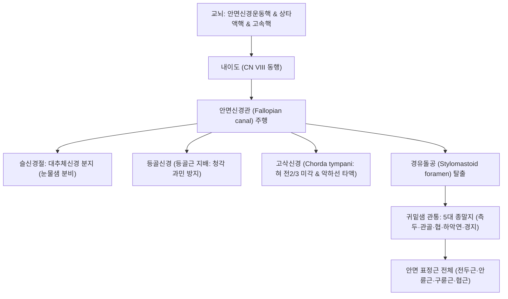

# ⚡ [[안면신경]] (Facial Nerve / 顔面神經, 제7뇌신경 CN VII: 종합 진료 가이드)

> **핵심 3줄 요약 (Key Summary)**:
> - 🗺️ **신경 기원 & 해부학적 주행**: 교뇌연수구에서 기시하여 내이도와 안면신경관(Fallopian canal)을 통과한 뒤 [[경유돌공]](Stylomastoid foramen)을 탈출하여 귀밑샘(이하선) 실질 내에서 5대 종말 분지(측두·관골·협골·하악연·경부지)를 형성한다.
> - 🎯 **복합 기능 지배**: 안면 표정근 전체([[전두근]], [[안륜근]], [[구륜근]], [[협근]] 등)의 운동, [[고삭신경]]을 통한 혀 전방 2/3 미각 및 악하선·설하선 타액 분비, 대추체신경을 통한 누선 분비를 총괄한다.
> - ⚠️ **임상 핵심 & 벨마비 감별**: 말초성 [[벨마비]](이마 주름 소실, Bell 현상 양성)와 중추성 뇌졸중(이마 주름 보존)을 감별하는 것이 1차 진료의 최우선 원칙이며, 귀 주변 수포를 동반한 람세이-헌트 증후군을 조기 감별해야 한다.
> - 🔍 주요 이학적 검사 & 통합 치료: 하우스-브랙만(HB Grade) 안면마비 척도를 평가하며, 신경 탈출부인 [[예풍]](TE17) 및 안면부 [[지창]](ST4), [[협거]](ST6), [[하관]](ST7) 전침·약침 및 안면 추나를 적용한다.

> [!NOTE]
> 본 문서는 [[7. 얼굴신경]]의 동일 명칭 문서로서 임상 진료 요약본입니다. 더 상세한 세부 해부학적 주행도와 학술 메커니즘은 [[7. 얼굴신경]] 전문을 함께 참조하십시오.

---

## 1. 신경 기원 & 해부학적 분지 경로 (Anatomy & Course)
안면신경(Facial nerve, CN VII)은 운동근과 감각·부교감 섬유를 지닌 중간신경(Nervus intermedius)이 합쳐진 혼합신경이다.

* **두개내 주행 (Intracranial Pathway)**:
  * 교뇌연수구 외측에서 출현하여 전정와우신경(CN VIII)과 함께 내이도(Internal acoustic meatus)로 진입.
  * 측두골 내의 미로 분절, 슬신경절(Geniculate ganglion), 고실 분절, 유돌 분절로 구성된 안면신경관(Fallopian canal)을 통과.
* **안면 탈출 및 5대 종말 분지 (Extracranial Branches)**:
  * 측두골 기저부의 [[경유돌공]](Stylomastoid foramen)을 통해 두개골 밖으로 탈출.
  * 귀밑샘(Parotid gland) 실질 내부를 관통하며 안면신경총(Pes anserinus)을 형성하고 5대 종말 분지로 갈라짐:
    1. **측두지 (Temporal branch)**: [[전두근]], [[추미근]], 상부 [[안륜근]].
    2. **관골지 (Zygomatic branch)**: 하부 [[안륜근]], 상순비익거근.
    3. **협지 (Buccal branch)**: [[협근]], 상순거근, [[구륜근]].
    4. **하악연지 (Marginal mandibular branch)**: [[구각하체근]], 하순하체근, [[이근]].
    5. **경지 (Cervical branch)**: [[광경근]](Platysma).

---

## 2. 신경 지배 맵 & 기능 네트워크 (Innervation Map)

---

## 3. 호발 포착 부위 & 터널 증후군 병태생리
* **안면신경관 미로 분절(Labyrinthine Segment)의 허혈성 감금**:
  * 안면신경관 중 가장 좁은(직경 약 0.7mm) 미로 분절에서 단순포진바이러스(HSV-1) 재활성화 등으로 신경 부종이 생기면 골성 벽에 의해 급성 포착 및 혈류 차단이 발생한다([[벨마비]]).
* **경유돌공(Stylomastoid Foramen) 부위 압박**:
  * 유양돌기와 하악지 사이의 한랭 노출(찬바람), 유돌부 부종 또는 이하선 종양으로 인한 기계적 압박.
* **람세이-헌트 증후군 (Ramsay Hunt Syndrome)**:
  * 슬신경절(Geniculate ganglion)에 잠복해 있던 수두대상포진바이러스(VZV)의 재활성화로 심한 이통, 귓바퀴 수포, 안면마비, 어지럼증 및 난청이 동반된다.

---

## 4. 손상 레벨별 임상 증상 & 신경학적 결손

| 손상 위치 | 마비 범위 및 동반 결손 증상 | 감별 핵심 포인트 |
| :--- | :--- | :--- |
| **중추성 병변 (뇌졸중/뇌종양)** | 하부 안면근만 마비 (**이마 주름 형성 정상**) | 양측 대뇌피질 지배로 상부 안면 보존, 편마비 동반 |
| **말초성 병변 (벨마비)** | 동측 안면 전체 마비 (**이마 주름 완전 소실, 눈 안 감김**) | 일측성 완전 마비, Bell 현상 양성 |
| **등골신경 분지 상부 손상** | 안면마비 + **청각 과민 (Hyperacusis)** | 등골근 마비로 소리가 크게 울려 들림 |
| **고삭신경 분지 상부 손상** | 안면마비 + 청각 과민 + **혀 전방 2/3 미각 소실 & 구강 건조** | 단맛·짠맛 식별 불가, 타액 감소 |
| **슬신경절 병변 (람세이헌트)** | 전신 증상 + **외이도 수포 + 극심한 이통 + 눈물 감소** | 영구적 후유증 위험 높음, 즉시 항바이러스제 |

---

## 5. 관련 이학적 검사 & 신경 감별 매트릭스

| 이학적 검사명 | 검사 방법 및 유발 기전 | 양성 반응 | 관련 감별 질환 |
| :--- | :--- | :--- | :--- |
| **이마 주름 짓기 검사 (Forehead Wrinkling)** | 눈을 위로 치켜뜨며 이마에 주름을 짓게 함 | 환측 이마 주름 형성 불가 | 말초성 안면마비 vs 중추성 뇌졸중 감별 |
| **눈 감기 및 벨 현상 (Bell's Phenomenon)** | 눈을 꽉 감게 할 때 안구 움직임 관찰 | 안검이 닫히지 않고 흰자위가 위로 돌아감 | 안면신경 마비 전형적 징후 |
| **하우스-브랙만 평가 (House-Brackmann Scale)** | 안면 표정근 기능에 따라 I(정상)부터 VI(완전 마비)까지 등급화 | 비대칭 및 기능 저하 정도 정량화 | 예후 판정 및 치료 효과 추적 |

---

## 6. 한의 신경 치료 프로토콜 (약침·침도·신경수기) (+ 양방 치료·의뢰 기준)

* **안면신경 주행 경혈 전침 치료**:
  * 본간 탈출부 [[예풍]](TE17)과 안면부 분지인 [[찬죽]](BL2), [[양백]](GB14), [[사백]](ST2), [[지창]](ST4), [[협거]](ST6), [[하관]](ST7)에 전침 저주파(1~2Hz) 자극을 시행하여 신경 재생 및 근위축을 방지한다.
* **초음파 유도하 안면신경간 약침술**:
  * 경유돌공 출현부 및 유양돌기 전방에 자하거약침 또는 소염약침을 정밀 주입하여 신경 부종을 신속히 소퇴시킨다.
* **풍열 거풍 및 거어통락 한약 처방**:
  * 급성기 부종 소퇴에 [[갈근탕]] 가감방, [[견정산]], 만성기 신경 회복에 [[보양환오탕]]을 처방한다.
* **양방 치료 & 의뢰 기준 (Conventional Treatment & Referral)**:
  * 발병 72시간 이내 골든타임에 경구 고용량 스테로이드(Prednisolone) 및 항바이러스제 병용 투여.
  * 이통과 함께 귓바퀴에 수포가 보이면 람세이-헌트 증후군으로 진단하고 신속히 이비인후과 의뢰 병행.

---

## 7. 💡 사용자 진료실 핵심 필기 & 임상 팁 (원문 보존)
- 안면 표정근 전체와 혀 앞 2/3의 미각, 침샘과 눈물샘 분비를 담당하는 핵심 신경이다.
- 벨마비 환자 진료 시 "이마 주름을 만들어보세요"가 제1번 질문이다. 이마 주름이 잡히면 뇌졸중(중추성), 안 잡히면 벨마비(말초성)이다.
- 귀 뒤쪽의 예풍혈(TE17) 압통은 안면신경 본간의 급성 염증과 부종을 반영하는 핵심 진단점이자 침 치료의 주관문이다.
- 급성기 환자에게는 눈이 완전히 감기지 않아 각막염이나 각막 궤양이 생길 수 있으므로, 취침 시 인공눈물 투여와 안대 착용을 반드시 티칭해야 한다.

---

## 8. 출처 및 학술 참고 문헌 (References)

- Lin WG et al. (2026). Short-term clinical outcomes associated with a standardized multicomponent facial rehabilitation program in acute or early-subacute peripheral facial nerve palsy: a prospective controlled cohort study. *Front Neurol*. 17:1931200. PMID: 42846125
  - [연구 요약] 급성 및 아급성 말초성 안면신경 마비 환자에서 표준화된 다학제 재활 및 복합 신경 자극 치료의 단기 임상 호전도 분석.

- Jain S et al. (2026). Facial Nerve Palsy With Olfactory and Gustatory Dysfunction Following COVID-19 Infection: An Illustrative Case-Based Narrative Review. *Cureus*. 18(9):e116106. PMID: 42861273
  - [연구 요약] 바이러스 감염 후 안면신경 마비와 후각 및 미각 신경 결손의 복합 발현 기전과 신경학적 회복 경로 고찰.
