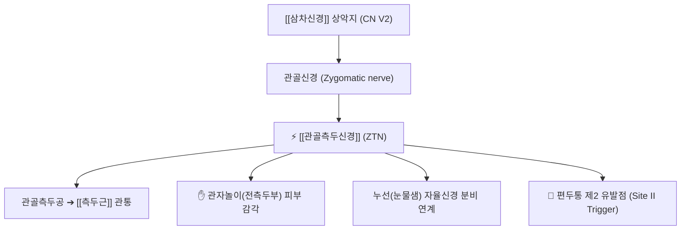

# ⚡ [[관골측두신경]] (Zygomaticotemporal Nerve / 顴骨側頭神經, CN V2)

> **핵심 3줄 요약 (Key Summary)**:
> - 🗺️ 신경 기원 & 해부학적 주행: 삼차신경 제2지인 [[상악신경]](Maxillary nerve, CN V2)의 관골신경(Zygomatic nerve) 분지, 하안와열을 지나 안와 외측벽의 관골측두공을 관통하여 [[측두근]](Temporalis)을 뚫고 피하로 상행.
> - 🎯 운동 지배(근육군) & 감각 지배 영역: 순수 감각 신경. 외안각(눈꼬리) 외측 관자놀이(측두부 전방) 피부 감각 지배, 누선(눈물샘) 부교감신경 분비 섬유 전달.
> - ⚠️ 호발 포착 부위 & 관련 임상 질환: 관골측두공(Zygomaticotemporal foramen) 골관 및 [[측두근]] 심부근막 관통부, [[측두부 편두통]](Migraine trigger site 2), 관자놀이 압박성 두통.
> - 🔍 주요 이학적 검사 & 신경학적 징후: 안와 외측연 후방 1.5cm 지점 티넬 징후, 측두근 악력 저작 시 관자놀이 두통 악화.

---

## 1. 신경 기원 & 해부학적 분지 경로 (Anatomy & Course)

* **신경 기원 (Origin & Trigeminal Branch)**:
  * [[삼차신경]](Trigeminal nerve, CN V)의 제2 분지인 **[[상악신경]](Maxillary nerve, CN V2)**에서 익구개와(Pterygopalatine fossa) 주행 중 분지하는 관골신경(Zygomatic nerve)의 종말 분지입니다.
* **상세 주행 경로 (Detailed Pathway)**:
  1. **안와강 진입**: 익구개와에서 분지한 관골신경은 하안와열(Inferior orbital fissure)을 통해 안와강 외측벽으로 들어갑니다.
  2. **관골 골관 관통**: 안와 외측벽의 광대뼈(Zygomatic bone) 내면에 위치한 **관골측두공(Zygomaticotemporal foramen)**을 통과하여 측두와(Temporal fossa)로 진입합니다.
  3. **[[측두근]] 관통 및 상행**: 측두와로 나온 신경은 [[측두근]](Temporalis) 전방 섬유를 뚫고 나오거나 전면을 우회한 후, 단단한 측두심근막(Deep temporal fascia)을 관통합니다.
  4. **피하 분지**: 관자놀이(전측두부) 피하지방층으로 나와 안와 외측연 상방, 눈꼬리 외측 및 이마 외측 피부로 방사상 분지합니다.

---

## 2. 신경 지배 맵 & 기능 네트워크 (Innervation Map)

### 1) 감각 및 자율신경 지배
* **피부 체성 감각**: 눈꼬리(외안각) 외방 및 상방의 관자놀이 피부, 이마 외측부의 통각, 촉각, 온도각을 담당합니다.
* **자율신경 분비 교통로**: 익구개신경절에서 유래한 후신경절 부교감신경 분비 섬유를 누선신경(Lacrimal nerve, CN V1 분지)으로 전달하는 문합 경로를 제공하여 눈물 분비를 조율합니다.

---

## 3. 호발 포착 부위 & 터널 증후군 병태생리

* **편두통의 핵심 트리거 포인트 (Bahman Guyuron 분류 Site II)**:
  * 외안각(눈꼬리)에서 외방으로 약 1.5cm, 상방으로 1.5cm 지점의 측두근 섬유와 측두근막 관통부에서 신경이 포착되면, 박동성의 극심한 **관자놀이 [[편두통]]**이 촉발됩니다.
* **이갈이 및 턱관절 장애 연계**:
  * 스트레스, 이악물기([[턱관절 장애]]), 과도한 껌 씹기 등으로 [[측두근]]과 [[교근]]이 만성 연축되면 관골측두공 출구가 협착되고 근막 관통부의 기계적 마찰이 심화되어 신경 허혈이 악화됩니다.
* **안경다리 및 헤드셋 압박**:
  * 단단한 안경테나 헬멧, 헤드셋이 측두골 표면의 관골측두신경 주행 경로를 직접 압박할 때 국소 허혈성 신경염이 호발합니다.

---

## 4. 손상 레벨별 임상 증상 & 신경학적 결손

* **관자놀이 편두통 (Temporal Migraine)**: 관자놀이를 바늘로 찌르거나 송곳으로 쑤시는 듯한 박동성 통증이 전두부나 안구 뒤쪽으로 투사됩니다.
* **접촉성 이질통 (Allodynia)**: 모자나 안경테가 닿기만 해도 관자놀이 피부가 화끈거리고 쓰라려 착용을 거부하게 됩니다.
* **자율신경 증상 동반**: 두통 발작 시 동측 눈에서 눈물이 나거나(Lacrimation) 결막 충혈이 동반될 수 있습니다.

---

## 5. 관련 이학적 검사 & 신경 감별 매트릭스

* **관골측두공 압통 검사 (ZTN Compression Test)**:
  * 외안각(눈꼬리) 외방 1.5cm, 상방 1.5cm 지점(태양혈 전방 골연)을 엄지손가락으로 3~5초간 지그시 압박할 때 평소 앓던 관자놀이 편두통이 즉각 유발되거나 방사통이 나타나면 양성.
* **이개측두신경(ATN)과의 감별 매트릭스**:
  * 관골측두신경(ZTN): 눈꼬리 외측, 전측두부 관자놀이 통증, 안경다리 앞쪽 압박통.
  * [[이개측두신경]](ATN, CN V3 분지): 귓바퀴 앞쪽, 천측두동맥 박동 부위, 측두부 후상방 통증, 턱관절 저작 시 악화.

---

## 6. 한의 신경 치료 프로토콜 (약침·침도·신경수기)

* **[[태양혈]](EX-HN5) 침도 미세 감압술**:
  * 관자놀이 태양혈 부위의 측두근막 긴장대에 침도를 골면에 수평 방향으로 안전하게 접근시켜 미세 절개 감압술을 시행합니다.
* **측두근 이완 침치료 및 신바로 약침**:
  * [[하관]](ST7), [[솔곡]](GB8), [[현로]](GB5)에 자침하여 측두근 과긴장을 해소하고, 신경 출구 부위에 신바로 약침 0.2~0.3cc를 주입하여 신경 부종을 소퇴시킵니다.
* **측두근막 수기 이완 (Temporalis Release)**:
  * 환자의 입을 가볍게 벌리게 한 상태에서 관자놀이 부위 측두근을 부드럽게 상방으로 견인하며 허혈성 압박을 해제합니다.

---

## 7. 💡 사용자 진료실 핵심 필기 & 임상 팁 (원문 보존)

* **"안경만 쓰면 관자놀이가 쑤신다"는 편두통 환자**:
  * 안경다리가 닿는 관자놀이 부위가 아파서 안경을 못 쓰겠다는 환자는 관골측두신경의 포착입니다.
  * [[태양혈]] 바로 앞쪽 관골측두신경 출구에 약침 0.2cc를 주입하면 즉각 안경 압박통이 소실됩니다.

---

## 8. 출처 및 학술 참고 문헌 (References)

* Mahajan R et al. (2025). "Ultrasound-guided pulsed radiofrequency of zygomaticotemporal nerve for refractory temporal headaches." *Anaesth Rep*, 13(2): e12340. [PMID: 41133131](https://pubmed.ncbi.nlm.nih.gov/41133131/)
  - [연구 요약]: 난치성 관자놀이 편두통 환자에서 관골측두신경의 초음파 유도하 박동성 고주파 감압 시술과 신경 해부학적 지형도 검증.
* Karl HW & Trescot AM. (2019). "Nerve Entrapment Headaches at the Temple: Zygomaticotemporal and/or Auriculotemporal Nerve?" *Pain Physician*, 22(1): E45-E54. [PMID: 30700076](https://pubmed.ncbi.nlm.nih.gov/30700076/)
  - [연구 요약]: 측두부 두통에서 관골측두신경과 이개측두신경의 포착 부위 감별 진단 매트릭스 및 수술적 감압술 효과 규명.
* Janis JE et al. (2010). "The zygomaticotemporal branch of the trigeminal nerve: Part II. Anatomical variations." *Plast Reconstr Surg*, 126(2): 589-594. [PMID: 20375758](https://pubmed.ncbi.nlm.nih.gov/20375758/)
  - [연구 요약]: 카데바 해부를 통한 관골측두신경의 측두근 관통 지점 지형도 및 편두통 유발 메커니즘 분석.
