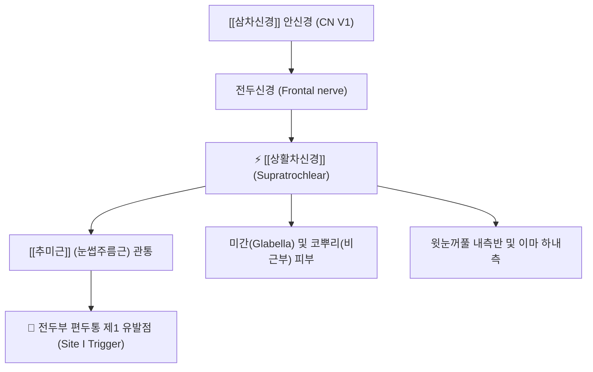

# ⚡ [[상활차신경]] (Supratrochlear Nerve / 上滑車神經, CN V1)

> **핵심 3줄 요약 (Key Summary)**:
> - 🗺️ 신경 기원 & 해부학적 주행: 삼차신경 제1지인 [[안신경]](Ophthalmic nerve, CN V1) 전두신경 분지, 상사근 활차(Trochlea) 상방을 통과하여 [[추미근]](Corrugator supercilii) 및 [[전두근]]을 뚫고 이마 내측 피하로 상행.
> - 🎯 운동 지배(근육군) & 감각 지배 영역: 순수 감각 신경. 미간(Glabella), 코뿌리(비근부), 상안검(윗눈꺼풀) 내측 및 이마 하내측 피부 감각 지배.
> - ⚠️ 호발 포착 부위 & 관련 임상 질환: [[추미근]] 실질 관통부(미간 주름근), [[전두부 편두통]](Frontal migraine trigger site 1), 미간 찌푸림 시 안와상부 신경통.
> - 🔍 주요 이학적 검사 & 신경학적 징후: 안와 상내측 연([[찬죽]]혈 부근) 압통 및 방사통, 미간 핀치(Pinch) 유발 검사.

---

## 1. 신경 기원 & 해부학적 분지 경로 (Anatomy & Course)

* **신경 기원 (Origin & Trigeminal Branch)**:
  * [[삼차신경]](CN V)의 제1 분지인 **[[안신경]](Ophthalmic nerve, CN V1)**의 주 줄기인 전두신경(Frontal nerve)에서 안와 내에서 분기하는 내측 가지입니다.
* **상세 주행 경로 (Detailed Pathway)**:
  1. **안와강 내 주행**: 상안검거근(Levator palpebrae superioris) 상면을 따라 전방으로 직행하다가, 상안와연에 도달하기 전 안와상신경의 내측에서 갈라져 나옵니다.
  2. **활차 통과**: 상사근 건을 지지하는 섬유연골성 고리인 활차(Trochlea)의 바로 윗부분을 스쳐 안와강을 빠져나옵니다.
  3. **[[추미근]] 관통**: 눈썹 안쪽 끝에 위치한 **[[추미근]](Corrugator supercilii)** 근육 섬유 및 비근근(Procerus) 외측부를 수직으로 뚫고 나옵니다.
  4. **이마 피하 상행**: [[전두근]](Frontalis) 심층 근막을 관통하여 피하로 올라온 뒤, 미간과 이마 하내측 피부로 방사상 분지합니다.

---

## 2. 신경 지배 맵 & 기능 네트워크 (Innervation Map)

### 1) 감각 지배 영역
* **미간 및 비근부**: 양 눈썹 사이 미간 피부 및 코뿌리 상부 피부.
* **안검 및 이마**: 윗눈꺼풀 내측 1/3 피부와 결막, 이마 중앙 하부 1/3 영역의 체성 감각(통각, 온각, 촉각).

---

## 3. 호발 포착 부위 & 터널 증후군 병태생리

* **추미근(Corrugator supercilii) 근복 관통 터널 (Bahman Guyuron 분류 Site I)**:
  * 컴퓨터 모니터 주시, 스트레스, 난시 또는 눈부심으로 인해 인상을 쓰며 미간을 찌푸리는 습관이 지속되면 추미근이 비후·경축되어 관통하는 상활차신경을 펜치처럼 쥐어짭니다.
* **골막-근막 유착 부위 (Supraorbital Rim Junction)**:
  * 안와 상내측 뼈 모서리에서 안와 중격(Orbital septum)과 전두골 골막이 만나는 섬유성 터널에서 신경이 견인 마찰을 받습니다.

---

## 4. 손상 레벨별 임상 증상 & 신경학적 결손

* **전두부 압박성 두통**: 눈썹 안쪽 및 미간 부위가 묵직하고 조여오는 듯한 통증이 발생하며, 눈을 치켜뜨거나 인상을 쓸 때 급격히 악화됩니다.
* **안구 내측 연관통**: 눈 안쪽 깊은 곳이 빠질 듯이 아프고 눈이 시린 증상이 동반됩니다.
* **이질통 및 감각 과민**: 눈썹 안쪽을 가볍게 건드리거나 세안할 때 이마 안쪽으로 찌릿한 불쾌감이 방사됩니다.

---

## 5. 관련 이학적 검사 & 신경 감별 매트릭스

* **[[찬죽]](BL2) 압진 검사 (Corrugator Pinch Test)**:
  * 눈썹 안쪽 끝 오목한 부위를 검지와 엄지로 집어 비틀거나 압박할 때 미간과 이마 안쪽으로 방사통이 재현되면 양성.
* **안와상신경(SON)과의 감별**:
  * 상활차신경(STN): 미간, 콧등 뿌리, 눈썹 내측단 통증.
  * [[안와상신경]](SON): 눈썹 중앙 1/3, 이마 전체 및 정수리(관상봉합)까지 넓게 방사되는 방전통.

---

## 6. 한의 신경 치료 프로토콜 (약침·침도·신경수기)

* **[[찬죽]](BL2) 침도 미세 박리술**:
  * 찬죽혈 부위 안와상연 골면에 침도를 접촉시켜 추미근 건막의 섬유성 조임을 횡방향으로 안전하게 미세 절개하여 신경 감압을 달성합니다.
* **미간 부위 신바로 약침**:
  * [[인당]](EX-HN3)과 찬죽혈 피하에 신바로 약침 또는 황련해독탕 약침 0.2cc를 주입하여 국소 무균성 신경염을 해소합니다.
* **미간 근막 이완술 (Glabellar Myofascial Release)**:
  * 양 엄지손가락으로 찬죽혈 부위 추미근을 외상방으로 부드럽게 밀어 올리며 근육 긴장을 해제합니다.

---

## 7. 💡 사용자 진료실 핵심 필기 & 임상 팁 (원문 보존)

* **"미간을 찌푸리면 머리가 지끈거려요"**:
  * 컴퓨터를 오래 보거나 집중할 때 인상을 쓰면서 이마 앞쪽이 조여오는 환자는 [[추미근]]에 상활차신경이 포착된 상태입니다.
  * [[찬죽]]혈의 추미근을 침도로 살짝 풀어주면 찌푸릴 때의 통증이 즉각 사라지고 눈 뜨기가 훨씬 편안해집니다.

---

## 8. 출처 및 학술 참고 문헌 (References)

* Ortiz R et al. (2020). "Migraine Surgery at the Frontal Trigger Site: An Analysis of Intraoperative Anatomy." *Plast Reconstr Surg*, 145(2): 523-531. [PMID: 31985652](https://pubmed.ncbi.nlm.nih.gov/31985652/)
  - [연구 요약]: 전두부 편두통 환자에서 상활차신경과 추미근 관통 경로의 해부학적 변이 분석 및 신경 감압 수술 성적 규명.
* Filipovic B et al. (2018). "Treatment of Frontal Secondary Headache Attributed to Supratrochlear and Supraorbital Nerve Entrapment With Oral Medication or Botulinum Toxin Type A vs Endoscopic Decompression Surgery." *JAMA Facial Plast Surg*, 20(5): 370-377. [PMID: 29801115](https://pubmed.ncbi.nlm.nih.gov/29801115/)
  - [연구 요약]: 상활차신경 및 안와상신경 포착성 전두부 두통 환자의 약물, 보툴리눔 독소 및 내시경 감압 치료 효과 비교.
* Lee HJ et al. (2015). "Topographic Relationship between the Supratrochlear Nerve and Corrugator Supercilii Muscle--Can This Anatomical Knowledge Improve the Response to Botulinum Toxin Injections in Chronic Migraine?" *Toxins (Basel)*, 7(7): 2608-2619. [PMID: 26193317](https://pubmed.ncbi.nlm.nih.gov/26193317/)
  - [연구 요약]: 상활차신경과 추미근의 3차원 지형 해부도를 정립하고 신경 압박 차단점의 임상 좌표 제시.
