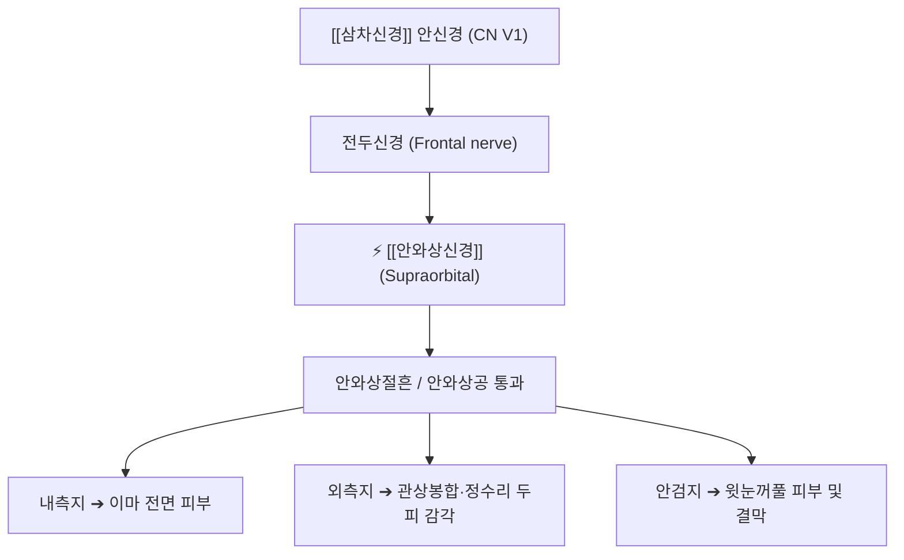

# ⚡ [[안와상신경]] (Supraorbital Nerve / 眼窩上神經, CN V1)

> **핵심 3줄 요약 (Key Summary)**:
> - 🗺️ 신경 기원 & 해부학적 주행: 삼차신경 [[안신경]](CN V1) 전두신경의 외측 주 분지, 안와 상벽을 따라 전방으로 주행하여 **안와상절흔(Supraorbital notch) 또는 안와상공(Foramen)**을 통과해 이마와 두피로 상행.
> - 🎯 운동 지배(근육군) & 감각 지배 영역: 순수 감각 신경. 윗눈꺼풀 중앙부, 결막, 이마([[전두부]]) 전면 및 두정부(정수리) 관상봉합선 부근까지 두피 감각 지배.
> - ⚠️ 호발 포착 부위 & 관련 임상 질환: 안와상절흔/공의 골성 인대 터널, [[안와상신경통]](Supraorbital neuralgia / Goggle headache, 안경·수경 압박통), 전두부 긴장성 [[편두통]].
> - 🔍 주요 이학적 검사 & 신경학적 징후: 안와상절흔(눈썹 안쪽 1/3 지점) 압진 시 번개 치는 듯한 방전통(티넬 징후), 이마 두피 이질통.

---

## 1. 신경 기원 & 해부학적 분지 경로 (Anatomy & Course)

* **신경 기원 (Origin & Trigeminal Branch)**:
  * [[삼차신경]](CN V)의 제1 분지인 **[[안신경]](Ophthalmic nerve, CN V1)**의 가장 굵고 긴 분지인 전두신경(Frontal nerve)에서 유래합니다.
* **상세 주행 경로 (Detailed Pathway)**:
  1. **안와강 통과**: 상안검거근(Levator palpebrae superioris) 상면을 따라 안와강 상벽 중앙을 전방으로 직행합니다.
  2. **안와상절흔/공 출구 통과**: 안와 상연 내측 1/3과 외측 2/3 경계에 위치한 **안와상절흔(Supraorbital notch)** 또는 골화된 섬유인대에 의해 형성된 **안와상공(Supraorbital foramen)**을 통과합니다.
  3. **내측지와 외측지 양분**: 안와상연을 넘어 전두골 표면으로 꺾여 올라간 뒤 두 개의 종말 분지로 갈라집니다:
     * **내측지(Medial branch)**: [[전두근]](Frontalis)을 뚫고 표층으로 나와 전두부 중앙 피부를 지배.
     * **외측지(Lateral branch)**: [[모상건막]](Galea aponeurotica) 심층을 따라 두정골 관상봉합(정수리)까지 길게 상행하여 심부 두피 감각을 지배.

---

## 2. 신경 지배 맵 & 기능 네트워크 (Innervation Map)

### 1) 감각 지배 영역
* **윗눈꺼풀 및 결막**: 윗눈꺼풀 중앙부 피부와 결막 상부.
* **이마 및 두피**: 눈썹 상방부터 이마 전체, 관상봉합선(Coronal suture)을 지나 정수리(두정부) 전반부까지의 체성 감각.

---

## 3. 호발 포착 부위 & 터널 증후군 병태생리

* **안와상절흔의 골성 인대 터널 (Supraorbital Notch/Foramen)**:
  * 안와상절흔 입구를 가로지르는 골화된 섬유성 인대(Supraorbital ligament)에 신경이 끼이거나, 완전한 뼈 구멍(Foramen) 형태로 갇혀 있을 때 외부 압박 및 견인에 대단히 취약해집니다.
* **외상 및 압박성 신경염 (수경 두통, Goggle Headache)**:
  * 수영 안경, 단단한 헬멧, 꽉 조이는 모자 테두리가 안와상절흔의 신경을 직접 압박할 때 허혈성 신경통이 발생합니다.
* **모상건막 및 전두근 유착**:
  * 스트레스로 인한 [[전두근]] 및 모상건막의 만성 경결은 신경의 [[신경가동술|활주 운동성]]을 제한하여 두피 당김과 작열감을 야기합니다.

---

## 4. 손상 레벨별 임상 증상 & 신경학적 결손

* **안와상신경통 (Supraorbital Neuralgia)**: 눈썹 위에서부터 이마, 정수리까지 전기가 오듯 찌릿찌릿 쏘는 발작통이 나타납니다.
* **두피 이질통 (Scalp Allodynia)**: 머리를 빗거나 모자를 쓸 때, 혹은 찬바람을 맞을 때 이마 두피가 따갑고 쓰라려 손을 대지 못합니다.
* **이마 감각 둔마**: 신경 압박이 지속되면 이마 앞쪽 피부 감각이 남의 살처럼 멍멍해지는 감각 저하가 발생합니다.

---

## 5. 관련 이학적 검사 & 신경 감별 매트릭스

* **안와상절흔 압통 검사 (SON Notch Sign)**:
  * 눈썹 안쪽 1/3 부위의 뼈 홈(Notch)을 손가락 끝으로 지그시 누를 때 이마 위로 번개 치듯 뻗치는 방전통(티넬 징후)이 나타나면 양성.
* **후두신경통과의 감별**:
  * 안와상신경통: 이마 앞쪽 및 눈 주위에서 시작하여 정수리로 상행.
  * [[대후두신경통]](GON): 뒷머리(후두부)에서 시작하여 정수리로 타고 넘어오는 통증.

---

## 6. 한의 신경 치료 프로토콜 (약침·침도·신경수기)

* **[[어요]](EX-HN4) 및 [[양백]](GB14) 침도 감압술**:
  * 안와상절흔 입구에 침도를 골막과 평행한 각도로 접근시켜 절흔을 가로지르는 비후된 섬유성 인대를 미세 박리합니다.
* **신바로 약침 및 전침 요법**:
  * 안와상연 피하에 신바로 약침 0.2~0.3cc를 주입하고, 어요와 양백에 2Hz 저주파 전침을 걸어 전두근 연축과 국소 염증을 신속히 배출합니다.
* **모상건막 견인 수기 (Galea Aponeurotica Release)**:
  * 손가락 끝으로 이마 헤어라인 부위의 모상건막을 부드럽게 두피에서 들어 올리듯 이완하여 신경 주행로를 확보합니다.

---

## 7. 💡 사용자 진료실 핵심 필기 & 임상 팁 (원문 보존)

* **"모자만 쓰면 이마가 저려요" - 안와상신경통 감별**:
  * 모자나 헬멧 테두리가 닿는 이마 부위가 아프다는 환자는 눈썹뼈 안쪽 안와상절흔을 만져보아야 합니다.
  * 뼈 홈 부위가 좁아져 신경이 눌려 있는 경우가 많으며, [[어요]]혈 주위를 침도로 1~2회 박리해주면 모자를 써도 통증이 재발하지 않습니다.

---

## 8. 출처 및 학술 참고 문헌 (References)

* Caminero AB & Pareja JA. (2001). "Supraorbital neuralgia: a clinical study." *Cephalalgia*, 21(3): 210-213. [PMID: 11442557](https://pubmed.ncbi.nlm.nih.gov/11442557/)
  - [연구 요약]: 안와상신경통의 전형적인 임상 양상, 안와상절흔 압통 진단 기준 및 국소 신경 차단술의 치료 효과 규명.
* Shimizu S. (2014). "[Scalp neuralgia and headache elicited by cranial superficial anatomical causes: supraorbital neuralgia, occipital neuralgia, and post-craniotomy headache]." *Rinsho Shinkeigaku*, 54(12): 1012-1014. [PMID: 24943074](https://pubmed.ncbi.nlm.nih.gov/24943074/)
  - [연구 요약]: 두개골 표재 신경(안와상신경, 후두신경)의 해부학적 포착과 난치성 두피 신경통의 병태생리 고찰.
* Filipovic B et al. (2018). "Treatment of Frontal Secondary Headache Attributed to Supratrochlear and Supraorbital Nerve Entrapment With Oral Medication or Botulinum Toxin Type A vs Endoscopic Decompression Surgery." *JAMA Facial Plast Surg*, 20(5): 370-377. [PMID: 29801115](https://pubmed.ncbi.nlm.nih.gov/29801115/)
  - [연구 요약]: 안와상신경 및 상활차신경 감압 수술의 전두부 편두통 호전 효과 검증.
