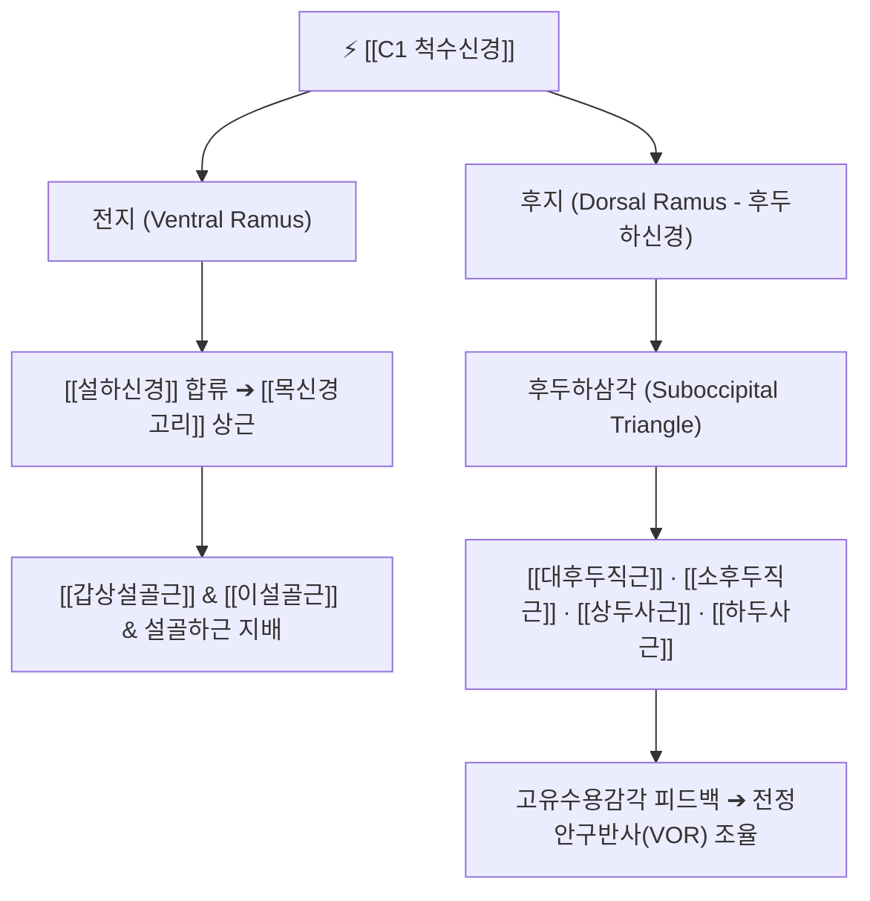

# ⚡ [[C1 척수신경]] (C1 Spinal Nerve / 제1경신경)

> **핵심 3줄 요약 (Key Summary)**:
> - 🗺️ 신경 기원 & 해부학적 주행: 후두골(C0)과 제1경추(환추, C1) 사이의 대후두공 하방 후두하 공간으로 분지, 추골동맥구(Vertebral groove)를 지나 전지와 후지로 분지.
> - 🎯 운동 지배(근육군) & 감각 지배 영역: 후근 신경절이 결여되어 대부분 순수 운동신경으로 작용. 후지는 [[후두하신경]]이 되어 4대 [[후두하근]](대후두직근, 소후두직근, 상두사근, 하두사근)을 지배하고, 전지는 [[목신경고리]] 상근을 형성.
> - ⚠️ 호발 포착 부위 & 관련 임상 질환: 상부경추 부정렬(C0-C1 아탈구) 및 후두하삼각 근육 과긴장, [[경추성 두통]](Cervicogenic headache), 후두하신경 포착 증후군, 만성 안정피로.
> - 🔍 주요 이학적 검사 & 신경학적 징후: 상부경추 굴곡-회전 검사(FRT), 후두하삼각 압진 시 안와·정수리 방사통, 전정안구반사(VOR) 이상.

---

## 1. 신경 기원 & 해부학적 분지 경로 (Anatomy & Course)

* **신경 기원 (Spinal Segments & Origin)**:
  * 경수 제1분절(C1 segment)에서 기원하여, 후두골(C0)과 환추(C1, Atlas) 후궁 사이의 후두환추관절막 상방으로 빠져나옵니다.
  * 약 50~80%의 개체에서 후근(Dorsal root) 및 후근신경절(DRG)이 완전히 결여되어 있어 고유한 피부 감각 분절(Dermatome)을 형성하지 않는 순수 운동신경의 특성을 띱니다.
* **상세 주행 경로 (Detailed Pathway)**:
  1. **추골동맥 동행**: 추골동맥(Vertebral artery)과 함께 환추 후궁 상면의 추골동맥구(Vertebral groove)를 지나며 즉시 전지(Ventral ramus)와 후지(Dorsal ramus)로 양분됩니다.
  2. **후지 (Dorsal Ramus - [[후두하신경]])**: 추골동맥 심부에서 후두하삼각(Suboccipital triangle) 내부로 진입하여 후두하근군으로 분지합니다.
  3. **전지 (Ventral Ramus)**: 환추 외측괴 앞쪽으로 돌아내려가 [[설하신경]](CN XII) 줄기에 합류하여 [[목신경고리]](Ansa cervicalis) 상근 형성에 기여합니다.

---

## 2. 신경 지배 맵 & 기능 네트워크 (Innervation Map)

### 1) 후두하 운동 지배 및 고유수용성 센터
* **후두하 4대 근육군**: [[대후두직근]], [[소후두직근]], [[상두사근]], [[하두사근]]을 전담 운동 지배합니다.
* **근방추(Muscle Spindle) 최고 밀도 부위**: 후두하근군은 인체 골격근 중 단위 그램당 근방추 밀도가 가장 높은 부위로, C1 신경은 두경부의 3차원 미세 자세 정렬 및 안구 운동과의 협응 피드백(전정안구반사)을 조율하는 핵심 감각-운동 통합 센터입니다.

### 2) 전지의 설골 운동 지배
* 설하신경에 편승한 C1 섬유는 [[갑상설골근]](Thyrohyoid)과 [[이설골근]](Geniohyoid)을 직접 운동 지배하며, 목신경고리 상근을 통해 연하 및 발성 시 설골 하강을 보조합니다.

---

## 3. 호발 포착 부위 & 터널 증후군 병태생리

* **후두하삼각(Suboccipital Triangle) 근막성 조임**:
  * 상두사근, 하두사근, 대후두직근으로 둘러싸인 삼각형 공간에서 두경부 전방 굴곡(거북목) 자세가 장기화되면 근육들이 단축·경결되어 C1 후지와 추골동맥을 기계적으로 포착합니다.
* **C0-C1 관절 아탈구 및 환추 후궁 비후**:
  * 후두환추관절의 회전·측굴 부정렬이 발생하면 후두골 하연과 환추 후궁 사이 간극이 좁아지며 신경 출구가 직접 압박됩니다.
* **삼차신경-경부 복합체 (Trigeminocervical Complex, TCC) 흥분**:
  * C1 신경의 고유수용성 자극 이상과 무균성 신경염은 뇌간의 삼차신경 척수로핵 미측부(Pars caudalis)로 구심 신호를 전달하여 안와 뒤쪽, 이마, 관자놀이로 연관통을 투사합니다.

---

## 4. 손상 레벨별 임상 증상 & 신경학적 결손

* **경추성 두통 (Cervicogenic Headache)**: 뒷머리 밑바닥(후두하부)이 묵직하게 조여오면서 눈 안쪽 깊은 부위까지 쑤시고 뻐근한 두통이 지속됩니다.
* **만성 시각 피로 및 미세 어지럼증**: 책이나 모니터를 주시할 때 후두하근의 지속 연축으로 초점 조절 장애, 안정피로(Asthenopia), 고개 회전 시 붕 뜨는 듯한 어지럼이 유발됩니다.
* **후두하 신경통성 근경련**: 목 뒤쪽을 젖히거나 돌릴 때 후두골 직하부에 쥐가 나는 듯한 강한 수축통이 발생합니다.

---

## 5. 관련 이학적 검사 & 신경 감별 매트릭스

* **경추 굴곡-회전 검사 (Flexion-Rotation Test, FRT)**:
  * 환자의 경추를 최대로 수동 굴곡시킨 상태(하부 경추 고정)에서 좌우 회전 각도를 측정. 정상(45도) 대비 10도 이상 감소하거나 후두통 유발 시 C1-C2 분절 병변 양성.
* **후두하삼각 압진 검사**:
  * [[풍지]](GB20) 내측 후두하삼각 오목한 부위를 엄지로 압박했을 때 두정부나 안와 후부로 연관통이 투사되면 양성.

---

## 6. 한의 신경 치료 프로토콜 (약침·침도·신경수기)

* **후두하 이완 추나요법 (Suboccipital Release)**:
  * 앙와위 환자의 후두골 하연(C0-C1 접합부)에 양손 손가락 패드를 거치하고 환자의 머리 무게를 활용하여 상미측으로 부드럽게 지속 견인합니다. C0-C1 관절 간격을 확보하여 C1 신경 및 추골동맥 감압을 유도합니다.
* **[[풍지]](GB20), [[아문]](GV15), [[천주]](BL10) 침치료**:
  * 후두하삼각 경혈점에 0.25×40mm 침을 사용하여 코끝 방향으로 안전한 심도로 자침, 후두하근군의 허혈성 경축을 해소합니다.
* **후두하 신바로 약침**:
  * 풍지혈 및 C1 횡돌기 주변에 신바로 약침 0.3~0.5cc를 분주하여 신경 주위 무균성 염증을 제거합니다 (추골동맥 주행 부위이므로 해부학적 심도를 철저히 준수).

---

## 7. 💡 사용자 진료실 핵심 필기 & 임상 팁 (원문 보존)

* **후두하근 긴장과 안정피로 연계**:
  * 후두하근군은 안구 운동과 직접적으로 연결(전정안구반사)되어 있어, 눈을 많이 써서 피로하거나 뒷목이 뻐근한 환자는 C1 후두하신경 지배 영역인 [[풍지]]혈과 후두하삼각을 침으로 풀어주면 눈이 즉각 밝아지고 머리가 맑아집니다.
* **C0-C1 아탈구와 상부경추 추나**:
  * 경추성 두통 환자에서 C0-C1 관절의 후두하 이완술을 3분간 지속 견인해주면 두개강 내 정맥 순환이 개선되며 만성 두통이 극적으로 경감됩니다.

---

## 8. 출처 및 학술 참고 문헌 (References)

* Bogduk N. (1992). "The anatomical basis for cervicogenic headache." *J Manipulative Physiol Ther*, 15(1): 67-70. [PMID: 1740655](https://pubmed.ncbi.nlm.nih.gov/1740655/)
  - [연구 요약]: 상부 경추 C1-C3 신경근과 삼차신경 척수로핵 간의 신경학적 수렴(Trigeminocervical convergence) 메커니즘과 경추성 두통 유발 기전 규명.
* Standring S. (2020). *Gray's Anatomy: The Anatomical Basis of Clinical Practice*. 42nd ed. Elsevier, pp. 745-752.
  - [연구 요약]: 제1경신경의 발생학적 무신경절 특성과 후두하신경 및 경신경고리 상근으로의 주행 분지 체계 총괄.
* Waxenbaum JA et al. (2026). "Anatomy, Head and Neck: Cervical Nerves." *StatPearls Publishing*. [PMID: 30844163](https://pubmed.ncbi.nlm.nih.gov/30844163/)
  - [연구 요약]: C1을 포함한 경추 신경근의 분절별 주행 경로 및 임상 해부학적 특성 정리.
