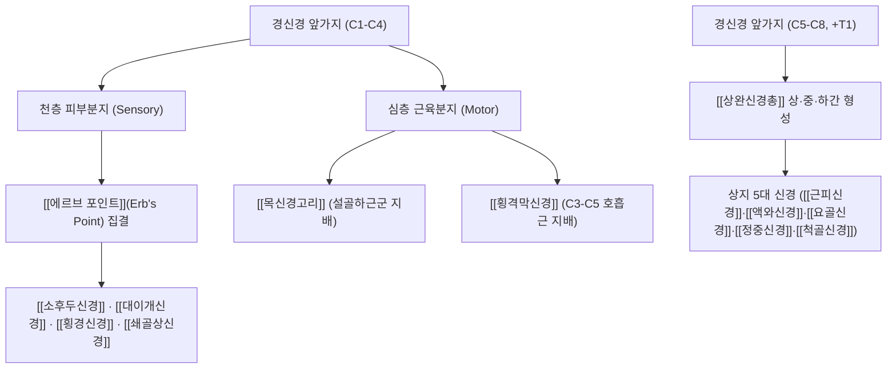

# ⚡ [[경신경 앞가지]] (Anterior Rami of Cervical Nerves / 경신경 전지)

> **핵심 3줄 요약 (Key Summary)**:
> - 🗺️ 신경 기원 & 해부학적 주행: C1부터 C8까지 8쌍의 경추 척수신경에서 분지되어 경부 전외측과 상지로 주행하는 주요 신경근 전지 복합체.
> - 🎯 운동 지배(근육군) & 감각 지배 영역: C1-C4 앞가지는 [[경신경총]]을 형성하여 두경부 피부 감각 및 [[횡격막신경]]을 구성하고, C5-C8 앞가지는 [[상완신경총]]을 이루어 상지 운동·감각을 전담 지배.
> - ⚠️ 호발 포착 부위 & 관련 임상 질환: [[사각근]] 간극 통과 부위에서 [[전사각근]] 및 [[중사각근]] 경결 시 [[흉곽출구 증후군]](TOS)과 경추 신경근증 유발.
> - 🔍 주요 이학적 검사 & 신경학적 징후: 애드슨 검사(Adson test), 에덴 검사, 상지 신경인장검사(ULTT), 경추 추간공 압박 검사(Spurling).

---

## 1. 신경 기원 & 해부학적 분지 경로 (Anatomy & Course)

* **해부학적 구성 (C1~C8 Anterior Rami)**:
  * 척수에서 나온 전근과 후근이 합류하여 짧은 척수신경간을 형성한 직후, 척추기립근과 후두하부로 가는 후지(Dorsal rami)를 뒤로 보내고, 훨씬 굵은 줄기인 **전지(Ventral rami, 앞가지)**가 경부 전외측으로 주행합니다.
* **상세 주행 경로 및 2대 신경총 형성**:
  1. **상부 경신경 앞가지 (C1-C4)**: 중사각근 및 견갑거근 전면을 하외측으로 주행하며 문합 고리를 형성하여 **[[경신경총]]**(Cervical plexus)을 구축합니다.
  2. **하부 경신경 앞가지 (C5-C8)**: 전사각근과 중사각근 사이의 사각근 간극(Interscalene triangle)을 비스듬히 통과한 뒤 제1흉신경(T1) 앞가지와 합류하여 **[[상완신경총]]**(Brachial plexus)을 형성합니다.

| 경신경 분절 | 주 형성 구조 | 주요 지배 영역 및 분지 |
| :--- | :--- | :--- |
| **C1 앞가지** | 경신경총 상근, [[목신경고리]] 형성 | [[설하신경]]과 합류, [[갑상설골근]], [[이설골근]] 지배 |
| **C2-C3 앞가지** | 경신경총 천층/심층 지 | [[소후두신경]], [[대이개신경]], [[횡경신경]], 목신경고리 하근 |
| **C3-C5 앞가지** | [[횡격막신경]] (Phrenic nerve) | [[횡격막]](호흡 운동 100%), 심낭, 종격동 흉막 |
| **C4 앞가지** | 경신경총 하부 지 | [[쇄골상신경]](Supraclavicular n.), 상완신경총 교통지 |
| **C5-C6 앞가지** | [[상완신경총]] 상간(Upper trunk) | 어깨 외전·외회전, 주관절 굴곡, 상완 외측 감각 |
| **C7 앞가지** | [[상완신경총]] 중간(Middle trunk) | 주관절 신전, 완관절 굴곡/신전, 수부 중심 감각 |
| **C8 앞가지** | [[상완신경총]] 하간(Lower trunk, +T1) | 수지 내재근, 수부 내측 감각, [[척골신경]] 지배 |

---

## 2. 신경 지배 맵 & 기능 네트워크 (Innervation Map)

### 1) 흉쇄유돌근 후연 신경점 (Erb's Point)
* C2~C4 앞가지에서 유래한 4대 천층 감각신경(소후두, 대이개, 횡경, 쇄골상신경)이 [[흉쇄유돌근]](SCM) 후연 중간 1/3 지점에서 한데 모여 경부 심부근막을 관통합니다.

### 2) 횡격막 신경의 보존
* "C3, 4, 5 keep the diaphragm alive"라는 해부학적 격언처럼, 상부 경신경 앞가지의 보존 여부는 척수 손상 환자에서 자발 호흡 유지의 결정적 척도입니다.

---

## 3. 호발 포착 부위 & 터널 증후군 병태생리

* **사각근 간극 (Interscalene Triangle)**:
  * **전방**: [[전사각근]](Scalenus anterior).
  * **후방**: [[중사각근]](Scalenus medius).
  * **하방**: 제1늑골(First rib) 상면.
  * C5부터 C8 경신경 앞가지와 쇄골하동맥이 이 좁은 간극을 통과합니다. 거북목([[일자목]]), 라운드 숄더, 흉식 호흡 과다 등으로 사각근이 비후·단축되면 앞가지들이 기계적으로 압박받습니다.
* **경추 추간공 외측 출구**:
  * 구추관절(Luschka joint)의 골극 형성이나 경추 디스크 탈출 시 전지가 기원부에서 직접 압박됩니다.

---

## 4. 손상 레벨별 임상 증상 & 신경학적 결손

* **흉곽출구 증후군 (TOS)**: C8-T1 앞가지 압박 시 넷째·다섯째 손가락 및 전완 내측의 저림, 파악력 저하, 수부 냉감이 나타나며, C5-C7 압박 시 어깨와 상완 외측으로 통증이 투사됩니다.
* **경추 신경근증 (Cervical Radiculopathy)**: 목을 젖히거나 아픈 쪽으로 돌릴 때 상지로 전기가 통하듯 날카로운 방사통이 발생합니다.
* **호흡근 기능부전**: C3-C5 분절 자극 시 횡격막 경련성 수축 및 만성적인 얕은 호흡, 가슴 답답함이 야기됩니다.

---

## 5. 관련 이학적 검사 & 신경 감별 매트릭스

* **애드슨 검사 (Adson Test)**:
  * 환자의 요골동맥 박동을 촉지한 상태에서 팔을 외전·신전시키고, 환자가 고개를 환측으로 돌려 턱을 든 채 깊은 흡기를 유지하게 함. 요골동맥 박동 감소 또는 상지 저림 재현 시 사각근 간극 신경혈관 압박 양성.
* **상지 신경인장검사 (Upper Limb Tension Test, ULTT 1 - 정중신경 바이어스)**:
  * 견갑골 하강, 어깨 외전 110도, 외회전, 완관절 및 수지 신전 후 주관절 신전 시 상지 방사통 유발 여부 확인.

---

## 6. 한의 신경 치료 프로토콜 (약침·침도·신경수기)

* **사각근 근막이완 추나요법 및 제1늑골 하강술**:
  * 환자의 두경부를 반대측으로 회전 및 측굴시킨 상태에서 전사각근과 중사각근을 부드럽게 신장하고, 호기 시 제1늑골을 미측으로 가압하여 사각근 간극을 물리적으로 넓힙니다.
* **경추 협척혈(華佗夾脊穴) 침도 감압술**:
  * 경신경 앞가지가 갈라져 나오는 추간공 외측 1.5cm 부위 협척혈에 침도를 골막에 평행하게 접근시켜 추간공 외측 인대성 결합조직을 미세 절개합니다.
* **사각근 신바로 약침 요법**:
  * [[천정]](LI17), [[부돌]](LI18), [[결분]](ST12) 부위 사각근 유착부에 신바로 약침 0.3~0.5cc를 분주하여 신경 주위 염증성 부종을 신속히 가라앉힙니다.

---

## 7. 💡 사용자 진료실 핵심 필기 & 임상 팁 (원문 보존)

* **팔이 저린데 목 디스크가 아니라는 환자 (사각근 감별)**:
  * MRI상 목 디스크는 경미한데 팔 전체가 저리고 밤마다 손이 붓는 환자는 십중팔구 사각근 간극에서 C5-C8 앞가지가 찝힌 상태입니다.
  * 쇄골 위 결분혈 부위에서 전사각근과 중사각근 사이를 엄지로 튕겨주었을 때 팔로 전기가 찌릿 흐르면 사각근 포착으로 진단하고, 사각근 약침과 제1늑골 교정 추나를 시행하면 1~2회 만에 저림이 극적으로 완화됩니다.

---

## 8. 출처 및 학술 참고 문헌 (References)

* Sanders RJ et al. (2007). "Diagnosis of thoracic outlet syndrome." *J Vasc Surg*, 46(3): 601-604. [PMID: 17826254](https://pubmed.ncbi.nlm.nih.gov/17826254/)
  - [연구 요약]: 사각근 간극에서의 경신경 앞가지 포착에 의한 신경인성 흉곽출구증후군의 진단 기준과 임상 검사법 제시.
* Standring S. (2020). *Gray's Anatomy: The Anatomical Basis of Clinical Practice*. 42nd ed. Elsevier, pp. 745-752.
  - [연구 요약]: 경신경 앞가지 8쌍의 해부학적 경로, 경신경총 및 상완신경총 형성 패턴과 사각근 간극 주행 특성 기술.
* Waxenbaum JA et al. (2026). "Anatomy, Head and Neck: Cervical Nerves." *StatPearls Publishing*. [PMID: 30844163](https://pubmed.ncbi.nlm.nih.gov/30844163/)
  - [연구 요약]: 경신경 전지의 분절별 신경총 구성 및 임상적 손상 기전 총괄.
