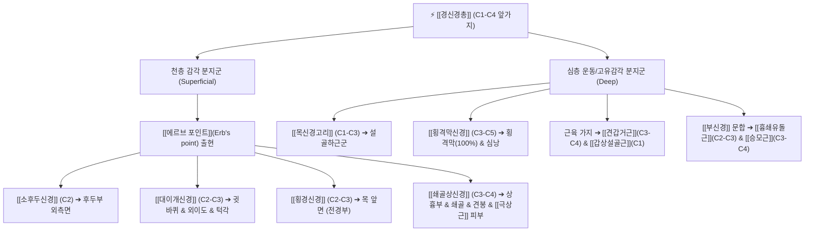

# ⚡ [[경신경총]] (Cervical Plexus / 頸神經叢, C1-C4)

> **핵심 3줄 요약 (Key Summary)**:
> - 🗺️ 신경 기원 & 해부학적 주행: 제1~4경신경(C1-C4) 앞가지에서 형성되어, [[흉쇄유돌근]](SCM) 바닥 깊이 위치하며 중사각근 및 견갑거근 전면에서 상하 문합 고리를 형성.
> - 🎯 운동 지배(근육군) & 감각 지배 영역: 천층 지는 4대 피하신경([[소후두신경]], [[대이개신경]], [[횡경신경]], [[쇄골상신경]])으로 두경부·전경부·어깨 피부 감각 지배. 심층 지는 [[목신경고리]](설골하근군), [[횡격막신경]](C3-C5), [[견갑거근]]·[[승모근]]·[[흉쇄유돌근]] 고유수용성 지배.
> - ⚠️ 호발 포착 부위 & 관련 임상 질환: SCM 후연 중간부 [[에르브 포인트]](Erb's point), 경추 횡돌기 부착부 근막 비후, 두경부 만성 신경통, 거북목성 긴장.
> - 🔍 주요 이학적 검사 & 신경학적 징후: Erb's point 압진 티넬 징후(귀·목·쇄골 방사통), 두경부 피부분절 감각 매핑.

---

## 1. 신경 기원 & 해부학적 분지 경로 (Anatomy & Course)

* **신경 기원 (Spinal Segments)**:
  * 제1, 2, 3, 4 경추 척수신경(C1-C4)의 **전지(Ventral rami, 앞가지)**가 경추 횡돌기 사이를 빠져나와 서로 연결되는 3개의 고리(Loops)를 형성하며 구축됩니다.
* **상세 주행 경로 (Detailed Pathway)**:
  1. **심부 주행**: 경추 전방의 두장근, 경장근 외측 및 [[중사각근]](Scalenus medius), [[견갑거근]](Levator scapulae)의 전면에서 경부 심부근막 프리베르테브랄 층의 심층을 주행합니다.
  2. **흉쇄유돌근(SCM)과의 관계**: [[흉쇄유돌근]](Sternocleidomastoid)의 바닥 깊은 곳에 안착하며, 내경정맥과 경동맥초의 후외측에 위치합니다.
  3. **천층과 심층 분지군의 양분**:
     * **천층 피하지 (Superficial branches)**: SCM 후연 중간의 **[[에르브 포인트]](Erb's point)**에서 경부 심부근막을 뚫고 피하로 올라와 4개 방향으로 방사.
     * **심층 근육지 (Deep branches)**: 전외측 근육군([[목신경고리]], [[횡격막신경]], 척추주위근)으로 직행.

---

## 2. 신경 지배 맵 & 기능 네트워크 (Innervation Map)

### 1) 운동 신경 지배 (Motor Innervation)
* **C1 전지**: [[설하신경]]에 편승하여 [[갑상설골근]](Thyrohyoid)과 [[이설골근]]을 운동 지배.
* **C1-C3 전지**: [[목신경고리]](Ansa cervicalis)를 완성하여 3대 설골하근([[흉골설골근]], [[흉골갑상근]], [[견갑설골근]]) 운동 지배.
* **C3-C5 분지**: [[횡격막신경]](Phrenic nerve)을 구성하여 주 호흡근인 [[횡격막]]을 전담 운동 지배.
* **C3-C4 분지**: [[견갑거근]](Levator scapulae)을 직접 지배하며, [[상완신경총]] C5-C8과 함께 [[전사각근]], [[중사각근]] 지배에 관여.
* **[[부신경]](CN XI) 협응**: [[흉쇄유돌근]]은 C2, C3 앞가지, [[상부승모근]]은 C3, C4 앞가지와 부신경을 통해 협동 지배받음.

### 2) 감각 신경 지배 (Sensory Innervation)
* 후두부 외측면, 외이도 및 귓바퀴, 목의 앞면(전경부), 상흉부(제2늑골 높이까지), 어깻죽지(견봉 부위) 및 [[극상근]] 부위의 피부 감각을 C2-C4 감각 신경망이 총괄합니다.

---

## 3. 호발 포착 부위 & 터널 증후군 병태생리

* **흉쇄유돌근(SCM) 후연 중간부 포착**:
  * C2-C4에서 나오는 후두부 외측면, 외이도, 목의 앞면, 상흉부, 어깻죽지, 극상근의 피부감각을 지배하는 4대 피하신경은 주로 **[[흉쇄유돌근]] 중간에서 포착**됩니다.
* **거북목 및 편타 손상(Whiplash)**:
  * 경추 전만 소실과 함께 SCM 및 사각근이 만성 연축되면 경신경총 줄기가 경추 횡돌기와 근육 사이에서 지속적인 기계적 마찰을 받습니다.

---

## 4. 손상 레벨별 임상 증상 & 신경학적 결손

* **천경신경총 증후군**: 귀 뒤, 귓바퀴 주변, 목 앞, 쇄골 상부가 동시에 쑤시고 타는 듯하거나 남의 살처럼 멍멍함.
* **호흡곤란 및 딸꾹질**: C3-C5 횡격막신경 자극 또는 압박으로 인한 얕은 호흡, 만성 딸꾹질, 가슴 답답함.
* **연하 장애 및 경부 긴장**: 목신경고리 및 C1 분지 기능이상으로 침이나 음식물을 삼킬 때 목 앞이 조여오는 불쾌감.

---

## 5. 관련 이학적 검사 & 신경 감별 매트릭스

* **Erb's Point 압진 검사**: SCM 후연 중간 지점을 압박하여 귀, 목 앞, 쇄골, 어깨 견봉 부위로 방사되는 통증 여부 확인.
* **경추 가동범위 검사**: 경추 회전 및 측굴 시 SCM과 견갑거근 부착부의 긴장 및 신경 방사통 재현 평가.

---

## 6. 한의 신경 치료 프로토콜 (약침·침도·신경수기)

* **SCM 후연 Erb's Point 침도 감압술**:
  * 천정(LI17) 외방 Erb's point에 침도를 피하 각도로 얕게 자입하여 심부근막 출구의 유착을 미세 절개합니다.
* **경신경총 복합 약침 요법**:
  * Erb's point 및 C2-C4 경추 횡돌기 결절 주변에 신바로 약침 0.5cc를 분주하여 신경 주위 무균성 염증과 부종을 해소합니다.
* **SCM 및 전사각근 근막 이완 수기**:
  * SCM 근복을 집게손가락으로 가볍게 들어 올리며 반대측 경추 회전을 유도하여 경신경총 주행 공간을 확보합니다.

---

## 7. 💡 사용자 진료실 핵심 필기 & 임상 팁 (원문 보존)

* **경신경총 해부학적 기원과 근육 지배 핵심 공식**:
  * C1-C4 척수신경의 앞가지에서 형성되어 [[흉쇄유돌근]] 바닥 깊이 위치한다.
  * C1: [[갑상설골근]]
  * C3,4: [[상완신경총]]으로 나온 C5와 합쳐져 가로막, 심막 지배, C5-8과 함께 전사각근, 중사각근 지배
  * [[흉쇄유돌근]]은 C2,3 앞가지, [[상부승모근]]은 C3,4 앞가지와 부신경을 통해 운동신경을 지배받음
  * C2-4에서 나오는 후두부 외측면, 외이도, 목의 앞면, 상흉부, 어깻죽지, [[극상근]]의 피부감각을 지배하는 신경은 주로 [[흉쇄유돌근]] 중간에서 포착된다.
  * C3,4 앞가지는 [[견갑거근]] 지배

---

## 8. 출처 및 학술 참고 문헌 (References)

* Prigge L et al. (2026). "Anatomical study of the superficial cervical plexus targeted for sensory nerve blocks in neonates." *Reg Anesth Pain Med*, 51(8): 612-619. [PMID: 40866302](https://pubmed.ncbi.nlm.nih.gov/40866302/)
  - [연구 요약]: 경신경총의 형성과 Erb's point 4대 피하지의 분지 변이 및 국소마취 차단술의 정밀 해부학적 랜드마크 분석.
* Waxenbaum JA et al. (2026). "Anatomy, Head and Neck: Cervical Nerves." *StatPearls Publishing*. [PMID: 30844163](https://pubmed.ncbi.nlm.nih.gov/30844163/)
  - [연구 요약]: C1-C4 경신경총의 분절별 운동 및 감각 지배 네트워크와 임상 신경 손상 기전 총괄.
* Standring S. (2020). *Gray's Anatomy: The Anatomical Basis of Clinical Practice*. 42nd ed. Elsevier, pp. 745-752.
  - [연구 요약]: 경신경총의 3대 문합 고리, 심층 근육지 및 천층 피하지의 표준 해부학 기술.
