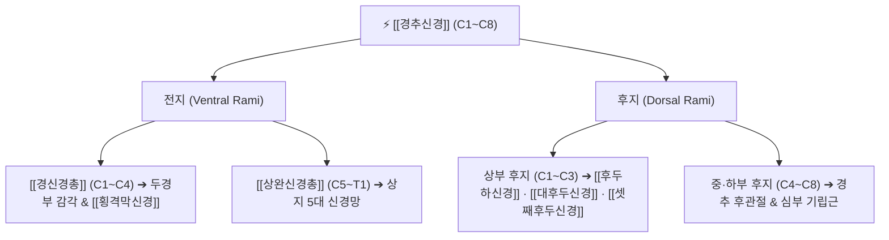

# ⚡ [[경추신경]] (Cervical Nerves / 목신경, C1~C8)

> **핵심 3줄 요약 (Key Summary)**:
> - 🗺️ 신경 기원 & 해부학적 주행: 7개의 경추골 사이 추간공을 통해 분지하는 8쌍의 척수신경(C1~C8)으로, 전지와 후지로 나뉘어 두경부와 상지 전체를 지배.
> - 🎯 운동 지배(근육군) & 감각 지배 영역: 전지는 [[경신경총]](C1~C4)과 [[상완신경총]](C5~T1)을 형성하고, 후지는 후두부 감각과 척추주위 심부근 및 경추 후관절을 지배.
> - ⚠️ 호발 포착 부위 & 관련 임상 질환: 경추 추간판 탈출증(HIVD) 및 구추관절 골극 형성에 의한 [[경추 신경근병증]](Cervical Radiculopathy), 후관절 관절증.
> - 🔍 주요 이학적 검사 & 신경학적 징후: 스펄링 검사(Spurling's test), 바코디 징후(Bakody's sign), 경추 견인 검사(Distraction test), 분절별 심부건반사(DTR).

---

## 1. 신경 기원 & 해부학적 분지 경로 (Anatomy & Course)

* **8쌍의 경추신경(C1~C8)과 7개의 경추골(C1~C7) 관계**:
  * **C1 신경**: 후두골(C0)과 제1경추(환추, C1) 사이에서 분지.
  * **C2~C7 신경**: **해당 번호 경추골의 "위쪽" 추간공**을 통해 주행 (예: C5 신경근은 C4-C5 추간공을 통해 출구).
  * **C8 신경**: 제7경추(C7)와 제1흉추(T1) 사이 추간공으로 분지.
* **전근(Ventral root)과 후근(Dorsal root)의 합류**:
  * 척수에서 나온 전근(운동신경)과 후근(후근신경절 DRG, 감각신경)이 추간공 내에서 합쳐져 짧은 척수신경 본간(Spinal nerve trunk)을 이룬 뒤, 즉시 **전지(Ventral ramus)**와 **후지(Dorsal ramus)**로 양분됩니다.

---

## 2. 신경 지배 맵 & 기능 네트워크 (Innervation Map)

### 1) 후지(Dorsal Rami)의 분포 및 후관절 지배
* **상부 후지 (C1~C3)**:
  * **C1 후지**: [[후두하신경]](순수 운동) $\rightarrow$ 4대 [[후두하근]] 지배.
  * **C2 후지**: 내측지가 [[대후두신경]](GON)이 되어 후두부~정수리 두피 감각 지배.
  * **C3 후지**: 내측지가 [[셋째후두신경]](TON)이 되어 C2-C3 후관절 및 후두하부 감각 지배.
* **중·하부 후지 (C4~C8)**:
  * **내측지(Medial branch)**: 경추 후관절(Facet joint)과 심부 기립근([[다열근]], [[회선근]], 경반극근) 지배 $\rightarrow$ 만성 경추성 후관절증 통증의 핵심 전달로.
  * **외측지(Lateral branch)**: 판상근, 장늑근 등 표층 신전근 지배.

### 2) 분절별 근육분절(Myotome) & 피부분절(Dermatome)

| 신경 분절 | 핵심 운동 지배 (Myotome) | 핵심 감각 지배 (Dermatome) | 심부건반사 (DTR) |
| :--- | :--- | :--- | :--- |
| **C1~C2** | 경부 굴곡 및 회전 | 두정부, 후두부 | - |
| **C3** | 경부 측굴 | 목 외측, 하악각 하방 | - |
| **C4** | 어깨 거상 ([[승모근]], [[견갑거근]]) | 쇄골 상부, 어깨 견봉 전면 | - |
| **C5** | 어깨 외전 ([[삼각근]], [[극하근]]) | 상완 외측 (삼각근 부착부) | 이두근건 반사 (Biceps reflex) |
| **C6** | 주관절 굴곡 ([[상완이두근]]), 완관절 신전 | 전완 외측, 모지 및 시지 (1-2지) | 상완요골근건 반사 (Brachioradialis) |
| **C7** | 주관절 신전 ([[상완삼두근]]), 완관절 굴곡 | 중지 (3지) 및 손등 중앙 | 삼두근건 반사 (Triceps reflex) |
| **C8** | 수지 굴곡 ([[심지굴근]]), 파악력 | 전완 내측, 약지 및 소지 (4-5지) | - |

---

## 3. 호발 포착 부위 & 터널 증후군 병태생리

* **경추 추간공 협착 (Intervertebral Foramen Stenosis)**:
  * 연성 디스크(Soft disc): 경추 추간판 탈출증(HIVD)으로 인한 수핵 돌출이 신경근을 기계적 압박 및 화학적 염증 자극.
  * 경성 디스크(Hard disc): 구추관절(Luschka joint)의 골극 형성이나 후관절 퇴행성 비후로 인한 신경관 협소화.
* **사각근 간극 및 소흉근 하부 (Double Crush Syndrome)**:
  * 신경근 기저부의 압박과 원위부 말초신경 포착이 병발하여 신경 축삭 수송 장애가 증폭됩니다.

---

## 4. 손상 레벨별 임상 증상 & 신경학적 결손

* **C5 신경근병증**: 삼각근 위축, 어깨 외전 약화, 상완 외측 둔마.
* **C6 신경근병증 (최호발)**: 완관절 신전 력 약화, 엄지·검지 저림, 이두근 반사 저하.
* **C7 신경근병증 (최호발)**: 삼두근 약화로 밀기 동작 제한, 가운뎃손가락 저림, 삼두근 반사 소실.
* **C8 신경근병증**: 손가락 쥐는 힘 약화, 넷째·다섯째 손가락 저림, 미세 수기 동작 장애.

---

## 5. 관련 이학적 검사 & 신경 감별 매트릭스

* **스펄링 검사 (Spurling's Test)**:
  * 환자의 경추를 신전하고 아픈 쪽으로 회전·측굴시킨 후 머리 위에서 수직 압박을 가할 때, 상지로 전기가 통하듯 방사통이 재현되면 양성 (특이도 > 90%).
* **바코디 징후 (Bakody's Sign / Shoulder Abduction Relief Test)**:
  * 환자가 아픈 팔을 들어 손을 머리 위에 얹었을 때 신경근의 장력이 느슨해지며 상지 방사통이 즉각 완화되면 경추 신경근병증 양성.
* **경추 견인 검사 (Cervical Distraction Test)**:
  * 환자가 누운 상태에서 머리를 위로 부드럽게 견인할 때 통증이 감소하면 양성.

---

## 6. 한의 신경 치료 프로토콜 (약침·침도·신경수기)

* **협척혈(夾脊穴) 신경근 약침술**:
  * 이환 분절 C4~C7 추간공 외측 1.5cm 협척혈에 신바로 약침 또는 황련해독탕 약침 0.5~1.0cc를 분주하여 신경근 주위 부종 및 염증성 사이토카인([[TNF-α]], [[IL-6]]) 분비를 차단합니다.
* **경추 감압 견인 추나요법**:
  * 추간공의 높이를 물리적으로 넓히고 구추관절의 가동성을 회복시켜 신경근 기계적 압박을 해소합니다.
* **원위부 신경 포착 침도 박리**:
  * 사각근 간극, 소흉근 하부 등 이중 압박(Double crush) 병소에 침도를 적용하여 말초 신경 활주성을 회복합니다.

---

## 7. 💡 사용자 진료실 핵심 필기 & 임상 팁 (원문 보존)

* **바코디 징후(Bakody sign)와 목 디스크 감별**:
  * 환자가 진료실 문을 열고 들어올 때 아픈 쪽 팔을 머리 위에 얹고 들어온다면 1초 만에 경추 신경근병증(목 디스크)을 확진할 수 있습니다.
  * 팔을 내리면 상완신경총이 아래로 당겨지며 추간공의 신경근이 강하게 팽팽해져 방사통이 극심해지기 때문에, 머리 위에 올려 신경을 느슨하게 만드는 자세를 취하게 됩니다.

---

## 8. 출처 및 학술 참고 문헌 (References)

* Radhakrishnan K et al. (1994). "Epidemiology of cervical radiculopathy. A population-based study from Rochester, Minnesota, 1976 through 1990." *Brain*, 117(2): 325-335. [PMID: 8186959](https://pubmed.ncbi.nlm.nih.gov/8186959/)
  - [연구 요약]: 경추 신경근병증의 역학 분석을 통해 C7(60%) 및 C6(28%) 신경근의 호발 빈도, 임상 양상 및 장기 추적 예후 규명.
* Standring S. (2020). *Gray's Anatomy: The Anatomical Basis of Clinical Practice*. 42nd ed. Elsevier, pp. 745-752.
  - [연구 요약]: 경추신경 C1~C8의 전·후지 분지 양상, 신경총 형성 및 분절성 신경 지배 총괄 해부학.
* Waxenbaum JA et al. (2026). "Anatomy, Head and Neck: Cervical Nerves." *StatPearls Publishing*. [PMID: 30844163](https://pubmed.ncbi.nlm.nih.gov/30844163/)
  - [연구 요약]: 경추 신경근의 분절별 운동·감각 맵 및 이학적 검사 표준 가이드.
