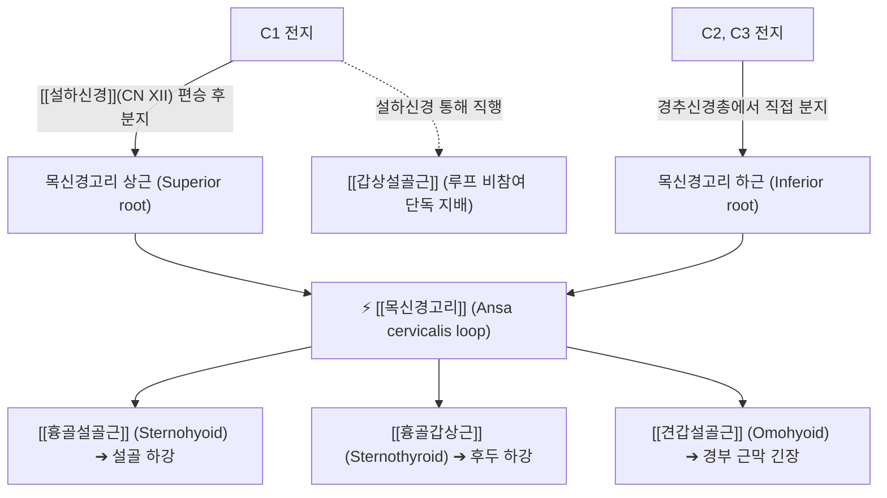

# ⚡ [[목신경고리]] (Ansa Cervicalis / 경신경고리, C1~C3)

> **핵심 3줄 요약 (Key Summary)**:
> - 🗺️ 신경 기원 & 해부학적 주행: 경추신경총(C1~C3 전지) 기원, 경동맥초(Carotid sheath) 표면에서 상근(C1)과 하근(C2-C3)이 만나 U자형 루프(Loop)를 형성하는 순수 운동신경 고리.
> - 🎯 운동 지배(근육군) & 감각 지배 영역: 순수 운동 신경. 설골하근군([[흉골설골근]], [[흉골갑상근]], [[견갑설골근]])을 운동 지배 (단, [[갑상설골근]]은 C1이 설하신경을 타고 직접 단독 지배).
> - ⚠️ 호발 포착 부위 & 관련 임상 질환: 갑상선 절제술 및 경추 전방 수술(ACDF) 시 견인 손상, 연하 곤란(Dysphagia), 인후부 이물감([[매핵기]]), 되돌이후두신경 손상 재건술의 신경 공여부.
> - 🔍 주요 이학적 검사 & 신경학적 징후: 연하 시 설골 하강 부전 평가, 전경부 설골하근 긴장 촉진.

---

## 1. 신경 기원 & 해부학적 분지 경로 (Anatomy & Course)

* **신경 기원 (Spinal Segments & Two Roots)**:
  * 목신경고리는 두 개의 뿌리(Root)가 목의 전외측 경동맥초 전면에서 만나 고리 모양을 이룹니다.
* **상세 주행 경로 (Detailed Pathway)**:
  1. **상근 (Superior root / 이전 명칭: Radix descendens hypoglossi)**:
     * C1 척수신경 전지에서 나와 뇌신경인 [[설하신경]](CN XII) 줄기에 일시적으로 합류(편승)합니다.
     * 경동맥 삼각(Carotid triangle) 부위에서 설하신경을 빠져나와 총경동맥(Common carotid artery)과 내경정맥을 싸고 있는 경동맥초의 전면을 따라 수직 하행합니다.
  2. **하근 (Inferior root / 이전 명칭: Radix descendens cervicalis)**:
     * C2 및 C3 척수신경 전지에서 기원합니다.
     * 내경정맥의 외측을 나선형으로 감아 돌며 하행하여 경동맥초 전면으로 진입합니다.
  3. **루프 형성 (Ansa loop)**:
     * 대략 견갑설골근 중간건(Intermediate tendon) 높이, 윤상연골(Cricoid cartilage) 높이 부근에서 상근과 하근이 문합하여 U자형 고리를 완성합니다.

---

## 2. 신경 지배 맵 & 기능 네트워크 (Innervation Map)

### 1) 지배 근육 (설골하근군, Infrahyoid muscles)
* **[[흉골설골근]](Sternohyoid)**: 연하 후 설골을 아래로 하강.
* **[[흉골갑상근]](Sternothyroid)**: 갑상연골과 후두를 아래로 하강.
* **[[견갑설골근]](Omohyoid)**: 설골을 하후방으로 당겨 경동맥초와 경부 심부근막의 팽팽함을 유지.
* **주의 (단독 지배)**: 설골하근 중 **[[갑상설골근]](Thyrohyoid)**은 목신경고리 루프의 지배를 받지 않고, C1 섬유가 설하신경을 타고 직접 주행하여 분지합니다.

### 2) 생체역학적 기능
* **연하 작용 (Swallowing)**: 연하 초기 설골상근에 의해 위로 들려 올려진 후두와 설골을 연하 후기 본래 위치로 신속히 끌어내려 기도를 재개방합니다.
* **발성 조절 (Phonation)**: 고음에서 저음으로 전환 시 후두를 하강시켜 성대의 장력과 공명강을 조절합니다.

---

## 3. 호발 포착 부위 & 터널 증후군 병태생리

* **갑상선 및 경부 외과 수술 시 손상**:
  * 갑상선 절제술, 경동맥 내막절제술(CEA), 전방 경추 유합술(ACDF) 시 경동맥초 전면을 박리하는 과정에서 견인되거나 손상되기 쉽습니다.
* **경부 심부 근막 유착**:
  * 만성적인 구강호흡이나 거북목 자세로 전경부 근막이 단축되면 견갑설골근과 흉골설골근이 경결되며 루프를 조입니다.

---

## 4. 손상 레벨별 임상 증상 & 신경학적 결손

* **연하 곤란 (Dysphagia)**: 음식물이나 알약을 삼킬 때 목에서 잘 넘어가지 않고 걸리는 느낌, 식후 목 안쪽의 뻐근한 피로감.
* **발성 장애 및 피로**: 고음 발성 후 저음으로의 전환이 매끄럽지 못하고, 오래 말할 때 목소리가 쉽게 잠김.
* **인후부 이물감 ([[매핵기]])**: 침을 삼켜도 걸려 있고 뱉어도 나오지 않는 전경부 불쾌감.

---

## 5. 관련 이학적 검사 & 신경 감별 매트릭스

* **연하 동적 촉진 검사 (Dynamic Swallowing Palpation)**:
  * 환자가 침을 삼킬 때 설골과 갑상연골의 거상 후 정상적인 즉각적 하강 여부를 검사자의 손가락으로 촉지 평가.
* **설골하근 압진 검사**:
  * 흉골병 상연 및 갑상연골 외측의 흉골설골근 부착부를 압박할 때 연하 곤란성 불편감 재현 여부 확인.

---

## 6. 한의 신경 치료 프로토콜 (약침·침도·신경수기)

* **[[인영]](ST9) 및 [[수돌]](ST10) 침치료**:
  * 총경동맥 박동 부위 외측으로 경동맥초 주변 목신경고리에 접근하여 설골하근군의 과긴장을 해소합니다.
* **[[천돌]](CV22) 및 [[기사]](ST11) 심부 근막 이완**:
  * 흉골설골근 및 흉골갑상근 부착부 근건에 0.25×30mm 침을 사용하여 유착을 완화합니다.
* **설골(Hyoid Bone) 가동화 추나요법**:
  * 설골을 좌우로 부드럽게 글라이딩시키며 전경부 심부 근막(Pretracheal fascia)을 이완하여 목신경고리의 자유로운 활주를 유도합니다.

---

## 7. 💡 사용자 진료실 핵심 필기 & 임상 팁 (원문 보존)

* **이비인후과 검사상 정상인 목 이물감(매핵기) 환자**:
  * 내시경이나 역류성 식도염 검사에서 아무런 이상이 없는데 "목에 가시나 알약이 걸린 것 같다"며 고통스러워하는 환자는 목신경고리와 설골하근군의 만성 연축인 경우가 많습니다.
  * 천돌혈과 인영혈 외측의 전경부 근막을 부드럽게 이완하고 설골 가동술을 1~2회 시행하면 목구멍이 시원하게 열립니다.

---

## 8. 출처 및 학술 참고 문헌 (References)

* Kikuta S et al. (2019). "Ansa cervicalis: a comprehensive review of its anatomy, variations, pathology, and surgical applications." *Anat Cell Biol*, 52(3): 221-228. [PMID: 31598349](https://pubmed.ncbi.nlm.nih.gov/31598349/)
  - [연구 요약]: 목신경고리의 해부학적 형성, C1-C3 분지 변이, 후두 재신경지배 수술 시 공여 신경으로서의 임상적 가치 총괄 고찰.
* Standring S. (2020). *Gray's Anatomy: The Anatomical Basis of Clinical Practice*. 42nd ed. Elsevier, pp. 745-752.
  - [연구 요약]: 목신경고리의 해부학적 기원, 상근과 하근의 주행 경로 및 설골하근 지배 신경망의 표준 해부학 기술.
* Waxenbaum JA et al. (2026). "Anatomy, Head and Neck: Cervical Nerves." *StatPearls Publishing*. [PMID: 30844163](https://pubmed.ncbi.nlm.nih.gov/30844163/)
  - [연구 요약]: 경신경총 운동 분지인 목신경고리의 주행과 임상적 외과 손상 메커니즘 정리.
