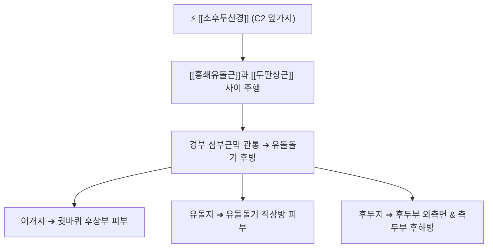

# ⚡ [[소후두신경]] (Lesser Occipital Nerve / 小後頭神經, C2)

> **핵심 3줄 요약 (Key Summary)**:
> - 🗺️ 신경 기원 & 해부학적 주행: 경신경총 제2경신경(C2) 앞가지에서 기원, [[흉쇄유돌근]](SCM) 후연을 따라 비스듬히 상행하여 [[두판상근]](Splenius capitis) 표면을 지나 유돌돌기 후방 두피로 주행.
> - 🎯 운동 지배(근육군) & 감각 지배 영역: 순수 감각 신경. 귀 뒤쪽(이개 후방), 유돌돌기 상방 두피, 후두부 외측면 및 측두부 후하방 피부 감각 지배.
> - ⚠️ 호발 포착 부위 & 관련 임상 질환: SCM 후연 상부 및 두판상근 외측 경계, [[후두신경통]](Occipital neuralgia), 경인성 두통, 경추 회전 제한.
> - 🔍 주요 이학적 검사 & 신경학적 징후: 완골(GB12) 및 풍지(GB20) 외측 압진 시 귀 뒤 방사통, 경추 회전 시 유발 통증.

---

## 1. 신경 기원 & 해부학적 분지 경로 (Anatomy & Course)

* **신경 기원 (Origin & Spinal Segment)**:
  * [[경신경총]](Cervical plexus)의 감각 분지로, **제2 경신경(C2)** 전지(앞가지)에서 단독 기원하거나 C3의 일부 섬유를 받아 형성됩니다.
* **상세 주행 경로 (Detailed Pathway)**:
  1. **SCM 후연 상행**: [[에르브 포인트]](Erb's point) 부근에서 기원하여, [[흉쇄유돌근]](Sternocleidomastoid)의 뒤쪽 모서리를 따라 거의 수직 또는 약간 비스듬하게 상행합니다.
  2. **근육 간극 통과**: 흉쇄유돌근과 [[두판상근]](Splenius capitis) 사이를 주행하며 심부근막을 뚫고 표재화됩니다.
  3. **두피 분지**: 유돌돌기(Mastoid process) 후하방을 돌아 상행하면서 귀 뒤쪽 피부, 후두 외측 두피, 측두골 후면 피부로 방사상 종말 분지를 냅니다.

---

## 2. 신경 지배 맵 & 기능 네트워크 (Innervation Map)

### 1) 감각 지배 영역
* **후두 외측 및 유돌부**: 귓바퀴 뒤쪽 오목한 부위부터 유돌돌기 상방 두피.
* **측두 후하방**: 귀 상방 측두부 헤어라인 안쪽 피부의 촉각, 통각, 온도각.

---

## 3. 호발 포착 부위 & 터널 증후군 병태생리

* **흉쇄유돌근(SCM)과 두판상근 사이 간극 포착**:
  * 소후두신경은 **[[흉쇄유돌근]]과 [[두판상근]] 사이를 주행**하며, C2에서 기시하므로 고개를 돌릴 때 이 근육들이 신경을 집어당기며 마찰을 일으킵니다.
* **견갑거근 및 판상근 긴장 연계**:
  * 거북목 자세로 인해 [[견갑거근]], [[흉쇄유돌근]], [[두판상근]]이 만성 연축되면 신경 출구의 섬유성 터널이 좁아집니다.

---

## 4. 손상 레벨별 임상 증상 & 신경학적 결손

* **외측 후두통 및 편두통성 통증**: 귀 뒤쪽에서부터 관자놀이 뒤쪽까지 찌릿하거나 타는 듯한 날카로운 신경통.
* **경추 회전 시 통증 악화**: 고개를 좌우로 회전할 때 귀 뒤가 당기며 목의 가동범위가 현저히 감소.
* **두피 이질통**: 머리를 묶거나 베개를 벨 때 귀 뒤쪽 두피가 닿으면 깜짝 놀랄 정도로 쓰라림.

---

## 5. 관련 이학적 검사 & 신경 감별 매트릭스

* **완골(GB12) 압진 티넬 검사**:
  * 유돌돌기 바로 뒤쪽 완골혈 부위를 압박하거나 두드릴 때 귀 뒤와 관자놀이로 뻗치는 방전통 재현 여부 확인.
* **후두신경 삼총사 감별**:
  * [[대후두신경]](GON, C2 후지): 뒷머리 중앙부터 정수리(두정부)까지 넓게 방사.
  * 소후두신경(LON, C2 전지): 귀 뒤쪽, 유돌돌기 외측, 측두 후하방 국한.
  * [[셋째후두신경]](TON, C3 후지): 후두하부 정중선 외측 및 C2-C3 후관절 연관통.

---

## 6. 한의 신경 치료 프로토콜 (약침·침도·신경수기)

* **[[완골]](GB12) 및 [[풍지]](GB20) 침도 박리술**:
  * 유돌돌기 후연 골막 부착부에 침도를 수평으로 진입시켜 두판상근 및 SCM 건막 유착을 안전하게 박리합니다.
* **소후두신경 신바로 약침**:
  * SCM 상부 후연 및 완골혈 피하에 신바로 약침 0.3cc를 주입하여 국소 신경염을 제거합니다.
* **회전 제한 해소 추나요법**:
  * C1-C2 분절의 회전 변위를 교정하고, 흉쇄유돌근과 두판상근을 스트레칭하여 가동범위를 회복시킵니다.

---

## 7. 💡 사용자 진료실 핵심 필기 & 임상 팁 (원문 보존)

* **소후두신경 포착과 경추 회전 제한 감별**:
  * [[흉쇄유돌근]]과 [[두판상근]] 사이 주행, C2에서 기시.
  * C2에서 기시하므로 고개를 돌릴 때 통증이 유발되거나 가동범위 감소가 있을 수 있기에 확인하여 긴장된 근육을 풀어준다 (주로 [[견갑거근]], [[흉쇄유돌근]], [[두판상근]]).

---

## 8. 출처 및 학술 참고 문헌 (References)

* Ha JH et al. (2026). "Lesser occipital nerve decompression for medically refractory occipital headache: A retrospective case series." *J Clin Neurosci*, 132: 110-117. [PMID: 42140115](https://pubmed.ncbi.nlm.nih.gov/42140115/)
  - [연구 요약]: 난치성 후두통 환자에서 소후두신경 감압술의 임상 성적과 DN4, VAS 통증 척도 호전도 분석.
* Wu M et al. (2026). "Anatomical and Morphological Structure of the Lesser Occipital Nerve." *Zhongguo Yi Xue Ke Xue Yuan Xue Bao*, 48(4): 485-491. [PMID: 42660834](https://pubmed.ncbi.nlm.nih.gov/42660834/)
  - [연구 요약]: 소후두신경의 척수 기원, 흉쇄유돌근 및 두판상근 사이 주행 경로의 해부학적 변이 정량 분석.
* Niemczyk WA et al. (2025). "The anatomy of the cutaneous branches of the cervical plexus and its clinical significance." *Folia Morphol (Warsz)*, 84(4): 712-723. [PMID: 41257499](https://pubmed.ncbi.nlm.nih.gov/41257499/)
  - [연구 요약]: 경신경총 피하지들의 해부학적 지형도와 임상적 신경통 감별 가이드라인.
