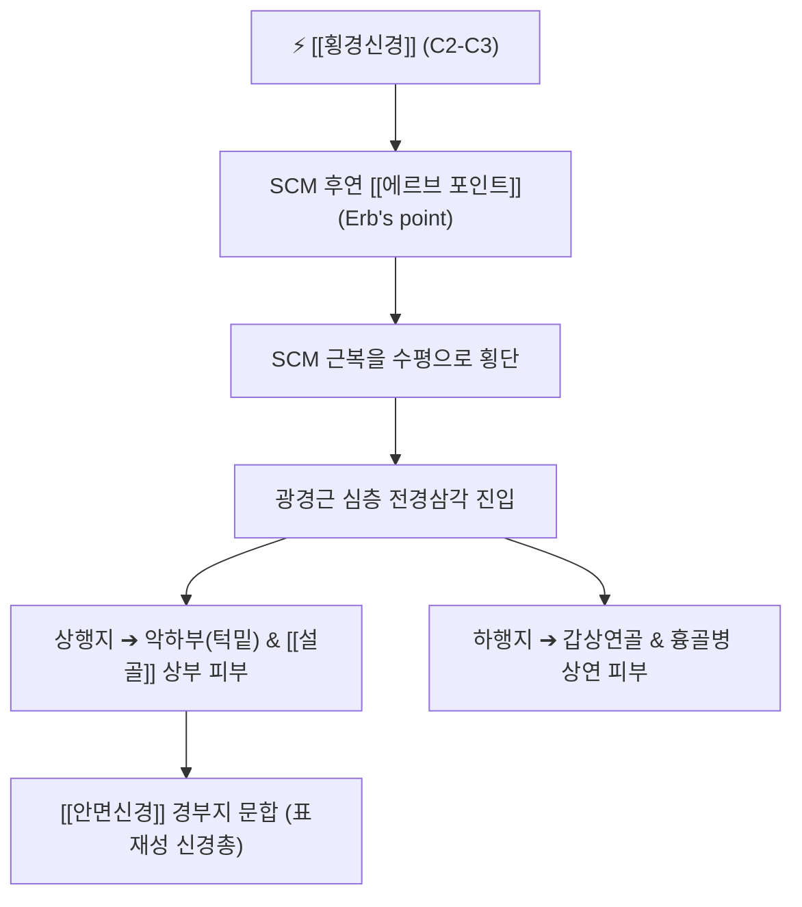

# ⚡ [[횡경신경]] (Transverse Cervical Nerve / 頸橫神經, C2-C3)

> **핵심 3줄 요약 (Key Summary)**:
> - 🗺️ 신경 기원 & 해부학적 주행: 경신경총(C2-C3) 기원, [[에르브 포인트]](Erb's point)에서 나와 [[흉쇄유돌근]](SCM) 중앙부를 수평으로 가로질러 [[광경근]](Platysma) 심층을 통해 전경부(목 앞쪽)로 주행.
> - 🎯 운동 지배(근육군) & 감각 지배 영역: 순수 감각 신경. 하악 하연부터 흉골병 상연에 이르는 **전경부(목 앞면 전체) 피부 감각** 지배, 안면신경 경부지와 문합.
> - ⚠️ 호발 포착 부위 & 관련 임상 질환: SCM 근막 관통부 및 광경근 유착, 목 앞쪽의 원인 모를 찌르는 통증, 갑상선 수술 후 전경부 감각 이상.
> - 🔍 주요 이학적 검사 & 신경학적 징후: SCM 중간 전연 압통 및 목 앞쪽 방사통, 전경부 감각 저하 또는 이질통.

---

## 1. 신경 기원 & 해부학적 분지 경로 (Anatomy & Course)

* **신경 기원 (Origin & Spinal Segments)**:
  * [[경신경총]](Cervical plexus)의 감각 분지군으로, **제2, 3 경신경(C2, C3)** 전지에서 기원합니다.
* **상세 주행 경로 (Detailed Pathway)**:
  1. **신경점 출현**: SCM 후연 중간 지점인 [[에르브 포인트]](Erb's point)에서 나와 흉쇄유돌근의 외측면을 **수평(Transverse)**으로 앞쪽을 향해 가로지릅니다.
  2. **혈관 및 근막 관계**: 외경정맥(External jugular vein)의 심부 또는 표층을 가로지른 후 [[광경근]](Platysma) 심층을 통해 전경삼각(Anterior cervical triangle)으로 진입합니다.
  3. **상행지와 하행지 분기**:
     * **상행지(Ascending branch)**: 광경근을 뚫고 턱밑(악하부)으로 상행하여 [[안면신경]] 경부지(Cervical branch of CN VII)와 문합 고리를 형성하고 [[설골]] 상부 피부를 지배.
     * **하행지(Descending branch)**: 전경부 피하를 따라 하행하여 갑상연골 및 흉골병 상연까지 피부 감각을 지배.

---

## 2. 신경 지배 맵 & 기능 네트워크 (Innervation Map)

### 1) 감각 지배 영역
* **전경부(목 앞면 전체)**: 하악골 하연에서부터 흉골자루(흉골병) 상연에 이르는 목 앞쪽 피부의 통각, 촉각, 온각을 전담합니다.

---

## 3. 호발 포착 부위 & 터널 증후군 병태생리

* **SCM 전연 및 광경근 심부 근막 유착**:
  * 고개를 한쪽으로 돌리고 자는 습관이나 스마트폰 고개 숙임으로 전경부 근막이 찌그러지면 신경이 압박받습니다.
* **갑상선 수술 및 전경부 외과 절개**:
  * 갑상선 절제술 시 횡절개선(Kocher incision) 부위에서 횡경신경의 상·하행 분지가 직접 절단되거나 수술 후 반흔 조직에 갇힙니다.

---

## 4. 손상 레벨별 임상 증상 & 신경학적 결손

* **전경부 신경통 (Anterior Neck Neuralgia)**: 목 앞쪽 피부를 살짝만 스치거나 옷깃이 닿아도 칼로 베는 듯 따갑고 쓰라림(이질통).
* **갑상선 수술 후 무감각**: 수술 후 목 앞부분 피부가 두꺼운 고무판을 댄 것처럼 감각이 둔마되고 남의 살 같음.
* **인후부 조임감**: 전경부 피부 감각 과민으로 인해 목에 넥타이나 목걸이를 착용하지 못함.

---

## 5. 관련 이학적 검사 & 신경 감별 매트릭스

* **SCM 전연 횡단부 압진 검사**:
  * 목빗근 앞쪽 모서리 중앙부를 지그시 눌렀을 때 울대뼈([[갑상연골]]) 주변으로 찌릿한 통증이 방사되면 양성.
* **매핵기와의 감별**:
  * 횡경신경 포착: 피부 표층을 꼬집거나 누를 때 표재성 통증 재현.
  * [[매핵기]](Globus hystericus): 피부 표층은 정상이나 인후강 내부 깊숙한 곳의 이물감 호소.

---

## 6. 한의 신경 치료 프로토콜 (약침·침도·신경수기)

* **[[인영]](ST9) 외방 및 [[부돌]](LI18) 침치료**:
  * SCM 전연 부돌혈 부위에 0.25×30mm 침으로 평자(平刺)하여 피하신경을 안전하게 이완합니다.
* **전경부 신바로 약침 요법**:
  * 수술 후 반흔 부위 및 SCM 전연에 신바로 약침 0.3cc를 침윤 주입하여 신경 재생을 촉진하고 염증을 소퇴시킵니다.
* **광경근 근막 스트레칭 수기**:
  * 쇄골 상부를 고정한 상태에서 턱을 위로 들어 올려 전경부 광경근을 부드럽게 신장시킵니다.

---

## 7. 💡 사용자 진료실 핵심 필기 & 임상 팁 (원문 보존)

* **목 앞쪽이 조이고 칼칼하다는 환자 (매핵기와 감별)**:
  * 인후부에 이물감이 있다고 호소할 때 내시경에 이상이 없고 목 앞 피부를 만지면 쓰라리다고 한다면, 한의학적 매핵기(기체증)와 더불어 횡경신경의 표층 포착을 의심해야 합니다. [[부돌]]혈 자침으로 즉효를 봅니다.

---

## 8. 출처 및 학술 참고 문헌 (References)

* Niemczyk WA et al. (2025). "The anatomy of the cutaneous branches of the cervical plexus and its clinical significance - The Great Auricular Nerve. A systematic review with meta-analysis." *Folia Morphol (Warsz)*, 84(4): 712-723. [PMID: 41257499](https://pubmed.ncbi.nlm.nih.gov/41257499/)
  - [연구 요약]: 경신경총 횡경신경의 흉쇄유돌근 횡단 지형도 및 전경부 감각 신경망 해부학적 변이 분석.
* Maniaci A et al. (2026). "Regional Anaesthesia Approaches in Head and Neck Surgery: Current Evidence and Clinical Applications." *Journal of Clinical Medicine*, 15(9): 3120. [PMID: 42194532](https://pubmed.ncbi.nlm.nih.gov/42194532/)
  - [연구 요약]: 갑상선 수술 시 횡경신경을 포함한 표재경신경총 차단술의 임상 효과 검증.
* Prigge L et al. (2026). "Anatomical study of the superficial cervical plexus targeted for sensory nerve blocks in neonates." *Reg Anesth Pain Med*, 51(8): 612-619. [PMID: 40866302](https://pubmed.ncbi.nlm.nih.gov/40866302/)
  - [연구 요약]: 횡경신경의 분지 경로와 초음파 랜드마크 분석.
