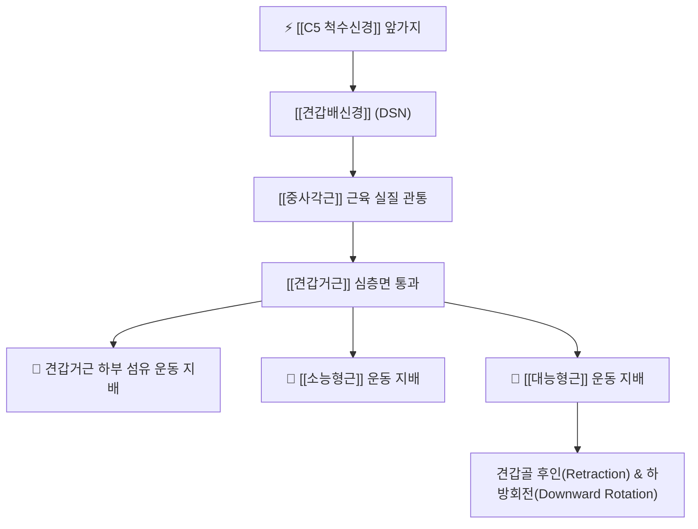

# ⚡ [[견갑배신경]] (Dorsal Scapular Nerve / 肩胛背神經, C5)

> **핵심 3줄 요약 (Key Summary)**:
> - 🗺️ 신경 기원 & 해부학적 주행: C5 척수신경 앞가지(뿌리 레벨)에서 기원하여, [[중사각근]](Scalenus medius)을 관통한 뒤 [[견갑거근]] 심층을 지나 견갑골 내측연을 따라 하행.
> - 🎯 운동 지배(근육군) & 감각 지배 영역: 순수 운동 신경. [[견갑거근]](Levator scapulae) 하부 및 [[능형근]](대능형근·소능형근)을 운동 지배하여 견갑골 후인·거상·하방회전을 총괄.
> - ⚠️ 호발 포착 부위 & 관련 임상 질환: [[중사각근]] 관통부 및 견갑골 상각 내측연, [[견갑배신경 포착 증후군]](견갑골 내측 작열통), 능형근 위축으로 인한 익상견갑 및 등이 늘어지는 자세.
> - 🔍 주요 이학적 검사 & 신경학적 징후: 능형근 도수근력검사(견갑골 후인 약화), 견갑골 내측연 압통, C5 사각근 압진 검사.

---

## 1. 신경 기원 & 해부학적 분지 경로 (Anatomy & Course)

* **신경 기원 (Spinal Segment & Root Origin)**:
  * [[상완신경총]](Brachial plexus)의 가장 근위부인 **제5 경추신경(C5)** 전지(앞가지) 뿌리(Root)에서 신경간(Trunk) 형성 이전에 단독으로 분지합니다 (간혹 C4의 기여가 동반됨).
* **상세 주행 경로 (Detailed Pathway)**:
  1. **사각근 관통**: C5 신경근에서 갈라져 나온 직후 [[중사각근]](Scalenus medius) 근육 실질을 비스듬히 관통합니다 (약 70~80%에서 관통형, 나머지는 중사각근 후연 주행).
  2. **경부 후방 하행**: 경추 후삼각을 가로질러 후하방으로 주행하며, [[견갑배동맥]](Dorsal scapular artery, 또는 경횡동맥 심지)과 나란히 주행합니다.
  3. **견갑골 내측연 안착**: [[견갑거근]](Levator scapulae)의 심층면을 지나 견갑골 상각(Superior angle)을 돌아 내려간 뒤, [[소능형근]]과 [[대능형근]]의 전면(심층)과 흉벽 사이를 따라 견갑골 하각까지 길게 주행하며 근육 섬유로 운동지를 방출합니다.

---

## 2. 신경 지배 맵 & 기능 네트워크 (Innervation Map)

### 1) 순수 운동 신경 지배 (Motor Innervation)
* **[[견갑거근]](Levator scapulae)**: 견갑골 상각을 들어 올리고 경추의 신전 및 동측 측굴을 보조.
* **[[능형근]](대능형근 및 소능형근)**: 견갑골을 척추 쪽으로 강하게 끌어당기는 후인(Retraction) 및 관절와의 하방회전(Downward rotation)을 전담.
* **감각 신경 특성**: 견갑배신경 자체는 피부 피하 감각지가 결여되어 있으며, 견갑골 내측 피부 감각은 흉추 신경 후지(T2-T6)에서 유래합니다.

---

## 3. 호발 포착 부위 & 터널 증후군 병태생리

* **중사각근 근육 관통부 (Scalenus Medius Tunnel)**:
  * 거북목, 라운드 숄더, 흉식 호흡 과다 등으로 [[중사각근]]이 비후·단축되면 근육을 뚫고 지나가는 견갑배신경이 집게에 집히듯 압박(Strangulation)되어 허혈성 신경염이 발생합니다.
* **견갑골 상각 및 능형근 건막 마찰**:
  * 장시간 컴퓨터 타이핑이나 운전으로 어깨가 앞으로 말린 상태가 지속되면 견갑골 내측연이 전외측으로 외전되면서 견갑배신경이 지속적인 신장(Traction) 스트레스를 받습니다.

---

## 4. 손상 레벨별 임상 증상 & 신경학적 결손

* **견갑골 안쪽 만성 작열통 (Interscapular Pain)**: 견갑골 안쪽 모서리와 흉추 극돌기 사이(고황혈 부위)가 뻐근하게 조여오거나 칼로 도려내는 듯 화끈거리는 통증 호소.
* **자세 변화 및 견갑골 상방회전 변형**:
  * 능형근 마비 시 견갑골을 후인하지 못해 **등이 구부정하게 늘어지고(Protraction), 견갑골이 전방으로 기울며 비정상적인 상방회전(Upward rotation) 상태로 고착**됩니다.
* **가성 익상견갑 (Pseudo-winging of Scapula)**: 전거근 손상과 달리 견갑골 하각보다 내측연 상중부가 척추에서 멀어지며 뒤로 들리는 양상.

---

## 5. 관련 이학적 검사 & 신경 감별 매트릭스

* **능형근 도수근력검사 (Rhomboid MMT)**:
  * 환자가 손을 등 뒤 허리에 얹은 상태에서 팔꿈치를 뒤로 젖히게 하고 검사자가 전방으로 저항을 줄 때, 환측 견갑골 후인 근력이 저하되거나 통증이 유발되면 양성.
* **C5 사각근 압진 검사 (Middle Scalene Compression Test)**:
  * 유양돌기와 쇄골의 중점(C5 분절 높이) 부근의 중사각근을 엄지로 압박했을 때 견갑골 내측연으로 찌릿한 방사통이 재현되면 견갑배신경 포착 양성.
* **경추 5번 신경근증(Radiculopathy)과의 감별**:
  * 경추 C5 디스크: 상완 외측 감각 저하 및 삼각근·이두근 약화 동반.
  * 견갑배신경 단독 포착: 상지 감각 결손 없이 견갑골 안쪽 국소 작열통 및 능형근 약화 국한.

---

## 6. 한의 신경 치료 프로토콜 (약침·침도·신경수기)

* **중사각근 기저부 침도 미세 감압술**:
  * C5 횡돌기 후결절 외측 1cm 중사각근 실질 부위에 침도를 안전한 각도로 자입하여 신경을 조이고 있는 섬유성 밴드를 미세 박리합니다.
* **견갑골 내측연([[고황]]·[[부분]]) 약침 치료**:
  * 능형근 부착부 압통점에 신바로 약침 0.5cc를 분주하여 신경 주위 무균성 염증과 연부조직 허혈을 해소합니다.
* **능형근 및 중사각근 추나 가동술**:
  * 견갑골을 수동으로 내측 후인시키며 중사각근을 반대측 경추 회전으로 스트레칭하여 신경에 걸린 장력을 해제합니다.

---

## 7. 💡 사용자 진료실 핵심 필기 & 임상 팁 (원문 보존)

* **견갑배신경의 기원 및 운동 마비 징후**:
  * C5 척수신경 앞가지에서 나와 [[상완신경총]]에서 분지.
  * [[견갑거근]]과 [[능형근]]의 하부 섬유를 운동 지배한다.
  * 신경에 문제가 생기면 **등이 늘어지고 견갑골이 상방회전 되어 있을 수 있다** (감각신경은 흉추에서 나옴).
  * **참고 좌표**: 유양돌기-쇄골의 이등분점이 C5 분절 랜드마크.

---

## 8. 출처 및 학술 참고 문헌 (References)

* Lam KHS et al. (2025). "Ultrasound-Guided Hydrodissection for Dorsal Scapular Nerve Entrapment: A Technical Report on the Scalene and Scapular Approaches." *Cureus*, 17(1): e76214. [PMID: 41497907](https://pubmed.ncbi.nlm.nih.gov/41497907/)
  - [연구 요약]: 견갑배신경 포착 환자에서 중사각근 관통부 및 견갑골 내측연 접근 초음파 유도하 수압박리술의 해부학적 지형도와 임상 효과 분석.
* Standring S. (2020). *Gray's Anatomy: The Anatomical Basis of Clinical Practice*. 42nd ed. Elsevier, pp. 745-752.
  - [연구 요약]: 완신경총 뿌리(C5) 유래 견갑배신경의 중사각근 관통 경로 및 능형근·견갑거근 지배 표준 해부도 기술.
* Waxenbaum JA et al. (2026). "Anatomy, Head and Neck: Cervical Nerves." *StatPearls Publishing*. [PMID: 30844163](https://pubmed.ncbi.nlm.nih.gov/30844163/)
  - [연구 요약]: C5 전지 분지 신경의 해부학적 특징과 견갑대 근육 지배 네트워크 고찰.
