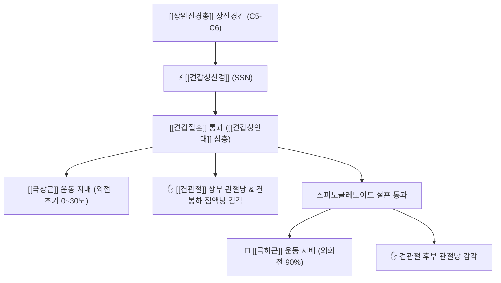

# ⚡ [[견갑상신경]] (Suprascapular Nerve / 肩胛上神經, C5-C6)

> **핵심 3줄 요약 (Key Summary)**:
> - 🗺️ 신경 기원 & 해부학적 주행: 상완신경총 상신경간(Upper trunk, C5-C6) 기원, 목 외측을 따라 하행하여 **[[견갑절흔]](Suprascapular notch)**을 통과한 뒤 견갑골 후면으로 진입, 극하와로 주행.
> - 🎯 운동 지배(근육군) & 감각 지배 영역: 혼합 신경. 회전근개 핵심인 [[극상근]](Supraspinatus)과 [[극하근]](Infraspinatus) 운동 지배, [[견관절]](어깨관절낭 70%), 견봉하점액낭, 견쇄관절의 감각 지배.
> - ⚠️ 호발 포착 부위 & 관련 임상 질환: **[[견갑상인대]](STSL)의 골화** 및 견갑절흔 협착, 스피노글레노이드 절흔(Spinoglenoid notch) 결절종(Ganglion), [[견갑상신경 포착 증후군]], 오십견 오진.
> - 🔍 주요 이학적 검사 & 신경학적 징후: 극하근 위축(Infraspinatus atrophy), 외회전 도수근력 약화, 견갑절흔 압통, 교차체간 내전 검사 시 통증.

---

## 1. 신경 기원 & 해부학적 분지 경로 (Anatomy & Course)

* **신경 기원 (Origin & Spinal Segments)**:
  * [[상완신경총]](Brachial plexus)의 **상신경간(Upper trunk)** 외측 모서리에서 유래하며, 척수 분절 **C5, C6** 앞가지 섬유로 구성됩니다 (일부 개체에서 C4 기여).
* **상세 주행 경로 (Detailed Pathway)**:
  1. **목 외측 하행**: 승모근과 오모설골근(견갑설골근) 심층을 지나 후경삼각을 가로질러 견갑골 상연으로 주행합니다.
  2. **[[견갑절흔]] 통과 (Army over Navy 원칙)**:
     * 견갑골 상연의 **견갑절흔(Suprascapular notch)**을 통과하여 견갑골 후면으로 진입합니다.
     * 이때 **[[견갑상인대]](Superior transverse scapular ligament, STSL)** 아래 터널로 신경이 통과하며, 견갑상동맥(Suprascapular artery)은 인대 위쪽으로 주행합니다.
  3. **극상근 지배**: 견갑극 상부 극상와(Supraspinous fossa)에 도달하여 [[극상근]](Supraspinatus)에 운동 분지와 견관절낭 상부 감각지를 방출합니다.
  4. **스피노글레노이드 절흔 및 극하근 진입**: 견갑극 기저부의 스피노글레노이드 절흔(Spinoglenoid notch, 하횡견갑인대 심층)을 돌아 극하와(Infraspinous fossa)로 진입한 뒤, [[극하근]](Infraspinatus)과 어깨관절낭 후면에 종말 분지합니다.

---

## 2. 신경 지배 맵 & 기능 네트워크 (Innervation Map)

### 1) 운동 신경 지배 (Motor Innervation)
* **[[극상근]](Supraspinatus)**: 상완골 외전 초기(0~30도) 주동근 및 상완골두를 관절와로 당겨 맞추는 중심화(Centration) 역할.
* **[[극하근]](Infraspinatus)**: 상완골 외회전력의 90%를 담당하는 핵심 외회전근.

### 2) 관절 감각 신경 지배 (Articular Sensory)
* 견관절낭(Glenohumeral capsule) 전체 감각의 약 70%를 담당하며, 견봉하점액낭(Subacromial bursa)과 견쇄관절의 고유통각을 전달합니다 (피부 피하 감각지는 없음).

---

## 3. 호발 포착 부위 & 터널 증후군 병태생리

* **제1 포착 터널: 견갑절흔 및 견갑상인대 (STSL)**:
  * **[[견갑상인대]]의 골화(Ossification)**나 비후는 섬유성 터널을 좁혀 신경을 직접 포착합니다.
  * 배구 스파이크, 투구 동작 등 어깨를 과도하게 교차 내전하거나 전인할 때 신경이 인대 모서리에 팽팽하게 당겨지며 견인 손상이 발생합니다.
* **제2 포착 터널: 스피노글레노이드 절흔 (Spinoglenoid Notch)**:
  * 관절순 파열(SLAP 병변)로 인한 관절액 누출로 결절종(Paralabral cyst)이 형성되면 극하근지만 선택적으로 압박됩니다.

---

## 4. 손상 레벨별 임상 증상 & 신경학적 결손

| 포착 레벨 | 마비 근육 | 감각 결손 및 통증 | 주요 임상 양상 |
| :--- | :--- | :--- | :--- |
| **견갑절흔 포착 (고위 손상)** | [[극상근]] + [[극하근]] | 어깨 심부 둔통, 관절낭 통증 | 외전 초기 근력 약화, 외회전 현저한 저하, 극상와·극하와 함몰 |
| **스피노글레노이드 포착 (저위 손상)** | [[극하근]] 단독 | 통증 경미하거나 후관절부 둔통 | 외회전만 선택적 약화, 극하와 단독 근위축 |

---

## 5. 관련 이학적 검사 & 신경 감별 매트릭스

* **극하근 외회전 저항 검사 (External Rotation Lag Sign)**:
  * 환자의 팔꿈치를 90도 굴곡하고 외회전시킨 상태에서 손을 놓았을 때 자세를 유지하지 못하고 안으로 튕겨 돌아오면 극하근 마비 양성.
* **교차 체간 내전 검사 (Cross-body Adduction Test)**:
  * 환자의 팔을 반대측 어깨 쪽으로 수평 내전시킬 때 견갑골 후면으로 깊은 둔통이 재현되면 견갑절흔 포착 의심.
* **회전근개 파열과의 감별**:
  * MRI상 회전근개 건 파열이 없는데도 극하근의 뚜렷한 지방 변성과 위축이 관찰되면 견갑상신경병증으로 확진.

---

## 6. 한의 신경 치료 프로토콜 (약침·침도·신경수기)

* **견갑절흔([[병풍]]혈 SI12) 침도 감압술**:
  * 견갑골 상연의 견갑절흔 오목한 뼈 모서리에 침도를 골면 가이드로 접촉시켜 비후·골화된 견갑상인대를 미세 절개하여 신경을 감압합니다.
* **스피노글레노이드 절흔([[천종]]혈 SI11 외상방) 약침 요법**:
  * 견갑극 기저부 외측 함요처에 신바로 약침 0.5cc를 정밀 주입하여 신경 주위 부종과 관절낭 염증을 가라앉힙니다.
* **견갑골 후방 연부조직 이완 추나**:
  * 견갑골의 내외측 회전 가동성을 회복시키고 오모설골근의 긴장을 해소하여 신경 견인 스트레스를 줄입니다.

---

## 7. 💡 사용자 진료실 핵심 필기 & 임상 팁 (원문 보존)

* **견갑상신경의 기원 및 포착 기전**:
  * C5-6 척수신경 앞가지에서 기원하여 [[상완신경총]]에서 분지하여 목을 따라 외측으로 주행해 내려오다가 **[[견갑절흔]]을 통과하면서 견갑골 뒤로 이동**.
  * [[극상근]], [[극하근]] 운동 지배, [[견관절|어깨관절낭]] 관절지, 견봉하 점액낭.
  * **[[견갑상인대]]의 골화는 포착을 유도**.
* **오십견 환자에서 극하와 함몰 관찰 필수**:
  * 어깨가 안 올라간다는 환자 상의를 탈의시켰을 때 견갑골 날개뼈 뒤쪽(극하와)이 푹 꺼져 있다면, 단순 오십견이 아니라 견갑상신경이 견갑절흔에서 눌려 극하근이 위축된 상태입니다. 병풍혈 부위 신경 감압술이 필수적입니다.

---

## 8. 출처 및 학술 참고 문헌 (References)

* Cotter EJ et al. (2025). "Arthroscopic Suprascapular Nerve Decompression: A Technique Video." *Video J Sports Med*, 5(2): e2635025. [PMID: 40370863](https://pubmed.ncbi.nlm.nih.gov/40370863/)
  - [연구 요약]: 견갑상절흔 및 견갑상인대 골화에 의한 신경 포착 시 관절경하 신경 감압 및 인대 절개 수술 기법 분석.
* Said HG et al. (2017). "A Shortcut to Arthroscopic Suprascapular Nerve Decompression at the Suprascapular Notch: Arthroscopic Landmarks and Surgical Technique." *Arthrosc Tech*, 6(5): e1823-e1827. [PMID: 29399455](https://pubmed.ncbi.nlm.nih.gov/29399455/)
  - [연구 요약]: 견갑상절흔의 해부학적 랜드마크와 횡견갑인대 감압 술기 및 신경혈관 손상 방지 가이드라인 제시.
* Standring S. (2020). *Gray's Anatomy: The Anatomical Basis of Clinical Practice*. 42nd ed. Elsevier, pp. 745-752.
  - [연구 요약]: 견갑상신경의 완신경총 상신경간 유래, 주행 경로, 견갑절흔 통과 및 회전근개 신경 지배 표준 해부도.
