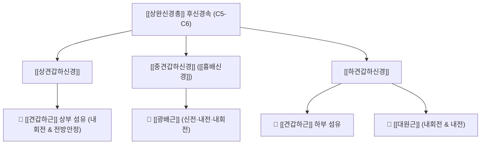

# ⚡ [[견갑하신경]] (Subscapular Nerve / 肩胛下神經, C5-C6)

> **핵심 3줄 요약 (Key Summary)**:
> - 🗺️ 신경 기원 & 해부학적 주행: 상완신경총 후신경속(Posterior cord, C5-C6)에서 기원하여, 견갑골 전면의 견갑하와(Subscapular fossa)로 주행하는 순수 운동신경.
> - 🎯 운동 지배(근육군) & 감각 지배 영역: 순수 운동 신경. [[상견갑하신경]]은 [[견갑하근]](Subscapularis) 상부를, [[하견갑하신경]]은 [[견갑하근]] 하부와 [[대원근]](Teres major)을 지배하여 견관절 강력 내회전 및 전방 안정성 제공.
> - ⚠️ 호발 포착 부위 & 관련 임상 질환: 액와강 후벽 근막 터널, [[동결견]](오십견) 환자의 견갑하근 구축, 투구 동작 후 어깨 전방 충돌 증후군.
> - 🔍 주요 이학적 검사 & 신경학적 징후: 리프트 오프 검사(Lift-off test), 벨리 프레스 검사(Belly-press test), 견갑하와 액와 압통.

---

## 1. 신경 기원 & 해부학적 분지 경로 (Anatomy & Course)

* **신경 기원 (Origin & Posterior Cord)**:
  * [[상완신경총]](Brachial plexus)의 **후신경속(Posterior cord)**에서 분지하며, 척수 분절 **C5, C6** 앞가지 섬유로 구성됩니다.
* **상·중·하 견갑하신경 분지 체계**:
  1. **[[상견갑하신경]] (Upper subscapular nerve)**: 후신경속 상부에서 가장 먼저 분지하여 짧은 경로를 거쳐 견갑골 전면의 [[견갑하근]](Subscapularis) 상부 근육 실질로 직행합니다.
  2. **[[중견갑하신경]] (흉배신경, Thoracodorsal nerve)**: 후신경속 중간에서 분지하여 견갑골 외측연을 따라 하행, 액와 후벽을 타고 [[광배근]]으로 주행합니다.
  3. **[[하견갑하신경]] (Lower subscapular nerve)**: 후신경속 하부에서 분지하여 견갑하근 전면을 가로질러 외하방으로 주행하며, 견갑하근 하부 섬유와 [[대원근]](Teres major)으로 분지합니다.

---

## 2. 신경 지배 맵 & 기능 네트워크 (Innervation Map)

### 1) 순수 운동 신경 지배 (Motor Innervation)
* **[[견갑하근]](Subscapularis)**: 회전근개 중 가장 크고 강력한 근육으로, 상완골두를 관절와 중심으로 끌어당겨 동적 전방 안정성을 유지하며 견관절 내회전을 주동.
* **[[대원근]](Teres major)**: 상완골 소결절능에 정지하여 팔의 강력한 내회전, 내전, 신전력을 제공.

---

## 3. 호발 포착 부위 & 터널 증후군 병태생리

* **액와강 후벽 근막성 압박**:
  * 견갑하근과 대원근, 광배근 건이 모여 액와 후벽을 이루는 공간에서 과도한 벤치프레스나 투구 동작으로 근육이 비후·단축되면 주행하는 신경이 압박받습니다.
* **상완골두 전방 활구(Anterior Glide) 마찰**:
  * 견관절 후방 관절낭이 단축되어 상완골두가 전방으로 밀려나면 견갑골 전면의 신경 주행로가 지속적으로 견인됩니다.

---

## 4. 손상 레벨별 임상 증상 & 신경학적 결손

* **견관절 내회전 근력 약화**: 열중쉬어 자세에서 손을 등 뒤로 떼어내는 동작 불능, 바지 뒷주머니에 손을 넣기 어려움.
* **어깨 전방 통증 및 불안정성**: 상완골두가 전방으로 전위되며 오훼돌기 및 이두근 장두 건초에 2차적인 충돌성 통증 발생.
* **견갑하근 단축성 오십견**: 팔을 바깥으로 돌리는 외회전 동작 시 극심한 제한과 통증 동반.

---

## 5. 관련 이학적 검사 & 신경 감별 매트릭스

* **리프트 오프 검사 (Lift-off Test)**:
  * 환자가 손등을 요추부에 얹은 상태에서 손등을 등에서 능동적으로 뒤로 떼어내게 함. 손을 떼지 못하거나 통증이 발생하면 견갑하근 마비 양성.
* **벨리 프레스 검사 (Belly-Press Test)**:
  * 손바닥을 배에 대고 팔꿈치를 몸 앞쪽으로 유지한 채 배를 누르게 함. 견갑하근이 약하면 팔꿈치가 몸 뒤로 빠지면서 손목 굴곡으로 보상(양성).

---

## 6. 한의 신경 치료 프로토콜 (약침·침도·신경수기)

* **액와부 견갑하근 직접 이완 추나 (Subscapularis Release)**:
  * 환자를 측와위로 눕히고 견관절을 굴곡시킨 상태에서 시술자의 손가락을 액와 후벽을 타고 견갑골 전면(견갑하와) 깊숙이 밀어 넣어 견갑하근을 허혈성 압박 이완합니다.
* **[[극천]](HT1) 및 [[견정]](SI9) 침치료**:
  * 액와 중앙 극천혈과 액와 후연 견정혈에서 견갑하근과 대원근 부착부를 향해 사자하여 신경 포착을 해소합니다.
* **신바로 약침 요법**:
  * 견갑골 외측연 및 견정혈 부위에 신바로 약침 0.5cc를 주입하여 국소 무균성 염증을 제거합니다.

---

## 7. 💡 사용자 진료실 핵심 필기 & 임상 팁 (원문 보존)

* **사용자 원문 필기**:
  * [[견갑하근]], [[대원근]] 운동 지배.
* **진료실 실전 팁 (외회전 제한 환자의 핵심 키)**:
  * 오십견 환자에서 팔을 바깥으로 돌리지 못해 머리를 빗거나 옷을 입지 못하는 경우, 대다수 한의사는 뒤쪽 극하근만 치료하지만 진짜 범인은 앞쪽에서 신경과 함께 굳어 있는 **[[견갑하근]]과 견갑하신경**입니다. 겨드랑이 안쪽(극천혈)으로 손을 찔러 넣어 견갑하근을 1분간 풀어주면 외회전 각도가 즉각 20도 이상 증가합니다.

---

## 8. 출처 및 학술 참고 문헌 (References)

* Sager B et al. (2019). "Innervation of the subscapularis: an anatomic study." *JSES Open Access*, 3(2): 76-80. [PMID: 31334431](https://pubmed.ncbi.nlm.nih.gov/31334431/)
  - [연구 요약]: 견갑하근에 대한 상견갑하신경과 하견갑하신경의 분지 경로, 건막 관통 부위 및 견관절 수술 시 신경 손상 위험 지대 정밀 분석.
* Standring S. (2020). *Gray's Anatomy: The Anatomical Basis of Clinical Practice*. 42nd ed. Elsevier, pp. 745-752.
  - [연구 요약]: 완신경총 후신경속 분지인 상·중·하 견갑하신경의 표준 해부학 기술.
* Waxenbaum JA et al. (2026). "Anatomy, Head and Neck: Cervical Nerves." *StatPearls Publishing*. [PMID: 30844163](https://pubmed.ncbi.nlm.nih.gov/30844163/)
  - [연구 요약]: C5-C6 신경근에서 유래하는 견갑대 운동 신경망 해부도.
