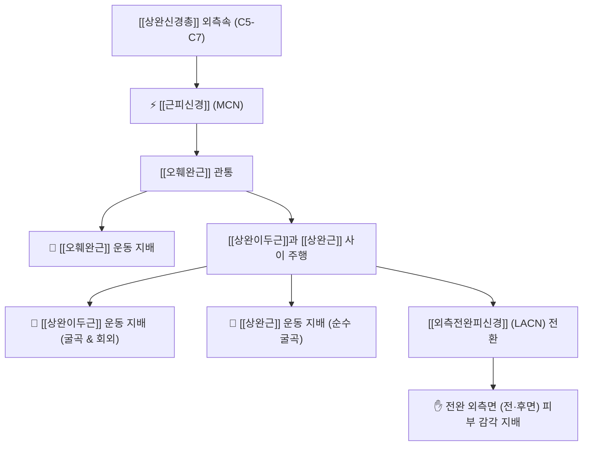

# ⚡ [[근피신경]] (Musculocutaneous Nerve / 筋皮神經, C5-C7)

> **핵심 3줄 요약 (Key Summary)**:
> - 🗺️ 신경 기원 & 해부학적 주행: 상완신경총 외측속(Lateral cord, C5-C7) 기원, **[[오훼완근]](Coracobrachialis)을 관통**한 뒤 [[상완이두근]](Biceps brachii)과 [[상완근]](Brachialis) 사이를 주행, 주관절 외측에서 외측전완피신경으로 전환.
> - 🎯 운동 지배(근육군) & 감각 지배 영역: 혼합 신경 (근육과 피부 모두 지배). [[오훼완근]], [[상완이두근]], [[상완근]]의 주관절 굴곡 운동 지배, 외측전완피신경을 통한 **전완 외측면(앞면·후면) 피부 감각** 지배.
> - ⚠️ 호발 포착 부위 & 관련 임상 질환: **[[오훼완근]] 실질 관통부** 및 이두근 건막 터널, [[근피신경병증]], 투수 및 헬스 선수 주관절 굴곡력 약화, 전완 외측 작열통.
> - 🔍 주요 이학적 검사 & 신경학적 징후: 이두근 도수근력검사(팔꿈치 굴곡 약화), 이두근건 반사(Biceps reflex) 감쇠, 전완 외측 감각 둔마, 오훼돌기 하방 압통.

---

## 1. 신경 기원 & 해부학적 분지 경로 (Anatomy & Course)

* **신경 기원 (Origin & Lateral Cord)**:
  * [[상완신경총]](Brachial plexus)의 **외측속(Lateral cord)**에서 유래하며, 척수 분절 **C5, C6, C7** 앞가지 섬유로 구성됩니다.
* **상세 주행 경로 (Detailed Pathway)**:
  1. **오훼완근 관통**: 소흉근 하방에서 나와 액와동맥 외측을 주행하다가, 오훼돌기 하방 약 5cm 지점에서 **[[오훼완근]](Coracobrachialis) 근육 실질을 직접 관통(Piercing)**합니다.
  2. **상완 전실 주행**: 오훼완근을 빠져나온 신경은 [[상완이두근]](Biceps brachii)의 심층과 [[상완근]](Brachialis)의 천층 사이의 결합조직 간극을 비스듬히 외하방으로 주행하며 두 근육에 운동지를 방출합니다.
  3. **종말 피하지 전환**: 주관절 주와(Cubital fossa) 외측에서 상완이두근 건 외측 모서리로 나와 심부근막을 뚫고 표재화되어 **[[외측전완피신경]](Lateral antebrachial cutaneous nerve, LACN)**으로 전환됩니다.
  4. **전완 분지**: 전완 외측의 전면 및 후면 피부를 따라 요골 경상돌기(손목)까지 주행합니다.

---

## 2. 신경 지배 맵 & 기능 네트워크 (Innervation Map)

### 1) 운동 신경 지배 (Motor 3대 굴곡근)
* **[[오훼완근]](Coracobrachialis)**: 상완골 전방 굴곡 및 내전 보조.
* **[[상완이두근]](Biceps brachii)**: 전완 회외(Supination) 상태에서의 강력한 주관절 굴곡.
* **[[상완근]](Brachialis)**: 전완 회내/회외 위치와 무관한 순수한 주관절 굴곡의 최강자.

### 2) 감각 신경 지배 (Sensory Innervation)
* 전완 외측 절반의 손목까지 이어지는 앞면 및 뒷면 피부 감각(통각, 온각, 촉각)을 전담합니다.

---

## 3. 호발 포착 부위 & 터널 증후군 병태생리

* **오훼완근 근육 실질 관통 터널**:
  * 투구 동작, 턱걸이, 과도한 이두박근 웨이트 트레이닝 등으로 [[오훼완근]]이 비후되면 관통하는 근피신경이 집게처럼 압박받습니다.
* **상완이두근과 상완근 사이 근막 유착**:
  * 만성적인 팔꿈치 과사용으로 두 근육 사이의 활주면이 섬유화되면 신경의 길이 신장 운동성이 상실됩니다.

---

## 4. 손상 레벨별 임상 증상 & 신경학적 결손

* **주관절 굴곡력 현저한 저하**: 팔꿈치를 구부리기 어렵고 무거운 물건을 들 때 팔 앞쪽이 후들거림.
* **전완 외측 감각 이상 및 저림**: 아래팔 바깥쪽 피부가 남의 살 같거나 찌릿찌릿 쑤시는 감각 이상.
* **이두근 위축 및 반사 소실**: 장기 방치 시 상완 전면부 근육이 홀쭉하게 마르고 이두근건 반사(C5-C6)가 소실됨.

---

## 5. 관련 이학적 검사 & 신경 감별 매트릭스

* **이두근 저항 굴곡 검사 (Biceps MMT)**:
  * 전완을 완전히 회외시킨 상태에서 팔꿈치 굴곡 저항을 줄 때 통증 유발 또는 근력 저하 확인.
* **오훼완근 압진 검사 (Coracobrachialis Tinel Sign)**:
  * 액와 전연 오훼돌기 하방 5cm 부위를 압박했을 때 전완 외측으로 찌릿한 방사통 재현 시 양성.
* **경추 C5-C6 디스크와의 감별**:
  * C5-C6 신경근병증: 삼각근 마비 및 경추 회전 시 목 통증 동반.
  * 근피신경 단독 포착: 어깨 삼각근은 정상이며 순수하게 팔꿈치 굴곡 약화 및 전완 외측 감각 이상만 국한.

---

## 6. 한의 신경 치료 프로토콜 (약침·침도·신경수기)

* **오훼완근 관통부([[천천]]혈 PC2) 침도 감압술**:
  * 액와 전벽 오훼돌기 하방의 신경 관통 지점에 침도를 접촉시켜 오훼완근의 긴장 밴드를 미세 박리합니다.
* **[[척택]](LU5) 외측 LACN 약침 요법**:
  * 주관절 외측 이두근건 외연에 신바로 약침 0.3~0.5cc를 주입하여 표재성 신경염을 해소합니다.
* **상완 전실 근막 이완 추나**:
  * 이두근과 상완근 사이의 고랑을 손가락으로 쥐고 좌우로 뜯어내듯 활주성을 회복시키는 근막 이완술을 적용합니다.

---

## 7. 💡 사용자 진료실 핵심 필기 & 임상 팁 (원문 보존)

* **근피신경의 해부학적 특성과 포착 부위**:
  * C5-7 앞가지에서 기원하여 [[상완신경총]]의 외측삭에서 분지, **[[오훼완근]]을 관통하고 [[상완이두근]]과 [[상완근]] 사이를 주행**하여 전완 외측 앞면, 후면의 피부 지배.
  * 외측 전완부 감각지배, [[상완이두근]], [[상완근]], [[오훼완근]] 운동지배.
  * **"근피 신경"이니까 근육과 피부 전부 컨트롤한다는 의미**.
  * **주로 [[오훼완근]], [[상완이두근]] 사이에서 포착됨**.

---

## 8. 출처 및 학술 참고 문헌 (References)

* Trewick NA et al. (2025). "Rare Case of Musculocutaneous Neuropathy in a Professional Baseball Pitcher." *J Orthop Case Rep*, 15(3): 45-49. [PMID: 41078638](https://pubmed.ncbi.nlm.nih.gov/41078638/)
  - [연구 요약]: 프로 야구 투수에서 오훼완근 관통부 근피신경 포착으로 인한 주관절 굴곡 약화 및 초음파 유도하 신경 중재술 증례 분석.
* Pećina M & Bojanić I. (1993). "Musculocutaneous nerve entrapment in the upper arm." *Int Orthop*, 17(4): 232-234. [PMID: 8407039](https://pubmed.ncbi.nlm.nih.gov/8407039/)
  - [연구 요약]: 오훼완근 실질 내 근피신경 포착 기전과 상완이두근-상완근 간극에서의 신경 포착 진단 및 수술적 감압 결과.
* Standring S. (2020). *Gray's Anatomy: The Anatomical Basis of Clinical Practice*. 42nd ed. Elsevier, pp. 745-752.
  - [연구 요약]: 근피신경의 외측속 기원, 오훼완근 관통 경로 및 외측전완피신경으로의 전환 표준 해부학.
