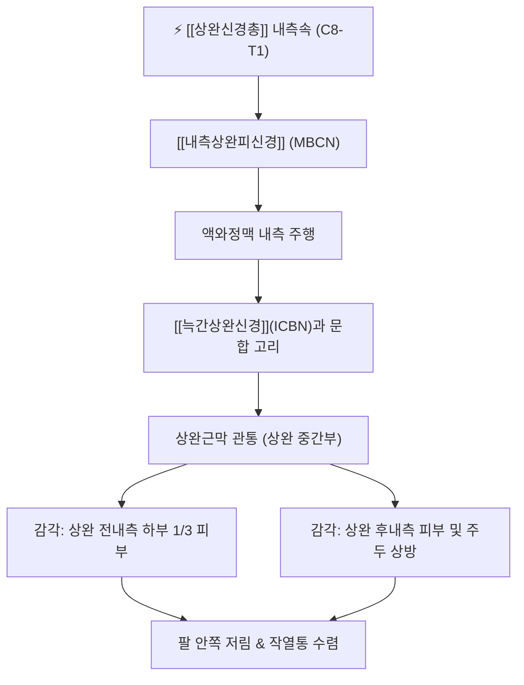

# ⚡ [[내측상완피신경]] (Medial Brachial Cutaneous Nerve / 內側上腕皮神經, C8-T1)

> **핵심 3줄 요약 (Key Summary)**:
> - 🗺️ 신경 기원 & 해부학적 주행: [[상완신경총]] 내측속(Medial cord, C8-T1)의 가장 근위부 분지로, 액와정맥 내측을 따라 하행하여 상완근막을 관통하고 상완 내측 피하로 진출.
> - 🎯 운동 지배(근육군) & 감각 지배 영역: 순수 감각 신경. 상완 내측면 및 후내측면 하부 1/3 피부 감각을 전담하며, 제2 늑간신경의 외측피지인 [[늑간상완신경]](ICBN)과 문합 루프 형성.
> - ⚠️ 호발 포착 부위 & 관련 임상 질환: 액와부 림프절 절제술 손상, [[소흉근]] 하방 간극 포착, 상완근막 관통부 섬유화로 인한 상완 내측의 이상감각 및 신경통.
> - 🔍 주요 이학적 검사 & 신경학적 징후: 상완 내측 티넬 징후(Tinel's sign), 액와부 도수 압진 검사, 흉곽출구 압박 검사.

---

## 1. 신경 기원 & 해부학적 분지 경로 (Anatomy & Course)

* **신경 기원 (Spinal Segments & Cord Origin)**:
  * [[상완신경총]](Brachial plexus)의 **내측속(Medial cord)**에서 가장 먼저 갈라져 나오는 가장 작은 독립 신경 분지이며, 척수 분절 **C8, T1** 전지(Anterior rami)에서 유래합니다.
* **상세 주행 경로 (Detailed Pathway)**:
  1. **액와강 주행 (Axillary Course)**: 액와강(Axilla) 내에서 [[액와동맥]] 및 [[액와정맥]](Axillary vein)의 후면을 지나 액와정맥의 내측 테두리를 따라 하행합니다.
  2. **늑간상완신경과의 문합 (Intercostobrachial Anastomosis)**: 액와부 또는 상완 상부에서 제2 흉추 늑간신경의 외측피지인 [[늑간상완신경]](Intercostobrachial nerve, ICBN)과 만나 문합 고리(Anastomotic loop)를 형성하며 상완 내측 감각 영역을 분담합니다.
  3. **근막 관통 및 피하 분지 (Fascial Piercing)**: [[상완삼두근]](Triceps brachii) 내측두와 [[상완동맥]] 내측 사이를 따라 내려오다가, 상완 중간 또는 하부 1/3 높이에서 심부 상완근막(Brachial fascia)을 뚫고 피하층으로 나와 전지(Anterior branch)와 후지(Posterior branch)로 갈라집니다.
  4. **종말 분포**: 주관절의 내측상과(Medial epicondyle) 및 주두(Olecranon) 상방 피부까지 분포하여 종말합니다.

---

## 2. 신경 지배 맵 & 기능 네트워크 (Innervation Map)

### 1) 감각 신경 지배 (Sensory Innervation)
* **상완 내측 하부 1/3 피부**: 상완골 내측을 감싸는 피부 전면과 후면의 감각을 총괄합니다.
* **주관절 내측부 피부**: 상완골 내측상과 직상방 및 주두(Olecranon) 내측의 피부 감각을 담당합니다.
* **운동 신경 지배**: 순수 감각 신경으로 골격근 운동 지배 섬유는 전혀 포함하지 않습니다.

---

## 3. 호발 포착 부위 & 터널 증후군 병태생리

* **액와부 및 소흉근하 간극 (Retropectoral Space)**:
  * [[소흉근]](Pectoralis minor)의 만성 단축이나 견갑골 전인(Protraction) 시 상완신경총 내측속 전체와 함께 내측상완피신경 기원부가 견인 및 압박을 받습니다.
* **액와 림프절 곽청술 및 유방암 수술 후 손상**:
  * 유방암 수술 중 액와 림프절 절제술(Axillary lymph node dissection) 시행 시 액와정맥 근처를 주행하는 본 신경 또는 늑간상완신경이 절단되거나 견인 손상되어 액와부 및 상완 내측의 영구적 감각 마비가 유발될 수 있습니다.
* **상완근막 관통 터널 (Brachial Fascia Piercing Site)**:
  * 상완 삼두근 내측두 전방에서 심부 근막을 관통하는 부위가 비후되거나 반흔 조직이 형성되면 신경 교액(Entrapment)이 발생하여 팔 안쪽의 작열통(Burning pain)이 일어납니다.

---

## 4. 손상 레벨별 임상 증상 & 신경학적 결손

| 손상 유형 / 원인 | 주요 임상 증상 | 신경학적 결손 양상 |
| :--- | :--- | :--- |
| **소흉근하 간극 압박 (TOS 연계)** | 팔을 들거나 뒤로 젖힐 때 상완 내측의 찌릿한 방사통, 냉감 | C8-T1 피부분절 이상감각, 소흉근 압진 시 통증 방사 |
| **근막 관통부 포착 (국소 신경병증)** | 상완 내측 하부의 국소적 타는 듯한 작열통, 옷깃 스침 통증 | 상완 내측 특정 부위 이질통(Allodynia) 및 티넬 징후 |
| **의원성 수술 손상 (림프절 절제)** | 겨드랑이 안쪽부터 팔 안쪽으로 이어지는 감각 탈락 및 무감각 | 상완 내측 피부의 온통각 및 촉각 소실, 신경종성 통증 |

---

## 5. 관련 이학적 검사 & 신경 감별 매트릭스

* **국소 티넬 징후 (Tinel's Sign at Arm)**:
  * 상완 중간부 내측 근막 관통 부위를 가볍게 타진할 때 상완 내측 하부 및 팔꿈치 내측으로 찌릿한 전기 감전감이 방사되면 국소 포착 의심.
* **[[척골신경]]과의 감별 (Ulnar Nerve Differential)**:
  * 척골신경 포착(주관할 증후군)은 전완 내측과 제4-5수지의 저림 및 손 내재근 위축을 동반하나, 내측상완피신경 단독 포착은 전완과 손가락 증상이 전혀 없고 오직 상완 내측 피부에만 국한됩니다.
* **[[내측전완피신경]]과의 감별 (MACN Differential)**:
  * 내측전완피신경은 팔꿈치 아래 **전완(Forearm)** 내측 피부를 담당하며, 내측상완피신경은 팔꿈치 위 **상완(Arm)** 내측 피부를 지배합니다.

---

## 6. 한의 신경 치료 프로토콜 (약침·침도·신경수기)

* **상완 내측 근막 침도 박리술 (Acupotomy)**:
  * 상완 내측 삼두근 내측두 전연의 근막 관통 압통점을 찾아 신경 주행과 평행하게 침도를 자입하여 비후된 상완근막 섬유를 미세 절개 감압합니다.
* **액와부 신경포착 해소 약침술 (Hydrodissection)**:
  * [[극천]](極泉, HT1) 및 [[청령]](靑靈, HT2) 혈 부위에서 액와혈관 다발을 피해 안전하게 피하 및 근막 간질로 중성어혈약침 또는 신바로약침 1.0~1.5cc를 주입하여 신경 부종을 소퇴시킵니다.
* **소흉근 및 상완삼두근 추나 이완 기법**:
  * 소흉근 근막 이완(Myofascial Release)과 상완삼두근 내측두의 능동 이완 기법(ART)을 병행하여 신경 긴장도를 낮춥니다.

---

## 7. 💡 사용자 진료실 핵심 필기 & 임상 팁 (원문 보존)

* **사용자 원문 필기**:
  * **[[소흉근]]과 갈비뼈 사이 공간**:
    * [[소흉근]] 과긴장, 단축 $\rightarrow$ [[내측상완피신경]](내측상완피부신경), [[내측전완피신경]](내측전완피부신경) 포착 (척골신경통 양상, 상완과 전완 내측부 감각신경성 통증)
* **진료실 실전 감별 팁**:
  * 환자가 "팔 안쪽 살이 스치기만 해도 쓰라리고 아프다"고 호소하며 병원에 올 때, 척골신경 병증으로 오진하기 쉽습니다. 반드시 제4-5지의 저림 유무를 확인하고, 팔꿈치 위쪽 상완 내측에만 국한된 통증이라면 소흉근 압박에 의한 내측상완피신경 포착을 1순위로 의심해야 합니다.
  * 소흉근의 외측 정지부(오훼돌기 하방)를 압진하면서 팔꿈치 안쪽으로 찌릿한 느낌이 전파되는지 확인하고, 해당 부위 자침 및 약침 치료를 시행하면 상완 내측 통증이 즉각 경감됩니다.

---

## 8. 출처 및 학술 참고 문헌 (References)

* Anetai, S., et al. (2023). "The medial brachial cutaneous nerve: An anatomical and histological study." *Anatomical Science International*, 98(3), 342-349. [PMID: 36629996](https://pubmed.ncbi.nlm.nih.gov/36629996/)
  - [연구 요약]: 내측상완피신경의 상완근막 관통 위치 및 늑간상완신경(ICBN)과의 문합 패턴을 정량화하고 임상적 포착 기전을 조직학적으로 규명.
* Race, C. M., & Saldana, M. J. (1991). "Anatomic variation in the medial cord of the brachial plexus." *The Journal of Hand Surgery*, 16(3), 515-518. [PMID: 1995693](https://pubmed.ncbi.nlm.nih.gov/1995693/)
  - [연구 요약]: 상완신경총 내측속에서 분지하는 내측상완피신경과 내측전완피신경의 해부학적 변이 및 액와부 수술 시 손상 방지 가이드라인 제시.
