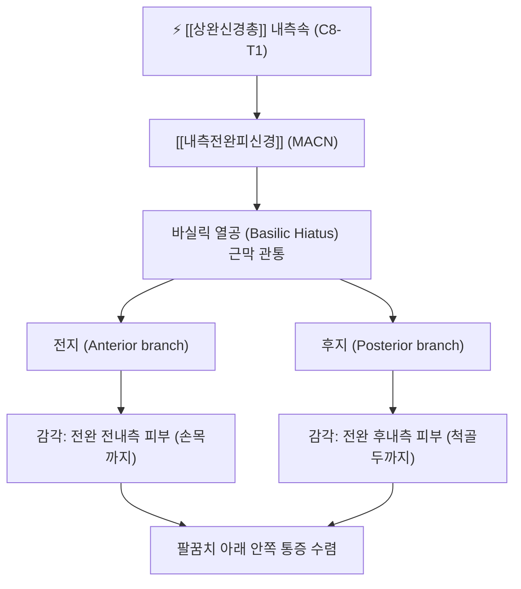

# ⚡ [[내측전완피신경]] (Medial Antebrachial Cutaneous Nerve / 內側前腕皮神經, C8-T1)

> **핵심 3줄 요약 (Key Summary)**:
> - 🗺️ 신경 기원 & 해부학적 주행: [[상완신경총]] 내측속(Medial cord, C8-T1)에서 유래하여 [[귀정맥]](Basilic vein)과 함께 상완근막 열공(Basilic hiatus)을 관통한 뒤 전완 내측 피하로 하행.
> - 🎯 운동 지배(근육군) & 감각 지배 영역: 순수 감각 신경. 전완 전내측 및 후내측 피부 전역을 지배(전지와 후지로 분지)하여 손목 관절 직전까지 감각을 담당.
> - ⚠️ 호발 포착 부위 & 관련 임상 질환: 주관절 바실릭 열공(Basilic hiatus), 팔꿈치 터널 수술 및 채혈 정맥천자 손상, [[소흉근]] 하방 간극 포착에 의한 전완 내측 작열통.
> - 🔍 주요 이학적 검사 & 신경학적 징후: 팔꿈치 내측 티넬 징후, 전완 내측 감각 저하 검사, [[척골신경]] 병증과의 감별 매트릭스.

---

## 1. 신경 기원 & 해부학적 분지 경로 (Anatomy & Course)

* **신경 기원 (Spinal Segments & Cord Origin)**:
  * [[상완신경총]](Brachial plexus)의 **내측속(Medial cord)**에서 [[척골신경]](Ulnar nerve) 바로 직전에 분지하며, **C8, T1** 척수신경 앞가지 섬유로 구성됩니다.
* **상세 주행 경로 (Detailed Pathway)**:
  1. **액와부 주행**: 액와동맥 내측 및 액와정맥 전방을 지나 상완으로 진입합니다.
  2. **상완부 동행 주행**: 상완 상부에서는 [[상완동맥]](Brachial artery) 및 [[귀정맥]](Basilic vein)과 나란히 주행하며, 상완근막 심층에 위치합니다.
  3. **바실릭 열공 관통 (Basilic Hiatus Piercing)**: 상완 중간부(내측상과 상방 약 8~10cm 지점)에서 귀정맥이 상완근막을 뚫고 들어가는 구멍인 **바실릭 열공(Basilic hiatus)**을 통해 피하층으로 빠져나옵니다.
  4. **전완부 2대 분지 (Anterior & Posterior Branches)**:
     * **전지 (Anterior branch)**: 주관절 굴곡 주름부에서 정중주와피정맥(Median cubital vein) 심층 또는 표재를 가로질러 전완 전내측 피부를 따라 손목 관절까지 직진 하행.
     * **후지 (Posterior branch)**: 내측상과(Medial epicondyle) 전면을 돌아 전완 후내측으로 넘어가 척골두(Ulnar head) 부근까지 피부 감각을 방출.

---

## 2. 신경 지배 맵 & 기능 네트워크 (Innervation Map)

### 1) 감각 신경 지배 (Sensory Innervation)
* **전완 전내측 피부**: 팔꿈치 굴곡 주름 내측부터 손목 수근관절 직전까지 전완 앞쪽 내측 피부 감각.
* **전완 후내측 피부**: 상완골 내측상과 하방에서 척골 후면 테두리를 따라 전완 뒤쪽 내측 피부 감각.
* **운동 신경 지배**: 순수 피하 감각 신경으로 근육 운동 지배 섬유가 전혀 없습니다.

---

## 3. 호발 포착 부위 & 터널 증후군 병태생리

* **바실릭 열공 근막 터널 (Basilic Hiatus Entrapment)**:
  * 상완근막을 뚫고 나오는 바실릭 열공 주변의 섬유성 밴드(Fibrous band)가 두꺼워지거나 귀정맥의 울혈이 있을 때 신경이 눌려 포착됩니다.
* **주관증후군 수술 및 정맥천자 의원성 손상**:
  * 팔꿈치 터널 증후군(Cubital tunnel release) 감압술 시 내측상과 전방을 절개할 때 후지가 손상받거나, 주관절 부위 헌혈·채혈 정맥천자 시 바늘에 직접 찔려 외상성 신경종(Neuroma)이 자주 발생합니다.
* **소흉근하 간극 및 흉곽출구 증후군 (TOS)**:
  * [[소흉근]](Pectoralis minor)이 단축되어 오훼돌기 하방에서 상완신경총 하하신경간 및 내측속이 압박받을 때 전완 내측 신경통이 가장 빈번하게 동반됩니다.

---

## 4. 손상 레벨별 임상 증상 & 신경학적 결손

| 병태 유형 | 주요 임상 양상 | 신체 검진 소견 |
| :--- | :--- | :--- |
| **바실릭 열공 포착** | 팔을 비틀거나 짚을 때 팔꿈치 안쪽부터 전완 내측으로 찌릿한 작열통 | 상완 내측 하부 바실릭 열공 압진 시 방사통 유발 |
| **의원성 수술/주사 손상** | 팔꿈치 내측 수술 부위 또는 주사 부위 만성 신경통, 옷깃 스침 과민증 | 국소 티넬 징후 양성, 전완 내측 감각 과민/저하 혼재 |
| **소흉근하 간극 압박 (TOS)** | 팔을 올리거나 뒤로 젖힐 때 전완 내측의 먹먹함, 뻐근한 당김 | 소흉근 압박 시 전완 내측으로 신경통 재현, 라이트 검사 양성 |

---

## 5. 관련 이학적 검사 & 신경 감별 매트릭스

* **[[척골신경]] (Ulnar Nerve)과의 결정적 감별**:
  * **내재근 마비 유무**: 척골신경 손상은 골간근, 소지구근 위축 및 프로망 징후(Froment's sign) 양성을 유발하지만, 내측전완피신경은 순수 감각신경이므로 **운동 마비가 일체 없습니다**.
  * **감각 영역 차이**: 척골신경은 제4-5수지 및 손바닥/손등 척측 감각을 지배하지만, 내측전완피신경은 손바닥에 도달하지 않고 **전완부 피부에서 종말**합니다.
* **주관절 티넬 징후 (Tinel's Sign at Elbow)**:
  * 내측상과 앞쪽 및 바실릭 열공 부위를 타진하여 전완 내측으로 전기 통증이 퍼지는지 확인합니다.

---

## 6. 한의 신경 치료 프로토콜 (약침·침도·신경수기)

* **바실릭 열공 침도 박리술 (Acupotomy)**:
  * 상완골 내측상과 상방 6~8cm 지점, 귀정맥 외측의 근막 관통 압통점을 촉지한 후 미세 침도를 자입하여 비후된 근막 띠를 횡방향으로 절개 감압합니다.
* **수소음심경·수태양소장경 혈위 약침술**:
  * [[소해]](少海, HT3) 및 [[소해]](小海, SI8) 부근에서 혈관과 신경 주행을 피해 신바로약침 또는 황련해독탕 약침을 주입하여 신경 주위 염증성 유착을 박리합니다.
* **전완 굴근군 및 상완근막 수기 가동술**:
  * 전완 내측 굴근군 표재 근막을 이완시키고 전완을 외전·외회전시키는 신경 활주 기법(Nerve gliding technique)을 적용합니다.

---

## 7. 💡 사용자 진료실 핵심 필기 & 임상 팁 (원문 보존)

* **사용자 원문 필기**:
  * **[[소흉근]]과 갈비뼈 사이 공간**:
    * [[소흉근]] 과긴장, 단축 $\rightarrow$ [[내측상완피신경]](내측상완피부신경), [[내측전완피신경]](내측전완피부신경) 포착 (척골신경통 양상, 상완과 전완 내측부 감각신경성 통증)
* **진료실 실전 감별 팁**:
  * 환자가 "새끼손가락 쪽은 괜찮은데 아래팔 안쪽 살이 타는 듯이 저리고 아프다"고 하면 100% 내측전완피신경 단독 병변입니다. 척골신경증으로 오인하여 주관(Cubital tunnel)만 치료하면 치료 반응이 전혀 없습니다.
  * 반드시 오훼돌기 아래 소흉근 부착부와 팔꿈치 위 8cm 부위의 바실릭 열공을 진찰해야 합니다. 소흉근 이완 약침 및 사암침법 후계·신맥 자침을 결합하면 전완 내측 통증이 빠르게 가라앉습니다.

---

## 8. 출처 및 학술 참고 문헌 (References)

* Lowe, J. B., 3rd, et al. (2004). "The medial antebrachial cutaneous nerve: anatomy and cutaneous distribution." *Plastic and Reconstructive Surgery*, 114(5), 1188-1193. [PMID: 15318047](https://pubmed.ncbi.nlm.nih.gov/15318047/)
  - [연구 요약]: 내측전완피신경의 기원, 분지 패턴, 바실릭 열공 통과 지점의 정량적 계측 및 전완 피부 지배 영역의 해부학적 매핑.
* Dellon, A. L., & MacKinnon, S. E. (1985). "Injury to the medial antebrachial cutaneous nerve during cubital tunnel surgery." *The Journal of Hand Surgery*, 10(1), 33-36. [PMID: 3998599](https://pubmed.ncbi.nlm.nih.gov/3998599/)
  - [연구 요약]: 팔꿈치 수술 및 정맥 처치 중 발생하는 내측전완피신경 손상 기전과 의원성 신경종의 임상적 예방 및 치료 원칙 제시.
