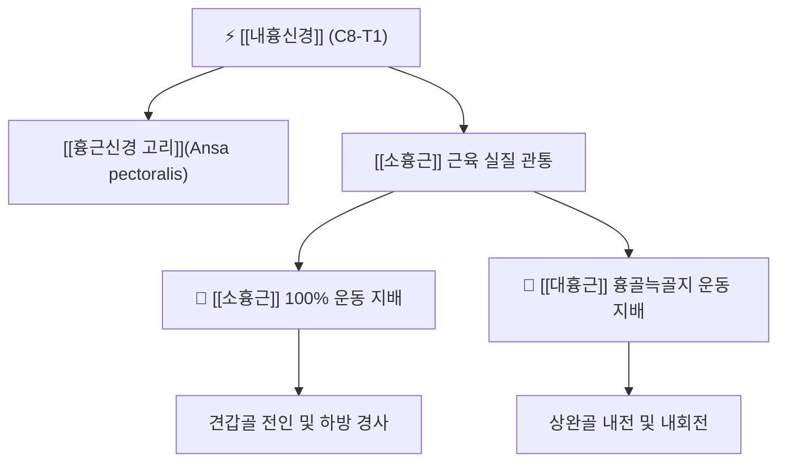

# ⚡ [[내흉신경]] (Medial Pectoral Nerve / 內胸神經, C8-T1)

> **핵심 3줄 요약 (Key Summary)**:
> - 🗺️ 신경 기원 & 해부학적 주행: [[상완신경총]] 내측속(Medial cord, C8-T1)에서 기원하여 액와혈관 다발 사이를 지나 [[소흉근]](Pectoralis minor)을 직접 관통하여 하강.
> - 🎯 운동 지배(근육군) & 감각 지배 영역: 순수 운동 신경. [[소흉근]] 100% 운동 지배 및 [[대흉근]](Pectoralis major) 흉골늑골지 운동을 전담.
> - ⚠️ 호발 포착 부위 & 관련 임상 질환: 오훼돌기 하방 소흉근 관통 터널, [[소흉근 증후군]], 둥근 어깨 자세에서의 흉곽출구 압박 및 전흉부 당김통.
> - 🔍 주요 이학적 검사 & 신경학적 징후: [[라이트 검사]](Wright test), 소흉근 압진 검사, 대흉근 하부 근력 평가.

---

## 1. 신경 기원 & 해부학적 분지 경로 (Anatomy & Course)

* **신경 기원 (Spinal Segments & Origin)**:
  * [[상완신경총]](Brachial plexus)의 **내측속(Medial cord)**에서 갈라져 나오며, **C8, T1** 척수신경 앞가지 섬유로 구성됩니다. 현대 해부학 표준 명칭은 [[내측흉근신경]](Medial pectoral nerve)입니다.
* **상세 주행 경로 (Detailed Pathway)**:
  1. 액와동맥 첫 번째 분절의 후면에서 기원하여 [[액와동맥]]과 [[액와정맥]] 사이를 가로질러 전하방으로 주행합니다.
  2. [[외측흉근신경]]에서 오는 교통지와 합류하여 **[[흉근신경 고리]](Ansa pectoralis)**를 형성합니다.
  3. [[소흉근]](Pectoralis minor)의 심부 표면으로 진입하며, 신경의 주간(Trunk)이 **소흉근 근육 실질을 직접 관통(Piercing)**합니다.
  4. 소흉근을 뚫고 나온 종말 분지들은 [[대흉근]](Pectoralis major)의 흉골늑골지(Sternocostal head) 심층으로 진입하여 근육 내로 퍼집니다.

---

## 2. 신경 지배 맵 & 기능 네트워크 (Innervation Map)

### 1) 운동 신경 지배 (Motor Innervation)
* **[[소흉근]](Pectoralis minor)**: 유일한 단독 운동 신경 지배를 담당합니다.
* **[[대흉근]](Pectoralis major) 흉골늑골지**: 대흉근의 하부 근섬유를 지배하여 상완골을 가슴 안쪽으로 강력하게 끌어당기는 기능을 발휘합니다.
* **감각 신경 특성**: 피하 감각 분지는 없으며, 골격근 운동 및 근방추 고유수용성 감각만을 담당합니다.

---

## 3. 호발 포착 부위 & 터널 증후군 병태생리

* **소흉근 관통부 터널 포착 (Transpectoral Tunnel Entrapment)**:
  * 내흉신경이 소흉근 근육 섬유를 관통할 때, 거북목이나 라운드 숄더로 소흉근이 지속적인 단축 연축 상태에 놓이면 신경이 근육 사이에 물리적으로 갇혀 허혈성 교액이 발생합니다.
* **오훼돌기 하방 흉곽출구 압박**:
  * 소흉근이 경직되면 오훼돌기와 제3-5늑골 사이의 공간이 좁아지며, 내흉신경뿐 아니라 상완신경총 신경속 전체와 액와혈관이 2차적으로 압박되는 흉곽출구증후군(소흉근 증후군)을 유발합니다.

---

## 4. 손상 레벨별 임상 증상 & 신경학적 결손

| 손상 유형 / 레벨 | 주요 임상 증상 | 신경학적 결손 소견 |
| :--- | :--- | :--- |
| **소흉근 관통부 신경 포착** | 가슴 앞쪽 바깥의 뻐근한 조임, 팔을 머리 위로 올릴 때 앞가슴 찢어짐 | 오훼돌기 내하방 압통점 및 방사통, 가슴 근육 뭉침 |
| **신경 단열 / 완전 마비** | 대흉근 하부의 현저한 위축 및 가슴 윤곽 함몰, 미는 힘 약화 | 상완골 내전력 감퇴, 견갑골 후인 제한 및 불균형 |

---

## 5. 관련 이학적 검사 & 신경 감별 매트릭스

* **[[라이트 검사]] (Wright Test)**:
  * 환자의 상지를 외전 및 외회전할 때 흉곽 전면 및 액와부 통증이 유발되거나 요골동맥 맥박이 감쇠하면 소흉근에 의한 신경혈관 압박으로 판정.
* **소흉근 도수 압진 검사 (Palpation Test)**:
  * 쇄골 아래 오훼돌기를 찾고, 그 내측 하방 약 2cm 부위의 소흉근 건막을 압진할 때 전형적인 압통과 전흉부 방사통이 재현되는지 확인.
* **[[내측흉근신경]]과의 관계**:
  * 내흉신경(內胸神經)은 내측흉근신경(Medial Pectoral Nerve)과 완전한 동일 신경의 한자 및 과거 의학 명칭입니다.

---

## 6. 한의 신경 치료 프로토콜 (약침·침도·신경수기)

* **소흉근 관통부 침도 박리술 (Acupotomy)**:
  * 오훼돌기 내하방 소흉근 건막 및 신경 관통 부위를 촉진하여 침도를 사자(Oblique insertion)하여 비후된 섬유성 밴드를 절개 감압합니다.
* **경혈 약침 주입술**:
  * [[중부]](中府, LU1) 혈 및 [[운문]](雲門, LU2) 혈 부위에서 심부 혈관을 피해 소흉근 근막층으로 중성어혈약침 1.0cc를 주입하여 국소 염증과 부종을 배출합니다.
* **대소흉근 근막 이완 추나 (Myofascial Release)**:
  * 환자를 앙와위로 두고 시술자의 수근부로 대흉근 및 소흉근을 흉벽 외측으로 스트레칭하며 흉곽 가동성을 회복시킵니다.

---

## 7. 💡 사용자 진료실 핵심 필기 & 임상 팁 (원문 보존)

* **사용자 원문 필기**:
  * **[[대흉근]], [[소흉근]] 운동 지배**
* **진료실 실전 임상 팁**:
  * 임상에서 라운드 숄더 환자가 "가슴 앞쪽이 뻐근하게 조이고 숨쉬기가 답답하다"고 호소할 때, 심장 질환이 배제되었다면 1순위로 내흉신경(내측흉근신경)의 소흉근 관통부 포착을 의심해야 합니다.
  * 소흉근을 뚫고 나오는 내흉신경을 오훼돌기 하방에서 정확히 찾아 침 치료를 시행하면 대흉근과 소흉근의 과긴장이 즉각 풀리며 어깨가 자연스럽게 뒤로 펴지는 효과를 얻을 수 있습니다.

---

## 8. 출처 및 학술 참고 문헌 (References)

* Stanczyk, P., et al. (2026). "Atypical Origin of the Pectoral Nerves: Morphological Insights for Orthopedic, Reconstructive, and Trauma Surgeons." *Cureus*, 18(5), e60124. [PMID: 42338849](https://pubmed.ncbi.nlm.nih.gov/42338849/)
  - [연구 요약]: 내흉신경(내측흉근신경)의 기원과 소흉근 관통 변이, 대흉근으로의 분지 분포에 대한 사체 해부학적 고찰.
* Park, S. B., et al. (2025). "Radiologic evidence supporting pectoral nerve involvement in perineural spread of breast cancer to the brachial plexus." *Acta Neurochirurgica*, 167(1), 188. [PMID: 40728544](https://pubmed.ncbi.nlm.nih.gov/40728544/)
  - [연구 요약]: 흉근신경 다발의 해부학적 주행과 상완신경총과의 연계성을 영상의학적 및 임상적 관점에서 규명.
