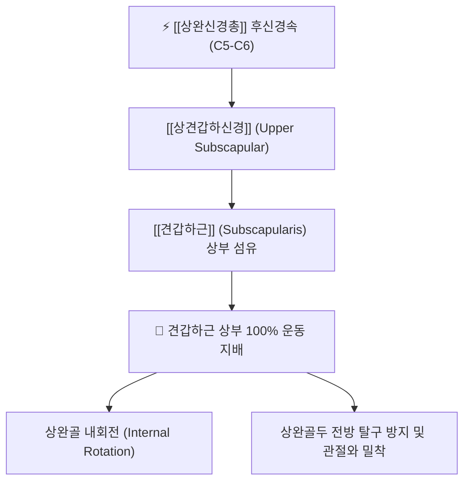

# ⚡ [[상견갑하신경]] (Upper Subscapular Nerve / 上肩胛下神經, C5-C6)

> **핵심 3줄 요약 (Key Summary)**:
> - 🗺️ 신경 기원 & 해부학적 주행: [[상완신경총]] 후신경속(Posterior cord, C5-C6)의 첫 번째 분지로, 액와강 후벽을 따라 짧게 주행하여 [[견갑하근]](Subscapularis) 상부로 진입.
> - 🎯 운동 지배(근육군) & 감각 지배 영역: 순수 운동 신경. [[견갑하근]]의 상부 근육 섬유를 100% 운동 지배하여 상완골 내회전 및 견관절 전방 동적 안정성 유지.
> - ⚠️ 호발 포착 부위 & 관련 임상 질환: 액와부 심부 유착, 견관절 전방 탈구 손상, [[유착성 관절낭염]](오십견) 환자에서 견갑하근 구축에 의한 외회전 가동 제한.
> - 🔍 주요 이학적 검사 & 신경학적 징후: 베어 허그 검사(Bear hug test), 리프트 오프 검사(Lift-off test), 견갑하근 상부 압진.

---

## 1. 신경 기원 & 해부학적 분지 경로 (Anatomy & Course)

* **신경 기원 (Spinal Segments & Origin)**:
  * [[상완신경총]](Brachial plexus)의 **후신경속(Posterior cord)**에서 가장 근위부에서 기원하며, **C5, C6** 척수신경 앞가지 섬유로 구성됩니다.
* **상세 주행 경로 (Detailed Pathway)**:
  1. 액와동맥(Axillary artery)의 후방에서 후신경속으로부터 직각에 가깝게 갈라져 나옵니다.
  2. [[흉배신경]](Thoracodorsal nerve) 및 [[하견갑하신경]](Lower subscapular nerve)보다 근위부에서 분지하여 액와강 후벽의 견갑하와(Subscapular fossa)를 향해 후하방으로 짧게 주행합니다.
  3. [[견갑하근]](Subscapularis)의 늑골면(심층 표면) 상부 1/3 영역의 근육 실질 속으로 직접 침투하여 다수의 미세 운동 신경 가지로 분지합니다.

---

## 2. 신경 지배 맵 & 기능 네트워크 (Innervation Map)

### 1) 운동 신경 지배 (Motor Innervation)
* **[[견갑하근]](Subscapularis) 상부 섬유**: 견갑하근의 상부 근육 다발을 전담 지배합니다.
* **기능적 역할**: 상완골의 강력한 내회전을 유발하며, 견관절 외전 시 상완골두가 관절와(Glenoid fossa)의 중심에 머물도록 아래로 끌어당기는 동적 안정자(Dynamic stabilizer) 역할을 수행합니다.
* **감각 신경 특성**: 피부 감각 지배지는 전혀 없으며, 견갑하근 근방추 및 견관절 전방 관절낭 일부의 고유수용성 감각을 관장합니다.

---

## 3. 호발 포착 부위 & 터널 증후군 병태생리

* **액와와 후벽 근막 유착**:
  * 후신경속에서 분지하여 견갑하근으로 진입하는 경로가 매우 짧아, 견관절의 과도한 외전·외회전 손상이나 액와강 심부 혈종 발생 시 견인 손상을 받기 쉽습니다.
* **견관절 전방 탈구 및 뱅카르트 병변 연계**:
  * 상완골두가 전하방으로 탈구될 때 후신경속 분지들이 전방으로 강하게 신장되면서 상견갑하신경의 신경실무율 저하 및 마비가 초래될 수 있습니다.
* **오십견 환자의 견갑하근 경직 악순환**:
  * [[유착성 관절낭염]](동결견) 시 전방 관절낭 구축과 함께 견갑하근의 만성 연축이 발생하면 상견갑하신경의 혈류 순환 장애와 신경인성 통증이 만성화됩니다.

---

## 4. 손상 레벨별 임상 증상 & 신경학적 결손

| 병태 유형 | 주요 임상 양상 | 신체 검진 소견 |
| :--- | :--- | :--- |
| **신경 포착 / 연축** | 열중쉬어 자세 시 견관절 심부의 묵직한 통증, 팔을 바깥으로 돌릴 때 앞쪽 저림 | 견갑하근 상부(액와 심부) 압진 시 극심한 압통 유발 |
| **신경 마비 / 손상** | 상완골 내회전력 약화, 투구 동작이나 수영 시 팔에 힘이 빠지는 무력감 | 베어 허그 검사 양성, 상완골두 전방 아탈구 경향 |

---

## 5. 관련 이학적 검사 & 신경 감별 매트릭스

* **베어 허그 검사 (Bear Hug Test)**:
  * 환자가 환측 손바닥을 건측 어깨 위에 얹고 팔꿈치를 든 상태에서 시술자가 손을 떼어내려 할 때 버티지 못하면 견갑하근 상부(상견갑하신경 지배 영역) 결손 확진.
* **[[하견갑하신경]]과의 비교 감별**:
  * 상견갑하신경은 견갑하근 상부만을 지배하는 반면, 하견갑하신경은 견갑하근 하부뿐 아니라 [[대원근]](Teres major)까지 지배하므로, 대원근 기능(상완골 내전 및 신전 보조) 보존 여부로 감별.
* **[[견갑상신경]]과의 감별**:
  * 견갑상신경 손상은 극상근·극하근 마비로 인한 외회전 및 외전 초기 결손을 보이나, 상견갑하신경은 내회전 결손을 보입니다.

---

## 6. 한의 신경 치료 프로토콜 (약침·침도·신경수기)

* **액와와 심부 견갑하근 자침술**:
  * 환자를 측와위로 눕히고 상지를 가볍게 외전시킨 상태에서 [[극천]](極泉, HT1) 외측, 견갑골 전면 늑골면을 향해 장침(60~75mm)을 심자하여 견갑하근 상부와 신경 진입부를 이완시킵니다.
* **견갑하근 침도 유착 박리술**:
  * 액와부 혈관과 신경총 주행을 초음파로 확인 후, 견갑골 외측연 전면의 견갑하근 건막 부착부를 침도로 미세 절개하여 섬유화된 근막을 감압합니다.
* **견관절 내회전근 추나 수기요법**:
  * 견갑골을 흉벽에 고정한 상태에서 상완골두를 후하방으로 글라이딩시키는 관절가동추나(Mobilization)를 적용합니다.

---

## 7. 💡 사용자 진료실 핵심 필기 & 임상 팁 (원문 보존)

* **사용자 원문 필기**:
  * **-[[견갑하근]] 운동지배**
* **진료실 실전 임상 팁**:
  * 오십견(유착성 관절낭염) 환자 중 팔을 뒤로 돌려 뒷주머니에 손을 넣지 못하거나(내회전 제한), 반대로 팔을 바깥으로 벌릴 때 어깨 앞쪽이 턱 걸리며 극심한 통증을 호소하는 환자의 열쇠는 견갑하근 상부와 이를 지배하는 상견갑하신경에 있습니다.
  * 액와 주름 안쪽 깊숙이 손가락을 넣어 견갑골 안쪽 앞면(견갑하와)을 짚고 견갑하근을 압박하면 환자가 자지러지는 비명을 지릅니다. 이 부위에 호침 심자 및 신바로약침 치료를 2~3회 병행하면 단단하게 굳었던 외회전 각도가 즉시 회복됩니다.

---

## 8. 출처 및 학술 참고 문헌 (References)

* Sager, B., et al. (2019). "The subscapular nerves: an anatomical study with clinical implications." *Folia Morphologica*, 78(4), 844-850. [PMID: 31334431](https://pubmed.ncbi.nlm.nih.gov/31334431/)
  - [연구 요약]: 상완신경총 후신경속에서 분지하는 상견갑하신경의 기원, 분지 패턴, 견갑하근 실질 내 신경 침투 지점의 3차원 해부학적 계측 및 임상적 손상 위험 분석.
