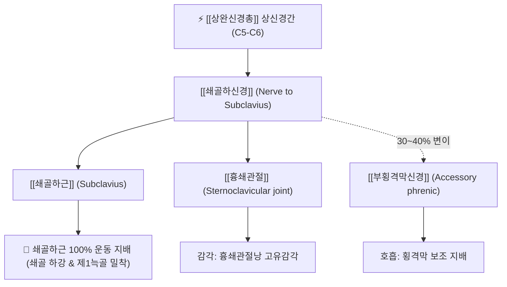

# ⚡ [[쇄골하신경]] (Nerve to Subclavius / 鎖骨下神經, C5-C6)

> **핵심 3줄 요약 (Key Summary)**:
> - 🗺️ 신경 기원 & 해부학적 주행: [[상완신경총]] 상신경간(Superior trunk, C5-C6) 전면에서 분지하여 [[쇄골하동맥]] 전면을 가로질러 [[쇄골하근]](Subclavius) 심층으로 진입.
> - 🎯 운동 지배(근육군) & 감각 지배 영역: [[쇄골하근]] 100% 운동 지배(쇄골 안정화) 및 [[흉쇄관절]](SC joint) 관절낭 감각 분지, 해부학적 변이로 [[부횡격막신경]] 분출.
> - ⚠️ 호발 포착 부위 & 관련 임상 질환: 쇄골 골절 및 금속판 고정 수술 후 손상, 쇄골하근 비후에 의한 늑쇄간극 [[흉곽출구 증후군]].
> - 🔍 주요 이학적 검사 & 신경학적 징후: 에덴 검사(Eden test / Costoclavicular maneuver), 쇄골 하방 압진, 흉쇄관절 스트레스 검사.

---

## 1. 신경 기원 & 해부학적 분지 경로 (Anatomy & Course)

* **신경 기원 (Spinal Segments & Trunk Origin)**:
  * [[상완신경총]](Brachial plexus)의 **상신경간(Superior trunk)** 전면에서 분지하며, **C5, C6** 척수신경 앞가지 섬유로 구성됩니다 (일부 C4 기여 가능).
* **상세 주행 경로 (Detailed Pathway)**:
  1. 상완신경총 상신경간에서 [[견갑상신경]](Suprascapular nerve)보다 원위부 전면에서 갈라져 나옵니다.
  2. [[쇄골하동맥]](Subclavian artery)의 제3부 전면을 대각선으로 가로질러 전하방으로 하행합니다.
  3. 쇄골 후면 아래를 주행하여 [[쇄골하근]](Subclavius)의 심부 근육 실질로 진입하여 운동 분지를 방출합니다.
  4. **부횡격막신경(Accessory Phrenic Nerve) 형성 변이**: 약 30~40%의 개체에서 쇄골하신경에서 갈라져 나온 신경 섬유가 전사각근 외측을 돌아 흉강 내로 진입한 뒤 [[횡격막신경]](Phrenic nerve)에 합류하는 임상적으로 매우 중요한 해부학적 변이를 보입니다.

---

## 2. 신경 지배 맵 & 기능 네트워크 (Innervation Map)

### 1) 운동 신경 지배 (Motor Innervation)
* **[[쇄골하근]](Subclavius)**: 쇄골하근을 지배하는 유일한 신경입니다.
* **기능적 역할**: 상지 운동 시 쇄골을 제1늑골 방향으로 끌어당겨 흉쇄관절의 탈구를 방지하고 쇄골하 신경혈관 다발을 보호하는 완충대 역할을 수행합니다.

### 2) 감각 및 자율 신경 지배
* **[[흉쇄관절]](SC Joint) 관절낭**: 흉쇄관절낭 및 오훼쇄골인대 부근의 고유수용성 감각 및 관절 통각 분지를 냅니다.
* **부횡격막신경 기여**: 횡격막의 운동 및 감각 지배에 보조적으로 관여합니다.

---

## 3. 호발 포착 부위 & 터널 증후군 병태생리

* **쇄골 골절 및 정형외과 수술 손상**:
  * 쇄골 골간부 골절(Clavicle midshaft fracture) 시 전위된 골편에 의해 신경이 직접 타박되거나, 쇄골 플레이트 고정 수술 시 박리 과정에서 견인 및 절단 손상을 입을 수 있습니다.
* **늑쇄간극 증후군 (Costoclavicular Space Syndrome)**:
  * 쇄골하근이 비후되거나 섬유화되면 쇄골하신경 자체의 압박뿐만 아니라, 쇄골과 제1늑골 사이 공간이 협소해져 바로 아래를 통과하는 상완신경총 신경속들과 쇄골하혈관이 동반 압박됩니다.

---

## 4. 손상 레벨별 임상 증상 & 신경학적 결손

| 병태 유형 | 주요 임상 양상 | 신체 검진 소견 |
| :--- | :--- | :--- |
| **늑쇄간극 압박 / 포착** | 가방을 멜 때 쇄골 아래가 뻐근하고 팔 전체로 저림이 방사 | 쇄골 중앙 하방 압진 시 국소 통증 및 팔 저림 재현 |
| **신경 마비 / 손상** | 팔을 거상할 때 흉쇄관절 부위의 불안정성 및 미세 통증 | 쇄골하근 위축, 상완 거상 시 쇄골의 비정상적 요동 |
| **부횡격막신경 합류 시** | 경부 손상이나 수술 시 횡격막 마비 또는 호흡 곤란 연계 위험 | 심호흡 시 흉곽 팽창 비대칭 가능성 |

---

## 5. 관련 이학적 검사 & 신경 감별 매트릭스

* **에덴 검사 (Eden Test / Costoclavicular Maneuver)**:
  * 환자가 가슴을 펴고 어깨를 뒤 아래로 강하게 당기는 군인 자세를 취할 때 쇄골하 공간이 좁아지며 요골동맥 맥박이 감쇠하거나 쇄골 하부 통증이 나타나면 양성.
* **[[견갑상신경]]과의 기원 감별**:
  * 두 신경 모두 상신경간(C5-C6)에서 기원하나, 견갑상신경은 후방 견갑절흔을 향해 주행하여 극상근·극하근을 지배하고, 쇄골하신경은 전하방으로 주행하여 쇄골하근을 지배합니다.

---

## 6. 한의 신경 치료 프로토콜 (약침·침도·신경수기)

* **쇄골하근 근막 침도 박리술 (Acupotomy)**:
  * 쇄골 중간부 1/3 하연에서 제1늑골을 향해 침도를 쇄골과 평행하게 사자하여 쇄골하동맥 및 흉막을 완벽히 피하면서 쇄골하근 건막 유착을 안전하게 감압합니다.
* **경혈 약침 주입술**:
  * [[결분]](缺盆, ST12) 및 [[기호]](氣戶, ST13) 혈 부위에서 쇄골 상·하연의 해부학적 랜드마크를 확인하고 신바로약침 또는 중성어혈약침 0.5~1.0cc를 천층으로 안전하게 주입합니다.
* **늑쇄간극 추나 수기요법**:
  * 흉쇄관절과 견봉쇄골관절의 관절가동술(Mobilization)을 통해 쇄골의 후방 회전 및 거상 가동성을 확보하여 늑쇄간극의 압박을 해소합니다.

---

## 7. 💡 사용자 진료실 핵심 필기 & 임상 팁 (원문 보존)

* **사용자 원문 필기**:
  * **- [[쇄골하근]]을 지배하는 신경**
* **진료실 실전 감별 팁**:
  * 무거운 백팩을 메고 다니는 수험생이나 직장인이 "어깨 앞쪽 쇄골 밑이 묵직하게 쑤시고 팔이 전체적으로 무겁다"고 할 때, 쇄골하근의 과긴장과 쇄골하신경의 자극 상태를 반드시 살펴야 합니다.
  * 쇄골 아래 1cm 지점을 손가락으로 쇄골 밑을 파고들듯 누르면 극심한 통증을 호소하는데, 이때 침 치료나 약침을 쇄골 뼈 방향으로 비스듬히 놓아 쇄골하근을 이완시키면 가슴이 시원하게 펴지는 즉각적인 치료 효과를 볼 수 있습니다.

---

## 8. 출처 및 학술 참고 문헌 (References)

* McCarty, P. J., et al. (2023). "Anatomy of the nerve to subclavius and its relationship to the clavicle and surrounding structures." *Clinical Anatomy*, 36(6), 882-888. [PMID: 37452892](https://pubmed.ncbi.nlm.nih.gov/37452892/)
  - [연구 요약]: 쇄골하신경의 상완신경총 상신경간 기원, 쇄골에 대한 해부학적 상관관계, 부횡격막신경 분지율 및 쇄골 골절 수술 시 신경 손상 예방 가이드라인 제시.
