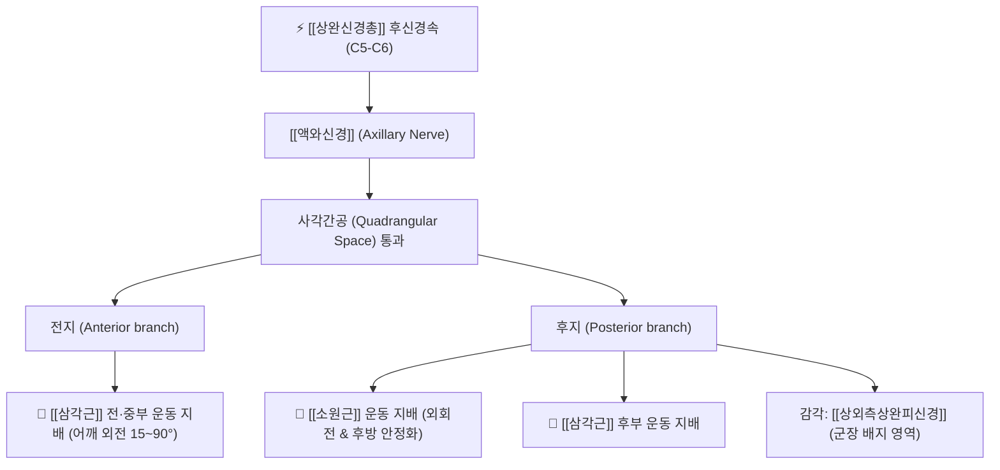

# ⚡ [[액와신경]] (Axillary Nerve / 腋窩神經, C5-C6)

> **핵심 3줄 요약 (Key Summary)**:
> - 🗺️ 신경 기원 & 해부학적 주행: [[상완신경총]] 후신경속(Posterior cord, C5-C6)에서 기원하여 견갑하근 전면을 지나 사각간공(Quadrangular space)을 통해 견관절 후방으로 진출.
> - 🎯 운동 지배(근육군) & 감각 지배 영역: [[삼각근]](전·중·후부) 및 [[소원근]] 운동 지배(어깨 외전·외회전), 상외측상완피신경을 통한 삼각근 하부 군장 엠블럼 부위 피부 감각 전담.
> - ⚠️ 호발 포착 부위 & 관련 임상 질환: 사각공 증후군(소원근·대원근 비후), 상완골 외과경 골절 및 견관절 전방 탈구 손상, 삼각근 마비 및 어깨 외측 통증.
> - 🔍 주요 이학적 검사 & 신경학적 징후: 삼각근 도수근력검사(MMT), 엠블럼 부위 감각 검사(Pinprick), 사각간공 압통 검사.

---

## 1. 신경 기원 & 해부학적 분지 경로 (Anatomy & Course)

* **신경 기원 (Spinal Segments & Cord Origin)**:
  * [[상완신경총]](Brachial plexus)의 **후신경속(Posterior cord)**에서 갈라져 나오며, **C5, C6** 척수신경 앞가지 섬유로 구성됩니다.
* **상세 주행 경로 (Detailed Pathway)**:
  1. 액와동맥(Axillary artery)의 후방에서 기원하여 [[견갑하근]](Subscapularis)의 전면(늑골면)을 따라 하외측으로 하행합니다.
  2. 견갑하근 하연을 지나 후방으로 회전하여 **사각간공(Quadrangular space)**으로 진입합니다.
  3. **사각간공(Quadrangular Space)의 경계 구조**:
     * 상계: [[소원근]](Teres minor) 및 견갑하근 하연
     * 하계: [[대원근]](Teres major) 상연
     * 내측계: [[상완삼두근]](Triceps brachii) 장두의 외측연
     * 외측계: 상완골 외과경(Surgical neck of humerus) 내측면
  4. 사각간공을 빠져나올 때 **후상완회선동맥(Posterior circumflex humeral artery, PCHA)**과 동행하며, 전지(Anterior branch)와 후지(Posterior branch)로 분지합니다.
  5. **전지**: 상완골 경부를 외측으로 감아 돌며 [[삼각근]](Deltoid) 전·중부 심층으로 침투하여 운동지를 냅니다.
  6. **후지**: [[소원근]]과 삼각근 후부로 운동 분지를 내고, 종말 분지인 **[[상외측상완피신경]]**이 되어 삼각근 후연을 돌아 피하로 나와 피부 감각을 담당합니다.

---

## 2. 신경 지배 맵 & 기능 네트워크 (Innervation Map)

### 1) 운동 신경 지배 (Motor Innervation)
* **[[삼각근]](Deltoid)**: 견관절의 15도~90도 외전(중부), 굴곡 및 수평 내전(전부), 신전 및 수평 외전(후부)을 담당하는 상지 최대의 모터 근육.
* **[[소원근]](Teres minor)**: 상완골의 강력한 외회전 및 상완골두를 관절와 후방에 안정화시키는 회전근개 핵심 근육.
* **관절지 (Articular branches)**: 견관절낭의 전면, 후면 및 하부 관절지에 감각 섬유를 분지하여 관절 고유수용감각을 관장.

### 2) 피부 감각 지배 (Sensory Innervation)
* **[[상외측상완피신경]](Superior Lateral Cutaneous Nerve of Arm)**:
  * 군복 견장(Regimental badge) 영역이라 불리는 삼각근 하부 1/2 외측 피부 감각을 총괄.
  * 액와신경 마비 여부를 선별하는 가장 결정적인 신경학적 랜드마크.

---

## 3. 호발 포착 부위 & 터널 증후군 병태생리

* **사각공 증후군 (Quadrangular Space Syndrome, QSS)**:
  * 투구, 수영, 배구 등 팔을 머리 위로 올리는 오버헤드(Overhead) 동작을 반복할 때 [[소원근]] 및 대원근의 과긴장, 비후 또는 섬유성 밴드 형성에 의해 액와신경과 후상완회선동맥이 교액됩니다.
  * 어깨 후외측의 뻐근한 둔통, 외전·외회전 시 방사통 악화, 삼각근 부위의 이상감각을 유발합니다.
* **견관절 전방 탈구 및 상완골 외과경 골절**:
  * 상완골두가 전하방으로 탈구될 때 상완골 경부를 휘감는 액와신경이 강하게 신장(Traction)되거나 골절편에 의해 열상(Laceration) 손상을 입어 급성 삼각근 마비가 발생합니다.

---

## 4. 손상 레벨별 임상 증상 & 신경학적 결손

| 병태 유형 | 주요 임상 양상 | 신체 검진 및 신경학적 결손 |
| :--- | :--- | :--- |
| **사각공 증후군 (신경 포착)** | 어깨 뒤쪽의 묵직한 통증, 팔을 들거나 젖힐 때 외측 방사통 | 사각간공 압진 시 극심한 압통, 상지 외전 유지 피로감 |
| **급성 액와신경 마비 (탈구/골절)** | 어깨를 옆으로 15도 이상 들어 올리지 못함 (외전 불능) | 견장 부위 감각 소실(Numbness), 삼각근 수축력 소실 |
| **만성 신경 손상** | 삼각근의 전반적 위축으로 인한 어깨의 각진 변형 (Square shoulder) | 상완골두 전하방 아탈구 경향, 소원근 지방 침윤 |

---

## 5. 관련 이학적 검사 & 신경 감별 매트릭스

* **삼각근 엠블럼 감각 검사 (Regimental Badge Pinprick Test)**:
  * 삼각근 외측 하부 중심부를 침 또는 손끝으로 자극하여 건측과 비교(감각 둔마 또는 무감각 확인).
* **삼각근 도수근력검사 (Deltoid MMT)**:
  * 환자가 팔을 90도 외전한 상태에서 시술자가 하방으로 압력을 가할 때 버티지 못하고 떨어지면 양성.
* **[[견갑상신경]]과의 외전 결손 감별**:
  * 외전 초기(0~15도) 시작이 불가능하면 극상근([[견갑상신경]]) 병변이며, 15도 이후 90도까지의 외전 거상이 불가능하면 삼각근([[액와신경]]) 병변입니다.

---

## 6. 한의 신경 치료 프로토콜 (약침·침도·신경수기)

* **사각간공 침도 유착 박리술 (Acupotomy)**:
  * 환자를 복와위로 두고 [[견정]](肩貞, SI9) 상외측, 소원근과 삼각근 후부 사이의 사각간공 개구부를 촉진하여 침도를 수직 자입 후 미세 절개하여 신경 포착 밴드를 감압합니다.
* **사각간공 및 삼각근 약침 요법**:
  * 견정(SI9), [[견료]](肩髎, TE14), [[노회]](臑會, TE13) 혈에 신바로약침 또는 중성어혈약침 1.0~1.5cc를 분할 주입하여 사각간공 주위 염증성 부종을 완화하고 신경 영양을 공급합니다.
* **소원근·대원근 능동 이완 추나 (Active Release Technique)**:
  * 시술자가 사각간공 부위를 모지로 압박 고정한 상태에서 환자에게 상완골을 천천히 내회전 및 외회전하도록 유도하여 근막 글라이딩을 정상화합니다.

---

## 7. 💡 사용자 진료실 핵심 필기 & 임상 팁 (원문 보존)

* **사용자 원문 필기**:
  * C5-6 척수신경 앞가지에서 기원하여 [[상완신경총]]에서 분지
  * [[견갑하근]] 앞으로 주행하여 내려오다가 뒤로 가 [[소원근]], [[대원근]], [[상완삼두근]], 상완골로 둘러싸인 공간을 통과
  * [[상완삼두근]]의 장두, [[소원근]], [[삼각근]] 운동지배, [[삼각근]] 피부영역 감각지배, 어깨관절 아랫면, 뒷면, 앞면, 아랫부분 관절지
  * 주로 [[소원근]]에서 포착됨
* **진료실 실전 감별 & 자침 팁**:
  * 환자가 어깨 외측 통증을 호소할 때 흔히 오십견이나 회전근개 파열로 단정하기 쉽습니다. 그러나 야간통과 함께 삼각근 바깥쪽의 감각이 둔하다고 하면 반드시 어깨 뒤쪽 사각간공(소원근 부위)을 엄지로 깊게 눌러보아야 합니다.
  * 소원근 부위를 누를 때 "선생님, 바로 거기가 쑤시면서 팔 바깥쪽으로 찌릿하게 퍼집니다"라고 하면 100% 사각공 증후군입니다. 이때 견정혈 침도 치료 1~2회로 오랜 어깨 통증이 드라마틱하게 소퇴됩니다.

---

## 8. 출처 및 학술 참고 문헌 (References)

* Cahill, B. R., & Palmer, R. E. (1983). "Quadrilateral space syndrome." *The Journal of Hand Surgery*, 8(1), 65-69. [PMID: 6827057](https://pubmed.ncbi.nlm.nih.gov/6827057/)
  - [연구 요약]: 사각간공에서 발생하는 액와신경 및 후상완회선동맥의 압박 기전, 임상 증상, 진단적 혈관조영술 및 수술적 감압술 프로토콜 정립.
* McClelland, D., & Paxinos, A. (2008). "The anatomy of the quadrilateral space with reference to quadrilateral space syndrome." *Journal of Shoulder and Elbow Surgery*, 17(1), 162-164. [PMID: 17993281](https://pubmed.ncbi.nlm.nih.gov/17993281/)
  - [연구 요약]: 사각간공 내 섬유성 밴드(Fibrous bands)의 해부학적 유병률(87.5%)과 견관절 회전 운동 시 신경 혈관 압박 면적의 동적 변화를 카데바 해부로 규명.
