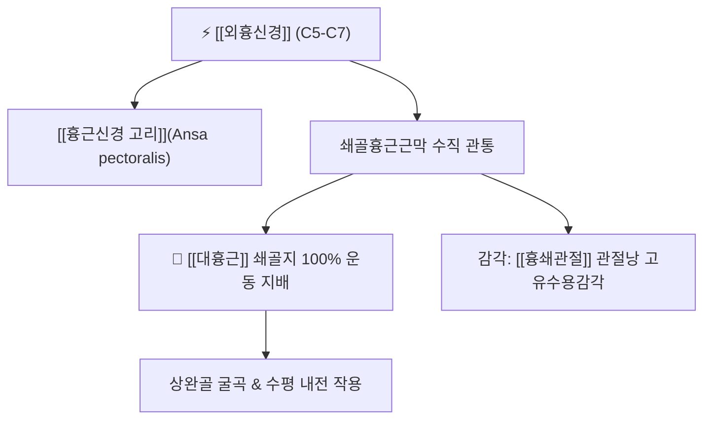

# ⚡ [[외흉신경]] (Lateral Pectoral Nerve / 外胸神經, C5-C7)

> **핵심 3줄 요약 (Key Summary)**:
> - 🗺️ 신경 기원 & 해부학적 주행: [[상완신경총]] 외측속(Lateral cord, C5-C7)에서 분지하여 액와혈관 전면을 가로지르고 쇄골흉근근막을 관통하여 [[대흉근]](Pectoralis major)으로 진입.
> - 🎯 운동 지배(근육군) & 감각 지배 영역: 순수 운동 신경. [[대흉근]] 쇄골지(Clavicular head) 100% 운동 지배 및 흉쇄관절낭 고유수용감각 분지.
> - ⚠️ 호발 포착 부위 & 관련 임상 질환: 쇄골하 쇄골흉근근막 관통 터널, [[대흉근]] 상부 경직성 흉통(비심인성 가슴 결림), 둥근 어깨([[라운드 숄더]]).
> - 🔍 주요 이학적 검사 & 신경학적 징후: 대흉근 쇄골지 도수근력평가(MMT), 쇄골하연 압진 검사, 흉벽 방사통 검사.

---

## 1. 신경 기원 & 해부학적 분지 경로 (Anatomy & Course)

* **신경 기원 (Spinal Segments & Origin)**:
  * [[상완신경총]](Brachial plexus)의 **외측속(Lateral cord)**에서 유래하며, **C5, C6, C7** 척수신경 앞가지 섬유로 구성됩니다. 현대 해부학 표준 명칭은 [[외측흉근신경]](Lateral pectoral nerve)입니다.
* **상세 주행 경로 (Detailed Pathway)**:
  1. 액와동맥 제1부 및 액와정맥의 전면을 대각선으로 가로질러 주행합니다.
  2. [[쇄골하근]](Subclavius) 바로 아래에서 단단한 건막인 **쇄골흉근근막(Clavipectoral fascia)**을 관통합니다.
  3. 흉봉선동맥의 흉근지와 동행하여 [[대흉근]](Pectoralis major) 쇄골지의 심층 표면으로 진입합니다.
  4. 주행 도중 [[내측흉근신경]](내흉신경)과 교통하는 **[[흉근신경 고리]](Ansa pectoralis)**를 형성하여 신경망 상호 협응을 이룹니다.

---

## 2. 신경 지배 맵 & 기능 네트워크 (Innervation Map)

### 1) 운동 신경 지배 (Motor Innervation)
* **[[대흉근]](Pectoralis major) 쇄골지**: 상완골을 앞으로 들어 올리고(굴곡) 가슴 안쪽으로 모으는 근력을 공급합니다.
* **감각 신경 특성**: 피하 감각지는 결여되어 있으나, 흉쇄관절낭의 통각 및 위치 감각을 전달합니다.

---

## 3. 호발 포착 부위 & 터널 증후군 병태생리

* **쇄골흉근근막 관통 터널 포착**:
  * 컴퓨터 작업이나 스마트폰 과사용으로 어깨가 앞으로 말리는 라운드 숄더 상태에서 대흉근 쇄골지가 단축되면, 쇄골흉근근막 구멍을 통과하는 외흉신경이 기계적으로 압박·견인됩니다.
* **비심인성 가슴 통증 유발**:
  * 외흉신경이 포착되면 쇄골 아래 앞가슴에 뻐근하고 쥐어짜는 듯한 통증이 발생하여 협심증으로 오인되기 쉽습니다.

---

## 4. 손상 레벨별 임상 증상 & 신경학적 결손

| 상태 구분 | 임상 증상 | 신경학적 결손 양상 |
| :--- | :--- | :--- |
| **외흉신경 포착 / 연축** | 쇄골 바로 아래 앞가슴의 뻐근한 조임, 팔을 앞으로 뻗을 때 당김통 | 쇄골 중앙 하방 국소 압통, 대흉근 상부 긴장대 형성 |
| **외흉신경 마비 / 손상** | 팔을 앞으로 들어 올리는 굴곡력 약화 | 쇄골 하부 대흉근 볼륨 위축 및 쇄골 노출 변형 |

---

## 5. 관련 이학적 검사 & 신경 감별 매트릭스

* **대흉근 쇄골지 저항 검사**:
  * 팔을 90도 굴곡하고 수평 내전한 상태에서 외하방으로 가해지는 저항에 버티는지 평가.
* **쇄골 하방 압통 검사**:
  * 쇄골 중간 1/3 지점의 하연을 깊게 압박할 때 전흉부로 퍼지는 방사통 여부 확인.
* **[[내흉신경]](내측흉근신경)과의 감별**:
  * 내흉신경은 소흉근을 관통하여 대흉근 흉골늑골지(가슴 하부)를 지배하는 반면, 외흉신경은 쇄골흉근근막을 뚫고 대흉근 쇄골지(가슴 상부)를 지배합니다.

---

## 6. 한의 신경 치료 프로토콜 (약침·침도·신경수기)

* **쇄골하근막 침도 절개술 (Acupotomy)**:
  * 쇄골 하연의 쇄골흉근근막 관통 부위에 침도를 쇄골과 평행하게 자입하여 두터워진 근막 섬유를 미세 절개 감압합니다 (기흉 방지를 위해 늑골 상면 지지 필수).
* **경혈 약침 요법**:
  * [[기호]](氣戶, ST13), [[운문]](雲門, LU2) 혈 주변 대흉근 쇄골지 압통점에 신바로약침 또는 중성어혈약침 0.5cc를 주입하여 국소 염증을 해소합니다.
* **대흉근 쇄골지 스트레칭 추나**:
  * 환자의 상완을 외전·외회전시킨 후 근막 이완을 유도하는 관절가동술을 병행합니다.

---

## 7. 💡 사용자 진료실 핵심 필기 & 임상 팁 (원문 보존)

* **사용자 원문 필기**:
  * **- [[대흉근]] 운동 지배**
* **진료실 실전 임상 팁**:
  * 심장 검사에서 특별한 이상이 발견되지 않는 흉통 환자 중, 쇄골 바로 밑을 누를 때 "아, 거기가 늘 결리고 아팠던 자리입니다"라고 하면 외흉신경(외측흉근신경)의 근막 포착 증후군입니다.
  * 쇄골 아래 1~2cm 지점의 대흉근 쇄골지 압통점에 침 치료와 약침을 1~2회 시술하면 오랫동안 지속되던 원인 불명의 가슴 답답함과 앞가슴 통증이 즉각적으로 개선됩니다.

---

## 8. 출처 및 학술 참고 문헌 (References)

* Stanczyk, P., et al. (2026). "Atypical Origin of the Pectoral Nerves: Morphological Insights for Orthopedic, Reconstructive, and Trauma Surgeons." *Cureus*, 18(5), e60124. [PMID: 42338849](https://pubmed.ncbi.nlm.nih.gov/42338849/)
  - [연구 요약]: 외흉신경(외측흉근신경)의 기원과 쇄골흉근근막 관통 패턴 및 대흉근 내 신경 분지 구조를 해부학적으로 규명.
* Tran, T., et al. (2025). "Innervation of the human sternoclavicular joint." *Clinical Anatomy*, 38(7), 812-820. [PMID: 39141520](https://pubmed.ncbi.nlm.nih.gov/39141520/)
  - [연구 요약]: 외흉신경의 흉쇄관절 관절낭 감각 분지 분포 및 흉쇄관절성 통증 매커니즘 규명.
