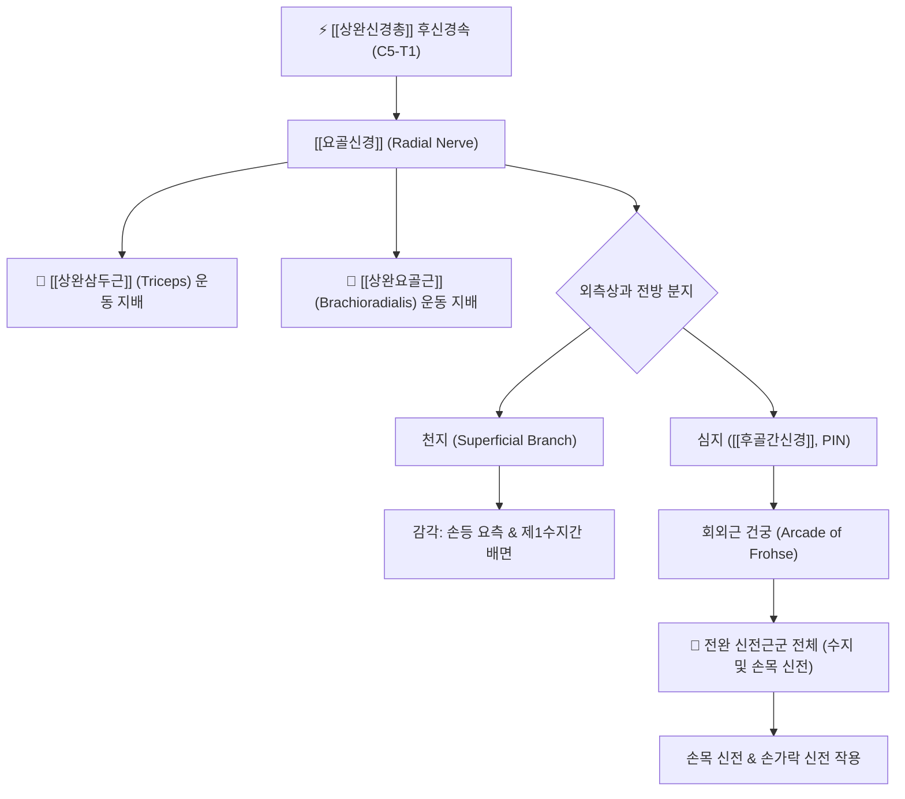

# ⚡ [[요골신경]] (Radial Nerve / 橈骨神經, C5~T1)

> **핵심 3줄 요약 (Key Summary)**:
> - 🗺️ 신경 기원 & 해부학적 주행: C5~T1 척수신경 앞가지 $\rightarrow$ [[상완신경총]] 후신경속 기원, 상완골 후방 요골신경구(Spiral groove)를 지나 외측근간중격을 뚫고 [[상완근]]과 [[상완요골근]] 사이를 하행하여 주관절 외측에서 천지(감각)와 심지([[후골간신경]], 운동)로 분지.
> - 🎯 운동 지배(근육군) & 감각 지배 영역: [[상완삼두근]], [[상완요골근]], 주근 및 전완 신전근군 전체(심지 경유) 운동 지배, 상완·전완 후면 및 손등 요측(제1수지간 배면) 피부 감각 전담.
> - ⚠️ 호발 포착 부위 & 관련 임상 질환: 상완골 골절 및 토요일 밤 마비(Saturday night palsy), 회외근 건궁(Arcade of Frohse) 포착, 외측상과염([[테니스 엘보]]) 연관 신경통, 손목하수(Wrist drop).
> - 🔍 주요 이학적 검사 & 신경학적 징후: 요골신경 상지신경긴장검사(ULNT2b), 코젠 검사(Cozen's test), 손목 신전 도수근력평가.

---

## 1. 신경 기원 & 해부학적 분지 경로 (Anatomy & Course)

* **신경 기원 (Origin & Segments)**:
  * [[상완신경총]](Brachial plexus) 후신경속(Posterior cord)의 최대 종말 분지로, **C5, C6, C7, C8, T1** 모든 신경근 섬유를 포함합니다 (주요 분절: C6~C8).
* **상세 주행 경로 (Detailed Pathway)**:
  1. **삼각간극 통과**: 액와부에서 [[대원근]](Teres major), [[상완삼두근]] 장두, 상완골 사이의 삼각간극(Triangular space)을 통해 상완 후방으로 진입합니다.
  2. **요골신경구 주행 (Spiral Groove)**: 상완골 간부 후면의 나선형 고랑(Radial groove)을 따라 상완삼두근 외측두와 내측두 사이를 비스듬히 통과합니다. 심상완동맥(Profunda brachii artery)과 동행합니다.
  3. **전방 구획 진입**: 상완 중간 하부에서 외측근간중격(Lateral intermuscular septum)을 뚫고 전외측 구획으로 넘어와 [[상완근]](Brachialis)과 [[상완요골근]](Brachioradialis) 사이 고랑을 따라 하행합니다.
  4. **주관절 외측 2대 분지**: 상완골 외측상과 전방에서 **천지(Superficial branch, 순수 감각)**와 **심지(Deep branch = [[후골간신경]], 순수 운동)**로 나뉩니다.
     * **천지**: 상완요골근 심층을 따라 전완을 내려가 손목 상방에서 피하로 나와 손등 요측 피부로 분포.
     * **심지**: 회외근(Supinator)의 두 층 사이를 파고들며 **회외근 건궁(Arcade of Frohse)**을 통과하여 [[후골간신경]](PIN)이 됨.

---

## 2. 신경 지배 맵 & 기능 네트워크 (Innervation Map)

### 1) 운동 신경 지배 (Motor Innervation)
* **상완부 본간 지배**: [[상완삼두근]](Triceps brachii 장두·외측두·내측두), 주근(Anconeus).
* **주관절 부근 지배**: [[상완요골근]](Brachioradialis), 장요측수근신근(ECRL).
* **심지([[후골간신경]]) 지배**: 단요측수근신근(ECRB), 회외근(Supinator), 총수지신근(EDC), 소지신근, 척측수근신근(ECU), 장모지외전근(APL), 단모지신근(EPB), 장모지신근(EPL), 시지신근(EIP).

### 2) 감각 신경 지배 (Sensory Innervation)
* **상완·전완 후면**: 후상완피신경 및 후전완피신경을 통한 팔 뒤쪽 피부 감각.
* **수배 요측 (Hand Dorsum)**: 엄지, 검지, 중지 및 약지 요측 절반의 손등 피부와 제1수지간(엄지와 검지 사이) 배면 피부 감각.

---

## 3. 호발 포착 부위 & 터널 증후군 병태생리

* **상완골 요골신경구 압박 (토요일 밤 마비, Saturday Night Palsy)**:
  * 술에 취해 팔을 의자 등받이에 걸치고 자거나 상완골 간부 골절(Holstein-Lewis 골절) 발생 시 뼈와 외부 압박물 사이에 신경이 짓눌려 급성 마비가 발생합니다.
* **회외근 건궁(Arcade of Frohse) 포착**:
  * 회외근 상연의 두터워진 섬유성 아치(Arcade of Frohse)를 심지가 통과할 때, 반복적인 전완 회내·회외 동작으로 인해 신경이 교액되어 [[후골간신경 증후군]] 및 요골관 증후군(Radial tunnel syndrome)을 유발합니다.
* **외측상과염([[테니스 엘보]])과의 기계감수성 연계**:
  * 외측 주관절 만성 건병증 환자에서 요골신경 주변의 결합조직 유착이 동반되어 신경의 기계감수성(Mechanosensitivity)이 상승합니다.

---

## 4. 손상 레벨별 임상 증상 & 신경학적 결손

| 손상 레벨 | 주요 마비 근육 및 신경 | 특징적 외형 및 신경학적 결손 |
| :--- | :--- | :--- |
| **고위 손상 (액와부 / 상완 근위부)** | 상완삼두근, 상완요골근, 모든 전완 신전근 | **완전 손목하수 (Complete Wrist Drop)**, 팔꿈치 신전 불능, 손등 감각 소실 |
| **중위 손상 (요골신경구 부위)** | 상완요골근 및 모든 전완 신전근 (삼두근 보존) | **손목하수 (Wrist Drop)**, 팔꿈치 신전은 정상, 손등 제1수지간 감각 저하 |
| **저위 손상 ([[후골간신경]] 포착)** | 전완 신전근군 (ECRL 및 감각지 보존) | **수지하수 (Finger Drop)**, 손목은 요측으로 신전 가능, **감각 결손 전혀 없음** |

---

## 5. 관련 이학적 검사 & 신경 감별 매트릭스

* **요골신경 상지신경긴장검사 (ULNT2b)**:
  * 견관절 하강 + 내회전 + 주관절 신전 + 전완 회내 + 손목 및 손가락 굴곡 조합 시 손등과 전완 외측으로 전격통이 방사되면 양성.
* **코젠 검사 (Cozen's Test) 및 중지 신전 검사**:
  * 주관절 외측상과 통증과 함께 저항성 중지 신전 시 요골관 통증이 심해지면 요골신경 포착을 의심.
* **경추 신경근병증(C7)과의 감별**:
  * 경추 C7 신경근병증은 삼두근 반사 저하 및 중지 감각 저하를 동반하나, 상완요골근(C5-C6 지배)은 정상이므로 상완요골근 근력 평가로 감별합니다.

---

## 6. 한의 신경 치료 프로토콜 (약침·침도·신경수기)

* **회외근 건궁 침도 감압술 (Acupotomy)**:
  * 외측상과 전하방 3~4cm 지점의 회외근 건궁 압통점을 촉진하고, 요골신경 심지 주행 방향과 평행하게 침도를 자입하여 섬유화된 아치를 미세 절개 감압합니다.
* **경혈 배합 약침 치료**:
  * [[곡지]](曲池, LI11), [[수삼리]](手三里, LI10), [[외관]](外關, TE5), [[비노]](臂臑, LI14) 혈에 신바로약침 또는 중성어혈약침 1.0cc를 주입하여 신경 허혈성 부종을 완화합니다.
* **요골신경 신경가동술 (Radial Nerve Gliding)**:
  * 전완 회내와 손목 굴곡 상태에서 경추 측굴을 반대 방향으로 조절하는 신경 슬라이딩(Slider) 운동을 지도합니다.

---

## 7. 💡 사용자 진료실 핵심 필기 & 임상 팁 (원문 보존)

* **사용자 원문 필기**:
  * C5-T1 척수신경 앞가지에서 기원하여 [[상완신경총]]이 되어 [[대원근]], [[상완삼두근]]의 장두, 외측두의 삼각 공간을 지나 [[상완근]]과 [[상완요골근]] 사이를 내려오다 상완골 외상과의 앞을 지나 주관절에 이름
* **진료실 실전 감별 & 자침 팁**:
  * 외측 팔꿈치 통증(테니스 엘보) 환자가 프롤로나 충격파 치료를 수차례 받아도 낫지 않는다면 건 부착부 병변이 아니라 요골신경의 기계감수성 항진 상태입니다.
  * 회외 저항 및 중지 신전 저항 시 통증이 재현되고 손등 제1수지간에 미세한 저림이 동반된다면, 곡지 하방 2촌의 회외근 압통점에 침 치료와 약침을 병행해야 즉각적인 호전을 보입니다.

---

## 8. 출처 및 학술 참고 문헌 (References)

* Yurdakul, O. V., et al. (2026). "Comparison of the effects of radial nerve mobilization and eccentric exercises in lateral epicondylitis: A randomized controlled trial." *Journal of Back and Musculoskeletal Rehabilitation*, 39(5), 1727-1738. [PMID: 42095617](https://pubmed.ncbi.nlm.nih.gov/42095617/)
  - [연구 요약]: 외측상과염 환자에서 요골신경 신경가동술과 편심성 운동 병행 시 신경 기계감수성 감소 및 악력·통증 역치 개선 효과를 무작위 대조군 시험으로 입증.
* De-la-Llave-Rincon, A. I., et al. (2024). "Effects of cervical spine manipulation on pain and sensitivity in lateral epicondylalgia: A randomized trial." *Clinical Rehabilitation*, 38(8), 1063-1079. [PMID: 38676324](https://pubmed.ncbi.nlm.nih.gov/38676324/)
  - [연구 요약]: 외측 주관절 통증 환자에서 경추 C5-C6 분절 교정과 건침 치료 병행 시 상지 요골신경 통증 역치가 유의하게 상승함을 규명.
