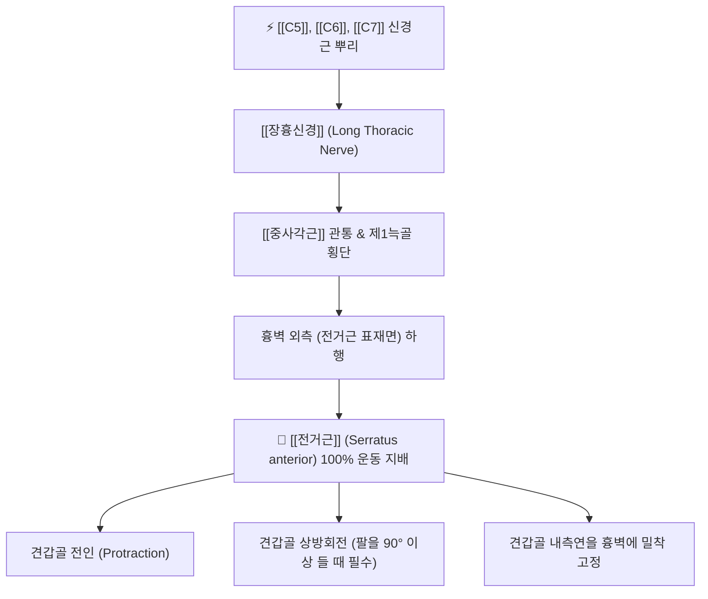

# ⚡ [[장흉신경]] (Long Thoracic Nerve / 長胸神經, C5-C7)

> **핵심 3줄 요약 (Key Summary)**:
> - 🗺️ 신경 기원 & 해부학적 주행: C5, C6, C7 척수신경 앞가지 뿌리(Roots) 레벨에서 직접 기원하여 [[중사각근]]을 관통한 뒤 제1늑골을 넘어 흉벽 외측 [[전거근]](Serratus anterior) 표면을 따라 수직 하행.
> - 🎯 운동 지배(근육군) & 감각 지배 영역: 순수 운동 신경. [[전거근]] 100% 운동 지배(견갑골 전인 및 상방회전 총괄, 흉벽 밀착 고정), 피부 감각 신경 섬유 없음.
> - ⚠️ 호발 포착 부위 & 관련 임상 질환: 중사각근 관통부 및 제1늑골 압박, 무거운 배낭 멜빵 압박, [[전거근]] 마비로 인한 내측 [[익상견갑]](Medial Winging of Scapula).
> - 🔍 주요 이학적 검사 & 신경학적 징후: 벽 밀기 검사(Wall push-up test), 견갑골 전인 도수근력검사, 전거근 압진.

---

## 1. 신경 기원 & 해부학적 분지 경로 (Anatomy & Course)

* **신경 기원 (Spinal Segments & Root Origin)**:
  * [[상완신경총]](Brachial plexus)의 가장 근위부인 **C5, C6, C7** 척수신경 앞가지 뿌리(Roots)에서 직접 분지합니다 (신경간 형성 이전).
* **상세 주행 경로 (Detailed Pathway)**:
  1. C5와 C6 분지는 [[중사각근]](Scalenus medius)의 근육 실질을 비스듬히 관통하며, C7 분지는 중사각근 전면을 주행하여 합류합니다.
  2. 세 신경근이 합쳐져 장흉신경 본간을 형성한 후, 상완신경총 신경속 및 액와혈관 다발의 후방을 지나 **제1늑골(First rib)** 외측면을 넘어 액와강으로 진입합니다.
  3. 액와강의 내측벽을 이루는 **[[전거근]](Serratus anterior)**의 표층 근막 위를 직접 타고 수직으로 길게 하행하며, 외측흉동맥(Lateral thoracic artery)과 나란히 주행합니다.
  4. 제1늑골부터 제8~9늑골까지 전거근의 각 근지(Digitation)마다 미세 운동 신경 가지를 방출하며 끝납니다.

---

## 2. 신경 지배 맵 & 기능 네트워크 (Innervation Map)

### 1) 운동 신경 지배 (Motor Innervation)
* **[[전거근]](Serratus anterior)**: 견갑골을 전인(Protraction)시키고 상방회전(Upward rotation)시키는 핵심 근육입니다.
* 팔을 90도 이상 머리 위로 들어 올릴 때 견갑골이 원활하게 상방 회전하도록 이끌며, 푸시업이나 펀치 동작 시 견갑골을 흉벽에 단단히 밀착시킵니다.

### 2) 감각 신경 특이성
* **순수 운동 신경**: 장흉신경 자체는 피부 감각 섬유가 전혀 없습니다.
* 전거근 부위의 피부 감각은 흉추 신경(T2-T6)의 외측피지에서 담당하므로, 전거근 부위의 뻐근하고 답답한 통증은 근막 허혈 및 신경성 연관통입니다.

---

## 3. 호발 포착 부위 & 터널 증후군 병태생리

* **중사각근 관통부 및 경부 견인 손상**:
  * 경추가 반대편으로 심하게 측굴되거나 어깨가 하강할 때(머리에 무거운 짐을 이거나 교통사고 충돌 시) 장흉신경이 견인 손상을 입습니다.
* **제1늑골과 쇄골 사이 압박**:
  * 무거운 군용 배낭이나 무거운 가방 끈에 의해 쇄골 상와에서 신경이 장시간 압박받을 때(Pack palsy) 호발합니다.
* **전거근 표층 노출로 인한 외상성 타박**:
  * 장흉신경은 근육 속이 아니라 전거근 표층 근막 위를 주행하므로, 흉벽 외측 타박상이나 액와 림프절 수술, 흉관 삽입술 시 손상 위험이 매우 높습니다.

---

## 4. 손상 레벨별 임상 증상 & 신경학적 결손

| 병태 유형 | 주요 임상 양상 | 신경학적 결손 및 외형적 변화 |
| :--- | :--- | :--- |
| **신경 포착 / 과긴장** | 옆구리 전거근 부위의 답답함, 결림, 호흡 시 흉벽 통증 | 전거근 압진 시 극심한 압통, 상지 거상 피로감 |
| **장흉신경 완전 마비** | 팔을 머리 위로 120도 이상 올리지 못함, 미는 힘 상실 | **내측 [[익상견갑]](Medial Winging of Scapula)**: 견갑골 내측연과 하각이 등 뒤로 툭 튀어나옴 |

---

## 5. 관련 이학적 검사 & 신경 감별 매트릭스

* **벽 밀기 검사 (Wall Push-Up Test)**:
  * 환자가 벽을 마주보고 서서 양손으로 벽을 강하게 밀 때, 환측 견갑골의 내측연이 새 날개처럼 등 뒤로 크게 솟아오르면 장흉신경 마비 확진.
* **[[부신경]](CN XI) 마비와의 익상견갑 감별**:
  * 장흉신경 손상 시: **내측 익상견갑** (견갑골이 척추 쪽으로 이동하며 하각이 내측 상방으로 회전).
  * 부신경(승모근) 손상 시: **외측 익상견갑** (견갑골이 척추에서 멀어지며 하각이 외측으로 회전).

---

## 6. 한의 신경 치료 프로토콜 (약침·침도·신경수기)

* **경부 사각근 및 제1늑골 감압 침도술**:
  * C5-C7 횡돌기 결절 사이 및 중사각근 기시부의 비후된 근막을 침도로 미세 절개하여 신경 기원부의 장력을 해소합니다.
* **전거근 주행로 약침 치료**:
  * [[연액]](淵腋, GB22), [[첩근]](輒筋, GB23), [[대포]](大包, SP21) 혈 부위의 전거근 표층에 신바로약침 또는 중성어혈약침 1.0cc를 얕게 주입하여 신경 주위 염증을 가라앉힙니다.
* **전거근 강화 및 견갑골 가동 추나요법**:
  * 흉곽과 견갑골 사이의 견갑흉곽관절(Scapulothoracic joint) 가동술을 시행하고 전거근 활성화 운동(Plus push-up)을 적용합니다.

---

## 7. 💡 사용자 진료실 핵심 필기 & 임상 팁 (원문 보존)

* **사용자 원문 필기**:
  * [[장흉신경]]은 운동신경이고, [[전거근]] 부위가 답답하고, 단축, 긴장, 허혈성 통증이 발생할 수 있다.(감각신경은 흉추에서 기원)
  * [[전거근]]이 수축하면 내측 [[익상견갑]]이 나타난다.
  * [[사각근]], [[소흉근]], 하부경추 부위의 근 이완을 통해서 신경 포착 완화한다.
* **진료실 실전 임상 팁**:
  * 환자가 "옆구리와 갈비뼈 쪽이 뻐근하게 쥐어짜듯 아프고 숨쉴 때 결린다"고 호소하면 늑간신경통뿐 아니라 장흉신경 자극을 반드시 확인해야 합니다.
  * 벽에 손을 짚게 해보고 견갑골 내측연이 들리는지 살피고, 목의 중사각근과 앞가슴의 소흉근을 함께 풀어주면 신경 경로 전체의 장력이 풀리면서 옆구리 통증이 신속히 완화됩니다.

---

## 8. 출처 및 학술 참고 문헌 (References)

* Martin, R. M., & Fish, D. E. (2008). "Scapular winging: anatomical review, diagnosis, and treatments." *Current Reviews in Musculoskeletal Medicine*, 1(1), 1-11. [PMID: 19468892](https://pubmed.ncbi.nlm.nih.gov/19468892/)
  - [연구 요약]: 장흉신경 손상에 따른 전거근 마비 및 내측 익상견갑의 병태생리, 진단적 근전도 검사, 보존적 재활 치료 프로토콜 총괄 검토.
