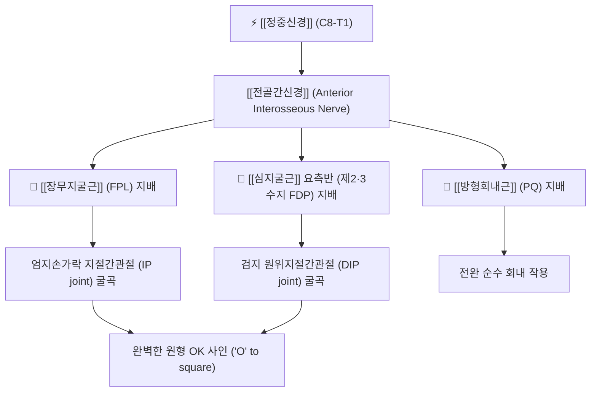

# ⚡ [[전골간신경]] (Anterior Interosseous Nerve / 前骨間神經, AIN)

> **핵심 3줄 요약 (Key Summary)**:
> - 🗺️ 신경 기원 & 해부학적 주행: 주관절 원위부에서 [[정중신경]](Median nerve) 본간으로부터 분지하여 [[원회내근]](Pronator teres) 두 머리 사이를 지나 전완 골간막 전면을 따라 수직 하행.
> - 🎯 운동 지배(근육군) & 감각 지배 영역: 순수 운동 신경. 전완 심부 굴근군인 [[장무지굴근]](FPL), [[심지굴근]](FDP)의 제2·3수지 요측반 및 [[방형회내근]](PQ) 100% 운동 지배, 피부 감각 섬유 없음.
> - ⚠️ 호발 포착 부위 & 관련 임상 질환: 원회내근 심두 건성 밴드 및 갠처 근육(Gantzer's muscle) 압박, [[전골간신경 증후군]](킬로-네빈 증후군), 엄지·검지 끝을 둥글게 모으지 못하는 OK 사인 소실([[집게 징후]]).
> - 🔍 주요 이학적 검사 & 신경학적 징후: OK 사인 검사(Pinch sign test), 저항성 전완 회내력 검사, 원회내근 심부 압진.

---

## 1. 신경 기원 & 해부학적 분지 경로 (Anatomy & Course)

* **신경 기원 (Origin & Spinal Segments)**:
  * [[정중신경]](Median nerve)의 가장 큰 주 분지로, **C8, T1** (일부 C7 기여) 척수신경 앞가지 섬유로 구성됩니다.
* **상세 주행 경로 (Detailed Pathway)**:
  1. 상완골 내측상과 원위부 약 5~8cm 지점에서 정중신경의 후면 또는 외측면에서 갈라져 나옵니다.
  2. [[원회내근]](Pronator teres)의 상완두와 척골두 사이를 통과한 후, [[천지굴근]](FDS)의 섬유성 아치(Fibrous arch) 심층으로 진입합니다.
  3. 전골간동맥(Anterior interosseous artery)과 동행하여 전완 골간막(Interosseous membrane) 전면을 따라 [[장무지굴근]](FPL)과 [[심지굴근]](FDP) 사이 간격을 똑바로 하행합니다.
  4. 전완 원위부에서 [[방형회내근]](Pronator quadratus)의 심층면으로 파고들어가 근육을 지배하고, 종말 가지는 손목 수근관절낭에 도달하여 끝납니다.

---

## 2. 신경 지배 맵 & 기능 네트워크 (Innervation Map)

### 1) 순수 운동 신경 지배 (Motor Innervation)
* **[[장무지굴근]](Flexor Pollicis Longus, FPL)**: 엄지손가락 끝마디(IP joint)를 구부리는 유일한 근육.
* **[[심지굴근]](Flexor Digitorum Profundus, FDP) 요측반**: 둘째(검지) 및 셋째(중지) 손가락 끝마디(DIP joint)를 구부리는 근육 (넷째·다섯째는 척골신경 지배).
* **[[방형회내근]](Pronator Quadratus, PQ)**: 전완의 원위부에서 손목을 안쪽으로 돌리는 강력한 회내근.
* **감각 신경 특성**: 피부 감각지가 결여되어 있어 **순수 운동 마비**만 발생하며, 손바닥이나 손가락의 저림·감각 저하는 전혀 없습니다.

---

## 3. 호발 포착 부위 & 터널 증후군 병태생리

* **킬로-네빈 증후군 (Kiloh-Nevin Syndrome / AIN 증후군)**:
  * 전골간신경이 전완 근위부의 섬유성 구조물에 의해 압박되어 발생하는 마비 질환입니다.
* **주요 해부학적 포착 지점**:
  1. **원회내근 심두(Deep head)**의 비후된 건성 테두리.
  2. [[천지굴근]](FDS) 근위부 건성 아치(Sublimis bridge).
  3. **갠처 근육(Gantzer's muscle)**: 인구의 약 45~50%에서 존재하는 FPL의 선천적 부속두(Accessory head)가 전골간신경을 앞쪽에서 교액.
  4. 전골간동맥의 혈전증 또는 비정상 주행에 의한 박동성 압박.

---

## 4. 손상 레벨별 임상 증상 & 신경학적 결손

| 병태 구분 | 주요 임상 양상 | 특징적 신경학적 결손 |
| :--- | :--- | :--- |
| **전골간신경 포착 (초기)** | 전완 전면 심부의 둔통, 무거운 물건을 쥐거나 글씨 쓸 때 손끝 피로 | 엄지·검지 끝 힘 빠짐, 전완 회내력 약화 |
| **완전 마비 ([[킬로-네빈 증후군]])** | 열쇠를 돌리거나 동전·단추를 집지 못함 (정밀 핀치 불능) | **집게 징후 ([[OK 사인]] 소실)**: 엄지 IP와 검지 DIP가 펴지며 납작하게 맞닿음 |

---

## 5. 관련 이학적 검사 & 신경 감별 매트릭스

* **OK 사인 검사 (Pinch Sign Test)**:
  * 엄지 끝과 검지 끝을 맞대어 둥근 'O' 모양을 만들게 할 때, FPL과 FDP 마비로 인해 끝마디를 구부리지 못하고 손가락 패드가 납작하게 닿는 **집게 모양("O" to square)**이 나타나면 양성.
* **[[수근관 증후군]](CTS)과의 감별**:
  * 수근관 증후군은 손바닥과 손가락의 감각 이상 및 모지구근 위축을 동반하나, AIN 마비는 **감각이 100% 정상**이고 무지구근([[단무지외전근]], [[무지대립근]])도 정상이므로 엄지를 세우는 대립 운동이 온전히 보존됩니다.

---

## 6. 한의 신경 치료 프로토콜 (약침·침도·신경수기)

* **원회내근 심부 침도 감압술 (Acupotomy)**:
  * 곡택(PC3) 하방 약 4~5cm 지점, 원회내근 두 머리 사이의 건성 아치 압통점을 촉진하고 침도를 신경 주행과 나란히 진입시켜 섬유성 밴드를 미세 절개 감압합니다.
* **전완 심부 경혈 약침 치료**:
  * [[곡택]](曲澤, PC3), [[극문]](郄門, PC4), [[수삼리]](手三里, LI10) 혈에 신바로약침 또는 중성어혈약침 1.0cc를 심부 주입하여 신경 허혈성 부종을 개선합니다.
* **전완 회내근군 근막 이완 추나**:
  * 전완 상부 1/3 전면의 원회내근과 천지굴근을 횡단 마사지(Cross-friction)하여 건성 아치의 긴장을 해소합니다.

---

## 7. 💡 사용자 진료실 핵심 필기 & 임상 팁 (원문 보존)

* **사용자 원문 필기**:
  * 주관절 원위부에서 정중신경 본간으로부터 분지하여 전완부 골간막 전면을 따라 주행하는 순수 운동신경.
  * 심부 굴근군인 [[장무지굴근]](FPL), [[심지굴근]](FDP)의 제2·3수지 요측부 및 [[방형회내근]](PQ)을 지배하여 무지 IP 관절과 시지 DIP 관절의 굴곡 운동 전담.
  * 신경 포착(킬로-네빈 증후군) 시 피부 감각 결손 없이 원형의 OK 사인을 만들지 못하는 집게 징후(Pinch sign)가 발생하며 원회내근 및 갠처 근육 부위 침·약침 치료 시행.
* **진료실 실전 감별 팁**:
  * 환자가 "손가락이 저리지는 않은데, 단추를 잠그거나 바늘을 잡을 때 엄지와 검지 끝에 힘이 안 들어가서 자꾸 미끄러진다"고 호소하면 1초 만에 OK 사인을 해보라고 시켜야 합니다.
  * 동그라미를 만들지 못하고 엄지·검지 끝이 쫙 펴진 채 맞닿는다면 전골간신경 증후군입니다. 전완 상부의 갠처 근육 부위에 침 치료와 약침 치료를 집중하면 수주 내로 핀치 파워가 회복됩니다.

---

## 8. 출처 및 학술 참고 문헌 (References)

* Schantz, K., & Riegels-Nielsen, P. (1992). "The anterior interosseous nerve syndrome." *The Journal of Hand Surgery: British & European Volume*, 17(5), 510-512. [PMID: 1453003](https://pubmed.ncbi.nlm.nih.gov/1453003/)
  - [연구 요약]: 전골간신경 증후군(킬로-네빈 증후군) 환자의 임상적 OK 사인 검사 신뢰도 및 비수술적 보존 치료 프로토콜과 자연 경과 고찰.
