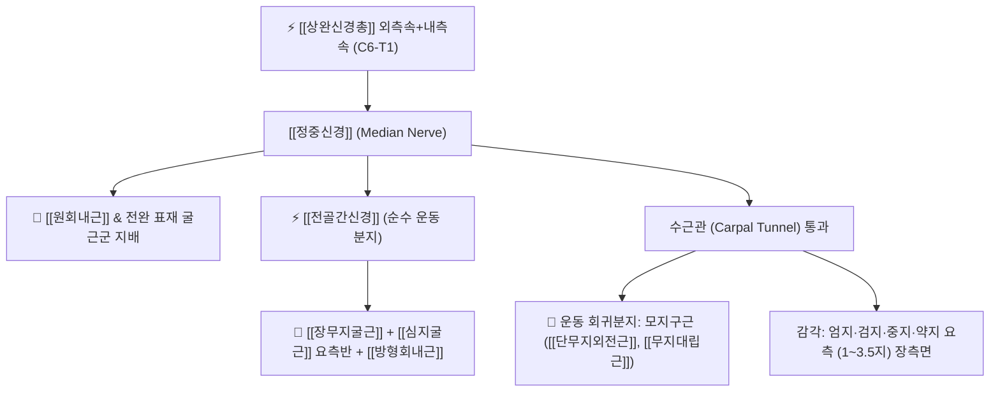

# ⚡ [[정중신경]] (Median Nerve / 正中神經, C6~T1)

> **핵심 3줄 요약 (Key Summary)**:
> - 🗺️ 신경 기원 & 해부학적 주행: C6~T1 척수신경 앞가지 $\rightarrow$ [[상완신경총]] 내·외측속 합류 기원, [[상완이두근]]과 [[상완근]] 사이를 하행하여 주관절 오금에서 [[원회내근]](Pronator teres) 두 머리 사이를 관통한 뒤 손목 수근관(Carpal tunnel)을 통과하여 손바닥으로 진입.
> - 🎯 운동 지배(근육군) & 감각 지배 영역: 전완 굴근군 대부분([[척측수근굴근]]·심지굴근 척측반 제외), [[전골간신경]] 경유 심부 굴근, 모지구근(Thenar) 및 제1·2충양근 운동 지배, 엄지·검지·중지 및 약지 요측 반(1~3.5지) 장측 피부 감각 전담.
> - ⚠️ 호발 포착 부위 & 관련 임상 질환: 손목 수근관([[수근관 증후군]], CTS), 원회내근 사이 터널([[원회내근 증후군]]), 스트러더스 인대(Ligament of Struthers) 압박.
> - 🔍 주요 이학적 검사 & 신경학적 징후: 팔렌 검사(Phalen's test), 수근관 티넬 징후, 모지구근 위축 및 무지 대립 검사.

---

## 1. 신경 기원 & 해부학적 분지 경로 (Anatomy & Course)

* **신경 기원 (Origin & Segments)**:
  * [[상완신경총]](Brachial plexus)의 외측속(Lateral cord, C5~C7)과 내측속(Medial cord, C8~T1)의 앞갈래가 액와동맥 전면에서 'Y'자 모양으로 합류하여 형성됩니다.
* **상세 주행 경로 (Detailed Pathway)**:
  1. **상완부 주행**: 상완동맥의 외측을 따라 하행하다가 상완 중간부에서 동맥 전면을 가로질러 내측으로 위치를 바꿉니다. [[상완이두근]](Biceps brachii)과 [[상완근]](Brachialis) 사이 고랑을 따라 주행하며 상완부에서는 주요 분지를 내지 않습니다.
  2. **주관절 통과 (Cubital Fossa)**: 이두근건막(Bicipital aponeurosis) 심층을 지나 주관절 전면으로 진입한 뒤, **[[원회내근]](Pronator teres)의 상완두와 척골두 사이**를 통과합니다.
  3. **전완부 주행 및 분지**: 원회내근 통과 직후 순수 운동 신경인 **[[전골간신경]](AIN)**을 분지하고, [[천지굴근]](FDS)과 [[심지굴근]](FDP) 사이 근막면을 따라 정중선을 타고 하행합니다.
  4. **수근관 통과 (Carpal Tunnel)**: 손목 굴근지대(Flexor retinaculum) 직전에서 손바닥 피부를 지배하는 **장측피지(Palmar cutaneous branch)**를 천층으로 분지(수근관 밖 주행)한 후, 9개의 굴근건과 함께 단단한 **수근관(Carpal tunnel)** 내부를 통과하여 손바닥으로 진입합니다.
  5. **손바닥 종말 분지**: 수근관을 나오자마자 외측으로 꺾이는 **운동 회귀분지(Recurrent motor branch)**를 내어 모지구근으로 들어가고, 고유수장수지신경(Proper palmar digital nerves)으로 갈라져 손가락 감각을 지배합니다.

---

## 2. 신경 지배 맵 & 기능 네트워크 (Innervation Map)

### 1) 운동 신경 지배 (Motor Innervation)
* **전완 굴근군**: [[원회내근]], [[요측수근굴근]](FCR), 장장근(Palmaris longus), [[천지굴근]](FDS).
* **[[전골간신경]](AIN) 지배**: [[장무지굴근]](FPL), [[심지굴근]](FDP) 제2·3수지 요측반, [[방형회내근]](PQ).
* **수부 내재근**: 모지구근([[단무지외전근]], [[무지대립근]], 단무지굴근 천두), 제1·2충양근(Lumbricals).
* **운동 예외**: [[척측수근굴근]](FCU)과 [[심지굴근]] 제4·5수지 척측반은 척골신경이 지배합니다.

### 2) 감각 신경 지배 (Sensory Innervation)
* **손가락 장측면**: 엄지, 검지, 중지 및 약지의 요측 절반(1~3.5지) 손바닥면 및 손가락 끝마디의 손등 손톱 부위.
* **손바닥 중심부 (장측피지)**: 수근관 상방에서 분지하여 굴근지대 위를 지나가므로, 수근관 증후군 발생 시에도 손바닥 중심부 감각은 온전히 보존됩니다.

---

## 3. 호발 포착 부위 & 터널 증후군 병태생리

* **수근관 증후군 (Carpal Tunnel Syndrome, CTS)**:
  * 인체에서 가장 흔한 말초신경 포착 질환. 손목의 반복 사용, 활액막염, 임신, 당뇨 등으로 수근관 내압이 상승하여 정중신경의 미세혈류 허혈 및 신경내막 부종이 발생합니다.
* **원회내근 증후군 (Pronator Teres Syndrome)**:
  * 원회내근의 두 머리 사이 또는 이두근건막(Lacertus fibrosus) 아래에서 신경이 눌려 전완 전면 통증과 함께 손바닥 중심부를 포함한 감각 이상이 나타납니다.
* **스트러더스 인대 (Ligament of Struthers) 압박**:
  * 상완골 내측상과 상방의 과상돌기(Supracondylar process)와 내측상과를 잇는 선천적 섬유성 인대 아래에서 정중신경과 상완동맥이 압박받는 드문 병태입니다.

---

## 4. 손상 레벨별 임상 증상 & 신경학적 결손

| 손상 레벨 | 주요 임상 양상 | 특징적 외형 및 신경학적 결손 |
| :--- | :--- | :--- |
| **수근관 부위 손상 ([[수근관 증후군]])** | 야간에 심해지는 손가락(1~3.5지) 저림, 손을 털면 완화(Flick sign) | **모지구근 위축(Ape hand)**, 단무지외전근 약화, 손바닥 중심 감각 보존 |
| **원회내근 부위 손상 ([[원회내근 증후군]])** | 전완부의 뻐근한 통증, 반복 회내 시 증상 악화 | 손바닥 중심부(장측피지 영역) 감각 저하 동반, 원회내근 압통 |
| **고위 손상 (주관절 상방)** | 손목 굴곡력 약화, 엄지·검지 굴곡 불능 | **축복하는 손 변형 (Hand of Benediction)**: 주먹을 쥘 때 1~3지 안 쥐어짐 |

---

## 5. 관련 이학적 검사 & 신경 감별 매트릭스

* **팔렌 검사 (Phalen's Test)**:
  * 양 손등을 맞대고 손목을 90도 최대 굴곡 상태로 60초간 유지할 때 1~3.5지로 저림과 통증이 방사되면 양성.
* **티넬 징후 (Tinel's Sign at Wrist)**:
  * 손목 굴근지대 정중신경 부위를 손가락 끝으로 가볍게 타진할 때 손가락 끝으로 전기 통증이 퍼지면 양성.
* **경추 신경근병증(C6)과의 감별**:
  * C6 신경근병증은 전완 외측 감각 저하 및 상완이두근 반사 저하를 동반하나, CTS는 손바닥 원위부에 국한되며 심부건반사가 정상입니다.

---

## 6. 한의 신경 치료 프로토콜 (약침·침도·신경수기)

* **수근관 침도 감압술 (Acupotomy)**:
  * 횡수근인대(굴근지대) 원위부와 정중신경 주행로를 확인하고, 대릉(PC7) 혈 부위에서 침도를 횡수근인대 섬유 방향과 평행하게 자입하여 비후된 인대를 미세 절개 감압합니다.
* **경혈 약침 치료**:
  * [[대릉]](大陵, PC7), [[내관]](內關, PC6), [[곡택]](曲澤, PC3) 혈에 신바로약침 또는 중성어혈약침 0.5~1.0cc를 수근관 주변 간질로 주입하여 신경 부종과 활액막 염증을 신속히 가라앉힙니다.
* **정중신경 신경가동술 (Median Nerve Slider)**:
  * 손목 신전-수지 신전과 경추 동측 측굴을 교대로 시행하는 신경 활주 운동을 통해 수근관 내 유착을 박리합니다.

---

## 7. 💡 사용자 진료실 핵심 필기 & 임상 팁 (원문 보존)

* **사용자 원문 필기**:
  * 상완신경총에서 나와 [[상완이두근]], [[상완근]] 사이로 주행해 내려오다 팔꿈치 오금으로 들어가 [[원회내근]] 사이를 통과한다.
  * [[전골간신경]]으로 분지되며, 이는 순수 운동신경임
  * 전완의 모든 굴곡근 지배([[척측수근굴근]], [[심지굴근]] 제외)
* **진료실 실전 감별 팁**:
  * 환자가 손가락이 저리다고 할 때 가장 먼저 "손바닥 한가운데 살도 저린가요?"를 물어야 합니다.
  * 손바닥 한가운데 감각은 정상인데 손가락 끝만 저리다면 수근관 증후군이고, 손바닥 중심까지 먹먹하게 저리다면 손목이 아니라 팔꿈치 원회내근 부위 포착입니다. 수근관 증후군 환자에서 엄지두덩(모지구) 근육이 푹 꺼져 있다면 영구적 축삭 손상이 진행 중이므로 신속히 침도 감압 치료를 시행해야 합니다.

---

## 8. 출처 및 학술 참고 문헌 (References)

* Wu, Y. T., et al. (2026). "Efficacy of Perineural Dextrose Versus Corticosteroid Injection for Carpal Tunnel Syndrome: A Randomized Clinical Trial." *Muscle & Nerve*, 74(2), 374-382. [PMID: 42206562](https://pubmed.ncbi.nlm.nih.gov/42206562/)
  - [연구 요약]: 양측성 경도~중등도 수근관 증후군 환자에서 초음파 유도 정중신경 주위 주사 시 5% 포도당수(D5W)와 코르티코스테로이드의 장기 치료 효과 및 신경전도 검사 개선율을 입증한 무작위 대조 임상시험.
* Maeda, Y., et al. (2017). "Rewiring the primary somatosensory cortex in carpal tunnel syndrome with acupuncture." *Brain*, 140(4), 914-927. [PMID: 28334999](https://pubmed.ncbi.nlm.nih.gov/28334999/)
  - [연구 요약]: 수근관 증후군 환자에게 침 치료를 적용했을 때 정중신경 전도 잠시 단축과 함께 뇌 1차 체성감각피질(S1)의 손가락 신경 지도 재배선 및 뇌 가소성 회복을 fMRI 영상으로 규명.
