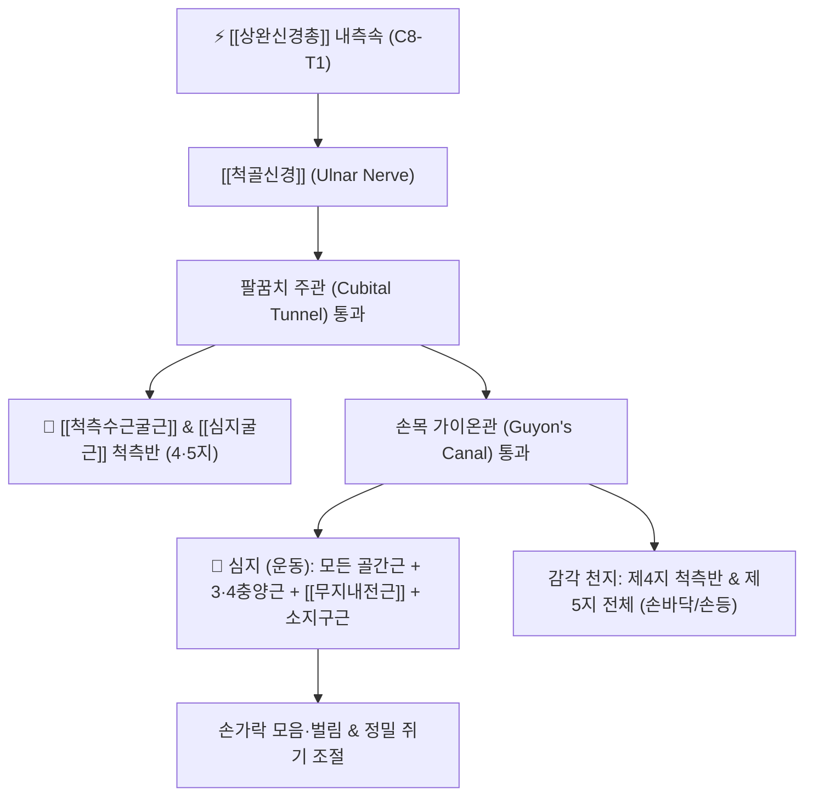

# ⚡ [[척골신경]] (Ulnar Nerve / 尺骨神經, C8~T1)

> **핵심 3줄 요약 (Key Summary)**:
> - 🗺️ 신경 기원 & 해부학적 주행: [[상완신경총]] 내측속(Medial cord, C8-T1)에서 기원하여 상완 내측을 지나 내측상과 후방의 주관(Cubital tunnel)을 통과한 뒤, 전완 척측을 타고 손목의 가이온관(Guyon's canal)으로 진입.
> - 🎯 운동 지배(근육군) & 감각 지배 영역: [[척측수근굴근]](FCU), [[심지굴근]](FDP) 척측반(제4·5지), 손의 모든 골간근(Interossei), 제3·4충양근, 소지구근, [[무지내전근]] 운동 지배 및 척측 1.5개 수지(제4지 척측·제5지 전체) 전후면 피부 감각 전담.
> - ⚠️ 호발 포착 부위 & 관련 임상 질환: 팔꿈치 주관([[주관 증후군]], Cubital tunnel syndrome), 손목 가이온관(Guyon's canal syndrome), [[소흉근]] 하방 간극 포착, 갈퀴손 변형([[Claw hand]]).
> - 🔍 주요 이학적 검사 & 신경학적 징후: 프로망 징후(Froment's sign), 팔꿈치 굴곡 검사(Elbow flexion test), 바텐베르크 징후(Wartenberg's sign).

---

## 1. 신경 기원 & 해부학적 분지 경로 (Anatomy & Course)

* **신경 기원 (Origin & Spinal Segments)**:
  * [[상완신경총]](Brachial plexus) **내측속(Medial cord)**의 가장 큰 종말 분지이며, 척수 분절 **C8, T1** (종종 C7 기여) 신경근 섬유를 포함합니다.
* **상세 주행 경로 (Detailed Pathway)**:
  1. **상완부 주행**: 상완동맥의 내측을 따라 상완삼두근 내측두 전방을 주행하다가, 상완 중간부에서 스트러더스 아케이드(Arcade of Struthers) 및 내측근간중격을 뚫고 후방 구획으로 넘어갑니다.
  2. **주관 통과 (Cubital Tunnel)**: 상완골 내측상과(Medial epicondyle)와 주두(Olecranon) 사이의 뼈고랑을 통과합니다. 오스본 인대(Osborne's ligament)로 덮인 **주관(Cubital tunnel)** 내부를 지나며, 팔꿈치 굴곡 시 인장력과 압박력이 급증합니다.
  3. **전완부 주행**: [[척측수근굴근]](FCU)의 두 머리 사이를 뚫고 전완 전방으로 진입하여, [[심지굴근]](FDP)과 FCU 사이를 따라 척골동맥과 나란히 하행합니다.
  4. **가이온관 통과 (Guyon's Canal)**: 두상골(Pisiform)과 유구골 갈고리(Hook of hamate) 사이의 섬유골성 터널인 **가이온관(Guyon's canal)**을 통해 손바닥으로 진입하며, 천지(감각)와 심지(운동)로 나뉩니다.

---

## 2. 신경 지배 맵 & 기능 네트워크 (Innervation Map)

### 1) 운동 신경 지배 (Motor Innervation)
* **전완부**: [[척측수근굴근]](FCU, 손목 굴곡 및 척측 편위), [[심지굴근]](FDP) 척측반 (제4·5수지 끝마디 굴곡).
* **수부 내재근 (손의 정밀 운동 총괄)**:
  * 장측 골간근 (손가락 모음, Adduction) & 배측 골간근 (손가락 벌림, Abduction).
  * 제3·4충양근(Lumbricals), 소지구근(단소지굴근, 소지외전근, 소지대립근).
  * **[[무지내전근]](Adductor Pollicis)**: 엄지를 검지 쪽으로 강하게 밀착시키는 핵심 근육.

### 2) 감각 신경 지배 (Sensory Innervation)
* **손바닥 및 손등 척측면**: 제5수지 전체 및 제4수지의 척측 절반 피부 감각.
* **수배피지 (Dorsal cutaneous branch)**: 손목 상방 약 5cm에서 미리 분지하므로, 가이온관 단독 병변 시에는 손등 감각이 온전히 보존됩니다.

---

## 3. 호발 포착 부위 & 터널 증후군 병태생리

* **주관 증후군 (Cubital Tunnel Syndrome)**:
  * 팔꿈치 터널에서 발생하는 가장 흔한 척골신경 포착 질환. 턱을 괴거나 팔꿈치를 구부리고 잘 때 주관 내압이 20배 이상 상승하며 신경이 신장·허혈 손상을 입습니다.
* **가이온관 증후군 (Guyon's Canal Syndrome)**:
  * 자전거 라이딩(핸들바 압박), 망치질 등 손바닥 척측에 만성적인 압박이 가해질 때 두상-유구 인대 사이에서 신경이 눌려 발생합니다.
* **소흉근하 간극 압박 (TOS)**:
  * [[소흉근]]이 과긴장되면 상완신경총 하신경간 및 내측속 전체가 압박을 받아 척골신경 주행로를 따라 방사통이 시작됩니다.

---

## 4. 손상 레벨별 임상 증상 & 신경학적 결손

| 손상 레벨 | 주요 임상 양상 | 특징적 기형 및 신경학적 결손 |
| :--- | :--- | :--- |
| **주관 부위 손상 (고위 마비)** | 팔꿈치 내측 통증, 4·5지 저림, 악력 약화 | **갈퀴손 변형 ([[Claw hand]])** (원위 손상보다 덜 심함 - FDP 약화 때문), 전완 척측 감각 저하 |
| **가이온관 손상 (저위 마비)** | 손바닥 척측 통증, 손가락 벌림/모음 불능 | **심한 갈퀴손 변형** (FDP 보존으로 4·5지 끝이 강하게 꺾임), 손등 감각은 정상 |

---

## 5. 관련 이학적 검사 & 신경 감별 매트릭스

* **프로망 징후 (Froment's Sign)**:
  * 엄지와 검지 사이에 종이를 끼우고 잡아당길 때, [[무지내전근]] 마비로 인해 종이를 놓치지 않으려고 엄지 끝을 구부리며 [[장무지굴근]](정중신경 지배)을 과도하게 대상 사용하면 양성.
* **팔꿈치 굴곡 검사 (Elbow Flexion Test)**:
  * 팔꿈치를 최대로 굴곡하고 손목을 신전한 상태를 60초간 유지할 때 4·5지에 저림이 재현되면 주관 증후군 확진.
* **바텐베르크 징후 (Wartenberg's Sign)**:
  * 제3장측골간근 마비로 인해 새끼손가락을 넷째 손가락에 모으지 못하고 바깥으로 벌어져 있으면 양성.

---

## 6. 한의 신경 치료 프로토콜 (약침·침도·신경수기)

* **주관 오스본 인대 침도 절개술 (Acupotomy)**:
  * 상완골 내측상과와 주두 사이의 주관 입구를 촉진하고 신경 주행 방향과 평행하게 침도를 자입하여 비후된 오스본 인대를 미세 절개 감압합니다.
* **가이온관 침도 박리술**:
  * 두상골과 유구골 갈고리 사이의 수근장측인대를 조심스럽게 감압하여 척골신경 운동지와 감각지를 해방합니다.
* **경혈 약침 요법**:
  * [[소해]](小海, SI8), [[음극]](陰郄, HT6), [[신문]](神門, HT7) 혈에 신바로약침 또는 황련해독탕 약침 1.0cc를 주입하여 국소 신경초 염증과 부종을 배출합니다.

---

## 7. 💡 사용자 진료실 핵심 필기 & 임상 팁 (원문 보존)

* **사용자 원문 필기**:
  * C8, T1 척수신경의 앞가지에서 기원하여 [[상완신경총]]을 거쳐 팔 아래로 내려옴
  * 척골 쪽 절반의 [[심지굴근]]을 운동지배, 척골 쪽 1.5개 손가락 등쪽면, 손등의 감각 지배, 소지구 근처 손목과 손바닥 감각 지배, 손의 여러 내재근 지배
  * 주로 [[소흉근]]에서 포착됨
* **진료실 실전 감별 팁**:
  * 환자가 "새끼손가락이 저리고 손에 힘이 빠져 젓가락질이 서툴러진다"고 호소하면 척골신경 병증입니다.
  * 이때 손등 척측 감각을 만져보아 손등까지 저리면 팔꿈치(주관) 병변이고, 손등 감각은 정상인데 손바닥 쪽 4·5지만 저리다면 손목(가이온관) 병변입니다.
  * 또한 소흉근 과긴장에 의한 TOS가 척골신경통 증상을 모방하는 경우가 대단히 많으므로, 반드시 오훼돌기 하방 소흉근 압진을 병행하여 이중 압박(Double crush)을 해결해야 합니다.

---

## 8. 출처 및 학술 참고 문헌 (References)

* Palmer, B. A., & Hughes, T. B. (2010). "Cubital tunnel syndrome." *The Journal of Hand Surgery*, 35(1), 153-163. [PMID: 20117320](https://pubmed.ncbi.nlm.nih.gov/20117320/)
  - [연구 요약]: 주관 증후군의 해부학적 포착 지점(오스본 인대, 내측근간중격), 전기진단학적 평가 기준 및 단계별 보존적/수술적 감압술 임상 지침 제시.
