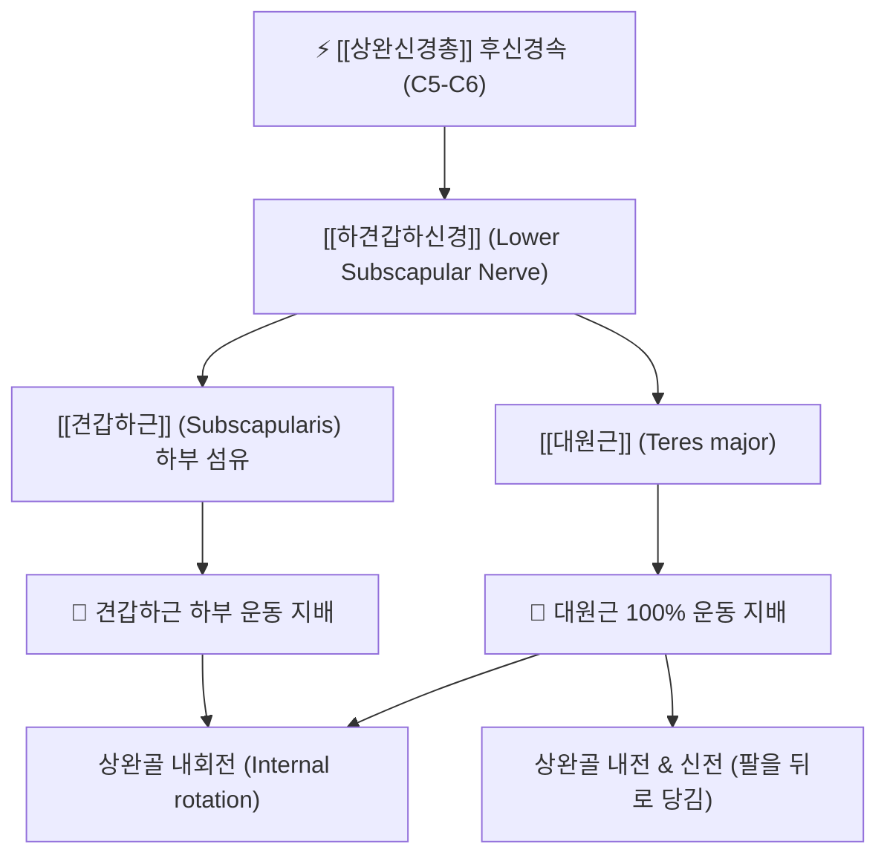

# ⚡ [[하견갑하신경]] (Lower Subscapular Nerve / 下肩胛下神經, C5-C6)

> **핵심 3줄 요약 (Key Summary)**:
> - 🗺️ 신경 기원 & 해부학적 주행: [[상완신경총]] 후신경속(Posterior cord, C5-C6)에서 기원하여 액와와 후벽을 따라 하외측으로 주행하여 견갑하근 하부와 대원근으로 진입.
> - 🎯 운동 지배(근육군) & 감각 지배 영역: 순수 운동 신경. [[견갑하근]](Subscapularis) 하부 섬유 및 [[대원근]](Teres major)을 100% 운동 지배하여 상완골 내회전, 내전 및 신전을 주도.
> - ⚠️ 호발 포착 부위 & 관련 임상 질환: 액와 후벽 근막 유착, 견관절 후하방 불안정성, [[유착성 관절낭염]](오십견) 시 견갑하근·대원근 구축으로 인한 상지 외전·외회전 제한.
> - 🔍 주요 이학적 검사 & 신경학적 징후: 거블러 리프트 오프 검사(Gerber's lift-off test), 대원근 도수근력평가, 견갑골 하외측연 압진.

---

## 1. 신경 기원 & 해부학적 분지 경로 (Anatomy & Course)

* **신경 기원 (Spinal Segments & Origin)**:
  * [[상완신경총]](Brachial plexus)의 **후신경속(Posterior cord)**에서 유래하며, **C5, C6** 척수신경 앞가지 섬유로 구성됩니다.
* **상세 주행 경로 (Detailed Pathway)**:
  1. [[상견갑하신경]] 및 [[흉배신경]](Thoracodorsal nerve)의 원위부에서 후신경속으로부터 갈라져 나옵니다.
  2. 액와와(Axillary fossa)의 후벽을 타고 [[견갑하근]](Subscapularis)의 늑골면(심층 표면) 위를 하외측 방향으로 주행합니다.
  3. 주행 도중 견갑하근 하부 2/3 영역으로 다수의 근육 가지를 내어 침투합니다.
  4. 주간(Main trunk)은 견갑하근 하연을 지나 원위부로 더 내려가서, 견갑골 하각 부근에 위치한 **[[대원근]](Teres major)**의 심층 표면으로 진입하여 종말합니다.

---

## 2. 신경 지배 맵 & 기능 네트워크 (Innervation Map)

### 1) 순수 운동 신경 지배 (Motor Innervation)
* **[[견갑하근]](Subscapularis) 하부 섬유**: 상완골두를 관절와 하방으로 끌어당겨 외전 시 상완골두가 견봉에 부딪히지 않도록 하방 활주를 유도.
* **[[대원근]](Teres major)**: 상완골의 강력한 내전(Adduction)과 신전(Extension)을 발휘하여 팔을 등 뒤로 당기는 작용 수행.
* **감각 신경 특성**: 피부 감각지는 일체 결여되어 있으며, 두 근육의 근방추 고유수용성 감각만을 담당합니다.

---

## 3. 호발 포착 부위 & 터널 증후군 병태생리

* **액와와 후벽 근막 유착**:
  * 견관절의 반복적인 투구 동작이나 라켓 스포츠 시 대원근과 광배근 건 부착부에 과도한 편심성 부하가 걸리면서 하견갑하신경 진입부에 섬유성 유착이 형성됩니다.
* **오십견 환자의 내회전근 단축 악순환**:
  * [[유착성 관절낭염]](동결견) 시 대원근과 견갑하근 하부가 굳어지면 신경 순환 장애가 초래되어 견관절 후하방의 깊은 통증이 만성화됩니다.

---

## 4. 손상 레벨별 임상 증상 & 신경학적 결손

| 병태 구분 | 주요 임상 양상 | 신경학적 결손 및 신체 검진 |
| :--- | :--- | :--- |
| **신경 포착 / 연축** | 열중쉬어 자세 시 견갑골 뒤쪽 아래의 뻐근한 통증, 팔을 앞으로 뻗을 때 당김 | 대원근 및 견갑골 외측연 압진 시 방사통 유발 |
| **신경 마비 / 손상** | 상완골 내회전 및 내전 근력 약화, 무거운 물건을 몸 쪽으로 끌어당기기 어려움 | 리프트 오프 검사 양성, 대원근 위축 |

---

## 5. 관련 이학적 검사 & 신경 감별 매트릭스

* **리프트 오프 검사 (Gerber's Lift-Off Test)**:
  * 환자가 손등을 요추부(허리 뒤)에 얹고 손바닥을 뒤로 밀어 등에서 떼어내게 할 때 손을 떼지 못하면 견갑하근 및 하견갑하신경 손상 확진.
* **[[상견갑하신경]]과의 비교 감별**:
  * 상견갑하신경은 견갑하근 상부만 지배하므로 대원근 기능이 정상이나, 하견갑하신경 손상 시에는 대원근 마비가 동반되어 팔을 뒤로 당기는 내전력이 함께 약화됩니다.

---

## 6. 한의 신경 치료 프로토콜 (약침·침도·신경수기)

* **대원근·견갑하근 부착부 침도 감압술 (Acupotomy)**:
  * 견갑골 외측연 하부 1/3 부위의 대원근 기시부를 촉진하고 침도를 견갑골 외측연을 따라 사자하여 긴장된 근막 섬유를 미세 절개 감압합니다.
* **경혈 약침 요법**:
  * [[견정]](肩貞, SI9) 하방 2촌, [[비통]](臂痛) 및 대원근 압통점에 신바로약침 또는 중성어혈약침 1.0cc를 심부 주입하여 신경 주위 혈류를 개선합니다.
* **내회전근군 MET 스트레칭 추나**:
  * 견관절을 외회전 및 거상시킨 상태에서 대원근을 신장시키는 등장성 저항 수기 기법을 적용합니다.

---

## 7. 💡 사용자 진료실 핵심 필기 & 임상 팁 (원문 보존)

* **사용자 원문 필기**:
  * **-[[견갑하근]] 하부, [[대원근]] 운동지배**
* **진료실 실전 감별 팁**:
  * 환자가 "팔을 등 뒤로 돌려 브래지어 끈을 채우거나 바지 뒷주머니에 손을 넣으려고 하면 어깨 뒤쪽 겨드랑이 밑이 결려서 안 돌아간다"고 할 때 대원근과 하견갑하신경을 확인해야 합니다.
  * 견갑골 바깥쪽 가장자리 아래를 엄지로 깊숙이 파고들어 누르면 환자가 깜짝 놀라며 통증을 호소합니다. 이 부위를 사암침법 후계·신맥 배합과 함께 침 치료로 풀어주면 등 뒤로 돌아가지 않던 손이 그 자리에서 쑥 올라갑니다.

---

## 8. 출처 및 학술 참고 문헌 (References)

* Sager, B., et al. (2019). "The subscapular nerves: an anatomical study with clinical implications." *Folia Morphologica*, 78(4), 844-850. [PMID: 31334431](https://pubmed.ncbi.nlm.nih.gov/31334431/)
  - [연구 요약]: 상완신경총 후신경속에서 분지하는 하견갑하신경의 기원, 분지 패턴, 대원근 및 견갑하근 하부 내 침투 지점의 정량적 계측 및 손상 기전 분석.
