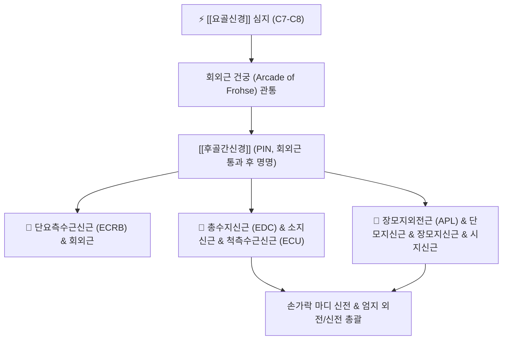

# ⚡ [[후골간신경]] (Posterior Interosseous Nerve / 後骨間神經, PIN)

> **핵심 3줄 요약 (Key Summary)**:
> - 🗺️ 신경 기원 & 해부학적 주행: [[요골신경]](Radial nerve, C7-C8)의 심지(Deep branch)가 회외근(Supinator) 상연의 **프로세 건궁(Arcade of Frohse)**을 관통하여 회외근을 빠져나온 후 [[전완]] 후방 골간막을 따라 하행.
> - 🎯 운동 지배(근육군) & 감각 지배 영역: 순수 운동 신경. 단요측수근신근(ECRB), 회외근, 총수지신근(EDC), 소지신근, [[척측수근굴근]] 길항근인 척측수근신근(ECU), 엄지 신근·외전근군 100% 운동 지배, 피부 감각 섬유 없음.
> - ⚠️ 호발 포착 부위 & 관련 임상 질환: 회외근 건궁 섬유성 아치, [[후골간신경 증후군]](PIN syndrome), 손가락을 펴지 못하는 수지하수([[Finger drop]]), [[요골신경 포착]] 질환군.
> - 🔍 주요 이학적 검사 & 신경학적 징후: 손가락 신전 검사(수지하수 확인), 저항성 중지 신전 검사, 회외근 압진, [[신경전도검사]].

---

## 1. 신경 기원 & 해부학적 분지 경로 (Anatomy & Course)

* **신경 기원 (Origin & Segments)**:
  * [[상완신경총]] 후신경속에서 유래한 [[요골신경]](Radial nerve)의 주간에서 외측상과 직상방 또는 [[주관절]] 전방에서 분지하는 **심지(Deep motor branch)**로 시작하며, **C7, C8** 척수신경 앞가지 섬유로 구성됩니다.
* **상세 주행 경로 (Detailed Pathway)**:
  1. [[주관절]] 외측에서 천지(감각)와 분리된 후, [[상완요골근]]과 단요측수근신근(ECRB) 사이를 지나 회외근(Supinator)을 향해 비스듬히 하행합니다.
  2. 회외근의 천두 상연에 형성된 두터운 반월형 섬유성 밴드인 **프로세 건궁(Arcade of Frohse)** 아래를 통과하여 근육 실질 내로 진입합니다.
  3. 회외근의 천두와 심두 사이 틈새를 나선형으로 통과한 후, **회외근 원위부를 완전히 빠져나오는 순간부터 공식적으로 '후골간신경(PIN)'**이라 부릅니다.
  4. [[전완]] 후방 구획에서 후골간동맥과 동행하며 전완 골간막(Interosseous membrane) 후면을 따라 하행하여, 손목의 [[수근관]] 반대편 관절낭 후면에서 고유수용성 감각 신경종말을 내며 종결합니다.

---

## 2. 신경 지배 맵 & 기능 네트워크 (Innervation Map)

### 1) 순수 운동 신경 지배 (Motor Innervation)
* **손목 신근**: 단요측수근신근(ECRB), 척측수근신근(ECU). (장요측수근신근 ECRL은 요골신경 본간 지배).
* **수지 신근**: 총수지신근(EDC), 소지신근(EDQ), 시지신근(EIP).
* **엄지 운동근**: 장모지외전근(APL), 단모지신근(EPB), 장모지신근(EPL).
* **회외근(Supinator)**: [[전완]] 회외 작용 보조.
* **감각 신경 특성**: 피부 감각지가 전혀 없어 **순수 운동 마비**만 발생하며, 손등이나 손가락의 감각은 100% 정상입니다.

---

## 3. 호발 포착 부위 & 터널 증후군 병태생리

* **후골간신경 증후군 (PIN Syndrome)**:
  * 회외근 상연의 **프로세 건궁(Arcade of Frohse)**이 반복적인 회내·회외 작업, 타이핑, 테니스 등으로 섬유화되어 두꺼워지면 신경이 물리적으로 교액되어 마비가 발생합니다.
* **5대 잠재적 포착 랜드마크 (요골관 내부)**:
  1. 단요측수근신근(ECRB) 내측 건성 띠.
  2. 헨리 혈관륜(Leash of Henry): 요골재발혈관 다발이 신경을 가로지르는 부위.
  3. 회외근 건궁(Arcade of Frohse) - 가장 흔함.
  4. 회외근 실질 내부 및 원위부 출구.
  5. 요골두 부근의 지방종 또는 결절종(Ganglion).

---

## 4. 손상 레벨별 임상 증상 & 신경학적 결손

| 병태 구분 | 주요 임상 양상 | 특징적 외형 및 신경학적 결손 |
| :--- | :--- | :--- |
| **요골관 증후군 (Radial Tunnel)** | 외측 팔꿈치 및 [[전완]] 후외측 심부의 타는 듯한 통증 | 운동 마비 없음, 저항성 회외 시 통증 악화 |
| **[[후골간신경 증후군]] (완전 마비)** | 손가락을 펴지 못하고 엄지를 벌리지 못함 | **수지하수 ([[Finger Drop]])**: 손목 신전은 가능하나 손가락 MCP 관절 신전 불능 |

---

## 5. 관련 이학적 검사 & 신경 감별 매트릭스

* **수지하수 검사 (Finger Drop Test)**:
  * 환자에게 손목과 손가락을 모두 펴보라고 지시할 때, 손목은 펴지지만(ECRL 정상) 손가락 끝마디들이 아래로 툭 떨어지는 수지하수가 나타나면 PIN 증후군 확진.
* **요골신경 고위 손상(손목하수)과의 감별**:
  * 고위 요골신경 손상은 [[상완골]] 골절 등으로 손목 자체가 처지는 **손목하수([[Wrist drop]])**와 손등 감각 소실이 동반되지만, PIN 병변은 손목 신전이 보존(요측 편위 신전)되고 **감각 결손이 전혀 없습니다**.
* **[[외측상과염]]과의 감별**:
  * 외측상과 부착부 압통과 함께 손가락 신전 저항 시 전완 심부로 통증이 방사되는지 확인.

---

## 6. 한의 신경 치료 프로토콜 (약침·침도·신경수기)

* **프로세 건궁 침도 절개술 (Acupotomy)**:
  * [[곡지]](LI11) 외하방 3cm, 회외근 건궁 진입부를 정밀 촉진하고 침도를 신경 주행과 평행하게 자입하여 건성 밴드를 미세 절개 감압합니다.
* **경혈 약침 요법**:
  * [[수삼리]](手三里, LI10), [[곡지]](曲池, LI11), [[외관]](外關, TE5) 부위에 신바로약침 1.0cc를 주입하여 신경 주위 허혈성 부종을 완화합니다.
* **전완 회외근 신경 활주 추나**:
  * 전완을 최대로 회내시킨 상태에서 [[주관절]]을 신전시키는 [[신경가동술]] 스트레칭과 능동 이완 수기를 결합합니다.

---

## 7. 💡 사용자 진료실 핵심 필기 & 임상 팁 (원문 보존)

* **사용자 원문 필기**:
  * **- 요골신경의 깊은 가지**
  * **- 요골신경이 회외근을 완전히 통과한 이후부터 후골간신경이라 함**
* **진료실 실전 감별 팁**:
  * 환자가 손등이나 손가락이 저리지는 않은데 "어느 날 갑자기 손가락이 위로 안 펴져요" 하면서 찾아올 때 중풍(뇌경색)으로 겁을 먹고 오는 경우가 많습니다.
  * 손목을 위로 젖혀보라고 했을 때 손목은 위로 번쩍 들리는데 손가락만 축 늘어져 있다면 뇌 질환이 아니라 팔꿈치 회외근에서 후골간신경이 꽉 막힌 것입니다. 곡지혈 아래 2촌 부위의 프로세 건궁을 침도로 1~2회 열어주면 굳었던 손가락이 정상적으로 펴집니다.

---

## 8. 출처 및 학술 참고 문헌 (References)

* Beneš, M., et al. (2021). "The arcade of Frohse: a systematic review and meta-analysis." *Surgical and Radiologic Anatomy*, 43(5), 703-711. [PMID: 33677682](https://pubmed.ncbi.nlm.nih.gov/33677682/)
  - [연구 요약]: 회외근 건궁(Arcade of Frohse)의 형태학적 특성, 유병률 및 요골신경 심지(후골간신경) 압박 기전에 대한 메타분석과 외과적 감압 가이드라인 제시.
