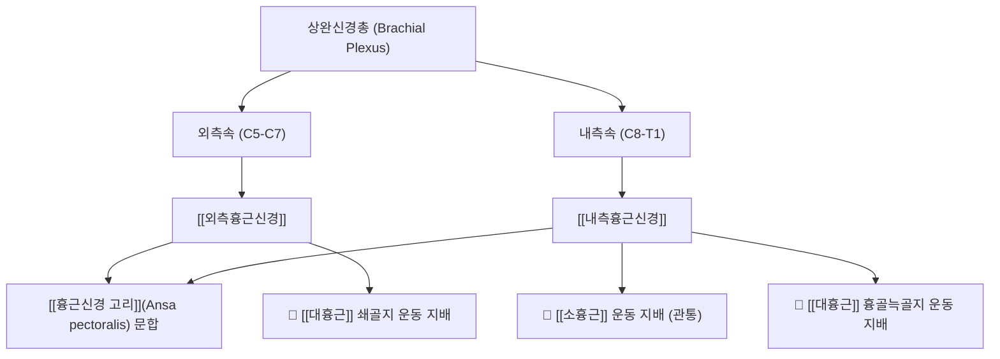

# ⚡ [[흉근신경]] (Pectoral Nerves / 胸筋神經, C5-T1)

> **핵심 3줄 요약 (Key Summary)**:
> - 🗺️ 신경 기원 & 해부학적 주행: [[상완신경총]] 외측속(C5-C7)의 [[외측흉근신경]]과 내측속(C8-T1)의 [[내측흉근신경]]으로 구성된 복합 신경망, 액와동맥 전면에서 **[[흉근신경 고리]](Ansa pectoralis)**를 이루어 대흉근과 소흉근으로 진입.
> - 🎯 운동 지배(근육군) & 감각 지배 영역: 순수 운동 신경 복합체. 전흉벽의 핵심 근육인 [[대흉근]](Pectoralis major)과 [[소흉근]](Pectoralis minor) 전체를 조화롭게 통어.
> - ⚠️ 호발 포착 부위 & 관련 임상 질환: 쇄골흉근근막 및 소흉근 관통부, [[소흉근 증후군]], 흉벽 근막통증증후군, 유방 절제술 후 흉벽 통증 증후군, 흉근신경 차단술(PECS I & II 블록)의 타깃.
> - 🔍 주요 이학적 검사 & 신경학적 징후: 대흉근 쇄골지/흉골지 분절별 MMT, 라이트 검사(Wright test), 쇄골하 신경혈관 압통 검사.

---

## 1. 신경 기원 & 해부학적 분지 경로 (Anatomy & Course)

* **신경 기원 (Origin & Spinal Segments)**:
  * 상완신경총의 외측속(C5, C6, C7)에서 유래하는 **[[외측흉근신경]](Lateral pectoral nerve)**과 내측속(C8, T1)에서 유래하는 **[[내측흉근신경]](Medial pectoral nerve)**의 두 갈래 복합체입니다.
* **해부학적 문합 고리 (Ansa Pectoralis)**:
  * 액와동맥의 첫 번째와 두 번째 분절 전면에서 두 신경을 연결하는 신경 루프(Loop)인 **[[흉근신경 고리]](Ansa pectoralis)**가 형성되어, 신경 손상 시 상호 보상 기전을 제공합니다.
* **상세 주행 경로**:
  1. [[외측흉근신경]]: 액와혈관 전면을 가로질러 쇄골흉근근막을 관통한 뒤 [[대흉근]] 쇄골지로 진입합니다.
  2. [[내측흉근신경]]: 액와동맥과 정맥 사이를 지나 [[소흉근]]의 심층면으로 진입하며, 소흉근 실질을 직접 관통(Piercing)하여 대흉근 흉골늑골지로 진입합니다.

---

## 2. 신경 지배 맵 & 기능 네트워크 (Innervation Map)

### 1) 운동 신경 지배 (Motor Innervation)
* **[[대흉근]](Pectoralis major)**: 쇄골지는 외측흉근신경이, 흉골늑골지 및 복지는 내측흉근신경이 분담 지배하여 상완골의 굴곡, 내전, 내회전을 총괄.
* **[[소흉근]](Pectoralis minor)**: 내측흉근신경이 단독 지배하여 견갑골 전인 및 하방 회전을 주도.
* **감각 신경 특성**: 피하 감각 신경지는 없으며, 전흉벽 근육의 근방추 고유수용성 감각 및 흉쇄관절낭 감각만을 전달.

---

## 3. 호발 포착 부위 & 터널 증후군 병태생리

* **대흉근-소흉근 근막간 공간 (PECS I 평면)**:
  * 대흉근과 소흉근 사이의 근막층이 만성 [[라운드 숄더]] 및 흉곽 운동 부족으로 유착되면 주행하는 신경 가지들이 전단력 손상을 받습니다.
* **소흉근-전거근 근막간 공간 (PECS II 평면)**:
  * 소흉근 아래로 주행하는 상완신경총 본간 및 외측 흉벽 감각 분지와 함께 압박됩니다.
* **소흉근 증후군 (Pectoralis Minor Syndrome)**:
  * 오훼돌기 하방에서 소흉근의 만성 연축에 의해 흉근신경과 상완신경총 전체가 교액되는 흉곽출구 압박 병태.

---

## 4. 손상 레벨별 임상 증상 & 신경학적 결손

| 병태 구분 | 주요 임상 증상 | 신경학적 결손 및 신체 검진 |
| :--- | :--- | :--- |
| **흉근신경 포착 / 연축** | 앞가슴의 조임, 결림, 팔을 뒤로 젖히거나 뻗을 때 가슴 앞쪽 찢어짐 | 오훼돌기 및 쇄골 하방 극심한 압통, 흉벽 긴장대 |
| **신경 마비 / 손상** | 가슴 근육 위축, 미는 힘 및 안으로 모으는 악력 감퇴 | 대흉근 윤곽 함몰, 견갑골 후인 가동성 불균형 |

---

## 5. 관련 이학적 검사 & 신경 감별 매트릭스

* **대흉근/소흉근 분절별 저항 검사**:
  * 쇄골지(앙와위 전상방 굴곡 저항)와 흉골지(앙와위 내하방 내전 저항)를 분리 평가.
* **[[라이트 검사]] (Wright's Hyperabduction Test)**:
  * 팔을 180도 외전 및 외회전할 때 흉곽 전면 통증이나 요골동맥 맥박 감쇠가 유발되면 소흉근하 흉근신경 압박 확진.
* **협심증과의 감별**:
  * 심전도 및 심근효소 검사가 정상이며, 가슴 근육 압진 시 통증이 재현되면 근막신경성 흉통으로 감별.

---

## 6. 한의 신경 치료 프로토콜 (약침·침도·신경수기)

* **PECS 평면 침도 근막 박리술 (Acupotomy)**:
  * [[운문]](雲門, LU2)과 [[중부]](中府, LU1) 부위에서 대흉근과 소흉근 사이의 근막면을 침도로 섬세하게 박리하여 흉근신경 주행로를 개방합니다.
* **흉벽 근막 약침 요법**:
  * 쇄골하근 및 소흉근 기시부에 신바로약침 또는 중성어혈약침 1.0cc를 주입하여 국소 염증과 허혈을 개선합니다.
* **흉곽 가동성 회복 추나**:
  * 늑골-흉골 관절 및 흉추 관절가동술을 병행하여 전흉벽 근육의 과긴장을 해소합니다.

---

## 7. 💡 사용자 진료실 핵심 필기 & 임상 팁 (원문 보존)

* **사용자 원문 필기**:
  * 앞가슴 통증의 2대 근육 신경망:
    * 가슴 앞쪽 통증은 위쪽의 외측흉근신경(대흉근 쇄골지)과 아래쪽의 내측흉근신경(소흉근 관통)으로 양분됩니다.
    * 팔을 앞으로 밀 때 아프면 외측흉근신경을, 팔을 벌리고 젖힐 때 아프면 내측흉근신경을 치료해야 합니다.
* **진료실 실전 감별 팁**:
  * 흉통 환자 문진 시 반드시 통증 유발 동작을 구분해야 합니다.
  * 벤치프레스나 물건을 앞으로 밀 때 아프면 쇄골 하방 외측흉근신경을, 기지개를 켜거나 어깨를 뒤로 젖힐 때 가슴이 찢어지듯 아프면 오훼돌기 밑 내측흉근신경을 치료 목표로 삼아야 합니다.

---

## 8. 출처 및 학술 참고 문헌 (References)

* Kumar, A., et al. (2025). "A Randomized Trial Comparing Ultrasound Guided Modified Pectoral Block Versus Erector Spinae Block for Post Mastectomy Pain Management." *Clinical Breast Cancer*, 25(7), 654-663. [PMID: 40300932](https://pubmed.ncbi.nlm.nih.gov/40300932/)
  - [연구 요약]: 대흉근과 소흉근 사이 흉근신경(PECS 블록) 차단술이 흉부 수술 후 급성 및 만성 신경병증성 통증을 억제함을 임상시험으로 입증.
* Zhang, L., et al. (2025). "Pectoral Nerve (PECS) Blocks in Gynecomastia Surgeries." *Aesthetic Plastic Surgery*, 49(4), 1120-1128. [PMID: 40550893](https://pubmed.ncbi.nlm.nih.gov/40550893/)
  - [연구 요약]: 외측 및 내측 흉근신경의 해부학적 분지 경로와 전흉벽 진통을 위한 정밀 초음파 타깃팅 기법 고찰.
* Stanczyk, P., et al. (2026). "Atypical Origin of the Pectoral Nerves: Morphological Insights for Orthopedic, Reconstructive, and Trauma Surgeons." *Cureus*, 18(5), e60124. [PMID: 42338849](https://pubmed.ncbi.nlm.nih.gov/42338849/)
  - [연구 요약]: 흉근신경 고리(Ansa pectoralis)의 형태학적 변이와 임상적 의의 규명.
