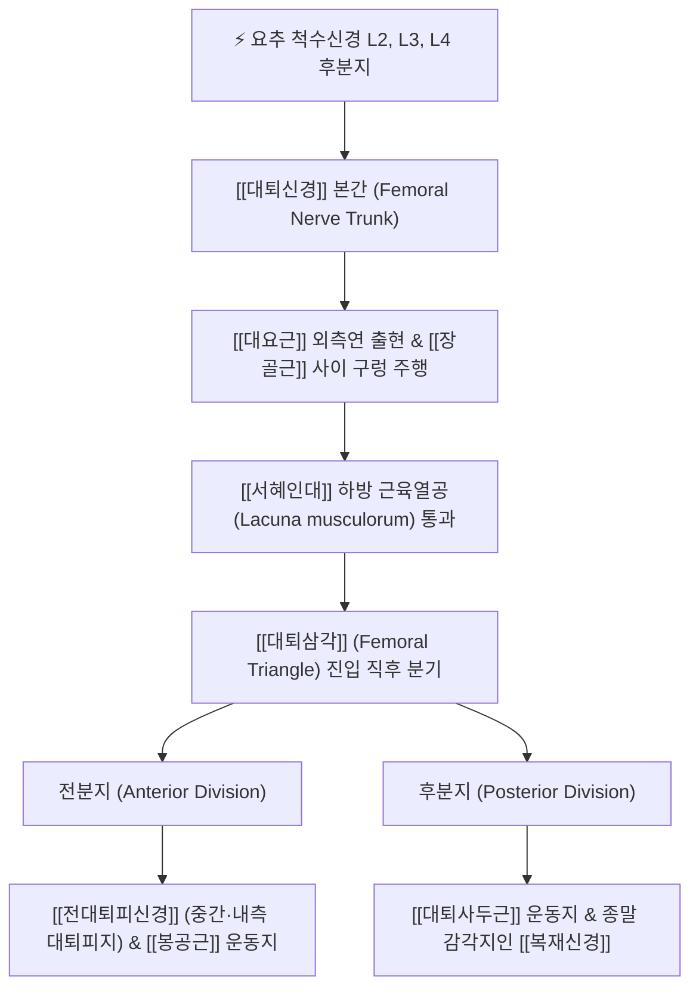

# 대퇴신경 (Femoral Nerve, 넙다리신경)

> [!NOTE]
> 요신경총(Lumbar plexus)에서 기원하는 가장 굵은 단일 말초신경으로, 하지 전면부의 고관절 굴곡 및 슬관절 신전 운동과 대퇴 전면 및 하퇴 내측의 피부 감각을 총괄하는 핵심 신경 간선입니다.

---

## 1. 신경 기원 & 해부학적 분지 경로 (Anatomy & Course)

* **신경 기원 (Origin & Spinal Roots)**:
  * 요추 제2, 3, 4 척수신경(L2, L3, L4) 앞가지의 **후분지(Posterior divisions)**가 합류하여 형성됩니다.
  * 요신경총에서 기원하는 말초신경 중 가장 구경이 크고 기능적 비중이 높습니다.
* **골반강 내 주행 경로**:
  * 복부 후벽에서 [[대요근]](Psoas major)의 후외측 실질을 관통하며 내려와 대요근 외측연과 [[장골근]](Iliacus) 사이의 깊은 고랑(Groove)을 따라 주행합니다.
  * 장골근막(Iliac fascia) 하부에 밀착되어 골반 가장자리를 타고 내려옵니다.
* **서혜부 및 대퇴삼각 통과**:
  * [[서혜인대]](Inguinal ligament) 중앙부 하방의 **근육열공(Lacuna musculorum)**을 통해 대퇴부로 진입합니다.
  * 대퇴혈관초(Femoral sheath)의 외측에 위치하며, 대퇴동맥(Femoral artery)의 바로 외측 0.5~1cm 부위에 자리잡고 있어 혈관박동 촉진을 통해 신경의 위치를 정확히 가늠할 수 있습니다.
  * 서혜인대를 통과하자마자 대퇴삼각 내부에서 약 2~4cm 이내에 다수의 전분지와 후분지로 부채살처럼 갈라집니다.

---

## 2. 신경 지배 맵 & 기능 네트워크 (Innervation Map)

* **운동 신경 지배 (Motor Innervation)**:
  * **전분지 계열**:
    * [[치골근]](Pectineus): 대퇴신경 전분지의 작은 가지가 지배하여 고관절 내전 및 보조 굴곡을 유도합니다 (폐쇄신경의 이중 지배를 받기도 함).
    * [[봉공근]](Sartorius): 고관절 굴곡, 외전, 외회전 및 슬관절 굴곡, 내회전을 복합 조절합니다.
  * **후분지 계열 ([[대퇴사두근]] 전담 지배)**:
    * [[대퇴직근]](Rectus femoris): 2개 관절을 지나는 근육으로 강력한 고관절 굴곡과 슬관절 신전을 담당합니다.
    * [[외측광근]](Vastus lateralis): 슬관절 신전 및 슬개골의 외측 활주 안정화.
    * [[중간광근]](Vastus intermedius): 슬관절 신전 심부 안정화 및 관절근(Articularis genus) 분지.
    * [[내측광근]](Vastus medialis): 슬관절 최종 신전 각도 완성 및 슬개골 내측 안정화(VMO).
* **감각 신경 지배 (Sensory Innervation)**:
  * [[전대퇴피신경]](Anterior cutaneous branches of femoral nerve): 대퇴 전면 및 전내측 피부 전반의 표재 감각.
  * [[복재신경]](Saphenous nerve): 대퇴신경의 최장 감각 종말지로, 내전근관을 거쳐 하퇴 내측, 내과(안쪽 복사뼈), 족부 내측연의 피부 감각 전담.
* **관절 감각지 (Articular Branches)**:
  * 고관절(Hip joint) 전면 관절낭 및 슬관절(Knee joint) 전면 관절낭에 고유수용성 감각 신경지를 공급합니다.

---

## 3. 호발 포착 부위 & 터널 증후군 병태생리

* **1차 호발 포착점: 대요근과 장골근 사이 구렁 (Retro-Psoas Groove)**:
  * 장시간 좌식 생활, 고관절 굴곡 구축, 복부 비만, 후복막강 혈종 등으로 인해 [[대요근]] 및 [[장골근]]이 만성 연축될 때 신경 간선이 압박됩니다.
  * 요추 척추전방전위증, 요추 후관절증후군 연관 반사성 연축에서도 신경 압박이 동반됩니다.
* **2차 호발 포착점: 서혜인대 하방 근육열공 (Subinguinal Lacuna Musculorum)**:
  * 골반의 전방경사(Anterior pelvic tilt)로 인해 서혜인대가 팽팽해지거나, 장골치골궁(Iliopectineal arch)과 서혜인대 사이의 공간이 협소해져 기계적 마찰이 발생합니다.
* **신경 손상의 병태생리**:
  * 신경 허혈 및 압박은 대퇴사두근 위축과 슬개건 반사 저하를 초래하며, 계단 보행 시 무릎이 꺾이는 갑작스러운 탈력감(Buckling of the knee)을 유발합니다.

---

## 4. 손상 레벨별 임상 증상 & 신경학적 결손

* **요추 신경근 레벨 (L2-L4 요추간판탈출증/협착증)**:
  * 서혜부 및 대퇴 전면 방사통과 함께 요통이 선행합니다.
  * 상위 신경근 압박 시 고관절 굴곡력 저하와 대퇴 전외측 감각 이상이 뚜렷합니다.
* **골반강 내 고위 손상 (High Femoral Neuropathy)**:
  * 후복막강 혈종, 골반 골절, 부인과/비뇨기과 복강경 수술 후 발생.
  * 고관절 굴곡([[장요근]])과 슬관절 신전([[대퇴사두근]])이 동시에 심각하게 마비됩니다.
* **서혜인대 하방 저위 손상 (Low Inguinal Entrapment)**:
  * 장요근 기능은 완전히 보존되어 고관절 굴곡은 정상이나, 슬관절 신전력 약화와 대퇴 전면부의 감각 이상 및 저림이 국한되어 나타납니다.
  * 보행 시 유각기 말기(Terminal swing)에서 슬관절 신전이 완전히 이루어지지 않아 뒤꿈치 닿기(Heel strike)가 불안정해집니다.

---

## 5. 관련 이학적 검사 & 신경 감별 매트릭스

* **[[대퇴신경 신장 검사]] (Femoral Nerve Stretch Test / Ely's Test)**:
  * 환자를 복와위(엎드린 자세)로 눕히고 검사자가 슬관절을 90도 이상 굴곡시킨 후 고관절을 수동적으로 신전시킵니다.
  * 대퇴 전면부로 찌릿한 방사통이나 극심한 저림이 유발되면 양성으로 판정합니다 (L2-L4 신경근 및 대퇴신경 긴장 징후).
* **슬개건 반사 (Patellar Tendon Reflex, L4)**:
  * 슬개건을 타진하여 대퇴사두근의 신장 반사를 측정합니다. 대퇴신경 병변 시 건반사가 소실되거나 뚜렷하게 저하됩니다.
* **신경 감별 매트릭스**:
  | 구분 | [[대퇴신경]] 마비 | [[외측대퇴피신경]] 포착 | [[폐쇄신경]] 마비 |
  | :--- | :--- | :--- | :--- |
  | **주요 운동 약화** | [[대퇴사두근]] (무릎 신전 불능) | 운동 마비 없음 (순수 감각) | [[내전근]]군 (다리 모음 약화) |
  | **감각 이상 부위** | 대퇴 전면 + 하퇴 내측 | 대퇴 전외측 (작열통) | 대퇴 내측 상·중부 |
  | **슬개건 반사** | 저하 또는 소실 | 정상 유지 | 정상 유지 |

---

## 6. 한의 신경 치료 프로토콜 (약침·침도·신경수기)

* **대요근 및 장요근 심부 약침술**:
  * 복와위에서 L2-L4 협척혈 및 기해수(BL24), 대장수(BL25) 외측 3.5~4촌 지점에서 복측 외측을 향해 75~90mm 장침 또는 약침용 바늘을 자입하여 대요근 심부 및 후관절 주위에 [[신바로약침]] 또는 황련해독약침을 주입합니다.
  * 대요근 연축으로 인한 신경근 압박 및 신경 부종을 직접 소퇴시킵니다.
* **서혜부 근육열공 침도 감압술**:
  * 앙와위에서 ASIS와 치골결절을 연결하는 서혜인대의 외측 1/3과 내측 2/3 경계 하방에서 대퇴동맥 맥동을 외측으로 1cm 피하여 안전하게 침도(소침도)를 직자합니다.
  * 비후된 장골근막 및 서혜인대 주변 섬유성 유착을 미세 박리하여 신경관의 감압을 유도합니다.
* **추나치료 및 신경가동술 (Neurodynamics)**:
  * 골반 변위 교정을 위한 골반 전방경사 교정 추나(기립근 및 장요근 이완 기법).
  * 앙와위 및 복와위에서 대퇴신경 활주 기법(Femoral nerve slider/tensioner technique)을 적용하여 신경의 생리적 활주성을 회복시킵니다.

---

## 7. 💡 사용자 진료실 핵심 필기 & 임상 팁 (원문 보존)

* **주행 및 분지 특성**:
  * L2, L3(및 L4)에서 기시하여 [[대퇴사두근]] 앞쪽, 안쪽으로 주행합니다.
* **포착 다발 위치**:
  * [[장요근]]의 서혜인대 부위, 복부의 [[대요근]], 대퇴신경 뿌리(요추 추간공 출구부)가 3대 핵심 포착점입니다.
* **임상 처치 핵심 노하우**:
  * `-> [[대요근]], [[장요근]] 이완, 요추 후관절 신경 치료`가 임상 회복의 관건입니다.
  * 단순히 무릎 주변이나 허벅지 통증 부위만 치료해서는 효과가 미진하며, 반드시 복강 내 대요근-장골근 고랑 및 요추 후관절부 신경근 출구부를 함께 치료해야 대퇴사두근 근력 회복과 무릎 꺾임 현상이 신속히 소실됩니다.

---

## 8. 출처 및 학술 참고 문헌 (References)

* Refai, N. A., Black, A. C., & Tadi, P. (2023). "Anatomy, Bony Pelvis and Lower Limb: Thigh Femoral Nerve." *StatPearls Publishing*. [PMID: 32310525](https://pubmed.ncbi.nlm.nih.gov/32310525/)
  - [연구 요약]: 대퇴신경의 요신경총 기원, 대요근 및 서혜인대 통과 해부학, 대퇴삼각 분지 및 대퇴사두근 운동 지배 상세 규명.
* Moore, K. L., Dalley, A. F., & Agur, A. M. (2018). *Clinically Oriented Anatomy* (8th ed.). Wolters Kluwer.
  - [연구 요약]: 하지 신경총의 임상 해부학적 구조와 근육열공 통과부 신경 포착의 진단 기준 수록.
* 전국한의과대학 침구경혈학교실 (2020). *침구의학*. 집문당.
  - [연구 요약]: 대퇴신경 마비 및 대퇴통에 대한 비관, 복토, 음시 취혈 및 심부 자침 프로토콜 제시.
