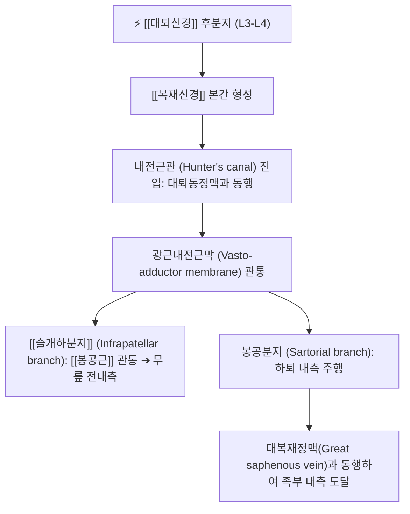

# 복재신경 (Saphenous Nerve, 두렁신경)

> [!NOTE]
> [[대퇴신경]] 후분지에서 갈라져 나오는 가장 길고 굵은 종말 순수 감각신경(Pure sensory nerve)으로, 내전근관(Hunter's canal)을 관통하여 슬관절 내측, 하퇴 내측, 안쪽 복사뼈 및 족부 내측연의 감각을 독점 지배합니다.

---

## 1. 신경 기원 & 해부학적 분지 경로 (Anatomy & Course)

* **신경 기원 (Spinal Origin)**:
  * 요신경총(Lumbar plexus)의 **제3, 4 요추신경(L3, L4)** 후분지에서 유래한 [[대퇴신경]]의 최장 종말 가지입니다.
  * 운동 신경 섬유를 전혀 포함하지 않는 순수 체감각 신경입니다.
* **내전근관 주행 (Adductor / Hunter's Canal)**:
  * 대퇴삼각을 지난 후 [[대퇴동맥]] 및 대퇴정맥과 함께 내전근관(Adductor canal)으로 진입합니다.
  * 내전근관의 지붕을 이루는 **광근내전근막(Vasto-adductor membrane)** 아래를 지나며, 대퇴동맥의 외측에서 전면을 가로질러 내측으로 위치를 바꿉니다.
* **표재화 및 원위부 분지**:
  * 대퇴골 내과 상방 약 10cm 지점에서 광근내전근막을 뚫고 표재층으로 빠져나옵니다.
  * **슬개하분지(Infrapatellar branch)**: [[봉공근]](Sartorius) 건을 관통하거나 그 하연을 돌아 슬개골 전면 및 하부 관절낭으로 분지하여 슬개하 신경총을 형성합니다.
  * **하퇴지(Crural branch)**: 봉공근 건과 박근(Gracilis) 건 사이를 통과하여 대복재정맥(Great saphenous vein)과 나란히 주행하며, 하퇴 전내측을 거쳐 족관절 내과 앞을 지나 제1 중족골 기저부까지 감각지를 뻗습니다.

---

## 2. 신경 지배 맵 & 기능 네트워크 (Innervation Map)

* **순수 감각 신경 지배 (Pure Sensory)**:
  * **슬개하 부위**: 슬개골 하연, 슬개건 전면, 경골 조면 주변 피부 (Gonalgia paresthetica 발생 부위).
  * **하퇴 내측 부위**: 정강이 안쪽면 전체(L4 피부분절) 피부 감각.
  * **족부 부위**: 족관절 안쪽 복사뼈(내과) 전면 및 족궁(발바닥 안쪽 아치) 기저부 피부 감각.
* **운동 신경 지배 부재**:
  * 운동 섬유가 전혀 없으므로, 신경이 단독으로 포착되거나 절단되어도 족하수나 무릎 신전 근력 약화 등 운동 결손은 전혀 발생하지 않습니다.
* **혈관 및 관절 감각 네트워크**:
  * 대복재정맥 벽에 혈관운동 신경지를 제공하고 슬관절 내측 관절낭 및 인대 부착부에 고유수용성 감각 신경지를 공급합니다.

---

## 3. 호발 포착 부위 & 터널 증후군 병태생리

* **내전근관 출구부 포착 (Adductor Canal Syndrome)**:
  * 광근내전근막(Vasto-adductor membrane) 출구부에서 [[봉공근]]과 [[내측광근]](Vastus medialis) 및 대내전근(Adductor magnus) 건의 수축에 의해 신경이 압박받는 상태입니다.
  * 장거리 달리기, 자전거 타기, 축구 등 다리 내전근을 과도하게 사용하는 운동선수에게 호발합니다.
* **봉공근 하부 및 슬관절 내측 굴곡부 포착**:
  * [[봉공근]] 아래를 통과하면서 봉공근과 내측광근 사이의 근막 유착에 의해 신경이 기계적으로 조여집니다.
* **의원성 수술 손상 (Iatrogenic Injuries)**:
  * 슬관절 관절경 수술(전방십자인대 재건술 시 자가건 채취), 인공슬관절 치환술(TKA), 하지정맥류 발거술(Stripping) 후 슬개하분지 손상으로 만성 신경병증성 동통이 자주 발생합니다.

---

## 4. 손상 레벨별 임상 증상 & 신경학적 결손

* **내전근관 고위 포착 증상**:
  * 대퇴 내측 원위부에서 시작하여 무릎 안쪽, 정강이 안쪽, 발목 안쪽까지 찌릿찌릿 뻗치는 방사통과 작열감(Burning sensation).
  * 계단을 내려가거나 무릎을 완전히 굽히거나 펼 때 대퇴 내전근 긴장으로 통증이 심화됩니다.
* **슬개하분지 단독 포착 (Gonalgia Paresthetica)**:
  * 하퇴나 발목으로의 방사통 없이 **슬개골 하부 및 내측에 국한된 시린 통증**, 감각 둔마, 옷깃만 스쳐도 따가운 이질통(Allodynia).
  * 퇴행성 관절염으로 오진되어 관절강 내 주사 치료를 반복해도 호전되지 않는 무릎 통증의 흔한 원인입니다.

---

## 5. 관련 이학적 검사 & 신경 감별 매트릭스

* **내전근관 틴넬 징후 (Tinel's Sign at Hunter's Canal)**:
  * 대퇴골 내과 상방 8~10cm 지점의 봉공근 후연(내전근관 부위)을 가볍게 타진할 때 하퇴 내측으로 찌릿한 방사통이 재현되면 양성입니다.
* **슬개하 틴넬 검사 (Infrapatellar Tinel's Sign)**:
  * 경골 내측 과간융기 주변 및 봉공근 건 정지부를 타진하여 슬개하부 감각 이상 유발을 확인합니다.
* **신경 감별 매트릭스**:
  | 구분 | [[복재신경]] 포착 | 요추 4번(L4) 신경근증 | 퇴행성 [[슬관절염]] |
  | :--- | :--- | :--- | :--- |
  | **통증 양상** | 하퇴 내측 표재성 작열통 | 요통 + 둔부·대퇴·하퇴 방사통 | 관절 심부의 묵직한 기계적 통증 |
  | **운동 약화** | 없음 (순수 감각) | 전경골근 약화 (족배굴곡 약) | 없음 (가동범위 제한만 존재) |
  | **슬개건 반사** | 정상 보존 | 저하 또는 소실 | 정상 |
  | **압통 부위** | 내전근관 및 봉공근 하부 | 요추 협척혈 (L3-L4) | 관절열극 (Joint line) |

---

## 6. 한의 신경 치료 프로토콜 (약침·침도·신경수기)

* **내전근관 출구부 침도 박리술**:
  * 앙와위에서 대퇴골 내과 상방 약 8cm, 봉공근과 대내전근 사이의 함요처(혈해혈 상방 및 기문혈 부근)에서 신경 주행 방향과 평행하게 침도를 자입합니다.
  * 팽팽해진 광근내전근막 및 근막간 유착을 절개·박리하여 신경 감압을 유도합니다.
* **혈해(SP10) 및 곡천(LR8) 약침 치료**:
  * 복재신경 슬개하분지가 표재화되는 혈해혈 및 곡천혈 주변 압통점에 [[신바로약침]] 또는 황련해독약침을 0.3~0.5cc씩 주입하여 신경 부종과 이질통을 진정시킵니다.
* **음릉천(SP9) 및 삼음교(SP6) 전침 요법**:
  * 하퇴 내측 경골 후연을 따라 복재신경 하퇴지가 주행하는 비경(脾經) 혈위에 저주파(2Hz) 연속파 전침을 통전하여 신경 혈류를 개선합니다.
* **봉공근 및 내전근 근막 이완 추나**:
  * 고관절 외전·외회전 상태에서 봉공근과 내측광근의 경계면을 촉지하여 심부 횡마찰(Deep transverse friction) 및 근막 이완 기법을 적용합니다.

---

## 7. 💡 사용자 진료실 핵심 필기 & 임상 팁 (원문 보존)

* **포착 발생 부위**:
  * [[봉공근]] 아래, [[봉공근]]과 [[내측광근]] 사이에서 포착됩니다.
* **주요 임상 증상 및 통증 발현**:
  * `하퇴 내측, 슬개골 하부에의 통증 유발`이 나타납니다.
* **임상 진료실 감별 포인트**:
  * 무릎 관절염 치료를 오래 받아도 무릎 안쪽 앞부분이 계속 시리고 타는 듯 아프다는 환자는 반드시 봉공근과 내측광근 사이의 복재신경 포착을 의심해야 합니다. 봉공근 하부 압통점을 풀어주면 수개월간 지속된 무릎 내측 통증이 즉각 경감됩니다.

---

## 8. 출처 및 학술 참고 문헌 (References)

* Romanoff, M. E., et al. (1989). "Saphenous nerve entrapment at the adductor canal." *The American Journal of Sports Medicine*, 17(4), 478-481. [PMID: 2782531](https://pubmed.ncbi.nlm.nih.gov/2782531/)
  - [연구 요약]: 내전근관(Hunter's canal) 출구부에서 복재신경 포착으로 인한 슬관절 내측 통증의 병태생리와 수술적·보존적 감압 요법 성적 보고.
* Trescot, A. M., et al. (2013). "Saphenous nerve entrapment: a review of the literature." *Pain Physician*, 16(3), E291-E300.
  - [연구 요약]: 복재신경 슬개하분지 및 하퇴지의 포착 기전과 초음파 유도하 차단술 가이드라인.
* 전국한의과대학 침구경혈학교실 (2020). *침구의학*. 집문당.
  - [연구 요약]: 슬관절 내측통 및 하퇴 내측 이상감각에 대한 혈해, 곡천, 음릉천 취혈 근거.
