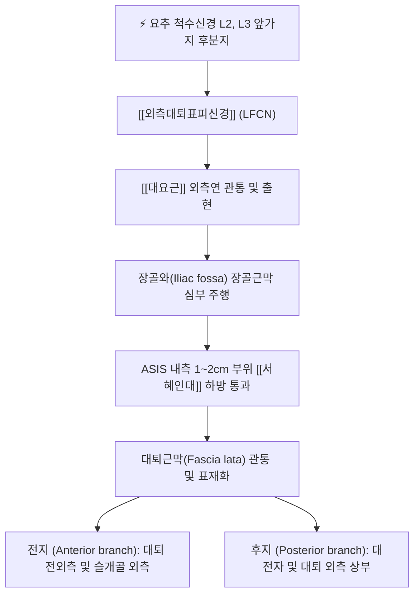

# 외측대퇴표피신경 (Lateral Femoral Cutaneous Nerve, LFCN)

> [!NOTE]
> 요신경총(L2-L3)에서 기원하여 대요근 외측을 돌아 상전장골극(ASIS) 내측 서혜인대 하방을 통과하는 순수 표재 감각신경으로, 대퇴 전외측 피부 감각을 전담하며 **이상감각성 대퇴신경통(Meralgia Paresthetica)**을 일으키는 대표적 말초신경입니다.

---

## 1. 신경 기원 & 해부학적 분지 경로 (Anatomy & Course)

* **신경 기원 (Spinal Segments)**:
  * 요신경총(Lumbar plexus) **제2, 3 요추신경(L2, L3)** 앞가지의 후분지(Posterior divisions)에서 기원합니다.
  * 운동 신경 섬유가 전혀 없는 **100% 순수 체감각 신경(Pure sensory nerve)**입니다.
* **복강 및 골반강 주행**:
  * 요추부에서 나와 [[대요근]](Psoas major)의 외측연을 뚫고 나와 장골근막(Iliac fascia) 심부를 따라 장골와(Iliac fossa)를 가로질러 외하방으로 비스듬히 주행합니다.
* **서혜인대 통과 및 해부학적 변이**:
  * 상전장골극(Anterior Superior Iliac Spine, ASIS)의 내측 약 1~2cm 지점에서 [[서혜인대]](Inguinal ligament) 하방의 좁은 섬유성 터널을 통과합니다.
  * 개인에 따라 서혜인대를 직접 관통하거나, ASIS 골성 융기를 직접 타고 넘어가거나, 봉공근 건 내부를 뚫고 지나가는 다양한 해부학적 변이가 존재하여 포착에 매우 취약합니다.
* **대퇴부 진입 및 표재 분지**:
  * 서혜인대 통과 후 약 2~3cm 하방에서 대퇴근막(Fascia lata)을 관통하여 피하지방층으로 빠져나오며, 전지(Anterior branch)와 후지(Posterior branch)로 갈라져 대퇴 전외측 피부로 넓게 분지합니다.

---

## 2. 신경 지배 맵 & 기능 네트워크 (Innervation Map)

* **감각 신경 지배 영역 (Cutaneous Innervation)**:
  * **전지 (Anterior branch)**: 대퇴부 전외측 피부(대전자 하방에서부터 무릎 슬개골 외측 상방까지)의 감각을 지배합니다.
  * **후지 (Posterior branch)**: 대전자(Greater trochanter) 주변 및 둔부 외측 하부에서 대퇴 중앙 외측까지의 피부 감각을 담당합니다.
* **운동 기능 결손 부재**:
  * 순수 감각신경이므로 신경이 완전 손상되거나 심하게 포착되어도 대퇴사두근, 둔근, 햄스트링 등 하지 근육의 근력은 100% 정상으로 보존됩니다.
* **자율신경 및 골반 울혈과의 연동 네트워크**:
  * 서혜부 및 복강 내 압력 증가, 골반강 정맥 울혈과 밀접하게 연동되어 골반강 내 장기(자궁, 난소, 방광) 기능 부전 시 연관통 및 피부분절 과민을 형성합니다.

---

## 3. 호발 포착 부위 & 터널 증후군 병태생리

* **1차 핵심 포착점: ASIS 내하방 서혜인대 터널**:
  * ASIS와 서혜인대 외측 부착부 사이의 좁은 각도(Angle)에서 신경이 날카로운 섬유성 띠에 의해 마찰을 받습니다.
  * 꼭 끼는 바지(스키니진), 무거운 공구 벨트나 군용 벨트 착용, 복부 비만, 임신 등으로 인해 서혜인대가 하방으로 견인될 때 신경이 심하게 조여집니다.
* **2차 포착점: 대퇴근막(Fascia lata) 관통부**:
  * 대퇴근막을 뚫고 표재로 나오는 섬유성 구멍에서 장경인대(ITB) 및 대퇴근막장근(TFL)의 긴장으로 인해 출구가 압박됩니다.
* **이상감각성 대퇴신경통 (Meralgia Paresthetica / Bernhardt-Roth Syndrome)**:
  * LFCN의 만성 포착으로 발생하는 전형적인 신경병증으로, 대퇴 전외측의 찌릿찌릿함, 타는 듯한 작열통(Burning pain), 차갑게 시린 느낌, 이질통을 유발합니다.

---

## 4. 손상 레벨별 임상 증상 & 신경학적 결손

* **전형적 이상감각성 대퇴신경통 증상**:
  * 대퇴 전외측에 국한된 핀으로 찌르는 듯한 저림(Pins and needles), 바늘로 쿡쿡 쑤시는 통증.
  * 손이나 옷자락이 스치기만 해도 화끈거리는 감각과민(Hyperesthesia) 또는 반대로 남의 살처럼 둔한 감각저하(Hypoesthesia).
* **자세 및 동작에 따른 증상 변화**:
  * 고관절을 신전하거나(뒤로 젖힐 때), 장시간 서 있거나 걸을 때 신경이 신장(Tension)되어 증상이 극심해집니다.
  * 고관절을 약간 굽히거나(의자에 앉는 자세) 몸을 앞으로 숙이면 서혜인대가 느슨해져 통증이 일시적으로 완화됩니다.
* **운동 결손 부재**:
  * 보행 시 무릎이 꺾이거나 족하수가 생기지 않으며, 심부건반사(슬개건반사, 아킬레스건반사)는 완전히 정상입니다.

---

## 5. 관련 이학적 검사 & 신경 감별 매트릭스

* **골반 압박 검사 (Pelvic Compression Test)**:
  * 환자를 이환된 쪽이 위로 오도록 측와위로 눕힌 후, 검사자가 장골능(Iliac crest)을 하방으로 강하게 압박합니다.
  * 서혜인대의 장력이 느슨해지면서 대퇴 외측 통증이 즉각적으로 경감되면 이상감각성 대퇴신경통으로 강력히 진단합니다 (민감도 95%).
* **ASIS 틴넬 징후 (Tinel's Sign at ASIS)**:
  * ASIS 내측 1~2cm, 서혜인대 바로 하방을 손가락이나 타진기로 톡톡 두드릴 때 대퇴 전외측으로 찌릿한 방사통이 재현되는지 확인합니다.
* **신경 감별 매트릭스**:
  | 구분 | [[외측대퇴표피신경]] 포착 | 요추 2-3번 신경근증 (L2/L3 Radiculopathy) | 전자점액낭염 (Trochanteric Bursitis) |
  | :--- | :--- | :--- | :--- |
  | **통증 위치** | 대퇴 전외측 표재 피부 | 허리 + 둔부 + 대퇴 전외측 방사통 | 대전자 국소 외측부 |
  | **운동 마비** | 전혀 없음 (근력 정상) | 고관절 굴곡([[장요근]]) 약화 가능 | 없음 (외전 시 통증만 발생) |
  | **반사 이상** | 건반사 정상 | 슬개건반사 저하 가능 | 정상 |
  | **통증 특성** | 작열통, 저림, 이질통 | 묵직하고 당기는 척추원성 신경통 | 압박 시 국소 압통, 보행 시 둔통 |

---

## 6. 한의 신경 치료 프로토콜 (약침·침도·신경수기)

* **ASIS 내하방 서혜인대 침도 감압술**:
  * 앙와위에서 ASIS 내측 1.5cm, 서혜인대 하방 1cm 지점의 신경 포착점을 촉지하고 압통점을 확인합니다.
  * 0.4×40mm 소침도를 서혜인대 주행과 평행한 방향으로 사자하여 비후된 서혜인대 외측 섬유와 대퇴근막 출구부를 미세 박리하여 신경관의 기계적 압박을 해소합니다.
* **혈위 특화 약침 치료 ([[오추]], [[유도]], [[충문]])**:
  * **오추(GB27)**: ASIS 전방 함요처에서 외측대퇴피신경의 골반 출구부를 직접 표적.
  * **유도(GB28)**: 오추 전하방 0.5촌으로 신경 주행 경로상의 근막 유착 해소.
  * **충문(SP11)**: 서혜인대 중앙 내측에서 골반강 신경혈관망 순환 촉진.
  * 해당 혈위에 [[신바로약침]] 또는 중성어혈약침 0.5~1.0cc를 주입하여 국소 무균성 신경염을 치료합니다.
* **대요근 및 장골근 심부 침치료**:
  * 외측대퇴표피신경이 관통하는 복강 내 [[대요근]]과 장골근의 긴장을 해소하기 위해 L2-L3 협척혈 및 외측 복벽 장골와 부위를 자침합니다.
* **골반 추나 및 근막 가동술**:
  * 골반 변위 교정 추나를 통해 장골의 후하방/전상방 아탈구를 바로잡고, 대퇴근막장근(TFL)과 장경인대(ITB)의 단축을 이완시킵니다.

---

## 7. 💡 사용자 진료실 핵심 필기 & 임상 팁 (원문 보존)

* **기원 및 주행 해부학**:
  * L2-3 척수신경 앞가지에서 기원하여 [[대요근]]을 뚫고 나와 외측 하방으로 주행 후 ASIS 내측에서 서혜인대를 지난 뒤 대퇴근막을 관통하여 대퇴부 전외측에 분포합니다.
* **지배 영역 및 기본 임상 원칙**:
  * 전외측 대퇴의 감각지배를 전담합니다.
  * `[[대요근]], 서혜인대의 압박을 풀어줌`이 치료의 제1원칙입니다.
* **부인과 및 골반통 임상 활용 비기**:
  * `여성 생리통, 성교통에 활용`합니다.
  * 외측대퇴표피신경 포착은 단순한 다리 저림에 그치지 않고 골반강 내 울혈, 자궁 인대의 긴장과 밀접하게 연동됩니다. 원인 불명의 심한 생리통, 만성 골반통, 성교통을 호소하는 여성 환자에서 ASIS 내측 서혜인대 부위([[오추]], [[유도]], [[충문]])를 자침 및 약침으로 감압해주면 골반 혈류가 개선되며 증상이 드라마틱하게 호전됩니다.

---

## 8. 출처 및 학술 참고 문헌 (References)

* Cheatham, S. W., et al. (2013). "Meralgia paresthetica: a review of the literature." *International Journal of Sports Physical Therapy*, 8(6), 883-893. [PMID: 24377074](https://pubmed.ncbi.nlm.nih.gov/24377074/)
  - [연구 요약]: 외측대퇴피신경(LFCN)의 해부학적 변이, 이상감각성 대퇴신경통의 병인, 골반 압박 검사의 진단적 가치 및 보존적 재활 치료 리뷰.
* Miniato, M. A., et al. (2023). "Anatomy, Bony Pelvis and Lower Limb: Lateral Femoral Cutaneous Nerve." *StatPearls Publishing*. [PMID: 30335334](https://pubmed.ncbi.nlm.nih.gov/30335334/)
  - [연구 요약]: LFCN의 요신경총 분지 기원, 서혜인대 하방 통과 경로 및 피부분절 감각 신경망 해부학 총괄.
* 전국한의과대학 침구경혈학교실 (2020). *침구의학*. 집문당.
  - [연구 요약]: 서혜부 신경 포착 및 골반통에 대한 오추, 유도, 충문 취혈 근거 수록.
