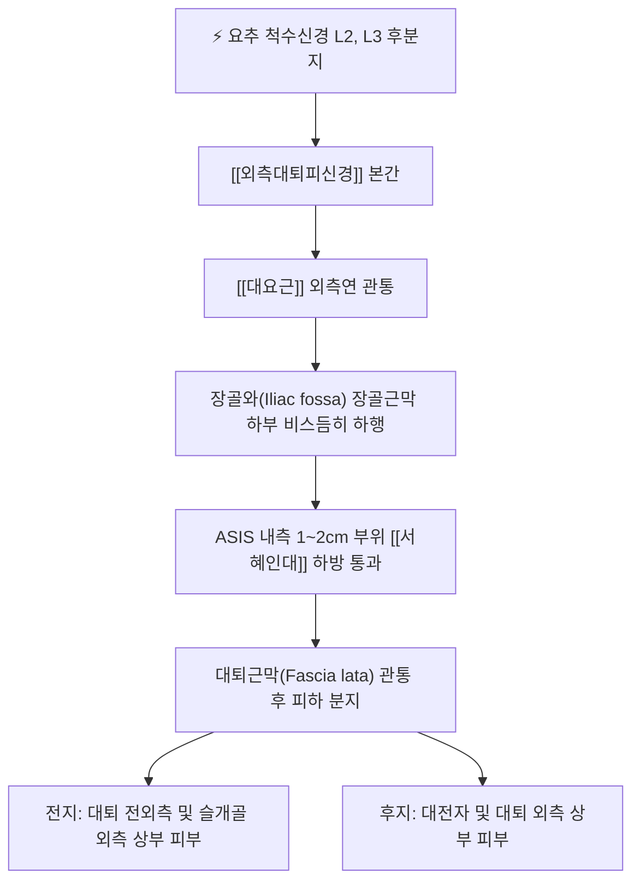

# 외측대퇴피신경 (Lateral Femoral Cutaneous Nerve, LFCN)

> [!NOTE]
> 요신경총(Lumbar plexus) L2-L3 척수신경 앞가지에서 기원하는 순수 감각신경으로, 상전장골극(ASIS) 내측 서혜인대 하방을 지나 대퇴 전외측 피부 감각을 지배하며 **이상감각성 대퇴신경통(Meralgia Paresthetica)**을 유발하는 핵심 신경입니다. 본 문서는 [[외측대퇴표피신경]]과 동일한 개념을 다룹니다.

---

## 1. 신경 기원 & 해부학적 분지 경로 (Anatomy & Course)

* **신경 기원 (Spinal Origin)**:
  * 요신경총 제2, 3 요추신경(L2, L3) 앞가지의 후분지(Posterior divisions)에서 기원합니다.
  * 운동 신경 섬유가 없는 순수 감각신경(Pure sensory nerve)입니다.
* **골반강 내 주행 경로**:
  * 복부 후벽에서 [[대요근]](Psoas major)의 외측연을 뚫고 나와 장골근(Iliacus) 표면을 덮는 장골근막(Iliac fascia) 심부를 따라 외하방으로 비스듬히 주행합니다.
* **서혜인대 통과 및 해부학적 변이**:
  * 상전장골극(ASIS)의 내측 약 1~2cm 부위에서 [[서혜인대]](Inguinal ligament) 아래를 통과합니다.
  * 개인에 따라 서혜인대를 직접 관통하거나 ASIS 골성 능선을 타고 넘는 등 주행 변이가 다양하여 기계적 포착에 매우 취약합니다.
* **대퇴부 진입 및 피하 분지**:
  * 서혜인대 하방 약 2~3cm 지점에서 대퇴근막(Fascia lata)을 뚫고 나와 전지(Anterior branch)와 후지(Posterior branch)로 갈라져 대퇴 전외측 피하지방층으로 넓게 분지합니다.

---

## 2. 신경 지배 맵 & 기능 네트워크 (Innervation Map)

* **감각 신경 지배 (Sensory Innervation)**:
  * **전지 (Anterior branch)**: 대퇴부 전외측 피부(대전자 하방에서부터 무릎 슬개골 외측 상방까지)의 감각을 지배합니다.
  * **후지 (Posterior branch)**: 대전자(Greater trochanter) 주변 및 둔부 외측 하부에서 대퇴 외측면 피부 감각을 담당합니다.
* **운동 신경 기능의 완전한 보존**:
  * 순수 감각신경이므로 신경이 심하게 눌리거나 손상되어도 하지 근육(대퇴사두근, 햄스트링, 둔근)의 근력 마비는 전혀 발생하지 않습니다.
* **골반 장기 및 자율신경 연동 네트워크**:
  * 서혜부 및 복강 내 압력, 골반강 정맥 울혈과 연동되어 자궁, 난소 등의 기능 이상 시 연관통 및 골반통을 함께 유발합니다.

---

## 3. 호발 포착 부위 & 터널 증후군 병태생리

* **ASIS 내측 서혜인대 터널 포착**:
  * ASIS와 서혜인대 사이의 좁은 각도에서 신경이 섬유성 띠에 의해 압박을 받습니다.
  * 꽉 끼는 바지, 무거운 벨트 착용, 복부 비만, 임신 등으로 인해 서혜인대가 팽팽해질 때 신경이 심하게 조여집니다.
* **대퇴근막(Fascia lata) 관통부 포착**:
  * 대퇴근막을 뚫고 표재층으로 나오는 부위에서 대퇴근막장근(TFL)과 장경인대(ITB)의 단축 및 과긴장으로 인해 신경이 압박됩니다.
* **이상감각성 대퇴신경통 (Meralgia Paresthetica)**:
  * 외측대퇴피신경의 만성 포착 증후군으로, 대퇴 전외측의 화끈거리는 작열통(Burning pain), 저림, 감각 저하, 옷깃만 스쳐도 아픈 이질통(Allodynia)을 유발합니다.

---

## 4. 손상 레벨별 임상 증상 & 신경학적 결손

* **이상감각성 대퇴신경통의 전형적 증상**:
  * 대퇴 전외측에 국한된 찌릿찌릿한 저림, 바늘로 찌르는 듯한 통증, 시리고 화끈거리는 감각 이상.
  * 걷거나 오래 서 있을 때, 고관절을 신전할 때 서혜인대가 당겨지며 통증이 악화됩니다.
  * 의자에 앉거나 고관절을 약간 굽히면 서혜인대가 느슨해져 증상이 완화됩니다.
* **운동 결손 부재**:
  * 무릎 꺾임이나 발목 마비가 없으며, 슬개건 반사 및 아킬레스건 반사는 정상입니다.

---

## 5. 관련 이학적 검사 & 신경 감별 매트릭스

* **골반 압박 검사 (Pelvic Compression Test)**:
  * 환자를 측와위로 눕힌 후 검사자가 장골능을 아래로 강하게 압박할 때, 서혜인대 장력이 느슨해져 대퇴 외측 통증이 즉시 완화되면 양성으로 진단합니다.
* **ASIS 틴넬 징후 (Tinel's Sign at ASIS)**:
  * ASIS 내측 1~2cm, 서혜인대 하방을 가볍게 두드릴 때 대퇴 전외측으로 저림이 유발되는지 확인합니다.
* **신경 감별 매트릭스**:
  | 구분 | [[외측대퇴피신경]] 포착 | 요추 신경근증 (L2-L3) | 전자부 점액낭염 |
  | :--- | :--- | :--- | :--- |
  | **통증 영역** | 대퇴 전외측 피부 국한 | 허리 + 둔부 + 대퇴 방사통 | 대전자 국소 외측부 |
  | **운동 마비** | 없음 (순수 감각) | 고관절 굴곡([[장요근]]) 약화 가능 | 없음 |
  | **건반사** | 정상 | 슬개건반사 저하 가능 | 정상 |

---

## 6. 한의 신경 치료 프로토콜 (약침·침도·신경수기)

* **ASIS 내하방 서혜인대 침도 감압술**:
  * 앙와위에서 ASIS 내측 1~2cm, 서혜인대 하방 압통점에 0.4×40mm 소침도를 서혜인대와 평행하게 자입하여 비후된 섬유성 띠와 대퇴근막 출구부를 미세 절개·박리합니다.
* **혈위 특화 약침 요법 ([[오추]], [[유도]], [[충문]])**:
  * **오추(GB27)**: ASIS 전방 함요처에서 신경 출구부를 표적.
  * **유도(GB28)**: 오추 전하방 0.5촌에서 신경 경로 근막 유착 해소.
  * **충문(SP11)**: 서혜인대 내측에서 골반 순환 촉진.
  * 해당 혈위에 [[신바로약침]] 또는 중성어혈약침을 0.5~1.0cc 주입하여 국소 염증과 신경 부종을 치료합니다.
* **대요근 및 장골근 심부 자침**:
  * L2-L3 협척혈 및 복벽 장골와 부위를 자침하여 신경 기원부의 긴장을 이완시킵니다.
* **골반 추나 교정**:
  * 골반 변위를 교정하고 대퇴근막장근과 장경인대를 이완시키는 근막 가동술을 병행합니다.

---

## 7. 💡 사용자 진료실 핵심 필기 & 임상 팁 (원문 보존)

* **기원 및 주행**:
  * L2-3 척수신경 앞가지에서 기원하여 [[대요근]]을 뚫고 나와 외측 하방으로 주행 후 ASIS 내측에서 서혜인대를 지난 뒤 대퇴근막을 관통하여 대퇴부 전외측에 분포합니다.
* **지배 및 치료 원칙**:
  * 전외측 대퇴의 감각지배를 전담합니다.
  * `[[대요근]], 서혜인대의 압박을 풀어줌`이 핵심 치료 목표입니다.
* **부인과 및 골반통 임상 활용**:
  * `여성 생리통, 성교통에 활용`합니다.
  * 외측대퇴피신경 포착은 골반강 울혈 및 자궁 인대 긴장과 연동되므로, 원인 불명의 극심한 생리통이나 성교통 환자에서 ASIS 내측 서혜인대 부위([[오추]], [[유도]], [[충문]])를 침도 및 약침으로 감압하면 골반 순환이 개선되며 놀라운 치료 효과를 거둘 수 있습니다.

---

## 8. 출처 및 학술 참고 문헌 (References)

* Cheatham, S. W., et al. (2013). "Meralgia paresthetica: a review of the literature." *International Journal of Sports Physical Therapy*, 8(6), 883-893. [PMID: 24377074](https://pubmed.ncbi.nlm.nih.gov/24377074/)
  - [연구 요약]: 외측대퇴피신경의 해부학적 변이, 이상감각성 대퇴신경통의 병태생리, 골반 압박 검사의 임상 유용성 및 보존적 중재 프로토콜.
* Miniato, M. A., et al. (2023). "Anatomy, Bony Pelvis and Lower Limb: Lateral Femoral Cutaneous Nerve." *StatPearls Publishing*. [PMID: 30335334](https://pubmed.ncbi.nlm.nih.gov/30335334/)
  - [연구 요약]: LFCN의 요신경총 분지, 서혜인대 하방 통과 해부학 및 대퇴 전외측 피부분절 지배 규명.
* 전국한의과대학 침구경혈학교실 (2020). *침구의학*. 집문당.
  - [연구 요약]: 서혜부 신경 포착 및 골반통 치료를 위한 오추, 유도, 충문 취혈 원리 수록.
