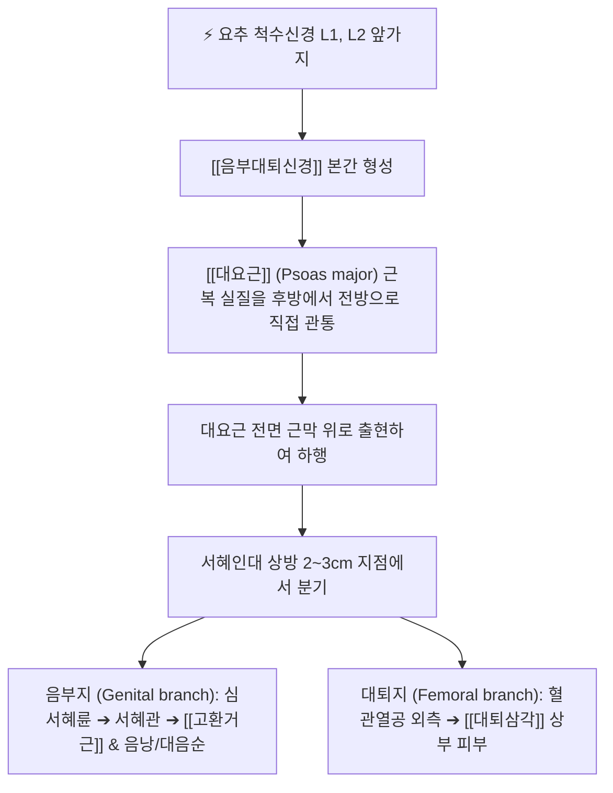

# 음부대퇴신경 (Genitofemoral Nerve, 음부넙다리신경)

> [!NOTE]
> 요신경총(L1-L2)에서 기원하여 대요근 실질의 전면을 유일하게 직접 관통하여 하행하는 복합 말초신경으로, 서혜관을 지나는 음부지(고환거근 운동 및 생식기 감각)와 서혜인대 하방을 지나는 대퇴지(대퇴삼각 상부 피부 감각)로 나뉘어 **음부대퇴신경통(Genitofemoral Neuralgia)**을 유발합니다.

---

## 1. 신경 기원 & 해부학적 분지 경로 (Anatomy & Course)

* **신경 기원 (Origin & Spinal Roots)**:
  * 요신경총(Lumbar plexus) **제1 및 제2 요추신경(L1, L2)** 앞가지의 복측 분지에서 유래합니다.
* **대요근 실질 관통 주행**:
  * 요신경총의 모든 신경 중 유일하게 [[대요근]](Psoas major)의 근육 실질을 후방에서 전방으로 직접 뚫고 나와 대요근 전면 근막 표층으로 노출됩니다.
  * 요관(Ureter) 및 내정계/난소 혈관의 후방을 따라 대요근 전내측면을 타고 하행합니다.
* **서혜인대 근위부 2대 종말 분지**:
  * **음부지 (Genital branch)**:
    * 심서혜륜(Deep inguinal ring)을 통해 서혜관(Inguinal canal) 내부로 진입합니다.
    * 남성: 정삭(Spermatic cord)과 동행하여 **고환거근(Cremaster muscle)**을 운동 지배하고 음낭 전면 피부 및 고환초막 감각을 담당합니다.
    * 여성: 자궁원색(Round ligament of uterus)과 동행하여 대음순 및 치구(Mons pubis) 피부 감각을 담당합니다.
  * **대퇴지 (Femoral branch)**:
    * 외장골동맥의 외측을 따라 주행하여 [[서혜인대]](Inguinal ligament) 아래(혈관열공 외측)를 통과합니다.
    * 대퇴삼각(Femoral triangle) 상부의 복재열공 부근에서 피하로 나와 대퇴 전상부(서혜부 바로 아래)의 피부 감각을 전담합니다.

---

## 2. 신경 지배 맵 & 기능 네트워크 (Innervation Map)

* **운동 신경 지배 (Motor Innervation)**:
  * **음부지**: **고환거근(Cremaster muscle)**을 단독 운동 지배하여 고환거근 반사(Cremasteric reflex)를 매개합니다.
* **감각 신경 지배 (Sensory Innervation)**:
  * **음부지**: 남성의 음낭(Scrotum) 전면부 및 고환초막, 여성의 대음순(Labium majus) 전면 및 치골결합 상부 피부.
  * **대퇴지**: 대퇴삼각(Femoral triangle) 상부 표재 피부(대퇴 전상방 서혜부 주름 바로 아래 손바닥 크기 영역).
* **고환거근 반사 (Cremasteric Reflex)**:
  * 대퇴부 내측 상부 피부(L1 피부분절)를 가볍게 자극할 때 동측 고환이 상방으로 수축하는 생리적 표재 반사입니다.
  * 구심로: 대퇴지 및 장골서혜신경 $\rightarrow$ 중추: L1-L2 척수 $\rightarrow$ 원심로: 음부지의 고환거근 수축.
  * 고환 염전(반사 소실) 및 상위 척수 병변 감별의 핵심 징후입니다.

---

## 3. 호발 포착 부위 & 터널 증후군 병태생리

* **대요근 근복 실질 관통부 포착**:
  * 만성적인 좌식 생활, 고관절 굴곡 구축, 복부 비만 등으로 인해 [[대요근]]이 과긴장 및 단축될 때 신경이 근육 실질을 통과하는 출구부에서 만성적으로 조여집니다.
* **서혜부 수술 후 반흔 및 메쉬 유착 (Iatrogenic Entrapment)**:
  * 서혜부 탈장 교정술(인공 메쉬 삽입), 충수절제술, 제왕절개, 복강경 골반 수술 후 반흔 조직에 의해 음부지가 서혜관 내부에서 심하게 유착·견인됩니다.
* **후복막강 병변에 의한 압박**:
  * 요관 결석, 후복막강 혈종, 대동맥류 등에 의해 대요근 전면에서 기계적 압박을 받습니다.

---

## 4. 손상 레벨별 임상 증상 & 신경학적 결손

* **음부대퇴신경통 (Genitofemoral Neuralgia)의 전형 증상**:
  * 서혜부, 치골부, 동측 음낭 또는 대음순, 대퇴 전상부로 방사되는 타는 듯한 작열통(Burning pain)과 바늘로 찌르는 듯한 이상감각.
  * 고관절을 신전하거나 걸을 때 대요근이 신장(Tension)되어 통증이 극심해지므로, 환자가 몸을 앞으로 구부리는 특징적인 방어 자세(Antalgic psoas gait)를 취합니다.
* **장골서혜신경통과의 감별 증상**:
  * 장골서혜신경 손상은 서혜부 내측과 치골 결합부 통증이 우세하나, 음부대퇴신경통은 **대퇴 전상부 삼각(대퇴지 영역)의 피부 작열통**이 반드시 동반되는 점이 결정적 감별점입니다.

---

## 5. 관련 이학적 검사 & 신경 감별 매트릭스

* **대요근 신장 검사 (Psoas Stretch Test)**:
  * 환자를 건측 측와위로 눕히고 환측 고관절을 수동적으로 과신전시킬 때 서혜부 및 생식기 부위로 작열통이 심하게 유발되면 대요근 관통부 신경 포착을 시사합니다.
* **서혜관 및 대퇴삼각 틴넬 징후**:
  * 심서혜륜 상방(ASIS와 치골결절 중간 상방 1.5cm) 및 서혜인대 바로 하방 대퇴동맥 외측을 압박할 때 저림이 재현되는지 확인합니다.
* **신경 감별 매트릭스**:
  | 구분 | [[음부대퇴신경]]통 | [[장골서혜신경]]통 | [[폐쇄신경]] 포착 |
  | :--- | :--- | :--- | :--- |
  | **주요 통증 부위** | 서혜부 + 생식기 + 대퇴 전상부 | 서혜부 내측 + 음낭/대음순 상부 | 대퇴 내측 중앙부 및 슬관절 내측 |
  | **특징적 검사** | 고환거근 반사 저하, 대퇴지 작열통 | 서혜관 외륜 압통, 복근 긴장 시 통증 | 하우쉽-롬베르그 징후, 내전 약화 |
  | **포착 원인** | 대요근 관통부 연축, 탈장 수술 메쉬 | 복횡근-내복사근 유착, 충수절제술 | 폐쇄관 섬유화, 골반 수술, 탈장 |

---

## 6. 한의 신경 치료 프로토콜 (약침·침도·신경수기)

* **대요근 심부 약침 요법**:
  * 측와위 또는 복와위에서 L1-L2 협척혈 및 기해수(BL24) 외측 3.5촌 지점에서 복측을 향해 심자하여 대요근 근복 실질을 관통하는 음부대퇴신경 출구부에 [[신바로약침]] 0.5~1.0cc를 주입하여 신경 주위 염증을 감압합니다.
* **서혜관 및 대퇴삼각 침도 박리술**:
  * 탈장 수술 반흔 및 서혜인대 주변 유착 부위([[충문]], [[기충]])에서 침도를 이용하여 수술 반흔성 섬유띠를 미세 절개·박리합니다.
* **골반 및 대요근 근막이완 추나 (Psoas Release)**:
  * 앙와위에서 고관절을 굴곡시킨 상태로 ASIS 내측 복벽을 통해 대요근 건복 경계를 완만히 압박하여 단축된 대요근을 신장시킵니다.
* **한의 변증 치료**:
  * **한체간맥(寒滯肝脈)**: 족궐음간경 순행부의 하복부 냉통, 음낭 수축감에 온경탕(溫經湯) 또는 당귀사역탕(當歸四逆湯) 투약.
  * **어혈조락(瘀血阻絡)**: 수술 후 반흔 및 외상성 작열통에 계지복령환(桂枝茯苓丸) 가감방 투약.

---

## 7. 💡 사용자 진료실 핵심 필기 & 임상 팁 (원문 보존)

* **해부학적 기원 및 경로**:
  * 요신경총(L1-L2)에서 기원하여 [[대요근]] 실질 전면을 관통하여 하행한 후 음부지와 대퇴지로 나뉘는 복합 말초신경입니다.
* **핵심 지배 및 기능**:
  * 음부지는 서혜관을 통과하여 [[고환거근]] 운동 및 음낭·대음순 감각을 지배하고, 대퇴지는 서혜인대 하방을 지나 대퇴 전상부 삼각 피부분절 감각을 전담합니다.
* **임상 진료실 핵심 치료 전략**:
  * `대요근 연축, 서혜부 탈장 수술 후 반흔 유착으로 서혜부 및 생식기 작열통(음부대퇴신경통)을 유발하며 서혜부 통증증후군 감별 및 대요근·충문 취혈 표적`으로 치료합니다.
  * 서혜부 수술을 받은 적이 없더라도 장시간 앉아서 일하는 사무직이나 고관절을 많이 굽히는 운동선수에서 대요근의 단축 연축만으로도 음부대퇴신경이 압박되어 고환이나 서혜부가 타는 듯 아플 수 있으므로, 대요근 치료를 최우선으로 시행해야 합니다.

---

## 8. 출처 및 학술 참고 문헌 (References)

* Gunduz, O. H., et al. (2019). "Selective Spinal Nerve Block in Ilioinguinal, Iliohypogastric and Genitofemoral Neuralgia." *Pain Physician*, 22(2), 173-178. [PMID: 30829381](https://pubmed.ncbi.nlm.nih.gov/30829381/)
  - [연구 요약]: 서혜부 신경통(장골서혜, 장골하복, 음부대퇴신경통) 환자에서 선택적 척수신경 차단술의 진단적 정확도 및 장기적 진통 효과 입증.
* Rothenberg, J. B., et al. (2014). "Successful treatment of genitofemoral neuralgia using ultrasound guided injection: a case report and short review of literature." *Pain Physician*, 17(3), E421-E425. [PMID: 24804105](https://pubmed.ncbi.nlm.nih.gov/24804105/)
  - [연구 요약]: 음부대퇴신경통의 초음파 유도하 표적 주사 치료 성공 증례 보고 및 대요근 관통 경로 포착 기전 리뷰.
* 전국한의과대학 침구경혈학교실 (2020). *침구의학*. 집문당.
  - [연구 요약]: 서혜부 말초신경통에 대한 충문, 기충, 대요근 협척혈 취혈의 임상 지침.
