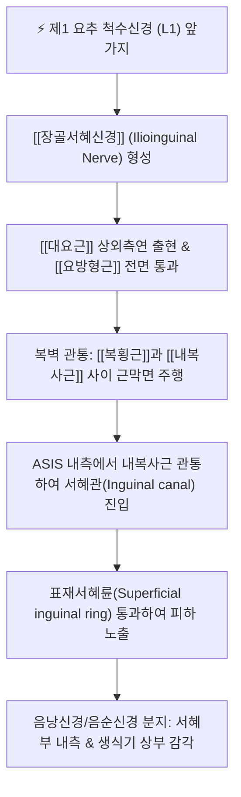

# 장골서혜신경 (Ilioinguinal Nerve, 엉덩샅신경)

> [!NOTE]
> 요신경총(L1)에서 기원하여 복벽 근육층(복횡근과 내복사근 사이)을 비스듬히 하행한 후 서혜관을 통과하여 표재서혜륜으로 빠져나오는 신경으로, 서혜부 내측, 치골 결합부, 음낭 전상부 및 대음순의 감각을 지배하며 서혜부 수술 후 만성 통증을 유발하는 주요 신경입니다.

---

## 1. 신경 기원 & 해부학적 분지 경로 (Anatomy & Course)

* **신경 기원 (Spinal Origin)**:
  * 요신경총(Lumbar plexus)의 **제1 요추 척수신경(L1)** 앞가지에서 기원하며, 장골하복신경보다 약간 하방에서 갈라져 나옵니다 (간혹 T12 신경 섬유가 일부 포함되기도 함).
* **복벽 심부 주행 경로**:
  * [[대요근]](Psoas major)의 상외측연을 뚫고 나와 [[요방형근]](Quadratus lumborum) 및 장골근(Iliacus) 전면을 비스듬히 외하방으로 가로지릅니다.
  * 장골능(Iliac crest) 전방 부위에서 복횡근(Transversus abdominis)을 뚫고 들어가 **[[복횡근]]과 [[내복사근]](Internal oblique) 사이의 근막면(TAP plane)**을 따라 하행합니다.
* **서혜관 진입 및 표재서혜륜 통과**:
  * 상전장골극(ASIS) 내측 약 2~3cm 부위에서 내복사근을 뚫고 나와 서혜관(Inguinal canal) 내부로 들어갑니다.
  * 서혜관 내에서 정삭(Spermatic cord) 또는 자궁원색(Round ligament)의 전면을 타고 주행한 뒤, **표재서혜륜(Superficial inguinal ring)**을 통과하여 피하지방층으로 분지합니다.

---

## 2. 신경 지배 맵 & 기능 네트워크 (Innervation Map)

* **운동 신경 지배 (Motor Innervation)**:
  * 복벽 근육층을 주행하면서 **[[복횡근]] 및 [[내복사근]]의 최하부 섬유**에 작은 운동 신경지를 공급하여 하복벽 안정화 및 복압 유지에 기여합니다.
* **감각 신경 지배 (Sensory Innervation)**:
  * **서혜부 내측**: 사타구니 안쪽 주름 및 치골 결합부(Symphysis pubis) 상방 피부.
  * **전음낭신경 (Anterior scrotal nerves, 남성)**: 음낭의 전상부 및 음경 기저부 피부.
  * **전음순신경 (Anterior labial nerves, 여성)**: 대음순(Labium majus)의 전상부 및 치구(Mons pubis) 피부.
  * 대퇴부 내측 최상부의 피부 감각 일부.
* **골반 안정화 네트워크**:
  * 복횡근 하부 운동 지배를 통해 골반저근 및 서혜인대의 장력을 조절하며, 기침이나 복압 상승 시 서혜관 괄약 기전(Shutter mechanism)을 보조합니다.

---

## 3. 호발 포착 부위 & 터널 증후군 병태생리

* **1차 호발 포착점: 복벽 근육층 관통부 (TAP Plane)**:
  * 복횡근과 내복사근 사이를 지나 내복사근을 뚫고 나오는 지점에서 복벽 근육의 과도한 긴장, 복직근초 혈종, 흉요근막 구축에 의해 신경이 조여집니다.
* **2차 호발 포착점: 서혜관 및 표재서혜륜 (Inguinal Canal & Ring)**:
  * 서혜관 내부를 통과하는 부위에서 서혜부 탈장, 스포츠 탈장(Gilmore's groin) 등으로 인해 지속적인 마찰을 받습니다.
* **의원성 수술 손상 (Iatrogenic Injury)**:
  * 서혜부 탈장 교정술(Herniorrhaphy/Hernioplasty) 시 봉합사나 인공 메쉬(Mesh)에 의한 신경 포착, 충수절제술 절개창 반흔, 제왕절개술 후 반흔 유착이 가장 흔한 병인입니다.

---

## 4. 손상 레벨별 임상 증상 & 신경학적 결손

* **장골서혜신경통 (Ilioinguinal Neuralgia)의 전형 증상**:
  * 하복부 외측에서 시작하여 서혜부 내측, 치골부, 음낭 또는 대음순 상부로 뻗치는 타는 듯한 작열통(Burning pain)과 찌르는 듯한 통증.
  * 보행 시 고관절을 신전하거나 몸을 곧게 펼 때 서혜관이 당겨져 통증이 심해지므로, 환자가 허리를 구부리고 다리를 약간 안쪽으로 모으고 걷는 파행을 보입니다.
* **고환통 및 만성 골반통**:
  * 비뇨기과적 이상(부고환염, 정계정맥류, 요로결석)이 없음에도 지속되는 만성적인 고환 통증 및 사타구니 안쪽의 불쾌한 감각 이상.

---

## 5. 관련 이학적 검사 & 신경 감별 매트릭스

* **서혜관 외륜 압통 및 틴넬 검사**:
  * 치골결절 외상방에 위치한 표재서혜륜 부위를 손가락 끝으로 가볍게 압박하거나 타진할 때 음낭이나 대음순으로 찌릿한 방사통이 재현되면 양성입니다.
* **ASIS 내측 압통 검사**:
  * ASIS 내측 2~3cm 지점의 내복사근 관통부를 깊게 눌렀을 때 국소 압통과 함께 서혜부로 방사되는 통증을 확인합니다.
* **신경 감별 매트릭스**:
  | 구분 | [[장골서혜신경]]통 | [[음부대퇴신경]]통 | 요추 1번(L1) 신경근증 |
  | :--- | :--- | :--- | :--- |
  | **통증 방사 부위** | 서혜부 내측 + 음낭/대음순 상부 | 서혜부 + 대퇴 전상부 삼각 | 허리 + 서혜부 띠 모양 방사 |
  | **대퇴부 감각 이상** | 거의 없음 (극상부에 국한) | 대퇴 전상부 피부 작열통 뚜렷 | 대퇴 전상부 및 둔부 동반 |
  | **고환거근 반사** | 정상 보존 | 저하 또는 소실 | 저하 가능 |

---

## 6. 한의 신경 치료 프로토콜 (약침·침도·신경수기)

* **서혜관 침도 박리술 (소침도 감압)**:
  * 앙와위에서 치골결절 외상방 표재서혜륜 부위 및 수술 반흔 유착점에 침도를 자입하여 굳어진 건막 및 섬유성 유착띠를 박리하여 신경관의 감압을 유도합니다.
* **혈위 특화 약침 치료 ([[기충]], [[충문]], [[오추]])**:
  * **기충(ST30)**: 치골결합 외측 서혜부 주름에서 장골서혜신경의 종말 피하지 표적.
  * **충문(SP11)**: 서혜관 심부 신경혈관망 순환 촉진.
  * **대맥(GB26) 및 오추(GB27)**: 복횡근과 내복사근 사이의 신경 주행로 압통점에 [[신바로약침]] 0.5cc씩 주입하여 신경 부종을 소퇴시킵니다.
* **복벽 근막 이완 추나 (TAP Plane Release)**:
  * 복사근과 복횡근의 근막을 부드럽게 이완시키는 복부 유찰수기법을 적용하여 서혜부로 가해지는 비틀림 장력을 해소합니다.

---

## 7. 💡 사용자 진료실 핵심 필기 & 임상 팁 (원문 보존)

* **기원 및 주행 경로**:
  * L1 척수신경 앞가지에서 기원하여 복횡근과 내복사근 사이를 지나 서혜관을 거쳐 표재서혜륜으로 빠져나옵니다.
* **지배 영역 및 핵심 임상 포인트**:
  * 서혜부 안쪽 및 음낭/대음순 상부 감각을 지배합니다.
* **진료실 임상 노하우**:
  * 맹장 수술(충수절제술)이나 탈장 수술을 받은 병력이 있는 환자가 사타구니 안쪽이나 고환이 타는 듯 아프다고 호소할 때, 비뇨기과 검사에서 이상이 없다면 100% 장골서혜신경의 수술 반흔 포착입니다.
  * 수술 흉터 끝부분 및 표재서혜륜 압통점에 소침도 유착 박리 및 신바로약침을 주입하면 수년간 지속된 신경통이 신속하게 관해됩니다.

---

## 8. 출처 및 학술 참고 문헌 (References)

* Klaassen, Z., et al. (2011). "Anatomy of the ilioinguinal and iliohypogastric nerves with observations of their spinal nerve contributions." *Clinical Anatomy*, 24(4), 454-461. [PMID: 21509811](https://pubmed.ncbi.nlm.nih.gov/21509811/)
  - [연구 요약]: 장골서혜신경과 장골하복신경의 요추 척수 분절 기원, 복벽 주행 경로의 해부학적 변이 및 신경 손상 위험 부위 상세 규명.
* Al-dabbagh, A. K. (2002). "Anatomical variations of the inguinal nerves and risks of injury in 110 hernia repairs." *Surgical and Radiologic Anatomy*, 24(4), 254-259. [PMID: 12197017](https://pubmed.ncbi.nlm.nih.gov/12197017/)
  - [연구 요약]: 서혜부 탈장 수술 110례 분석을 통한 장골서혜신경의 주행 변이 및 의원성 신경 손상 예방 가이드라인 제시.
* 전국한의과대학 침구경혈학교실 (2020). *침구의학*. 집문당.
  - [연구 요약]: 서혜부 신경통에 대한 기충, 충문, 오추의 경혈학적 특성 및 자침 심도 수록.
