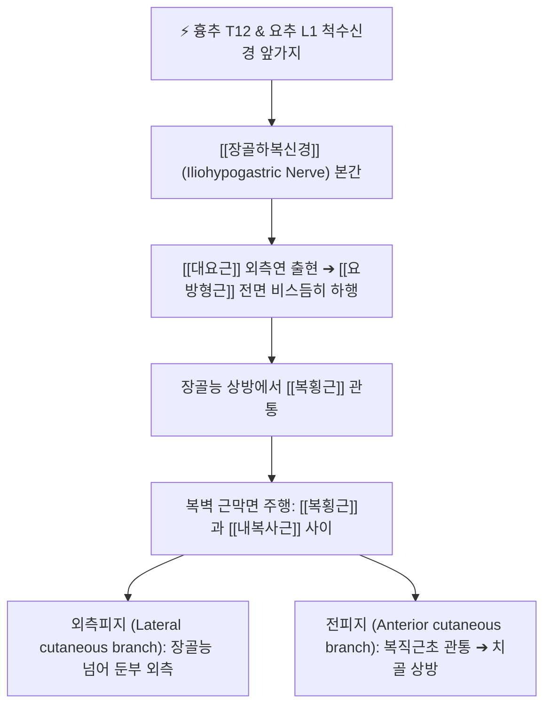

# 장골하복신경 (Iliohypogastric Nerve, 엉덩아랫배신경)

> [!NOTE]
> 요신경총의 최상단(T12-L1)에서 기원하여 요방형근 전면과 복벽 근육층을 따라 주행하며 외측 둔부 및 치골 결합 상방 하복부의 피부 감각과 복벽 근육을 지배하는 복합 신경으로, 하복부 수술 후 작열통 및 서혜부 상부 신경통을 일으키는 주요 말초신경입니다.

---

## 1. 신경 기원 & 해부학적 분지 경로 (Anatomy & Course)

* **신경 기원 (Spinal Origin)**:
  * 제12 흉추신경(T12, 늑골하신경 가지) 및 **제1 요추 척수신경(L1)** 앞가지에서 기원합니다.
  * 요신경총에서 갈라져 나오는 말초신경 중 가장 상부에 위치합니다.
* **복벽 심부 주행 경로**:
  * [[대요근]](Psoas major)의 상외측연을 뚫고 나와 [[요방형근]](Quadratus lumborum)의 앞면을 비스듬히 가로지릅니다.
  * 신장(Kidney)의 후하방을 지나 장골능(Iliac crest) 상방에서 복횡근(Transversus abdominis)의 후연을 뚫고 들어갑니다.
* **2대 주요 종말 분지**:
  * **외측피지 (Lateral cutaneous branch)**:
    * 장골능 중간 부위에서 내복사근과 외복사근을 관통하여 장골능을 넘어 둔부 외측 상부 피부로 분지합니다 (중둔피신경 영역과 인접).
  * **전피지 (Anterior cutaneous branch)**:
    * 복횡근과 내복사근 사이를 계속 전하방으로 주행하다가, ASIS 내측 약 2cm 지점에서 내복사근을 뚫고 외복사근 건막 아래로 들어갑니다.
    * 치골 결합 상방 약 2~3cm 지점에서 복직근초(Rectus sheath) 전엽을 관통하여 피하지방층으로 분지합니다.

---

## 2. 신경 지배 맵 & 기능 네트워크 (Innervation Map)

* **감각 신경 지배 (Sensory Innervation)**:
  * **외측피지**: 장골능 외측, 둔부 전외측 상부(대퇴근막장근 상방)의 피부 감각.
  * **전피지**: 치골 결합(Symphysis pubis) 상방, 하복부 정중선 외측 및 서혜관 외륜 상부 피부 감각.
* **운동 신경 지배 (Motor Innervation)**:
  * 복벽 근육층을 주행하면서 **[[복횡근]] 및 [[내복사근]]의 하부 근섬유**를 운동 지배하여 복벽의 장력 유지와 복압 형성에 기여합니다.
* **복벽 및 골반 지지 네트워크**:
  * 기침, 배변, 분만 시 복벽 근육을 협조 수축시키고, 골반 전방 경사를 억제하는 복근의 안정성을 조절합니다.

---

## 3. 호발 포착 부위 & 터널 증후군 병태생리

* **1차 호발 포착점: 복횡근 관통부 및 TAP 근막면**:
  * 요방형근 전면에서 복횡근을 뚫고 들어가는 부위 또는 복횡근-내복사근 사이의 근막면(TAP plane)에서 만성 요근 연축 및 복벽 긴장에 의해 신경이 포착됩니다.
* **2차 호발 포착점: ASIS 내측 내복사근 관통부**:
  * ASIS 내측 2~3cm 지점에서 내복사근을 관통하는 부위가 장골능 주변의 섬유성 조직과 마찰을 일으키기 쉽습니다.
* **의원성 수술 손상 (Iatrogenic Injury)**:
  * 충수절제술(McBurney 절개창), 제왕절개술(Pfannenstiel 가로 절개창), 서혜부 탈장 수술, 복강경 투관침(Trocar) 삽입 시 신경이 직접 절단되거나 봉합사에 묶이거나 수술 후 반흔에 유착되는 경우가 매우 흔합니다.

---

## 4. 손상 레벨별 임상 증상 & 신경학적 결손

* **장골하복신경통 (Iliohypogastric Neuralgia)의 전형 증상**:
  * 하복부 치골 상방 및 외측 둔부로 뻗치는 타는 듯한 작열통(Burning dysesthesia), 찌릿한 칼로 베는 듯한 통증.
  * 기침을 하거나 재채기를 할 때, 배에 힘을 줄 때 하복부로 찌릿한 전기 통증이 유발됩니다.
* **장골서혜신경통과의 감별점**:
  * 장골하복신경 병변은 통증이 **치골 결합 바로 위쪽 하복부와 둔부 외측**에 집중되며, 음낭이나 대음순으로는 거의 방사되지 않습니다.
* **복벽 불룩거림 (Abdominal Wall Bulging)**:
  * 신경이 심하게 손상되거나 절단된 경우 내복사근과 복횡근 하부의 운동 마비로 인해 해당 부위 하복벽이 팽륜되어 마치 탈장처럼 불룩 튀어나오는 현상이 발생할 수 있습니다.

---

## 5. 관련 이학적 검사 & 신경 감별 매트릭스

* **ASIS 내상방 압통 및 틴넬 검사**:
  * ASIS 내측 2cm, 상방 2cm 지점을 깊게 압박할 때 치골 상방 하복부로 방사통이 재현되면 양성입니다.
* **수술 반흔 국소 압통 검사**:
  * 맥버니(McBurney) 흉터나 제왕절개 흉터의 외측 끝부분을 촉지하여 날카로운 압통과 이상감각이 유발되는지 확인합니다.
* **신경 감별 매트릭스**:
  | 구분 | [[장골하복신경]]통 | [[장골서혜신경]]통 | 제12 늑간신경통 (T12) |
  | :--- | :--- | :--- | :--- |
  | **주요 통증 영역** | 치골 결합 상방 하복부 + 외측 둔부 | 서혜부 내측 + 음낭/대음순 | 옆구리 하부 + ASIS 주변 |
  | **생식기 방사통** | 없음 (치골 상방에 국한) | 뚜렷함 (음낭/대음순) | 없음 |
  | **운동 약화 증상** | 하복벽 국소 팽륜(Bulging) 가능 | 서혜관 괄약 기전 약화 | 복벽 외측 근력 저하 |

---

## 6. 한의 신경 치료 프로토콜 (약침·침도·신경수기)

* **복벽 수술 반흔 침도 박리술**:
  * 앙와위에서 제왕절개, 충수절제술 등 수술 흉터 외측단 및 치골 상방 관통부 압통점에 침도를 사자하여 굳어진 반흔 건막과 피하 유착을 박리합니다.
* **혈위 특화 약침 치료 ([[관원]], [[중극]], [[대맥]])**:
  * **관원(CV4) 및 중극(CV3) 외측 2촌(수도혈 부근)**: 장골하복신경 전피지가 복직근초를 뚫고 나오는 부위에 [[신바로약침]] 0.5cc 주입.
  * **대맥(GB26) 및 오추(GB27)**: 복횡근-내복사근 주행 경로에 약침을 주입하여 신경 주위 무균성 염증을 제거합니다.
* **요방형근 및 대요근 심부 침치료**:
  * 요방형근 전면을 통과하는 신경 기원부를 이완시키기 위해 지실(BL52) 및 L1 협척혈을 심자합니다.
* **복벽 근막 이완 수기요법**:
  * 복부 피부와 심부 근막의 유착을 해소하는 롤링(Skin rolling) 및 근막 이완 추나를 병행합니다.

---

## 7. 💡 사용자 진료실 핵심 필기 & 임상 팁 (원문 보존)

* **원문 필기 핵심**:
  * `- 감각신경이다.`
* **임상 진료실 고도화 해설**:
  * 사용자 원문 필기에서 간결하게 `- 감각신경이다.`라고 강조한 것은, 임상에서 하복부 통증 환자를 볼 때 **운동 마비가 두드러지지 않고 순수 감각 이상(치골 상방 및 골반 외측의 작열통, 시림, 찌릿거림)으로 내원하는 경우가 대다수**이기 때문입니다.
  * 맹장 수술이나 제왕절개 수술 후 아랫배가 당기고 화끈거려서 내과나 산부인과를 전전하는 환자들은 장골하복신경의 감각지 포착입니다. 수술 흉터 끝부분 복벽 관통점을 찾아 침도 요법과 신바로약침을 시술하면 극심한 신경통이 즉각 진정됩니다.

---

## 8. 출처 및 학술 참고 문헌 (References)

* Klaassen, Z., et al. (2011). "Anatomy of the ilioinguinal and iliohypogastric nerves with observations of their spinal nerve contributions." *Clinical Anatomy*, 24(4), 454-461. [PMID: 21509811](https://pubmed.ncbi.nlm.nih.gov/21509811/)
  - [연구 요약]: 장골하복신경과 장골서혜신경의 척수 분절 기원, 요방형근 및 복벽 근막면 통과 해부학과 신경 손상 부위 규명.
* Al-dabbagh, A. K. (2002). "Anatomical variations of the inguinal nerves and risks of injury in 110 hernia repairs." *Surgical and Radiologic Anatomy*, 24(4), 254-259. [PMID: 12197017](https://pubmed.ncbi.nlm.nih.gov/12197017/)
  - [연구 요약]: 서혜부 및 하복부 수술 시 장골하복신경 손상의 해부학적 위험 인자 분석.
* 전국한의과대학 침구경혈학교실 (2020). *침구의학*. 집문당.
  - [연구 요약]: 하복부 신경통 및 수술 후 유착통에 대한 관원, 중극, 대맥 취혈의 임상 지침.
