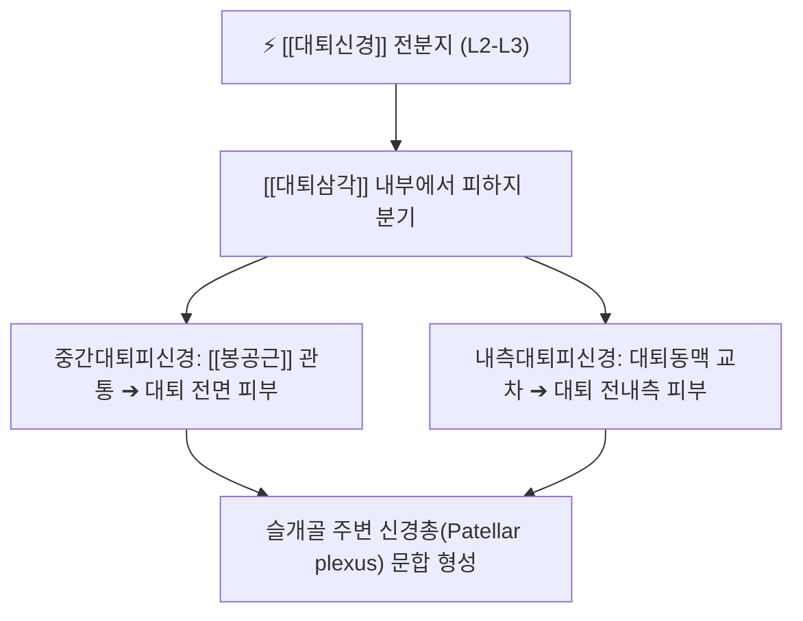

# 전대퇴피신경 (Anterior Cutaneous Branches of Femoral Nerve, 앞넙다리피부신경)

> [!NOTE]
> [[요신경총]]에서 유래하는 [[대퇴신경]] 전분지의 표재 감각신경망으로, [[봉공근]]을 관통하여 [[대퇴사두근]] 전면 및 전내측 피부 감각을 지배하며, 노인성 하지 시림증 및 [[요추]] 디스크 오진의 주요 원인이 되는 말초신경입니다.

---

## 1. 신경 기원 & 해부학적 분지 경로 (Anatomy & Course)

* **신경 기원 (Origin & Spinal Roots)**:
  * [[요신경총]](Lumbar plexus) **제2, 3 요추신경(L2, L3)** 앞가지에서 기원하는 [[대퇴신경]](Femoral nerve) 전분지의 피하지들입니다.
* **상세 주행 경로**:
  * [[서혜인대]](Inguinal ligament) 하방 [[대퇴삼각]](Femoral triangle) 내부에서 대퇴신경 본간으로부터 중간대퇴피신경(Intermediate cutaneous nerve)과 내측대퇴피신경(Medial cutaneous nerve)으로 갈라집니다.
  * 중간대퇴피신경은 [[봉공근]](Sartorius) 근복 실질을 직접 뚫거나 근막을 관통하여 대퇴근막(Fascia lata) 표층 피하지방층으로 분지합니다.
  * 내측대퇴피신경은 대퇴동맥의 전면을 비스듬히 가로질러 대퇴부 내측으로 주행한 후 피하로 빠져나옵니다.
  * 두 신경지는 [[대퇴사두근]] 전면을 따라 하행하여 무릎 슬개골 상부에서 슬개골 주변 신경총(Patellar plexus) 형성에 기여합니다.

---

## 2. 신경 지배 맵 & 기능 네트워크 (Innervation Map)

* **감각 신경 지배 영역 (Cutaneous Innervation)**:
  * **중간대퇴피신경 분지**: 대퇴 전면부 피부([[서혜인대]] 하방에서부터 [[슬관절]] 슬개골 상연까지 허벅지 앞면 전체).
  * **내측대퇴피신경 분지**: 대퇴부 전내측면 피부 하부 2/3 영역.
  * **슬개골 주변부**: [[슬관절]] 전면 피부의 지각을 [[복재신경]] 슬개하분지와 함께 분담합니다.
* **운동 기능 결손 부재**:
  * 순수 피하지(Cutaneous branches)이므로 신경이 단독으로 포착되어도 [[대퇴직근]], [[내측광근]], [[외측광근]] 등 [[대퇴사두근]]의 근력 약화나 무릎 꺾임 현상은 발생하지 않습니다.
* **표재 감각 수용기 네트워크**:
  * 온각, 냉각, 촉각을 매개하는 자유 신경종말이 조밀하게 분포하여 외부 온열 자극 및 마찰에 민감하게 반응합니다.

---

## 3. 호발 포착 부위 & 터널 증후군 병태생리

* **봉공근 관통부 및 대퇴근막 출구 (Sartorius Piercing Site)**:
  * [[봉공근]] 근복을 뚫고 대퇴근막을 관통하는 섬유성 구멍에서 골반 전방경사, [[장요근]] 구축, 봉공근 과긴장 시 신경이 조여집니다.
* **외부 압박성 기전**:
  * 몸에 꽉 끼는 타이트한 청바지, 거들, 안전벨트의 직접 압박, 장시간 대퇴부를 쪼그리는 자세에 의해 신경 허혈이 유발됩니다.
* **외측대퇴피신경(LFCN)과의 구별**:
  * [[외측대퇴피신경]]은 허벅지 외측을 지배하나, 전대퇴피신경은 허벅지 바로 앞면과 무릎 위쪽을 집중 지배합니다.

---

## 4. 손상 레벨별 임상 증상 & 신경학적 결손

* **허벅지 앞면 작열감 및 이상감각**:
  * 허벅지 앞쪽이 화끈거리거나 얼얼하게 시린 감각 이상(Dysesthesia), 손으로 쓸어내릴 때 전기가 통하듯 따끔거리는 이질통(Allodynia).
  * 야간에 이불이 닿기만 해도 화끈거려 잠을 이루지 못하는 피부 과민 반응.
* **수술 후 신경 손상**:
  * 무릎 인공관절 수술이나 전방십자인대 재건술 시 건 채취 부위 절개창으로 인한 신경 손상.

---

## 5. 관련 이학적 검사 & 신경 감별 매트릭스

* **대퇴삼각 압통 검사**:
  * [[서혜인대]] 중앙 하방 2~3cm 지점([[대퇴신경]] 전분지 부위)을 압박할 때 대퇴 전면으로 저림이 재현되는지 확인합니다.
* **하지직거상 검사 (SLR Test) 음성 확인**:
  * [[요추]] 디스크 질환과의 감별을 위해 [[하지직거상 검사]]를 시행하여 정상(음성)임을 확인합니다.
* **신경 감별 매트릭스**:
  | 구분 | [[전대퇴피신경]] 포착 | [[요추]] 3-4번 추간판탈출증 | [[외측대퇴피신경]] 포착 |
  | :--- | :--- | :--- | :--- |
  | **통증 영역** | 허벅지 바로 앞면 (시림·화끈거림) | 요통 + 대퇴 전면 + 무릎 내측 | 허벅지 외측 (대전자~외측무릎) |
  | **하지직거상(SLR)** | 정상 (음성) | 양성 (방사통 재현) | 정상 (음성) |
  | **슬개건 반사** | 정상 보존 | 저하 또는 소실 | 정상 |
  | **대퇴사두근 근력** | 정상 | 약화 (무릎 꺾임) | 정상 |

---

## 6. 한의 신경 치료 프로토콜 (약침·침도·신경수기)

* **복토(ST32) 및 비관(ST31) 침치료**:
  * 대퇴 전면부 위경(胃經) 경혈을 따라 0.25×40mm 호침으로 자침하여 피하신경 포착 부위의 근막 긴장을 해소합니다.
* **봉공근 관통부 침도 박리술**:
  * [[봉공근]] 주행 경로상의 압통점에서 팽팽해진 대퇴근막 출구부를 미세 절개·박리하여 신경을 감압합니다.
* **약침 치료 요법**:
  * 복토혈 및 비관혈 주변 피하에 [[신바로약침]] 또는 황련해독약침을 0.3~0.5cc씩 주입하여 신경 부종과 작열감을 신속히 가라앉힙니다.
* **장요근 및 봉공근 근막 이완 추나**:
  * [[고관절]] 신전 기법 및 대퇴 전면 근막 이완 [[추나치료]]를 통해 대퇴 전면 피부의 과긴장도를 완화시키고 [[신경가동술]]을 병행합니다.

---

## 7. 💡 사용자 진료실 핵심 필기 & 임상 팁 (원문 보존)

* **허벅지 앞면이 시리고 화끈거린다는 노인 환자**:
  * 요추 3-4번 디스크로 오진하기 쉬우나, 하지직거상(SLR) 검사가 정상이고 [[대퇴사두근]] 근력 저하가 없다면 전대퇴피신경의 말초 포착입니다.
  * 복토혈 주변 약침 치료로 신속히 개선됩니다.
* **진료실 감별 팁**:
  * 고령 환자 중 "허벅지 앞이 얼음장을 댄 것처럼 시리다" 또는 "화끈거려서 바지를 못 입겠다"고 호소하는 경우, 척추 MRI 상 디스크 팽윤이 있더라도 실제 증상의 원인은 [[봉공근]] 근막에 걸린 전대퇴피신경 포착인 경우가 대단히 많습니다. 복토, 비관, 음시혈 부위에 약침 치료와 근막 이완을 시행하면 수일 내에 증상이 드라마틱하게 호전됩니다.

---

## 8. 출처 및 학술 참고 문헌 (References)

* Ruzbarsky, J. J., et al. (2026). "Anatomical relationship between the distal lateral femoral cutaneous nerve and the quadriceps tendon autograft harvest site: a cadaveric study with implications for acl reconstruction surgery." *Surgical and Radiologic Anatomy*, 48(8), 915-923. [PMID: 42616156](https://pubmed.ncbi.nlm.nih.gov/42616156/)
  - [연구 요약]: 대퇴사두근 건 채취 및 무릎 수술 시 대퇴 전면 피하신경의 주행 변이와 의인성 신경 손상 예방 해부학 규명.
* Barton, D., et al. (2026). "Surgical Anatomical Study of the Lateral Femoral Cutaneous Nerve in Direct Anterior Approach for Total Hip Arthroplasty." *Clinical Anatomy*, 39(3), 345-353. [PMID: 41793066](https://pubmed.ncbi.nlm.nih.gov/41793066/)
  - [연구 요약]: 대퇴 전면 피하신경망과 고관절 전방 접근 수술 시 신경 보존을 위한 절개 가이드라인 제시.
* Refai, N. A., Black, A. C., & Tadi, P. (2023). "Anatomy, Bony Pelvis and Lower Limb: Thigh Femoral Nerve." *StatPearls Publishing*. [PMID: 32310525](https://pubmed.ncbi.nlm.nih.gov/32310525/)
  - [연구 요약]: 대퇴신경 전분지의 전피하지 기원, 피부분절 감각 분포 및 임상적 의의 총괄.
