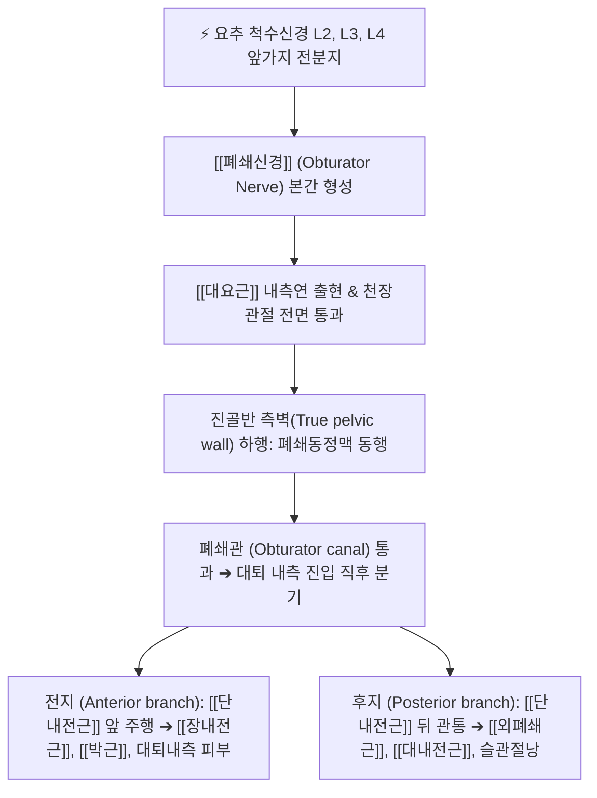

# 폐쇄신경 (Obturator Nerve, 폐쇄구멍신경)

> [!NOTE]
> 요신경총(L2-L4) 앞가지의 전분지에서 기원하여 진골반 측벽을 따라 주행한 후 폐쇄관(Obturator canal)을 통과하는 주요 말초신경으로, 하지 내전근군 전체의 운동과 대퇴부 내측 피부 및 슬관절낭의 감각을 총괄하는 핵심 신경입니다.

---

## 1. 신경 기원 & 해부학적 분지 경로 (Anatomy & Course)

* **신경 기원 (Origin & Spinal Roots)**:
  * 요신경총(Lumbar plexus) **제2, 3, 4 요추신경(L2, L3, L4)** 앞가지의 **전분지(Anterior divisions)**가 합류하여 형성됩니다 (후분지에서 기원하는 대퇴신경과 해부학적 쌍을 이룸).
* **골반강 내 주행 경로**:
  * 복부 후벽에서 [[대요근]](Psoas major)의 내측연을 뚫고 나와 천장관절(Sacroiliac joint) 앞면을 지나 진골반(True pelvis)으로 진입합니다.
  * 골반강 측벽에서 폐쇄동맥 및 폐쇄정맥과 동행하여 전하방으로 비스듬히 주행합니다.
* **폐쇄관 통과 및 분지 (Obturator Canal)**:
  * 치골상지(Superior pubic ramus) 하방의 **폐쇄관(Obturator canal)**을 통해 골반강을 빠져나와 대퇴부 내측 근육군으로 진입합니다.
  * 폐쇄관을 통과하자마자 단내전근(Adductor brevis)을 사이에 두고 **전지(Anterior branch)**와 **후지(Posterior branch)**로 갈라집니다.

---

## 2. 신경 지배 맵 & 기능 네트워크 (Innervation Map)

* **운동 신경 지배 (Motor Innervation)**:
  * **전지 (Anterior branch)**:
    * [[장내전근]](Adductor longus): 고관절 강력 내전 및 보조 굴곡.
    * [[단내전근]](Adductor brevis): 고관절 내전 및 회전 조절.
    * [[박근]](Gracilis): 고관절 내전 및 슬관절 굴곡, 내회전.
    * [[치골근]](Pectineus): 대퇴신경과 함께 이중 신경 지배를 받기도 함.
  * **후지 (Posterior branch)**:
    * [[외폐쇄근]](Obturator externus): 고관절 외회전 및 안정화.
    * [[대내전근]](Adductor magnus)의 전부 섬유(Adductor part): 하지의 가장 강력한 내전 운동.
* **감각 신경 지배 (Sensory Innervation)**:
  * **대퇴 내측 피부**: 전지의 종말 피하지가 대퇴 내측 하부 1/3 영역의 피부 감각을 지배합니다.
  * **관절 감각 (Articular branches)**: 고관절 관절낭 전하방 및 슬관절 관절낭 후면(후지의 관절지)에 고유수용성 감각 신경지를 공급합니다.
* **보행 안정화 기능**:
  * 보행 주기 중 입각기에서 골반의 측방 동요를 방지하고 양 하지의 중심축을 정렬하는 데 필수적인 내전 근력을 제공합니다.

---

## 3. 호발 포착 부위 & 터널 증후군 병태생리

* **1차 호발 포착점: 폐쇄관 (Obturator Canal)**:
  * 치골과 폐쇄막(Obturator membrane) 사이의 골섬유성 관(Osseofibrous tunnel)인 폐쇄관 내부에서 폐쇄막의 섬유화, 골반 골절, 만성 내전근 연축에 의해 포착됩니다.
* **폐쇄탈장 (Obturator Hernia)**:
  * 고령, 다산 여성, 만성 소모성 질환자에서 골반저 지방 조직이 소실되면서 소장이 폐쇄관으로 밀려 나오는 폐쇄탈장이 발생하며, 신경을 직접 압박합니다.
* **골반강 내 및 산부인과적 병인**:
  * 부인과적 골반 수술(자궁적출술, 림프절 곽청술), 골반강 자궁내막증, 난소 낭종, 분만 시 태아 두개골에 의한 직접 압박.
* **스포츠 내전근 손상 (Athletic Pubalgia)**:
  * 축구, 하키, 럭비 선수 등 급격한 방향 전환을 반복하는 운동선수에서 내전근 기시부 건병증 및 만성 근막 비후로 인한 신경 포착.

---

## 4. 손상 레벨별 임상 증상 & 신경학적 결손

* **하지 내전근 마비 및 보행 장애**:
  * 고관절 내전(다리 모음) 근력이 심각하게 약화되어 보행 시 다리가 바깥쪽으로 벌어지는 외전 보행(Abducted gait)을 보입니다.
  * 미끄러운 바닥을 걸을 때 다리가 옆으로 미끄러지는 것을 제어하지 못해 낙상 위험이 급증합니다.
* **하우쉽-롬베르그 징후 (Howship-Romberg Sign)**:
  * 폐쇄신경 압박(특히 폐쇄탈장)의 특징적 징후로, 고관절을 신전, 외전, 외회전할 때 폐쇄관이 좁아지며 **대퇴 내측 및 무릎 안쪽으로 심한 통증이 방사**되고, 고관절을 굴곡시키면 통증이 완화됩니다.
* **무릎 내측 연관통 (Knee Pain without Local Pathology)**:
  * 후지의 관절지가 슬관절낭 후면으로 가기 때문에, 실제 병변은 골반강 내 폐쇄신경에 있으나 환자는 오직 '무릎 안쪽 통증'만을 호소하여 무릎 관절염으로 오진되는 경우가 흔합니다.

---

## 5. 관련 이학적 검사 & 신경 감별 매트릭스

* **고관절 내전 도수근력검사 (Hip Adduction MMT)**:
  * 환자를 측와위로 눕히고 아래쪽 다리를 침대에서 들어 올리도록 저항을 주어 내전근 근력(장내전근, 박근, 대내전근)의 저하 여부를 평가합니다.
* **하우쉽-롬베르그 검사 (Howship-Romberg Test)**:
  * 고관절을 수동적으로 외전 및 신전시킬 때 대퇴 내측 방사통이 유발되는지 확인합니다.
* **신경 감별 매트릭스**:
  | 구분 | [[폐쇄신경]] 마비 | [[대퇴신경]] 마비 | 요추 3-4번 신경근증 |
  | :--- | :--- | :--- | :--- |
  | **주요 운동 약화** | [[내전근]]군 (다리 모음 불능) | [[대퇴사두근]] (무릎 신전 불능) | 고관절 굴곡 및 슬관절 신전 약화 |
  | **감각 결손 부위** | 대퇴 내측 중앙~하부 피부 | 대퇴 전면 및 하퇴 내측 | 요통 + 대퇴 전외측 및 하퇴 내측 |
  | **슬개건 반사** | 정상 보존 | 저하 또는 소실 | 저하 또는 소실 |
  | **특징적 징후** | 하우쉽-롬베르그 징후 | 대퇴신경 신장 검사 양성 | 하지직거상(SLR) 검사 양성 |

---

## 6. 한의 신경 치료 프로토콜 (약침·침도·신경수기)

* **폐쇄관 출구부 침도 감압술**:
  * 앙와위에서 고관절을 굴곡·외전·외회전시킨 개구리 다리 자세(Frog-leg position)를 취합니다.
  * 치골결절 하방 2cm, 대퇴동맥 맥동의 내측 2~3cm 지점의 장내전근 및 단내전근 기시부 함요처(오리혈 부근)를 촉지합니다.
  * 0.4×50mm 소침도를 치골하지 외측연을 따라 안전하게 자입하여 비후된 내전근 근막과 폐쇄관 외구 주변 섬유성 유착을 미세 박리합니다.
* **내전근 특화 약침 치료 ([[음렴]], [[족오리]], [[급맥]])**:
  * **음렴(LR9) 및 족오리(LR10)**: 폐쇄신경 전지가 통과하는 장내전근과 박근 사이 경혈.
  * **급맥(LR12)**: 치골결합 외측 폐쇄신경 주행로.
  * 해당 혈위에 [[신바로약침]] 또는 자하거약침을 0.5~1.0cc씩 주입하여 신경 부종과 내전근 구축을 해소합니다.
* **내전근 근막 이완 및 골반 가동 추나**:
  * 단축된 장내전근, 박근, 대내전근에 대한 허혈성 압박(Ischemic compression) 및 스트레칭 기법을 적용하고, 치골결합 및 천장관절의 비틀림을 교정합니다.

---

## 7. 💡 사용자 진료실 핵심 필기 & 임상 팁 (원문 보존)

* **원문 필기 원형**:
  * `폐쇄구멍을 지나며, 허벅지 안쪽 운동, 감각 지배`
* **임상 진료실 고도화 해설**:
  * 사용자 원문에서 직관적으로 정리한 바와 같이, 폐쇄신경은 골반강의 폐쇄구멍(폐쇄관)을 통과하여 허벅지 안쪽 내전근군의 운동과 대퇴 내측 감각을 전담합니다.
  * 무릎 관절 자체에는 아무런 이상이 없는데 무릎 안쪽이 쑤시고 아프며 다리에 힘이 빠져 자꾸 다리가 벌어진다는 환자는 골반 내 폐쇄신경 병변을 반드시 확인해야 합니다.
  * 치골결절 하방의 내전근 기시부(오리, 음렴 부위)에 소침도 감압 및 신바로약침을 시술하면 무릎 내측 통증과 내전 근력이 빠르게 정상화됩니다.

---

## 8. 출처 및 학술 참고 문헌 (References)

* Scharfetter, S., et al. (2025). "Endogenous Causes of Obturator Nerve Entrapment: Literature Review and Proposal of a Treatment Algorithm." *Journal of Clinical Medicine*, 14(6), 1950. [PMID: 40142876](https://pubmed.ncbi.nlm.nih.gov/40142876/)
  - [연구 요약]: 폐쇄신경 포착의 내인성 병인(폐쇄막 섬유화, 혈관 변이, 골반 병변), 임상 증상 분석 및 단계별 치료 알고리즘 제안.
* Moore, K. L., Dalley, A. F., & Agur, A. M. (2018). *Clinically Oriented Anatomy* (8th ed.). Wolters Kluwer.
  - [연구 요약]: 폐쇄신경의 요신경총 전분지 기원, 폐쇄관 주행 해부학 및 내전근 지배 수록.
* 전국한의과대학 침구경혈학교실 (2020). *침구의학*. 집문당.
  - [연구 요약]: 대퇴 내측통 및 내전근 마비에 대한 음렴, 족오리, 급맥 취혈의 임상 지침.
