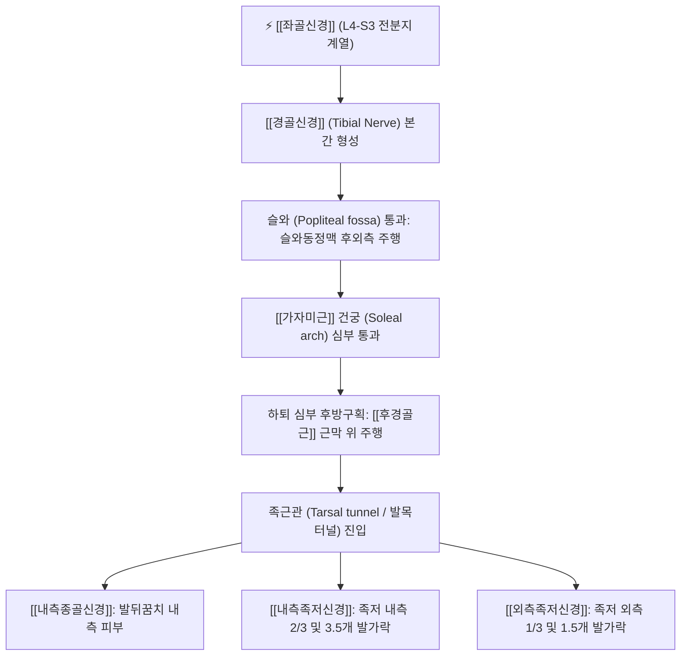

# 경골신경 (Tibial Nerve, 정강신경)

> [!NOTE]
> [[좌골신경]]의 내측 주간선으로 천골신경총(L4-S3) 앞가지의 전분지에서 유래하며, 슬와(오금)와 가자미근 건궁을 지나 하퇴 후방 구획 근육군 전체의 족척굴곡 운동과 족저부 전체의 감각을 총괄하는 핵심 말초신경입니다.

---

## 1. 신경 기원 & 해부학적 분지 경로 (Anatomy & Course)

* **신경 기원 (Spinal Origin)**:
  * 천골신경총(Sacral plexus) **제4 요추신경부터 제3 천추신경(L4, L5, S1, S2, S3)** 앞가지의 **전분지(Anterior divisions)**가 합류하여 형성된 좌골신경의 대형 내측 줄기입니다.
* **슬와(Popliteal fossa) 주행 경로**:
  * 대퇴 후방 하부(슬와 상각)에서 총비골신경과 갈라진 후 슬와 중앙을 수직으로 하행합니다.
  * 슬와 내부에서 슬와동맥(Popliteal artery) 및 슬와정맥보다 표재성(후방)에 위치하며, 슬와근(Popliteus) 표면을 가로지릅니다.
* **가자미근 건궁 통과 및 하퇴 주행**:
  * [[가자미근]](Soleus)의 비골두와 경골 기시부 사이에 형성된 섬유성 건궁(**가자미근 건궁 / Soleal arch**) 아래를 통과하여 하퇴 심부 후방 구획으로 진입합니다.
  * 하퇴 후방에서 후경골동맥과 나란히 주행하며 [[후경골근]](Tibialis posterior)과 장지굴근(Flexor digitorum longus) 사이의 근막면을 따라 하행합니다.
* **족근관(Tarsal tunnel) 통과 및 종말 분지**:
  * 내과(안쪽 복사뼈) 후하방의 굴근지대(Flexor retinaculum) 하부 터널인 **족근관(Tarsal tunnel)**을 통과합니다.
  * 족근관 내부 및 출구부에서 **[[내측종골신경]]**, **[[내측족저신경]]**, **[[외측족저신경]]**으로 최종 분지합니다.

---

## 2. 신경 지배 맵 & 기능 네트워크 (Innervation Map)

* **운동 신경 지배 (Motor Innervation)**:
  * **슬관절 및 하퇴 천층 굴근군**:
    * [[비복근]](Gastrocnemius): 슬관절 굴곡 보조 및 강력한 족관절 족척굴곡(Plantarflexion).
    * [[가자미근]](Soleus): 직립 시 자세 유지 및 지속적인 족척굴곡.
    * 족척근(Plantaris): 고유수용성 감각 보조.
    * [[슬와근]](Popliteus): 슬관절 굴곡 개시 시 대퇴골 외회전(무릎 잠금 해제, Unlocking).
  * **하퇴 심층 굴근군**:
    * [[후경골근]](Tibialis posterior): 족관절 내번(Inversion) 및 내측 종아치 동적 지지.
    * 장무지굴근(Flexor hallucis longus): 엄지발가락 굴곡 및 보행 말기 도약(Push-off).
    * 장지굴근(Flexor digitorum longus): 제2~5지 굴곡.
  * **족저부 내재근군**:
    * 내·외측 족저신경을 통해 족저부의 모든 단근 및 내재근군(무지외전근, 단지굴근, 골간근, 충양근 등)을 전담 지배합니다.
* **감각 신경 지배 (Sensory Innervation)**:
  * **내측비복피부신경(Medial sural cutaneous nerve)**: 슬와에서 분지하여 외측비복피부신경의 연통가지와 합류, [[비복신경]](Sural nerve)을 형성하여 종아리 후외측, 발목 외측(외과 후방), 발등 및 발바닥 외측 국소 부위 피부를 지배합니다.
  * **족저부 감각**: 내측족저신경, 외측족저신경, 내측종골신경을 통해 발바닥 전체와 발뒤꿈치의 체감각을 총괄합니다.
* **관절 감각**:
  * 슬관절낭 후면, 경비관절, 족관절(Ankle joint) 관절낭에 고유수용성 감각 신경지를 공급합니다.

---

## 3. 호발 포착 부위 & 터널 증후군 병태생리

* **1차 호발 포착점: 가자미근 건궁 (Soleal Arch)**:
  * 슬와근 표면을 지나 [[가자미근]]의 근막 건궁을 통과하는 부위에서 종아리 근육의 과도한 긴장, 비후, 구획내 압력 상승에 의해 포착됩니다.
  * 신경이 조여질 경우 아랫다리 후방 구획 근육의 허혈성 통증과 쥐남(Cramp), 파행성 통증을 유발합니다.
* **2차 호발 포착점: 족근관 (Tarsal Tunnel Syndrome / 발목터널증후군)**:
  * 안쪽 복사뼈 후하방의 굴근지대 내부에서 건초염, 결절종, 정맥류, 평발(후족부 외번 변형)로 인한 만성 견인으로 신경 간선이 압박됩니다.
* **슬와부 포착**:
  * 베이커 낭종(Baker's cyst) 팽창이나 슬와동맥류에 의해 슬와 내부에서 직접 압박을 받을 수 있습니다.

---

## 4. 손상 레벨별 임상 증상 & 신경학적 결손

* **슬와 고위 손상 (High Tibial Neuropathy)**:
  * 발목을 아래로 내리는 족척굴곡(Plantarflexion) 및 발가락 굴곡이 완전히 불가능해집니다.
  * 발뒤꿈치로만 딛고 걷는 **종족 변형(Pes calcaneus / 까치발 보행 불능)**이 발생합니다.
  * 아킬레스건 반사(S1)가 완전 소실되고, 족저부 전체 감각 마비로 족부 궤양 위험이 증가합니다.
* **족근관 저위 손상 (Tarsal Tunnel Syndrome)**:
  * 종아리 근력은 정상이지만, 발바닥 전체에 타는 듯한 작열통(Burning pain), 저림, 감각 둔마가 나타납니다.
  * 특히 야간에 통증이 악화되며 걷거나 서 있을 때 발바닥 감각 이상이 심해집니다.

---

## 5. 관련 이학적 검사 & 신경 감별 매트릭스

* **족근관 틴넬 징후 (Tinel's Sign at Tarsal Tunnel)**:
  * 내과 후하방 굴근지대 부위를 손가락이나 타진기로 두드릴 때 발바닥이나 발가락으로 찌릿한 방사통이 재현되면 양성입니다.
* **발목 배굴-외번 검사 (Dorsiflexion-Eversion Test)**:
  * 발목을 최대로 족배굴곡시키고 외번시킨 상태로 유지할 때 족근관 내부 장력이 증가하여 족저부 통증이 유발되는지 확인합니다.
* **아킬레스건 반사 (Achilles Reflex, S1)**:
  * 아킬레스건을 타진하여 족척굴곡 반사를 확인하며, 고위 경골신경 손상 시 소실됩니다.
* **신경 감별 매트릭스**:
  | 구분 | [[경골신경]] 손상 (고위) | [[족근관 증후군]] (저위) | [[총비골신경]] 손상 |
  | :--- | :--- | :--- | :--- |
  | **주요 운동 약화** | 족척굴곡 불능 (까치발 불가) | 족저 내재근 약화 (발가락 벌림 저하) | 족배굴곡 불능 ([[족하수]] 발생) |
  | **주요 감각 이상** | 종아리 후면 + 발바닥 전체 | 발바닥 및 발뒤꿈치 국한 | 종아리 전외측 + 발등 전체 |
  | **건반사** | 아킬레스건 반사 소실 | 정상 보존 | 정상 보존 |

---

## 6. 한의 신경 치료 프로토콜 (약침·침도·신경수기)

* **가자미근 건궁 침도 감압술**:
  * 복와위에서 위중(BL40) 하방 3~4촌, 가자미근 기시 건궁 부위(합양혈 부근)에서 신경 주행 방향과 평행하게 침도를 자입하여 비후된 섬유성 건궁을 미세 절개·박리합니다.
* **족근관 침도 및 약침 요법**:
  * 앙와위 또는 측와위에서 내과 후하방 태계(KI3), 수천(KI5), 조해(KI6) 부위 굴근지대 압통점에 [[신바로약침]] 0.5~1.0cc를 주입하여 신경 부종을 가라앉히고, 필요시 소침도로 굴근지대 유착을 박리합니다.
* **승산(BL57) 및 승근(BL56) 전침 치료**:
  * 하퇴 후방 비복근과 가자미근 근복에 2Hz 저주파 전침을 통전하여 허혈성 근막 연축을 이완시키고 신경 혈류를 촉진합니다.
* **족부 관절 가동 추나**:
  * 거골하관절(Subtalar joint) 및 족근골 변위를 교정하여 후족부 외번 장력을 해소하고 족근관의 용적을 확보합니다.

---

## 7. 💡 사용자 진료실 핵심 필기 & 임상 팁 (원문 보존)

* **원문 필기 내용**:
  * `내측비복피부신경, 외측비복피부신경, 비복신경으로 분지하여 종아리 바깥쪽 뒷면 피부, 발등과 발바닥 외측 국소 부위 피부 지배`
  * `발목터널(발목 내측)에서 내측종골신경, 내측족저신경, 외측족저신경 분지`
  * `슬과근의 표면을 지나 가자미근을 통과, 포착> 아랫다리 후방구획 근육의 허혈성 통증`
* **진료실 임상 고도화 팁**:
  * 야간에 종아리가 쥐가 나고 당기며 발바닥이 저리다는 환자는 디스크보다는 가자미근 건궁에서의 경골신경 포착을 의심해야 합니다. 슬와 하방 3촌의 가자미근 건궁 부위(합양혈)를 깊게 지압하면 종아리 통증과 야간 쥐남이 즉각 완화됩니다.
  * 발바닥이 화끈거려 잠을 못 이루는 노인 환자는 족근관 부위 굴근지대의 비후를 확인하고 태계혈 심자 및 신바로약침을 시술하는 것이 특효입니다.

---

## 8. 출처 및 학술 참고 문헌 (References)

* Desai, S. S., & La Rose, J. (2026). "Anatomy, Bony Pelvis and Lower Limb: Tibial Nerve." *StatPearls Publishing*. [PMID: 30725713](https://pubmed.ncbi.nlm.nih.gov/30725713/)
  - [연구 요약]: 경골신경의 천골신경총 분지 기원, 슬와 및 가자미근 건궁 주행 해부학, 하지 후방 구획 근육 지배 총괄.
* Moore, K. L., Dalley, A. F., & Agur, A. M. (2018). *Clinically Oriented Anatomy* (8th ed.). Wolters Kluwer.
  - [연구 요약]: 족근관 증후군의 해부학적 병인과 경골신경 손상 시 임상적 결손 수록.
* 전국한의과대학 침구경혈학교실 (2020). *침구의학*. 집문당.
  - [연구 요약]: 하지 신경통 및 비증에 대한 위중, 승산, 태계 취혈 지침.
