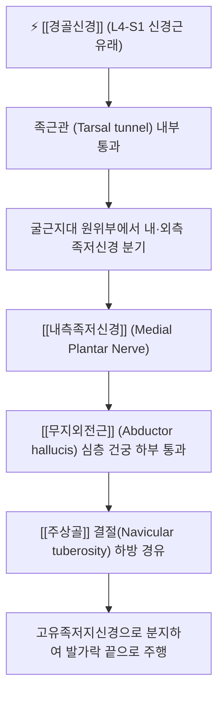

# 내측족저신경 (Medial Plantar Nerve, 안쪽발바닥신경)

> [!NOTE]
> [[경골신경]]이 내과 후하방 [[족근관 증후군]]의 발생지인 족근관을 통과한 후 갈라지는 최대 말초 종말지로 상지의 [[정중신경]]에 상응하는 신경입니다. [[무지외전근]], 단지굴근, 단무지굴근 및 제1충양근을 운동 지배하고 족저부 내측 2/3와 내측 세 발가락 반의 감각을 담당하며 **조깅선수 발(Jogger's foot)**의 원인 신경입니다.

---

## 1. 신경 기원 & 해부학적 분지 경로 (Anatomy & Course)

* **신경 기원 (Spinal Roots)**:
  * [[천골신경총]] L4, L5, S1 분절에서 유래한 [[경골신경]](Tibial nerve)의 가장 큰 종말 분지입니다.
* **주행 경로**:
  * 내과 후하방의 족근관(Tarsal tunnel) 내부에서 [[외측족저신경]]과 분기합니다.
  * 내측족저동맥과 동행하며 [[무지외전근]](Abductor hallucis) 근복 심층의 섬유성 건궁 아래를 지나 족저부 내측으로 진입합니다.
  * [[주상골]] 결절(Navicular tuberosity) 하방을 경유하여 장무지굴근건과 장지굴근건 사이를 따라 발바닥 중심부로 전진합니다.
* **말초 분지**:
  * 족저부 전방에서 고유족저지신경(Proper plantar digital nerves)으로 갈라져 제1~4족지 족저면으로 주행합니다.

---

## 2. 신경 지배 맵 & 기능 네트워크 (Innervation Map)

* **운동 지배 근육군 (Motor Innervation)**:
  * [[무지외전근]](Abductor hallucis): 내측 종아치 동적 지지 및 엄지발가락 외전.
  * 단지굴근(Flexor digitorum brevis): 외인성 굴근 보조 및 발바닥 중간 아치 유지.
  * 단무지굴근(Flexor hallucis brevis): 보행 추진기(Push-off) 시 엄지발가락 지지.
  * 제1충양근(First lumbrical): 보행 시 중족지절관절 굴곡 및 지간관절 신전 조절.
* **피부 감각 영역 (Sensory Innervation)**:
  * 족저부 내측 2/3 피부 감각.
  * 엄지발가락, 둘째, 셋째 발가락 바닥면 전체 및 넷째 발가락 내측 절반의 피부 감각 (상지의 [[정중신경]] 감각 영역과 상동).
* **상동 기관 대비 및 생체역학적 의의**:
  * 해부발생학적으로 수부의 [[정중신경]]과 상동 기관(Homologue)입니다.
  * 보행 주기 중 디딤기(Stance phase)와 말기 추진기(Push-off)에 내측족저신경 지배 내재근들이 수축하여 족궁이 무너지지 않도록 윈드라스 메커니즘(Windlass mechanism)을 완성합니다.

---

## 3. 호발 포착 부위 & 터널 증후군 병태생리

* **조깅선수 발 (Jogger's Foot / Medial Plantar Nerve Entrapment)**:
  * [[무지외전근]] 심부 건궁과 [[주상골]] 결절 하방을 지나는 통로(Master knot of Henry 부근)에서 신경이 기계적으로 압박받는 상태입니다.
  * 마라톤, 조깅, 장거리 보행을 즐기는 운동선수나 평발(Overpronation) 환자에서 발 아치가 무너지며 신경이 지속적으로 신장·마찰됩니다.
* **족근관 증후군 연관 포착**:
  * 굴근지대 심부에서 족근관의 용적 감소로 인해 [[외측족저신경]]과 함께 압박을 받습니다.

---

## 4. 손상 레벨별 임상 증상 & 신경학적 결손

* **전형적 임상 증상**:
  * 발바닥 안쪽 아치 및 엄지발가락 쪽으로 방사되는 타는 듯한 작열통(Burning pain)과 저림.
  * 달리기나 보행 시 통증이 악화되고, 신발을 벗고 발바닥을 주무르면 일시적으로 완화됩니다.
* **운동 마비 증상**:
  * 만성 포착 시 엄지발가락 외전력 저하 및 무지구 내재근 위축으로 인해 추진력이 약화됩니다.

---

## 5. 관련 이학적 검사 & 신경 감별 매트릭스

* **주상골 하방 압통 검사 및 틴넬 징후**:
  * [[주상골]] 결절 바로 아래, [[무지외전근]] 기시부 경계를 깊게 누르거나 타진할 때 엄지발가락 쪽으로 찌릿한 저림이 방사되는지 확인합니다.
* **발목 외번 신장 검사**:
  * [[족관절]]을 배굴 및 외번시키고 엄지발가락을 과신전시킬 때 내측 아치 통증이 재현되면 양성입니다.
* **신경 감별 매트릭스**:
  | 구분 | [[내측족저신경]] 포착 (조깅선수 발) | [[족저근막염]] | [[내측종골신경]]염 |
  | :--- | :--- | :--- | :--- |
  | **주요 통증 부위** | 발바닥 안쪽 아치 및 1~3지 발가락 | 발뒤꿈치 전내측 바닥 (종골 부착부) | 발뒤꿈치 내측면 피부 국한 |
  | **통증 특성** | 신경병증성 작열통, 방사통 | 아침 첫발 디딜 때 극심한 기계적 둔통 | 체중 부하와 무관한 지속적 저림 |
  | **감각 결손** | 엄지~셋째 발가락 감각 둔마 동반 | 감각 이상 전혀 없음 | 발뒤꿈치 내측 피부 감각 저하 |

---

## 6. 한의 신경 치료 프로토콜 (약침·침도·신경수기)

* **연곡(KI2) 및 공손(SP4) 약침 치료**:
  * [[주상골]] 결절 하방 내측족저신경 통과부에 위치한 [[연곡]]혈 및 [[공손]]혈, [[태계]]혈 부위에 [[신바로약침]] 또는 황련해독약침을 0.3~0.5cc 주입하여 신경 주위 무균성 염증과 부종을 가라앉힙니다.
* **무지외전근 건궁 침도 감압술**:
  * [[주상골]] 결절 하방 1cm 압통점에서 0.35×40mm 소침도를 자입하여 비후된 [[무지외전근]] 근막과 건궁 섬유띠를 미세 박리합니다.
* **족부 관절 가동 추나 (Windlass Activation)**:
  * [[주상골]], 설상골, 제1 중족골의 아탈구를 교정하여 내측 종아치를 회복시키는 족부 [[추나치료]]와 [[신경가동술]]을 적용합니다.

---

## 7. 💡 사용자 진료실 핵심 필기 & 임상 팁 (원문 보존)

* **원문 필기 내용**:
  * `무지외전근 심부 통과부에서 포착 시 조깅선수 발(Jogger's foot) 및 내측 족저 통증을 유발하여 족근관 감압 추나와 연곡혈 약침의 핵심 표적.`
* **임상 진료실 감별 포인트**:
  * [[족저근막염]] 치료를 장기간 받아도 호전되지 않는 발바닥 통증 환자는 반드시 [[주상골]] 하방의 내측족저신경 포착(Jogger's foot)을 의심해야 합니다.
  * 아침 첫발 통증보다 보행 후 지속되는 타는 듯한 발바닥 통증이 주증상인 경우, [[연곡]]혈 심자 및 [[신바로약침]] 치료로 극적인 호전을 이끌어낼 수 있습니다.

---

## 8. 출처 및 학술 참고 문헌 (References)

* Collins, M. S., & Tiegs-Heiden, C. A. (2020). "MRI appearance of jogger's foot." *Skeletal Radiology*, 49(12), 2007-2013. [PMID: 32556951](https://pubmed.ncbi.nlm.nih.gov/32556951/)
  - [연구 요약]: 조깅선수 발(Jogger's foot) 환자 14례의 MRI 분석을 통해 무지외전근 심부 내측족저신경 포착 부위의 신경 비후 및 근위축 패턴 규명.
* Moore, K. L., Dalley, A. F., & Agur, A. M. (2018). *Clinically Oriented Anatomy* (8th ed.). Wolters Kluwer.
  - [연구 요약]: 내측족저신경의 해부학적 분지 및 족저근막과의 관계 기술.
* 전국한의과대학 침구경혈학교실 (2020). *침구의학*. 집문당.
  - [연구 요약]: 족저통 및 발바닥 신경통에 대한 연곡, 공손 취혈 프로토콜.
