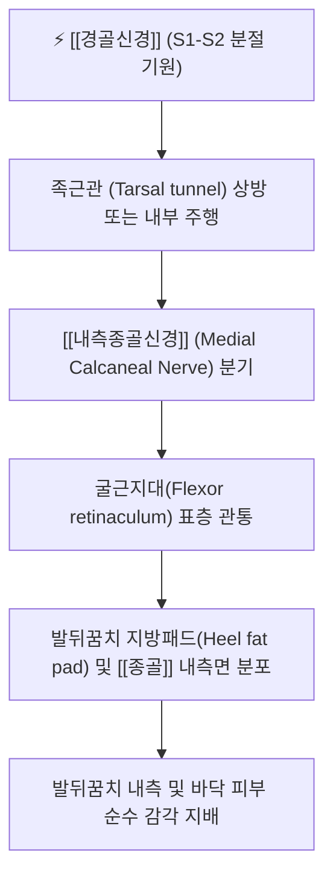

# 내측종골신경 (Medial Calcaneal Nerve, 안쪽발꿈치신경)

> [!NOTE]
> [[경골신경]]에서 분지하여 발뒤꿈치 내측면과 바닥 피부 감각을 지배하는 순수 피하 감각신경으로, 만성 발뒤꿈치 통증을 유발하며 **[[족저근막염]]과 반드시 감별해야 하는** 핵심 말초신경입니다.

---

## 1. 신경 기원 & 해부학적 분지 경로 (Anatomy & Course)

* **신경 기원 (Spinal Roots)**:
  * [[천골신경총]] S1, S2 척수신경 분절에서 유래한 [[경골신경]](Tibial nerve) 본간에서 갈라져 나옵니다.
* **분기점 및 주행 경로**:
  * 내과(안쪽 복사뼈) 상방 약 2~3cm 지점의 [[족근관 증후군]] 호발 부위인 족근관 근위부 또는 족근관 내부에서 1~3개의 가지로 분기합니다 (개인에 따른 분기 변이가 매우 큼).
  * 후경골동맥의 종골분지와 동행하며 굴근지대(Flexor retinaculum)를 비스듬히 관통하여 표재화됩니다.
* **종말 분포**:
  * 발뒤꿈치 지방패드(Heel fat pad) 심부를 통과하여 [[종골]] 결절(Calcaneal tuberosity) 내측면과 발뒤꿈치 바닥면 피하지방층으로 분지합니다.

---

## 2. 신경 지배 맵 & 기능 네트워크 (Innervation Map)

* **순수 감각 신경 지배 (Pure Sensory)**:
  * 발뒤꿈치 내측면 피부 감각.
  * 발뒤꿈치 바닥 체중부하 부위(Weight-bearing area of heel) 피부 감각.
  * [[종골]] 골막(Periosteum of calcaneus) 및 발뒤꿈치 지방패드의 통각과 기계적 수용기 감각.
* **운동 기능 결손 부재**:
  * 운동 신경 섬유가 전혀 없으므로 신경이 손상되거나 차단되어도 [[족관절]]이나 발가락의 운동 마비는 발생하지 않습니다.
* **체중 부하 충격 감지 네트워크**:
  * 보행 시 초기 접지기(Initial contact / Heel strike)에 가해지는 지면 반발력을 감지하여 체중 분산 반사를 조절합니다.

---

## 3. 호발 포착 부위 & 터널 증후군 병태생리

* **굴근지대 관통부 포착 (Flexor Retinaculum Piercing Site)**:
  * 굴근지대를 뚫고 표재층으로 나오는 좁은 섬유성 구멍에서 굴근지대의 비후, 섬유화에 의해 신경이 조여집니다.
* **종골 골극 및 족저근막 부착부 마찰**:
  * [[종골]] 결절 내측 돌기(Medial process) 주변의 골극(Spur) 형성, 만성 [[족저근막염]], 건막염에 의해 신경이 2차적으로 압박·견인됩니다.
* **발뒤꿈치 지방패드 위축 및 외상**:
  * 노화나 반복된 스테로이드 국소 주사로 인해 발뒤꿈치 지방패드가 얇아지면, 보행 시 [[종골]] 결절과 지면 사이에서 신경이 직접 짓눌려 만성 신경염이 발생합니다.

---

## 4. 손상 레벨별 임상 증상 & 신경학적 결손

* **내측종골신경병증 (Medial Calcaneal Neuropathy)의 전형 증상**:
  * 발뒤꿈치 내측과 바닥으로 찌릿찌릿하거나 타는 듯한 작열통(Burning pain), 화끈거림, 먹먹한 감각 이상.
  * 밤에 쉴 때나 잘 때도 발뒤꿈치가 쑤시고 저려서 발을 주무르게 됩니다.
* **족저근막염과의 결정적 임상 차이**:
  * [[족저근막염]]은 아침 기상 후 첫발을 디딜 때 통증이 극심하다가 활동하면서 다소 완화되는 반면, 내측종골신경염은 **체중 부하와 무관하게 휴식 시나 야간에도 통증이 지속**되며 발뒤꿈치 내측 피부를 가볍게 긁어도 이상감각이 유발됩니다.

---

## 5. 관련 이학적 검사 & 신경 감별 매트릭스

* **종골 내측 압통 검사 및 틴넬 검사**:
  * 안쪽 복사뼈 하방 2~3cm, [[종골]] 내측면을 손가락 끝으로 가볍게 압박하거나 타진할 때 발뒤꿈치 바닥으로 찌릿한 전기가 통하면 양성입니다.
* **신경 감별 매트릭스**:
  | 구분 | [[내측종골신경]]염 | [[족저근막염]] | [[족근관 증후군]] |
  | :--- | :--- | :--- | :--- |
  | **통증 위치** | 발뒤꿈치 내측면 및 바닥 | 발바닥 뒤꿈치 전내측 (건막 부착부) | 발바닥 전체 및 발가락 방사 |
  | **통증 양상** | 화끈거림, 시림, 찌릿한 신경통 | 묵직하고 찢어지는 듯한 기계적 둔통 | 발바닥 전체 작열감 및 무감각 |
  | **휴식기 통증** | 뚜렷함 (야간통 흔함) | 거의 없음 (휴식 시 완화) | 뚜렷함 (야간통 호발) |
  | **아침 첫발 통증** | 심하지 않음 | 극심함 (전형적 증상) | 보통 |

---

## 6. 한의 신경 치료 프로토콜 (약침·침도·신경수기)

* **종골 내측 굴근지대 침도 감압술**:
  * 측와위에서 [[태계]](KI3) 하방 1.5촌, [[수천]](KI5) 및 [[조해]](KI6), [[곤륜]](BL60) 주변 [[종골]] 내측면 압통점에 0.35×30mm 소침도를 자입하여 비후된 굴근지대 섬유와 종골 골막 유착을 미세 박리합니다.
* **태계(KI3) 및 수천(KI5) 약침 요법**:
  * 내측종골신경 주행로에 [[신바로약침]] 또는 중성어혈약침 0.5cc를 주입하여 국소 신경 부종과 신경막 염증을 진정시킵니다.
* **발뒤꿈치 지방패드 감압 및 족부 테이핑**:
  * 힐컵(Heel cup) 적용 및 키네시오 테이핑을 통해 발뒤꿈치 지방패드를 모아주어 보행 시 [[아킬레스건]] 및 신경에 가해지는 충격을 완화하고 [[추나치료]]를 병행합니다.

---

## 7. 💡 사용자 진료실 핵심 필기 & 임상 팁 (원문 보존)

* **원문 필기 내용**:
  * `경골신경에서 분지하여 발뒤꿈치 내측, 바닥 피부 지배`
  * `족저근막염과 감별`
* **진료실 임상 고도화 팁**:
  * "발뒤꿈치가 아파서 병원에 갔더니 [[족저근막염]]이라며 체외충격파와 스테로이드 주사를 맞았는데도 전혀 낫지 않고 오히려 더 화끈거린다"고 호소하는 환자는 10중 8~9가 내측종골신경 포착입니다.
  * [[종골]] 결절 내측의 신경 관통 압통점을 찾아 침도 요법으로 유착을 박리하고 [[신바로약침]]을 주입하면, 수개월간 지속된 뒤꿈치 통증이 빠르게 가라앉습니다.

---

## 8. 출처 및 학술 참고 문헌 (References)

* Kuran, B., & Aydoğ, T. (2017). "Medial calcaneal neuropathy: A rare cause of prolonged heel pain." *Agri*, 29(2), 85-88. [PMID: 28467569](https://pubmed.ncbi.nlm.nih.gov/28467569/)
  - [연구 요약]: 난치성 만성 발뒤꿈치 통증 환자에서 내측종골신경병증의 임상적 진단과 초음파 유도하 치료 성적 및 족저근막염과의 감별점 보고.
* Moore, K. L., Dalley, A. F., & Agur, A. M. (2018). *Clinically Oriented Anatomy* (8th ed.). Wolters Kluwer.
  - [연구 요약]: 경골신경의 종골 분지 해부학 및 발뒤꿈치 피부 감각 신경망 수록.
* 전국한의과대학 침구경혈학교실 (2020). *침구의학*. 집문당.
  - [연구 요약]: 족근통 및 발뒤꿈치 통증에 대한 태계, 수천, 조해 취혈 지침.
